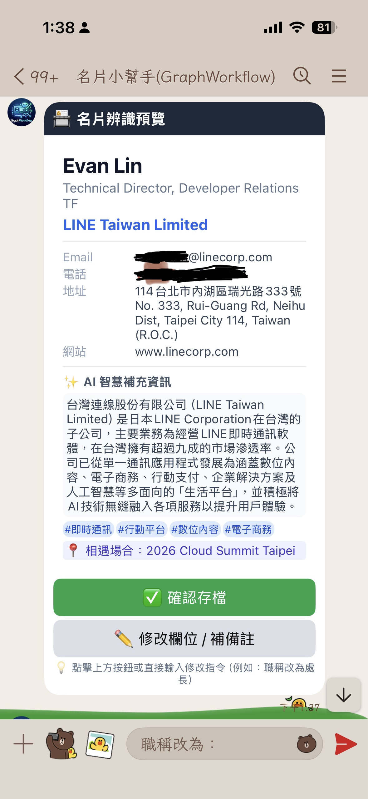

# 前情提要

在過去一年多的 AI Agent 開發熱潮中，許多開發者第一個寫出來的 Agent 往往長這樣：寫一段超長的 `System Instruction`，再把五、六個 Tools 全部塞給同一個 `LLMAgent`，然後祈禱模型能夠乖乖照著步驟 A → B → C → D 執行。

一開始做 Demo 很驚艷，但只要一上生產環境，問題馬上浮現：
- **步驟越多、失控率越高**：當 Prompt 裡塞滿了「先做 OCR、再去查資料庫有沒有重複、同時上網查這家公司在做什麼、然後組出預覽卡片問使用者、如果使用者說要改職稱就重新產生預覽、確認後才能寫入 DB 並寫一封破冰信」，模型偶爾就會跳過查重、或是還沒等使用者確認就直接寫入資料庫。
- **不該花 Token 的地方也在燒錢與等待**：像是「依據 LINE 事件種類分流」或「正規化電話號碼格式」這種 100% 確定性的邏輯，交給 LLM 判斷不僅慢，還可能出錯。
- **獨立任務被迫排隊執行**：查資料庫、Google 搜尋公司背景、比對近期對話紀錄明明互不相干，卻因為單一 Agent 的線性對話迴圈而變成循序等待。

為了解決這個痛點，Google 在 **Agent Development Kit (ADK) 2.0** 正式引入了重磅功能 —— **Graph Workflows（圖形工作流）**，並且同步支援 Python 與 **Go (`google.golang.org/adk/v2/workflow`)**！

看到這個更新後，我立刻決定用最熟悉的 **Golang + LINE Messaging API SDK v8** 實際打造一個完整的開源專案 **[line-card-assistant（LINE AI 名片王）](https://github.com/kkdai/line-card-assistant)**，把 ADK 2.0 Graph Workflow 的所有核心武器（`AddRoute` 條件路由、`AddFanOut` / `AddFanIn` 平行處理與匯聚、`NewRequestInputEvent` Human-in-the-Loop 暫停等待與迴圈修正）全部實戰跑過一遍，並部署上 Google Cloud Run。

這篇文章會先帶大家導讀 Google 官方針對 ADK Graph Workflows 必讀的兩篇核心技術文件，接著一步步拆解我們如何用 Go 程式碼將這些圖形工作流模式落地到 LINE Bot 中！

---

# 一、Google 官方怎麼定義 Graph Workflow？兩篇必讀指南解析

在開始看程式碼之前，強烈建議大家先理解 ADK 團隊設計 Graph Workflows 的核心哲學。Google 官方在近期發布了兩份非常關鍵的開發者指南：

1. **Google Cloud 官方部落格**：[Graph Workflows in ADK: Everything You Need to Know](https://cloud.google.com/blog/topics/developers-practitioners/graph-workflows-in-adk-everything-you-need-to-know)（由 ADK 團隊的 Annie Wang 與 Shangjie Chen 撰寫）
2. **ADK 官方技術文件**：[Graph-based agent workflows (adk.dev/graphs)](https://adk.dev/graphs/)

我們把這兩篇官方文章的精華濃縮整理如下：

## 1. 什麼是「Graph Engineering（圖形工程）」？

在《[Graph Workflows in ADK: Everything You Need to Know](https://cloud.google.com/blog/topics/developers-practitioners/graph-workflows-in-adk-everything-you-need-to-know)》一文中，作者以一個「客服退費審核流程（Customer Refund Workflow）」為例，點出了一個核心觀念：

> **當工作流程變複雜時，可靠性來自於將「工作流控制權（Workflow Control）」與「模型推理（Model Reasoning）」分離。**
> **Graph Engineering 的本質，就是把任務拆解成獨立的節點（Nodes），用邊（Edges）連接它們，並明確決定在每一個步驟中，究竟該由「程式碼（Code）」、「模型（Models）」還是「人類（People）」來決定下一步。**

文章中歸納了五個在真實世界最常使用的 Graph Workflow 設計模式：

| 核心模式 | 解決什麼痛點？ | ADK 2.0 對應機制 |
| :--- | :--- | :--- |
| **1. Fan-out 與 Fan-in 平行匯聚** | 多個互不依賴的資料蒐集步驟（例如：查訂單、查付款、查客服紀錄）若循序執行會拖慢整體延遲。 | 使用 `AddFanOut` 同時觸發多個節點平行執行，再透過 `JoinNode` (`AddFanIn`) 等待所有分支完成後一次匯聚，**中間完全不需要消耗額外的 LLM Call**。 |
| **2. 確定性路由 vs. Agent 路由**<br>*(Deterministic vs. Agent Router)* | 有些分流規則非黑即白（例如金額 > $100 走人工審核），不該讓 LLM 猜測；有些則需要理解自然語言意圖。 | **Deterministic Router**：純程式碼邏輯設定 `ev.Routes`，0 Token 消耗、100% 可測試。<br>**Agent Router**：由 LLM 判斷開放式意圖，但圖形邊界（Edges）嚴格限制了合法的跳轉目標。 |
| **3. Human-in-the-Loop (HITL) 暫停與恢復** | 高風險動作（如大額退費、寫入正式資料庫）必須等人確認，但傳統 Webhook 是無狀態的短連線。 | 節點發出 `RequestInput` 事件將執行狀態（Checkpoint）凍結並暫停 Graph；等收到外部人類回覆後，透過 `RerunOnResume` 喚醒同一個節點繼續往下走。 |
| **4. Parallel Workers vs. Fan-out** | 區分「對同一份資料做三種不同檢查」與「對 N 個項目做同一種處理」。 | **Fan-out**：不同節點做不同職責。<br>**Parallel Workers**：同一個節點針對陣列元素平行展開。 |
| **5. 靜態圖形 (Static Graph) vs. 動態編排** | 如何在「架構可視化/可維護性」與「動態迴圈修正」之間取得平衡？ | 透過靜態 `Edges` 定義清楚的路由與**條件迴圈（Conditional Cycles，例如：產出草稿 → 檢查/修改 → 重新產出）**，讓整個系統的狀態機一目了然。 |

---

## 2. ADK Go v2.0 (`adk.dev/graphs`) 的四大核心建構積木

而在官方文件《[Graph-based agent workflows](https://adk.dev/graphs/)》中，則詳細展示了 ADK 2.0 在 **Go 語言 (`google.golang.org/adk/v2/workflow`)** 中的 API 設計。要在 Go 裡面組裝一張 Graph，主要就是掌握以下四個元件：

1. **Nodes（節點）**：
   - `workflow.NewFunctionNode` / `workflow.NewEmittingFunctionNode`：把任何標準 Go 函式包裝成圖形節點，適合處理 DB 查詢、資料清洗、API 呼叫或組裝 LINE Flex Message。
   - `llmagent.RunLLMAgentAsNode`：將一個具備特定 Prompt 與工具（例如 `geminitool.GoogleSearch{}`）的 `llmagent` 封裝進單一節點中，讓 LLM 專注做好「一件事」。
2. **State & Data Flow（資料流與共享狀態）**：
   - 節點之間除了可以傳遞強型別的 `Output` 之外，還可以透過 `ev.Actions.StateDelta` 將結構化資料寫入 Session State（`ctx.Session().State()`），讓下游節點或匯聚節點讀取。
3. **Edges & EdgeBuilder（邊與路由建構器）**：
   - `eb.Add(from, to)`：單向直線連接。
   - `eb.AddRoute(from, workflow.StringRoute("route_name", targetNode), ...)`：條件分支路由（亦可用於建立迴圈 Cycle！）。
   - `eb.AddFanOut(from, branch1, branch2, ...)` 與 `eb.AddFanIn(joinNode, branch1, branch2, ...)`：平行分支與同步匯聚。
4. **WorkflowAgent（工作流代理封裝）**：
   - 最後呼叫 `workflowagent.New(workflowagent.Config{Edges: edges})`，整張 Graph 就會變成一個標準的 ADK `agent.Agent`，直接交給 `runner.Runner` 執行與管理 Session！

---

# 二、實戰專案架構：LINE AI 名片王 (`line-card-assistant`)

理解了官方的理論後，我們來看看如何將這些觀念應用在真實的 LINE Bot 場景。

商務人士每天在展會或會議收到大量紙本名片，傳統的名片 App 只有單純的 OCR 辨識，卻缺少了**「這間公司最近在做什麼？」**、**「我是在哪一場活動認識他的？」**以及**「辨識錯了怎麼在聊天室直接用講的修改？」**。

因此，我們設計了 `line-card-assistant`，整體架構完全對應 ADK 2.0 的 Graph Workflow：

```text
[LINE Webhook] 
      │
      ▼
[Router Node (AddRoutes)]
  ├── (收到名片照片) ──► [Vision OCR 節點] 
  │                           │
  │                    (AddFanOut 平行處理)
  │            ┌──────────────┼──────────────┐
  │            ▼              ▼              ▼
  │     [DB 查重與驗證]  [公司背景搜尋]  [過往互動檢索]
  │            └──────────────┼──────────────┘
  │                    (AddFanIn 匯聚)
  │                           ▼
  │              [生成 Flex Message 預覽卡]
  │                           │
  │            ⏸️ NewRequestInputEvent (HITL 暫停等待)
  │                           │
  │      ┌────────────────────┴────────────────────┐
  │      ▼ (點擊：確認存檔)                         ▼ (點擊：修改欄位 / 補備註)
  │ [寫入 DB + 產出破冰信草稿]              [Re-entry 迴圈修正節點]
  │
  └── (收到查詢文字) ──► [Query Rewrite] ──► [SQL + Vector 混合檢索] ──► [Flex Carousel 名片輪播]
```

這張架構圖涵蓋了三條核心路徑：
1. **名片辨識與豐富化管線（Ingest Pipeline）**：收到照片 → Vision OCR → **平行執行三項任務（DB 查重 + Google Search 公司背景 + 對話上下文推測認識場合）** → 匯聚產生 LINE Flex 預覽卡 → **HITL 暫停等待使用者確認或修改**。
2. **HITL 迴圈修正（Re-entry Loop）**：當圖形暫停在 `HITLConfirmNode` 時，使用者如果直接在 LINE 輸入文字（例如：「*職稱改為處長，在 Cloud Summit 認識*」），工作流會喚醒並走 `RouteEdit` 分支進入 `ApplyEditNode`，更新欄位後**繞回 `BuildPreviewNode` 重新產生預覽卡並再次暫停**，直到使用者點擊「✅ 確認儲存」才真正寫入資料庫並產出破冰信！
3. **自然語言混合檢索管線（Search Pipeline）**：收到查詢文字（例如：「*幫我找上週在 Cloud Summit 認識做 AI 的人*」）→ Query Rewrite 結構化拆解 → SQL + 關鍵字/標籤混合檢索 → 回傳 LINE Flex Carousel 名片輪播。

---

# 三、Go 程式碼深度拆解：把 Graph Workflow 寫進 LINE Bot

接下來我們直接看 [`internal/workflow/graph.go`](https://github.com/kkdai/line-card-assistant/blob/main/internal/workflow/graph.go) 與各個節點的 Go 實作，看看 ADK 2.0 的 API 在 Go 裡面寫起來有多乾淨。

## 1. 一覽全局：用 `EdgeBuilder` 組裝整張 Graph

在 [`internal/workflow/graph.go`](https://github.com/kkdai/line-card-assistant/blob/main/internal/workflow/graph.go) 中，我們透過 `BuildEdges` 函式將所有節點宣告並連接起來。你可以清楚看到整張圖的拓撲結構：

```go
func BuildEdges(deps *Dependencies) ([]workflow.Edge, error) {
	// 1. 入口路由節點
	routerNode, _ := NewRouterNode()

	// 2. 名片辨識與 Fan-Out 三大平行節點
	visionOCRNode, _ := NewVisionOCRNode(deps)
	cleanAndDedupNode, _ := NewCleanAndDedupNode(deps)
	companyEnrichNode, _ := NewCompanyEnrichNode(deps)
	contextMatchNode, _ := NewContextMatchNode(deps)
	joinPreviewNode := workflow.NewJoinNode("JoinPreviewNode")

	// 3. 預覽卡生成、HITL 暫停與確認/修改分支節點
	buildPreviewNode, _ := NewBuildPreviewNode(deps)
	hitlConfirmNode, _ := NewHITLConfirmNode(deps)
	saveCardNode, _ := NewSaveCardNode(deps)
	applyEditNode, _ := NewApplyEditNode(deps)

	// 4. 自然語言搜尋與破冰信節點
	queryIntentNode, _ := NewQueryIntentNode(deps)
	hybridSearchNode, _ := NewHybridSearchNode(deps)
	broadSearchNode, _ := NewBroadSearchNode(deps)
	formatCarouselNode, _ := NewFormatCarouselNode(deps)
	emailDraftNode, _ := NewEmailDraftNode(deps)

	eb := workflow.NewEdgeBuilder()

	// Entry -> Deterministic Router
	eb.Add(workflow.Start, routerNode)
	eb.AddRoute(routerNode,
		workflow.StringRoute(RouteImage, visionOCRNode),
		workflow.StringRoute(RouteText, queryIntentNode),
		workflow.StringRoute(RoutePostbackDraft, emailDraftNode),
	)

	// Ingest Pipeline: Vision OCR -> Parallel Fan-Out -> JoinNode Fan-In -> Preview
	eb.AddFanOut(visionOCRNode, cleanAndDedupNode, companyEnrichNode, contextMatchNode)
	eb.AddFanIn(joinPreviewNode, cleanAndDedupNode, companyEnrichNode, contextMatchNode)
	eb.Add(joinPreviewNode, buildPreviewNode)
	eb.Add(buildPreviewNode, hitlConfirmNode)

	// HITL 暫停後的條件分支：確認存檔 vs. 修改欄位迴圈
	eb.AddRoute(hitlConfirmNode,
		workflow.StringRoute(RouteConfirm, saveCardNode),
		workflow.StringRoute(RouteEdit, applyEditNode),
	)
	// ★ 關鍵迴圈 (Cycle)：修改完欄位後，導回 buildPreviewNode 重新產生 Flex 預覽卡並再次進入 HITL！
	eb.AddRoute(applyEditNode,
		workflow.StringRoute(RoutePreview, buildPreviewNode),
	)

	// Search Pipeline: Query Rewrite -> Hybrid Search -> (Found / Empty Fallback) -> Carousel
	eb.Add(queryIntentNode, hybridSearchNode)
	eb.AddRoute(hybridSearchNode,
		workflow.StringRoute(RouteFound, formatCarouselNode),
		workflow.StringRoute(RouteEmpty, broadSearchNode),
	)
	eb.Add(broadSearchNode, formatCarouselNode)

	return eb.Build()
}
```

這段程式碼完美體現了 Google Cloud Blog 所說的 **Static Graph 優勢**：不需要去翻幾千行的 Prompt 或追查散落各處的 Tool Call，光看 `BuildEdges` 的 30 行程式碼，就能 100% 掌握整個 Agent 系統的所有可能路徑與迴圈邊界。

---

## 2. Deterministic Router：0 Token 消耗的精準分流

當 LINE Webhook 收到事件時，我們不需要浪費一次 Gemini API 呼叫去問模型「使用者現在是傳圖片還是傳文字？」。我們使用 `workflow.NewEmittingFunctionNode` 建立一個純程式碼的確定性路由節點 `RouterNode`：

```go
const (
	RouteImage         = "route_image"
	RouteText          = "route_text"
	RoutePostbackDraft = "route_postback_draft"
)

func NewRouterNode() (workflow.Node, error) {
	return workflow.NewEmittingFunctionNode("RouterNode", func(ctx workflow.Context, _ struct{}) (string, error) {
		inputType, err := getStateString(ctx, StateKeyInputType)
		if err != nil || inputType == "" {
			inputType = "text"
		}

		var route string
		switch inputType {
		case "image":
			route = RouteImage
		case "postback_draft":
			route = RoutePostbackDraft
		default:
			route = RouteText
		}

		// 發出帶有 Routes 標籤的事件，讓 EdgeBuilder 的 AddRoute 決定下一個節點
		ev := workflow.NewEvent(ctx, "route_selected")
		ev.Routes = []string{route}
		if err := ctx.Emit(ev); err != nil {
			return "", err
		}
		return route, nil
	}, workflow.WithDeclaredRoutes(RouteImage, RouteText, RoutePostbackDraft))
}
```

只要在發出 `workflow.Event` 時設定 `ev.Routes = []string{route}`，並搭配 `workflow.WithDeclaredRoutes(...)` 在建構期驗證路由合法性，ADK 就會在啟動階段自動幫你檢查有沒有拼錯 Route 名稱！

---

## 3. Fan-Out / Fan-In 平行處理：同時跑 DB 查重、Google Search 與上下文推理

當 `VisionOCRNode` 透過 `gemini-2.5-flash` 的多模態能力從名片照片萃取出結構化的 `models.BusinessCard` 後，接下來我們有三件完全獨立的任務要做：

1. **`CleanAndDedupNode`（純程式碼 + DB 查詢）**：將台灣手機與市話正規化為 `+886-...` 格式，並查詢 SQLite 資料庫是否已經存在同一人的名片（若職稱不同，還能標記「升遷/異動提醒」！）。
2. **`CompanyEnrichNode`（內嵌具備 Google Search 工具的 `llmagent`）**：自動根據名片上的公司名稱，上網搜尋該公司的最新背景，濃縮成 2 句話簡介與 3~5 個產業標籤（Tags）。
3. **`ContextMatchNode`（LLM 上下文推理）**：讀取使用者在傳照片前後的最近幾則 LINE 對話紀錄（例如使用者剛傳過「*今天來參加 Cloud Summit*」），自動推論出這張名片的認識場合（`MetContext`）。

在 [`internal/workflow/nodes_ingest.go`](https://github.com/kkdai/line-card-assistant/blob/main/internal/workflow/nodes_ingest.go) 中，我們甚至可以在 `CompanyEnrichNode` 裡面直接使用 `llmagent.RunLLMAgentAsNode` 來呼叫帶有 `geminitool.GoogleSearch{}` 的子代理：

```go
// 在 Graph 節點中結合具備 Google Search Grounding 能力的 LLMAgent
searchAgent, err := llmagent.New(llmagent.Config{
	Name:        "CompanySearchSubAgent",
	Description: "Searches the web for company background and industry tags.",
	Model:       deps.SearchModel,
	Instruction: "Given a company name, search Google and return JSON with summary (2 sentences in Traditional Chinese) and tags (3 to 5 industry tags).",
	Tools:       []tool.Tool{geminitool.GoogleSearch{}},
})
if err == nil {
	_ = llmagent.RunLLMAgentAsNode(searchAgent, llmagent.NodeConfig{Name: "CompanySearchSubAgentNode"})
}
```

### 💡 Go 平行節點的實戰細節：如何避免 Race Condition？

在 Go 裡面跑 `eb.AddFanOut` 時，三個分支節點會在不同的 Goroutine 平行執行。如果三個節點同時去讀寫同一個 `BusinessCard` JSON 物件再寫回同一個 State Key，就會發生 **Lost Update（後寫蓋前寫）** 的競態問題！

為了解決這個問題，我們在實作上採用了一個非常乾淨的技巧：
- **各自寫入獨立的 StateDelta Key**：
  - `CleanAndDedupNode` 只寫入 `StateKeyDedupCard`、`StateKeyIsDuplicate`、`StateKeyOldTitle`。
  - `CompanyEnrichNode` 只寫入 `StateKeyCompanySummary` 與 `StateKeyCompanyTags`。
  - `ContextMatchNode` 只寫入 `StateKeyMetContext`。
- ADK 2.0 的 `Runner` 會在主 Goroutine 依序 Commit 每個節點發出的 `ev.Actions.StateDelta`。
- 當 `JoinPreviewNode` (`eb.AddFanIn`) 確認三個平行分支都完成後，才交由單一執行緒的 `BuildPreviewNode` 透過 `loadMergedCardFromState(ctx)` 將三個分支的成果安全地合併成完整的 `BusinessCard`，並渲染出精美的 LINE Flex Message 預覽卡！

---

## 4. Human-in-the-Loop (HITL)：`NewRequestInputEvent` 暫停與 Re-entry 迴圈修正

這整套系統最精采的部分，莫過於 **Human-in-the-Loop 暫停與恢復機制**。

在傳統的 LINE Bot 開發中，如果你要做到「先送出預覽卡片 → 等使用者按確認或打字修改 → 修改後再送出新預覽卡片 → 確認後存檔」，你通常得自己在資料庫維護複雜的 `user_state_machine` 資料表。

但在 ADK 2.0 Graph Workflow 中，這件事直接內建在 `HITLConfirmNode` 裡！我們來看看 [`internal/workflow/nodes_ingest.go`](https://github.com/kkdai/line-card-assistant/blob/main/internal/workflow/nodes_ingest.go) 中的 `NewHITLConfirmNode` 是怎麼寫的：

```go
func NewHITLConfirmNode(_ *Dependencies) (workflow.Node, error) {
	rerun := true
	return workflow.NewEmittingFunctionNode("HITLConfirmNode", func(ctx workflow.Context, _ struct{}) (string, error) {
		activeID, _ := getStateString(ctx, StateKeyActiveInterruptID)

		// 【階段一：首次進入節點】尚未暫停過，發出 NewRequestInputEvent 暫停 Graph！
		if activeID == "" {
			interruptID := fmt.Sprintf("hitl-card-%d", time.Now().UnixNano())
			if err := emitStateDelta(ctx, map[string]any{
				StateKeyActiveInterruptID: interruptID,
			}); err != nil {
				return "", err
			}

			reqEv := workflow.NewRequestInputEvent(ctx, session.RequestInput{
				InterruptID: interruptID,
				Payload: map[string]any{
					"prompt": "請確認名片資訊是否正確，點擊「確認儲存」或直接輸入修改內容（例如：職稱改為處長）。",
				},
			})
			if err := ctx.Emit(reqEv); err != nil {
				return "", err
			}
			return "waiting_for_user", nil
		}

		// 【階段二：收到使用者回覆後喚醒重跑 (RerunOnResume: true)】
		resumedVal, err := ctx.ResumedInput(activeID)
		var decision HITLResumePayload
		if err == nil && resumedVal != nil {
			_ = decodeViaJSON(resumedVal, &decision)
		}

		// 清除已經消費掉的 InterruptID，這樣如果等一下走 Edit 迴圈繞回來，才能再次觸發暫停！
		_ = emitStateDelta(ctx, map[string]any{
			StateKeyActiveInterruptID: "",
			StateKeyHITLAction:        decision.Action,
			StateKeyHITLEditText:      decision.EditText,
		})

		route := RouteConfirm
		if strings.EqualFold(decision.Action, "edit") || (decision.Action != "confirm" && strings.TrimSpace(decision.EditText) != "") {
			route = RouteEdit
		}

		ev := workflow.NewEvent(ctx, "hitl_decision")
		ev.Routes = []string{route}
		if err := ctx.Emit(ev); err != nil {
			return "", err
		}
		return route, nil
	}, workflow.WithNodeConfig(workflow.NodeConfig{
		RerunOnResume: &rerun, // ★ 關鍵設定：當收到外部輸入恢復時，重新執行此節點函式
	}), workflow.WithDeclaredRoutes(RouteConfirm, RouteEdit))
}
```

### LINE Webhook 如何把使用者的按鈕或文字餵回給暫停中的 Graph？

當 `HITLConfirmNode` 發出 `NewRequestInputEvent` 時，我們的 `Engine`（位於 [`internal/workflow/engine.go`](https://github.com/kkdai/line-card-assistant/blob/main/internal/workflow/engine.go)）會捕捉到這個 `InterruptID`，並把 `BuildPreviewNode` 產生的 LINE Flex Message 預覽卡推播給使用者。

接著：
- 如果使用者點擊了 Flex Message 上的 **「✅ 確認儲存」按鈕（Postback Event）**，LINE Webhook 就會呼叫 `Engine.ResumeHITL(ctx, userID, HITLResumePayload{Action: "confirm"})`。
- 如果使用者直接在聊天室打字 **「職稱改為技術處長，在 AI 大會認識」（Text Event）**，LINE Webhook 偵測到該名使用者有正在等待的 `PendingHITL`，就會自動攔截這則文字，呼叫 `Engine.ResumeHITL(ctx, userID, HITLResumePayload{Action: "edit", EditText: text})`！

在 `Engine.ResumeHITL` 內部，只需要傳送一個帶有 `workflow.WorkflowInputFunctionCallName` 的 `FunctionResponse` 給 ADK Runner，被凍結的 Graph 就會無縫接軌繼續執行：

```go
msg := &genai.Content{
	Role: string(genai.RoleUser),
	Parts: []*genai.Part{
		{
			FunctionResponse: &genai.FunctionResponse{
				ID:   pending.InterruptID,
				Name: workflow.WorkflowInputFunctionCallName,
				Response: map[string]any{
					"action":    payload.Action,
					"edit_text": payload.EditText,
				},
			},
		},
	},
}
```

一旦走進 `RouteEdit`，`ApplyEditNode` 會修正名片資料，接著透過 `eb.AddRoute(applyEditNode, workflow.StringRoute(RoutePreview, buildPreviewNode))` **繞回 `BuildPreviewNode`**，產生更新後的 Flex 預覽卡，然後再次停在 `HITLConfirmNode` 等待使用者確認。這就是 Graph Workflow 處理多輪互動修正最強大的地方！

---

## 5. 自然語言混合檢索管線（Query Rewrite + Hybrid Search + Flex Carousel）

當使用者沒有在等待確認名片、而是直接輸入查詢文字（例如：「*幫我找上週在 Cloud Summit 認識做 AI 的人*」）時，`RouterNode` 會將請求導向 `RouteText` 分支（定義於 [`internal/workflow/nodes_search.go`](https://github.com/kkdai/line-card-assistant/blob/main/internal/workflow/nodes_search.go)）：

1. **`QueryIntentNode`**：透過 Gemini 將自然語言拆解成結構化的 `SearchFilter`（包含 `Keywords`、`Tags`、`Company`、`Title`、`MetContext`）。
2. **`HybridSearchNode`**：結合 SQL 條件過濾與標籤/關鍵字比對，並同時扮演 **Deterministic Router**：
   - 若有找到名片 → 發出 `RouteFound` 直接前往 `FormatCarouselNode`。
   - 若精準條件找不到結果 → 發出 `RouteEmpty` 自動進入 `BroadSearchNode` 進行模糊放寬檢索（Fallback），最後再由 `FormatCarouselNode` 渲染出最多 10 張的 LINE Flex Carousel 名片輪播卡，每張名片下方還附帶 **「✉️ 產生破冰信」** 的一鍵 Postback 按鈕！

---

# 四、部署上雲：Cloud Run + Self-Identity 安全認證

完成開發並通過所有單元測試（`go test ./...`）後，我們將服務部署至 **Google Cloud Run (`asia-east1`)**。

在雲端部署架構上，我們可以搭配 Cloud Run 的 **Service Account Self-Identity（Application Default Credentials, ADC）** 機制：
- 只要為 Cloud Run 綁定具備 `roles/aiplatform.user` 權限的 Service Account，並在環境變數設定 `GOOGLE_GENAI_USE_VERTEXAI=true` 與 `GOOGLE_CLOUD_PROJECT`，應用程式就能透過 Cloud Run 執行環境自帶的 Identity 直接呼叫 Vertex AI / Gemini 模型，省去管理靜態 API Key 外洩的風險。
- 若在本地開發或使用 Gemini Developer API，也可以透過環境變數輕鬆切換：

```bash
gcloud run deploy line-card-assistant \
  --source . \
  --region asia-east1 \
  --allow-unauthenticated \
  --set-env-vars="LINE_CHANNEL_SECRET=your_secret,LINE_CHANNEL_ACCESS_TOKEN=your_token,GEMINI_MODEL=gemini-2.5-flash"
```

---

# 五、踩坑與實戰心得總結

這次實際把 **Google ADK 2.0 Graph Workflow (`google.golang.org/adk/v2/workflow`)** 與 **LINE Bot** 深度整合，有幾個非常值得分享給 Go 開發者的實戰心得：

1. **把 Prompt 拆小、把流程交給 Graph**：以前一個超級 Agent 要寫上百行 Prompt 還常常漏步驟；現在每個節點（如 `VisionOCRNode`、`CompanyEnrichNode`、`ContextMatchNode`）的 Prompt 都只有短短幾行，職責單一、輸出格式固定，穩定度幾乎是質的飛躍。
2. **`AddFanOut` 讓體感延遲大幅降低**：在 LINE 聊天室中，使用者傳送名片照片後最怕乾等。透過 `AddFanOut` 同時執行 DB 查重、Google Search 公司背景調查與上下文推論，總耗時只取決於最慢的那個分支，而不是三個步驟的時間總和。
3. **善用 `StateDelta` 隔離平行寫入**：在 Go 使用 `AddFanOut` 時，切記讓每個平行分支寫入各自專屬的 Session State Key，等通過 `JoinNode` (`AddFanIn`) 匯聚後再統一合併，就能優雅避開併發覆寫問題。
4. **`NewRequestInputEvent` + `RerunOnResume` 是聊天機器人的神兵利器**：不管是 LINE 的 Postback 按鈕還是自由文字輸入，都能統一封裝成 `WorkflowInputFunctionCallName` 的 `FunctionResponse` 喚醒同一個 Graph Session，徹底告別手刻義大利麵式的狀態機！

完整的專案原始碼、架構圖與部署腳本都已經開源在 GitHub 上，歡迎大家 Clone 下來玩玩看，或是直接改造為你自己的企業級 LINE Agent 工作流！

---

## 參考資源與延伸閱讀

- **本專案開源程式碼**：[kkdai/line-card-assistant (GitHub)](https://github.com/kkdai/line-card-assistant)
- **Google Cloud 官方部落格**：[Graph Workflows in ADK: Everything You Need to Know](https://cloud.google.com/blog/topics/developers-practitioners/graph-workflows-in-adk-everything-you-need-to-know)
- **ADK 官方文件**：[Graph-based agent workflows - Agent Development Kit (ADK)](https://adk.dev/graphs/)
