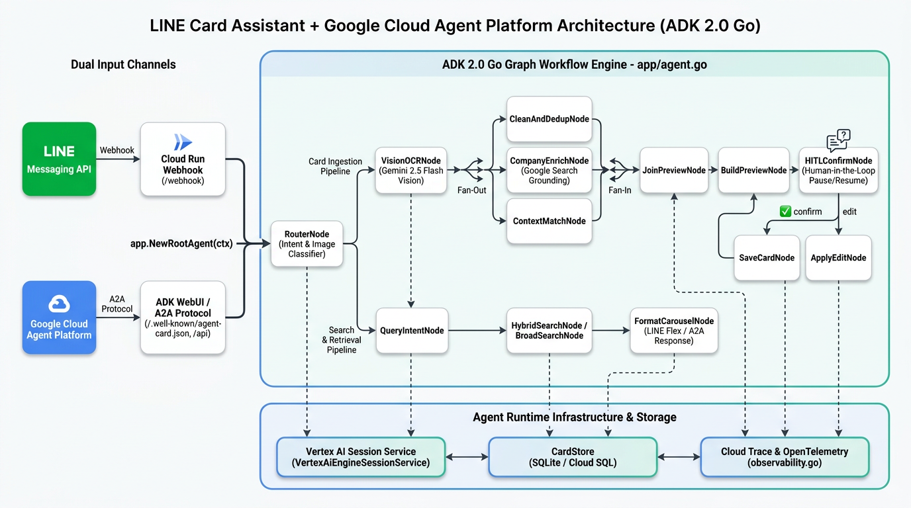
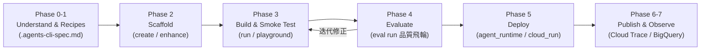

# 前情提要

在上一篇文章《[[Agent Platform 實戰 (1)] 用 Go 與 Google ADK 2.0 Graph Workflow 打造 LINE AI 名片王](/2026/10/16/adk-graph-workflow-go/)》中，我們用 **Golang (`google.golang.org/adk/v2/workflow`)** 與 **LINE Messaging API SDK v8** 從零打造了 **[line-card-assistant（LINE AI 名片王）](https://github.com/kkdai/line-card-assistant)**，把 ADK 2.0 Graph Workflow 的四大核心能力 —— **Deterministic Router 確定性路由**、**`AddFanOut` / `AddFanIn` 平行背景調查與匯聚**、以及 **`NewRequestInputEvent` Human-in-the-Loop (HITL) 暫停與迴圈修正** —— 完整跑通並部署到了 Google Cloud Run。

不過，當我們把這個單體式（Monolithic）的 LINE Bot 推上雲端後，若要進一步往**企業級 AI Agent 平台（Production-grade Agent Platform）**演進，馬上就會遇到幾個架構層級的叩問：

1. **跨實例的 HITL Session 狀態保存在哪裡？**
   在第一版中，我們使用 `session.InMemoryService()` 搭配本地 SQLite。當 Cloud Run 因為流量擴縮（Auto-scaling）或重新部署而切換 Container 實例時，正在等待使用者按下「✅ 確認儲存」的 HITL 暫停狀態（Checkpoint）就會因為記憶體重置而消失。
2. **如何讓這個名片 Agent 被其他 Agent 呼叫（Agent-to-Agent, A2A）？**
   如果公司內部還有另一個「CRM 業務助理 Agent」或「行事曆排程 Agent」，希望能直接透過標準 **A2A 協定** 查詢我們名片王裡的聯絡人或請它代寫破冰信，綁死在 LINE Webhook `/webhook` 入口的單體伺服器是無法直接對外提供標準 Agent 介面的。
3. **如何有系統地評估（Evaluate）與觀測（Observe）整張 Graph？**
   改了一行 Prompt 或調整了一個節點後，要怎麼確保 OCR 準確率、Fan-Out 平行工具呼叫軌跡（Tool Trajectory）與搜尋品質沒有退化？

為了解決從「寫出一個 Agent 原型」到「上線維運企業級 Agent」的鴻溝，Google 官方推出了全新的命令列與技能工具組 —— **[`agents-cli` (Google Agents CLI)](https://google.github.io/agents-cli/guide/getting-started/)**，作為 **Google Cloud Agent Platform（現整合為 Gemini Enterprise Agent Platform）** 的統一開發入口。

這篇系列文的第二集，我們就來深入導讀 **[`agents-cli` 官方開發指南](https://google.github.io/agents-cli/guide/getting-started/)**，解答大家最常問的 **Agent Runtime 擴縮容（Scale-to-Zero）與計費機制**，並帶大家一步步看我們如何完成 **Phase 1 架構升級（[PR #10](https://github.com/kkdai/line-card-assistant/pull/10)）**：在不破壞原本 LINE Bot 功能的前提下，將專案重構為符合 `adk_go` + `agent_runtime` 規範的雙通道架構！

---

# 一、深入解析 Google Cloud Agent Platform 與 `agents-cli` 官方指南

在動手改程式碼之前，我們先透過 Google 官方的《[Getting Started - agents-cli](https://google.github.io/agents-cli/guide/getting-started/)》與《[The Lifecycle - agents-cli](https://google.github.io/agents-cli/guide/lifecycle/)》兩份核心文件，釐清 Google 在 Agent Platform 上的最新技術版圖。

## 1. 產品名詞對照：什麼是 Agent Platform 與 Agent Runtime？

如果你過去一年有追蹤 Google Cloud 的 AI 產品線，可能會聽過 *Vertex AI Agent Engine*、*Reasoning Engine*、*Agent Platform* 或 *Gemini Enterprise Agent Platform (GEAP)*。在最新的 `agents-cli` v1.10+ 規範中，官方將這些名詞與底層資源做了非常清楚的收斂：

| 開發者常說的名稱 | Google Cloud 官方定位與底層資源 | `agents-cli` 對應參數 |
| :--- | :--- | :--- |
| **Agent Platform / Gemini Platform** | Google Cloud 託管企業級 AI Agent 的整體平台（涵蓋 Runtime、Sessions、Memory Bank、Agent Gateway、Agent Registry 與 Eval） | 統一透過 `agents-cli` 操作 |
| **Agent Runtime / Agent Engine** | 專為 AI Agent 設計的全託管容器執行環境，底層 GCP 資源路徑為 `projects/{project}/locations/{location}/reasoningEngines/{id}` | `--deployment-target agent_runtime` |
| **Agent Platform Sessions** | 雲端全託管的對話與狀態持久化服務（ADK 會自動綁定 `VertexAiEngineSessionService`） | `--session-type agent_platform_sessions` |
| **Gemini Enterprise / Agent Registry** | 企業級 Agent 發布與目錄中心，讓部署好的 Agent 可直接在 Gemini 企業版介面或透過 A2A 被發現與調用 | `agents-cli publish gemini` |

---

## 2. `agents-cli` 的七階段開發生命週期 (The Agent Development Lifecycle)

過去我們開發應用程式習慣「寫 code → `go test` → `gcloud run deploy`」三步走；但在《[The Lifecycle](https://google.github.io/agents-cli/guide/lifecycle/)》文件中，`agents-cli` 定義了一套結合 Coding Agent Skills（支援 Antigravity CLI、Gemini CLI、Claude Code 等）的**七階段品質飛輪（Quality Flywheel）**：



1. **Phase 0 & 1 — 需求定義與參考範本（Understand & Study Recipes）**：
   在寫任何一行程式碼前，先將 Agent 的核心目標、外部工具、安全邊界與部署目標寫入專案根目錄的 **`.agents-cli-spec.md`**，作為整個開發週期的 Single Source of Truth。
2. **Phase 2 — 專案骨架生成（Scaffold）**：
   透過 `agents-cli scaffold create` 或針對既有專案執行 `agents-cli scaffold enhance .`，自動產生符合官方規範的目錄結構、設定檔（`agents-cli-manifest.yaml`）、A2A 端點、Session 切換器與 OpenTelemetry 觀測模組。
   - 支援兩大官方內建模板：**`adk`（Python）** 與 **`adk_go`（Golang）**！
3. **Phase 3 — 實作與本地互動驗證（Build & Playground）**：
   - Go 專案只需專注在 `app/agent.go` 中實作並匯出 `NewRootAgent(ctx)`。
   - 開發過程中可隨時用 `agents-cli run "你的測試問題"` 進行終端機快速冒煙測試（Smoke Test），或執行 `agents-cli playground`（或 `make playground`）開啟瀏覽器視覺化互動介面測試多輪對話。
4. **Phase 4 — 自動化行為評估（Evaluate — 品質飛輪的核心）**：
   官方特別強調：**「Unit Test (`go test`) 測的是程式碼合約與型別正確性；而 `agents-cli eval` 測的是 Agent 的行為品質（工具呼叫軌跡 Tool Trajectory、回覆品質與安全性）。」**
5. **Phase 5 — 一鍵容器化部署（Deploy）**：
   透過 `agents-cli deploy` 將專案打包並部署至 `agent_runtime`、`cloud_run` 或 `gke`，並自動將部署後的資源 ID 記錄於 `deployment_metadata.json`。
6. **Phase 6 & 7 — 發布與生產環境可觀測性（Publish & Observe）**：
   透過 `agents-cli publish gemini` 註冊至企業目錄，並結合 OpenTelemetry 將所有的 Graph 節點耗時、LLM Prompt/Response 與 Token 消耗自動匯出至 **Cloud Trace**、**Cloud Logging** 與 **BigQuery Agent Analytics**。

---

## 3. Agent Runtime vs. Cloud Run vs. GKE：我該選哪一個部署目標？

`agents-cli` 支援三種容器化部署目標（底層全部都是讀取專案根目錄的 `Dockerfile` 進行建置，因此 **Go 語言在三個平台都是一等公民**）。我們根據官方 Deployment Decision Matrix 整理比較如下：

| 評估維度 | **Agent Runtime (`agent_runtime`)** | **Cloud Run (`cloud_run`)** | **GKE (`gke`)** |
| :--- | :--- | :--- | :--- |
| **基礎設施管理** | **全託管（專為 Agent 打造）**，自動由 `Dockerfile` 建置並掛載至 `reasoningEngines` | 容器化無伺服器託管，需自行設定網路與服務參數 | GKE Autopilot，具備完整 K8s 控制權但維運複雜度最高 |
| **Session 狀態管理** | **原生內建 Agent Platform Sessions**（執行期自動注入 `GOOGLE_CLOUD_AGENT_ENGINE_ID` 並啟用雲端持久化 Session） | 預設 In-Memory，需額外設定 Cloud SQL 或手動串接托管 Session | 預設 In-Memory，需額外設定 Cloud SQL 或托管 Session |
| **API 與存取介面** | 內建 `:query` / `:streamQuery`、Console Playground、以及 **`/api/{container_path}` HTTP Passthrough** 與 **A2A** | 原生公開或 IAM 保護之 HTTPS URL，最適合直接接收外部 Webhook（如 LINE / Slack） | 自訂 K8s Ingress / Gateway |
| **企業進階整合** | 原生支援 **Managed OAuth 2.0 User Consent**、**Agent Identity**、**Agent Gateway** 與 **PSC-I 私有網路** | 支援 VPC Egress、IAP，但不支援託管式 Agent OAuth 流程 | 完整 K8s 網路控制 |
| **計費模型** | 依實際使用的 **vCPU-hours + Memory-hours** 計費（閒置縮容至 0 時不計運算費） | 依 Request 期間或 Instance 秒數計費 | 依 K8s Node Pod 資源計費 |

---

## 4. 關鍵解惑：搬到 Agent Runtime 的 Instance 會不會 Scale to Zero？

在規劃將 `line-card-assistant` 遷移到 Agent Runtime 時，大家最關心的一個問題就是：
> **「根據 `agents-cli` 的規範，搬到 Agent Runtime 的 Instance 是不是都不會 Scale 到 0、會一直常駐燒錢？」**

答案是：**Agent Runtime 支援 Scale to Zero（縮容至 0），而且 `agents-cli` 採取了非常聰明的「開發預設縮容至 0、生產環境預設預熱 1 台」的雙模式設計！**

根據 `agents-cli` 官方部署規範（Sizing a Deployment）：
1. **直接使用 `agents-cli deploy` 部署時（預設 Scale to Zero）**：
   - CLI 的預設資源配置與 Cloud Run 完全一致：`--cpu 1`、`--memory 4Gi`、`--concurrency 8`、**`--min-instances 0`**、`--max-instances 10`。
   - 也就是說，當沒有流量進入 Agent Runtime 時，Instance 數量會自動縮減為 `0`；而 Agent Runtime 的計費方式是依實際分配的 **vCPU-hours 與 Memory-hours** 計算，**當閒置縮容到 0 時，完全不會產生運算費用！**
2. **使用 Terraform (`service.tf`) 部署正式環境時（預設 `min_instances = 1`）**：
   - 當你為生產環境產生 Terraform IaC（`deployment/terraform/single-project/service.tf`）時，範本預設會將 `min_instances` 設為 `1`，目的是避免正式環境的第一位使用者遇到容器冷啟動（Cold Start）。
   - 如果你的正式環境也希望省錢、允許幾秒鐘的 Cold Start，隨時可以在部署時指定 `agents-cli deploy --min-instances 0`，或在 `service.tf` 中將 `min_instances` 改回 `0`。

### 💡 為什麼 LINE Bot 搭配 Agent Runtime 最適合「雙層解耦架構」？

理解了 Agent Runtime 的特性後，你會發現把系統拆成兩層是絕配：
- **外層：LINE Webhook Gateway（Cloud Run，`min-instances=0`）**：
  因為 LINE 伺服器發送 Webhook 時，只會帶 `X-Line-Signature` HMAC 簽章，無法攜帶 Google Cloud IAM OAuth Token 去呼叫受 IAM 保護的 Agent Runtime API。用一個超輕量的 Go Cloud Run 服務專門負責「在 1 秒內驗章、回傳 HTTP 200、觸發 LINE Loading 動畫」，平時沒人傳名片時完全 Scale to 0。
- **內層：核心大腦（Agent Runtime，`min-instances=0`）**：
  專心運行 ADK 2.0 Graph Workflow、管理雲端持久化 `VertexAiEngineSessionService`（確保 HITL 暫停狀態跨容器不遺失！），並同時對企業內部公開 **A2A (`/.well-known/agent-card.json`)** 與 **Agent Engine Playground**！

---

# 二、規劃遷移藍圖：使用 GitHub CLI 建立 5 階段 Roadmap

為了有條不紊地完成這次架構演進，我們先在 GitHub Repository ([`kkdai/line-card-assistant`](https://github.com/kkdai/line-card-assistant)) 中使用 `gh` CLI 建立了完整的 **5 個 Milestones (Phases)**、**8 個實作 Issues** 與總覽追蹤清單 **[Roadmap Issue #9](https://github.com/kkdai/line-card-assistant/issues/9)**：

- **[Phase 1: `agents-cli` 環境與 `adk_go` 專案 Scaffolding](https://github.com/kkdai/line-card-assistant/milestone/1)**（本篇實作重點！）
  - [x] [#1](https://github.com/kkdai/line-card-assistant/issues/1) 升級 `google-agents-cli` 至 1.10+ 並建立 `.agents-cli-spec.md` 與 `agents-cli-manifest.yaml`
  - [x] [#2](https://github.com/kkdai/line-card-assistant/issues/2) 導入 `adk_go` + `agent_runtime` 標準啟動器架構 (`app/agent.go`, A2A, `/app-info`, Sessions 與 Observability)
- **[Phase 2: ADK Go Graph Workflow 雲端儲存與持久化適配](https://github.com/kkdai/line-card-assistant/milestone/2)**
  - [ ] [#3](https://github.com/kkdai/line-card-assistant/issues/3) 深化 ADK Go v2.6+ Graph Workflow 與 `NewRootAgent` 狀態管理
  - [ ] [#4](https://github.com/kkdai/line-card-assistant/issues/4) 整合 Agent Platform Sessions (`session/vertexai`) 與 GCS Artifact Service 支援跨實例 HITL 暫停恢復
  - [ ] [#5](https://github.com/kkdai/line-card-assistant/issues/5) 將名片資料庫 (`CardStore`) 擴充支援 Cloud SQL / Firestore 雲端持久化儲存
- **[Phase 3: LINE Webhook Gateway 與 Agent Runtime 解耦架構](https://github.com/kkdai/line-card-assistant/milestone/3)**
  - [ ] [#6](https://github.com/kkdai/line-card-assistant/issues/6) 實作 LINE Webhook Gateway (Cloud Run) 與 Agent Runtime 雙層解耦呼叫架構
- **[Phase 4: `agents-cli eval` 自動化評估與基準測試](https://github.com/kkdai/line-card-assistant/milestone/4)**
  - [ ] [#7](https://github.com/kkdai/line-card-assistant/issues/7) 建立 `agents-cli eval` 評估資料集與品質飛輪 (OCR、Fan-Out/Fan-In、HITL 迴圈、Hybrid Search)
- **[Phase 5: Agent Runtime 正式部署、IaC 與可觀測性](https://github.com/kkdai/line-card-assistant/milestone/5)**
  - [ ] [#8](https://github.com/kkdai/line-card-assistant/issues/8) 透過 `agents-cli deploy` 部署至 Agent Runtime 並建立 Terraform IaC、CI/CD 與 Cloud Trace 可觀測性

---

# 三、Phase 1 實戰拆解：把既有 Go 專案改造為 `adk_go` + `agent_runtime` 雙通道架構

在 Phase 1（對應已合併之 **[PR #10](https://github.com/kkdai/line-card-assistant/pull/10)**）中，我們的目標是：**保留原本 `cmd/server/main.go` 的獨立 LINE Webhook 伺服器，同時在專案根目錄導入 `agents-cli` (`adk_go` + `agent_runtime`) 的標準架構**，讓同一個 Codebase 同時具備兩種超能力！

我們來看看這次升級到底改了哪些關鍵檔案，以及帶來了什麼新功能：

```text
line-card-assistant/
├── .agents-cli-spec.md          # [新增] Phase 0 架構規格書 (Single Source of Truth)
├── agents-cli-manifest.yaml     # [新增] agents-cli v1.10.0 專案設定檔 (adk_go + agent_runtime)
├── deployment_metadata.json     # [新增] 記錄遠端 Agent Runtime 資源 ID 與 A2A 狀態
├── main.go                      # [新增] Agent Runtime / ADK WebUI / A2A 標準 HTTP 入口
├── apploader.go                 # [新增] 支援 /ui/?app=app 與 rootAgent.Name() 的雙別名 Loader
├── appurl.go                    # [新增] 自動推算 Cloud Run / Agent Runtime 外部公開 URL (供 A2A Card 使用)
├── observability.go             # [新增] OpenTelemetry Cloud Trace / Logging / Metrics 自動掛載
├── app/
│   ├── agent.go                 # [新增] 標準匯出介面：NewRootAgent(ctx) 回傳 12 節點 Graph Workflow
│   └── agent_test.go            # [新增] 直接透過 ADK Runner 驗證 Root Agent 執行與搜尋輸出
├── appinfo/
│   └── appinfo.go               # [新增] GET /app-info 端點，自動解析 Root Workflow 與內嵌之 CompanyEnrichAgent
├── sessions/
│   └── sessions.go              # [新增] 自動切換 VertexAiEngineSessionService 與本地 InMemoryService
├── cmd/server/main.go           # [保留] 原本的獨立 LINE Bot Webhook 伺服器
└── internal/workflow/           # [強化] Graph Workflow 節點升級支援雙通道輸入與串流 Content 輸出
```

---

## 1. 建立 `agents-cli-manifest.yaml` 與 `.agents-cli-spec.md`

要讓 `agents-cli` 認得一個 Go 專案，核心關鍵在於根目錄的 [`agents-cli-manifest.yaml`](https://github.com/kkdai/line-card-assistant/blob/main/agents-cli-manifest.yaml)：

```yaml
# Managed by agents-cli. Do not edit manually.
acli_version: "1.10.0"
project_name: "line-card-assistant"
root_agent_name: "line_card_assistant"
base_template: "adk_go"
language: "go"
framework: "google-adk"
deployment_target: "agent_runtime"
agent_directory: "app"
region: "asia-east1"
agent_guidance_filename: "GEMINI.md"
is_a2a: true
prototype: true
generated_at: "2026-10-17T16:12:00Z"
```

設定完成後，我們在專案根目錄執行 `agents-cli info`，CLI 就能立刻辨識出這是一個支援 A2A、目標部署於 `asia-east1` Agent Runtime 的 Go 專案：

```bash
$ agents-cli info
CLI version:        1.10.0
Project root:       /Users/evanlin/Documents/line-card-assistant
Project name:       line-card-assistant
Root agent name:    line_card_assistant
Language:           go
Deployment target:  agent_runtime
Agent directory:    app
Region:             asia-east1
A2A:                yes
```

---

## 2. 封裝標準 Root Agent 入口：`app/agent.go`

在 `adk_go` 模板規範中，所有的 Agent 邏輯都應該透過 `app` package 下的 **`NewRootAgent(ctx context.Context) (agent.Agent, error)`** 匯出。

因為我們在第一篇中已經使用 ADK 2.0 的 `workflowagent.New` 將 12 個節點的 Graph Workflow 封裝成標準的 `agent.Agent`，所以在 [`app/agent.go`](https://github.com/kkdai/line-card-assistant/blob/main/app/agent.go) 中，我們只需要負責初始化底層的 `CardStore`（SQLite 或 Memory）與 `model.LLM`（自動偵測 Vertex AI ADC 或 Gemini API Key），再呼叫 `workflow.NewCardAssistantAgent` 即可無縫接軌！

```go
package app

import (
	"context"
	"log/slog"
	"os"
	"strings"

	"github.com/kkdai/line-card-assistant/internal/config"
	"github.com/kkdai/line-card-assistant/internal/store"
	"github.com/kkdai/line-card-assistant/internal/workflow"
	"google.golang.org/adk/v2/agent"
	"google.golang.org/adk/v2/model"
)

const RootAgentName = workflow.WorkflowName // "line_card_assistant"

// NewRootAgent constructs the root ADK v2 Graph Workflow agent for Agent Runtime,
// ADK WebUI playground, A2A server, and evaluation CLI.
func NewRootAgent(ctx context.Context) (agent.Agent, error) {
	cfg := config.Load()

	var cardStore store.CardStore
	if strings.TrimSpace(cfg.SQLitePath) != "" {
		sqliteStore, err := store.NewSQLiteStore(cfg.SQLitePath)
		if err != nil {
			slog.Warn("failed to open SQLite store, falling back to in-memory store", "err", err)
			cardStore = store.NewMemoryStore()
		} else {
			cardStore = sqliteStore
		}
	} else {
		cardStore = store.NewMemoryStore()
	}

	var llm model.LLM
	if cfg.UseVertexAI || cfg.GoogleAPIKey != "" || os.Getenv("GOOGLE_CLOUD_AGENT_ENGINE_ID") != "" {
		realLLM, err := workflow.NewGeminiModel(ctx, cfg.GeminiModel, cfg.GoogleAPIKey, cfg.UseVertexAI, cfg.GoogleCloudProject, cfg.GoogleCloudLocation)
		if err != nil {
			slog.Warn("failed to initialize Gemini model, falling back to mock LLM", "err", err)
			llm = workflow.NewMockLLM()
		} else {
			llm = realLLM
		}
	} else {
		llm = workflow.NewMockLLM()
	}

	return NewRootAgentWithDeps(cardStore, llm)
}

func NewRootAgentWithDeps(cardStore store.CardStore, llm model.LLM) (agent.Agent, error) {
	return workflow.NewCardAssistantAgent(cardStore, llm)
}
```

注意這裡的一個巧思：當部署在 Agent Runtime 時，系統會自動注入 `GOOGLE_CLOUD_AGENT_ENGINE_ID` 環境變數；而在跑單元測試（`go test ./...`）且未設定 API Key 時，它會自動退回 `workflow.NewMockLLM()`，讓離線測試依然保持 100% 快速且確定性通過！

---

## 3. Agent Runtime 標準 HTTP Server 與 A2A 端點（Root `main.go`）

接著我們來看專案根目錄新增的 [`main.go`](https://github.com/kkdai/line-card-assistant/blob/main/main.go)。當容器部署到 Agent Runtime（或在本機執行 `make playground`）時，這個入口會一次掛載五大標準服務：

1. **OpenTelemetry 可觀測性（`setupObservability`）**：自動將 Traces、Logs 與 Metrics 匯出至 Google Cloud Trace 與 Cloud Logging。
2. **Session 服務自動切換（`sessions.SessionService()`）**：
   在 [`sessions/sessions.go`](https://github.com/kkdai/line-card-assistant/blob/main/sessions/sessions.go) 中，只要偵測到 `VERTEX_AI_SEARCH_ENGINE_ID`（Agent Engine ID），就會自動啟用雲端持久化的 **`NewVertexAiEngineSessionService`**；本機開發則無縫使用 `session.InMemoryService()`。
3. **ADK REST API 與 WebUI（`/api/` 與 `/ui/`）**：
   直接透過 `api.NewLauncher()` 與 `webui.NewLauncher()` 啟動 ADK 內建的串流對話 API 與網頁除錯介面。
4. **A2A (Agent-to-Agent) 協定伺服器**：
   自動在 `/.well-known/agent-card.json` 公開這個 Agent 的能力描述卡（AgentCard），並在 `/a2a/app` 提供 JSON-RPC 調用端點！
5. **Agent 結構自省端點（`GET /app-info`）**：
   透過 [`appinfo/appinfo.go`](https://github.com/kkdai/line-card-assistant/blob/main/appinfo/appinfo.go) 分析整棵 Agent Tree，不僅能列出 Root Graph Workflow，還會把內嵌在 `CompanyEnrichNode` 裡面、掛載了 `geminitool.GoogleSearch{}` 的 **`CompanyEnrichAgent` (`gemini-2.5-flash`)** 一併註冊到 `/app-info` 回應中，讓 `agents-cli eval` 與 Google Cloud Console Playground 能夠清楚看見系統內部的所有子代理與工具！

---

## 4. 關鍵改造：讓 Graph Workflow 同時支援「LINE Webhook」與「ADK WebUI / A2A」雙通道！

在第一版中，我們的 `RouterNode` 假設所有的輸入都來自 LINE Webhook Handler 預先塞進 Session State 的 `StateKeyInputType` 或 `StateKeyImageBytes`；而且各個終端節點（如 `FormatCarouselNode`、`BuildPreviewNode`、`SaveCardNode`）只把結果寫入 `StateKeyReplyText` 與 `StateKeyFlexCarouselJSON`，供 LINE Bot 取出後呼叫 `ReplyMessage` 推播。

但是，當我們開啟 **ADK WebUI (`make playground`)**、**Agent Engine Console Playground** 或是透過 **`agents-cli run "幫我找做 AI 的人"`** 直接跟 Root Agent 對話時，輸入是走標準的 ADK `ctx.UserContent()`（包含文字 `Part.Text` 或上傳圖片 `Part.InlineData`），而輸出則是讀取事件串流中的 `ev.Content`！

因此，我們在 [`internal/workflow/nodes_ingest.go`](https://github.com/kkdai/line-card-assistant/blob/main/internal/workflow/nodes_ingest.go) 與 [`internal/workflow/nodes_search.go`](https://github.com/kkdai/line-card-assistant/blob/main/internal/workflow/nodes_search.go) 做了兩項完全向下相容的強化：

### (1) `RouterNode` 自動解析 `ctx.UserContent()` 的圖片與文字

```go
// 當直接從 ADK WebUI / A2A / Agent Engine Playground 上傳名片圖片時，
// 自動從 ctx.UserContent().Parts 取出 InlineData.Data 並導向 RouteIngest！
if len(getBytesState(ctx, StateKeyImageBytes)) == 0 && ctx.UserContent() != nil {
	for _, part := range ctx.UserContent().Parts {
		if part != nil && part.InlineData != nil && len(part.InlineData.Data) > 0 {
			setState(ctx, ev, StateKeyImageBytes, part.InlineData.Data)
			if getStringState(ctx, StateKeyInputType) == "" {
				setState(ctx, ev, StateKeyInputType, RouteIngest)
			}
			break
		}
	}
}

// 若為文字輸入且 input 參數為空，自動從 ctx.UserContent().Parts 擷取查詢文字或指令
if inputType == "" {
	sTrim, _ := input.(string)
	sTrim = strings.TrimSpace(sTrim)
	if sTrim == "" && ctx.UserContent() != nil {
		for _, part := range ctx.UserContent().Parts {
			if part != nil && strings.TrimSpace(part.Text) != "" {
				sTrim = strings.TrimSpace(part.Text)
				break
			}
		}
	}
	// 自動判斷是搜尋名片 (RouteSearch) 還是產生破冰信 (action=draft_email&card_id=...)
    ...
}
```

### (2) 終端節點同步寫入 `ev.Content`

在 `BuildPreviewNode`、`SaveCardNode`、`FormatCarouselNode` 與 `EmailDraftNode` 中，除了原本寫入 `StateDelta` 給 LINE Bot 讀取外，我們加上了一行：

```go
ev.Content = genai.NewContentFromText(flexJSON, genai.RoleModel)
```

這麼一來：
- **從 LINE 傳名片或查名片**：LINE Webhook 一樣從 `StateDelta` 拿到 Flex JSON 渲染出漂亮的 LINE 卡片。
- **從 ADK WebUI (`make playground`) 或 Agent Engine Playground 測試**：不需透過 LINE 帳號，直接在瀏覽器上傳一張名片圖片或輸入「*幫我找在 Cloud Summit 認識做 AI 的人*」，就能在對話視窗直接看到完整的執行軌跡（Graph Node 跳轉）與輸出的 Flex JSON / 破冰信草稿！

我們也在 [`app/agent_test.go`](https://github.com/kkdai/line-card-assistant/blob/main/app/agent_test.go) 中新增了 `TestRootAgentDirectSearchExecution` 單元測試，直接用標準 ADK `runner.Runner` 對 `app.NewRootAgent` 發送 `genai.Content` 查詢，驗證不經過 LINE Engine 也能直接從 Event Stream 取得名片 Carousel JSON！

---

## 5. Multi-binary `Dockerfile`：一個映像檔同時搞定 Agent Runtime 與 LINE Webhook

最後，為了讓同一個容器映像檔既能被 `agents-cli deploy` 部署到 **Agent Runtime**，又能被部署到 **Cloud Run** 作為獨立 LINE Bot 伺服器，我們更新了 [`Dockerfile`](https://github.com/kkdai/line-card-assistant/blob/main/Dockerfile)，在 Multi-stage Build 中一次編譯出兩支靜態執行檔：

```dockerfile
# Build the Agent Runtime / ADK WebUI / A2A entrypoint binary (root main.go)
RUN CGO_ENABLED=0 GOOS=linux GOARCH=amd64 go build -ldflags="-s -w" -o /out/agent .

# Also build the standalone LINE Bot Webhook server binary (cmd/server/main.go)
RUN CGO_ENABLED=0 GOOS=linux GOARCH=amd64 go build -ldflags="-s -w" -o /out/line-card-assistant ./cmd/server
```

- 預設 `ENTRYPOINT ["/agent"]` 會啟動 Agent Runtime 標準伺服器（監聽 `0.0.0.0:8080`）。
- 若在 Cloud Run 需要作為單體 LINE Webhook Server 執行，只需將 Container Command 指定為 `/bin/line-card-assistant` 即可！

---

# 四、總結與下一步預告

透過 Phase 1 的改造（[PR #10](https://github.com/kkdai/line-card-assistant/pull/10)），我們的 **LINE AI 名片王 (`line-card-assistant`)** 已經正式從一個單純的 LINE Bot 應用程式，蛻變為符合 Google Cloud Agent Platform 標準的 **`adk_go` Agent**：

1. **完整支援 `agents-cli` 生態系**：具備 `agents-cli-manifest.yaml` 與 `.agents-cli-spec.md`。
2. **雙通道執行能力**：既能透過 LINE 聊天室互動，也能直接透過 `make playground` 開啟 ADK WebUI、透過 A2A 協定讓其他 Agent 呼叫、或在 Agent Engine Playground 直接進行多模態名片辨識與搜尋測試。
3. **雲端原生準備就緒**：內建 `VertexAiEngineSessionService` 自動切換與 OpenTelemetry Cloud Trace 追蹤能力。

在下一篇系列文章中，我們將進入 **Phase 2 & Phase 3**，實際將 HITL 暫停狀態與圖片 Artifact 接上雲端持久化儲存，並把系統拆解為「Cloud Run LINE Webhook Gateway + Agent Runtime 核心大腦」的雙層解耦架構，敬請期待！

---

## 參考資源與延伸閱讀

- **系列文第一篇**：[[Agent Platform 實戰 (1)] 用 Go 與 Google ADK 2.0 Graph Workflow 打造 LINE AI 名片王：從 Fan-Out 平行檢索到 HITL 暫停迴圈修正](/2026/10/16/adk-graph-workflow-go/)
- **本專案開源程式碼與 Roadmap**：
  - GitHub Repository：[kkdai/line-card-assistant](https://github.com/kkdai/line-card-assistant)
  - Agent Runtime 遷移總覽 Roadmap：[Issue #9](https://github.com/kkdai/line-card-assistant/issues/9)
  - Phase 1 實作 Pull Request：[PR #10: feat(phase1): scaffold adk_go Agent Runtime project structure and app.NewRootAgent](https://github.com/kkdai/line-card-assistant/pull/10)
- **Google `agents-cli` 與 Agent Platform 官方文件**：
  - [Getting Started - agents-cli](https://google.github.io/agents-cli/guide/getting-started/)
  - [The Lifecycle - agents-cli](https://google.github.io/agents-cli/guide/lifecycle/)
- **Google ADK Graph Workflow 官方文件**：
  - [Graph Workflows in ADK: Everything You Need to Know (Google Cloud Blog)](https://cloud.google.com/blog/topics/developers-practitioners/graph-workflows-in-adk-everything-you-need-to-know)
  - [Graph-based agent workflows (adk.dev/graphs)](https://adk.dev/graphs/)
