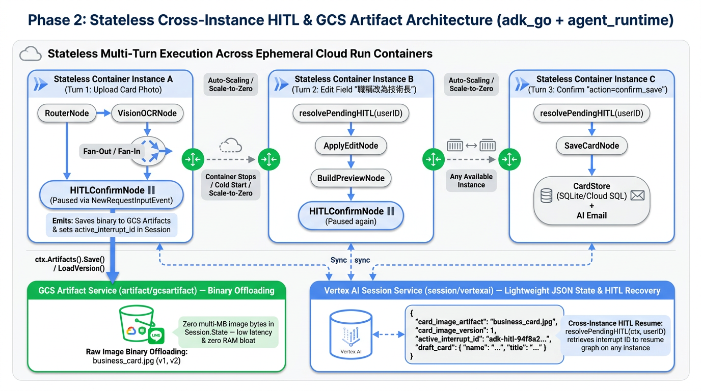
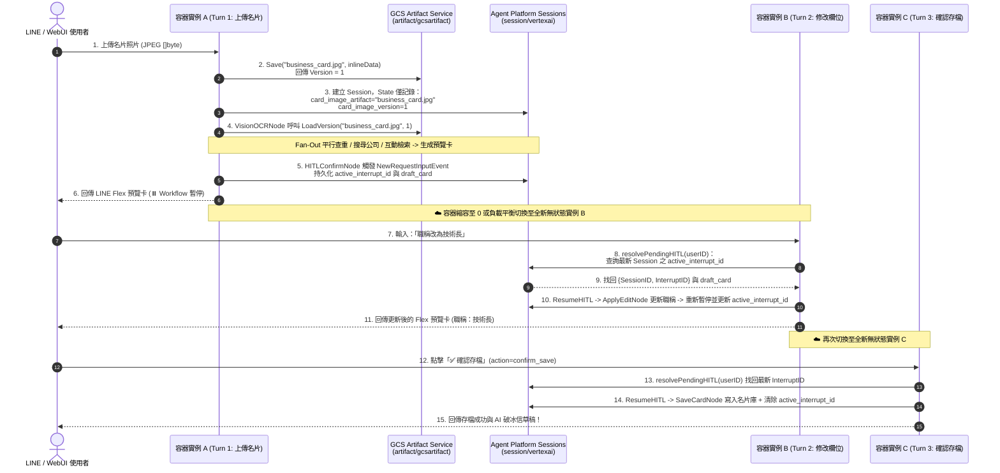

# 前情提要

在前兩篇系列文章中：
- **《[[Agent Platform 實戰 (1)] 用 Go 與 Google ADK 2.0 Graph Workflow 打造 LINE AI 名片王](/2026/10/16/adk-graph-workflow-go/)》**：我們用 `google.golang.org/adk/v2/workflow` 實作了包含 **Deterministic Router**、**`AddFanOut` / `AddFanIn` 三路平行背景調查**，以及 **`NewRequestInputEvent` Human-in-the-Loop (HITL) 暫停與迴圈修正** 的 12 節點名片助理。
- **《[[Agent Platform 實戰 (2)] 從單體 Cloud Run 邁向 Google Cloud Agent Runtime：用 agents-cli 與 ADK Go 重構 LINE AI 名片王](/2026/10/17/adk-graph-workflow-go-2/)》**：我們導讀了 `agents-cli` 官方開發生命週期，解答了 Agent Runtime 的 Scale-to-Zero 機制，並完成 **Phase 1（[PR #10](https://github.com/kkdai/line-card-assistant/pull/10)）**，將專案改造為同時支援 LINE Webhook、ADK WebUI Playground 與 A2A 協定的 `adk_go` 標準雙通道架構。

進入 **Phase 2（[Issue #3](https://github.com/kkdai/line-card-assistant/issues/3) & [Issue #4](https://github.com/kkdai/line-card-assistant/issues/4)）**，我們要面對把這套系統推向生產環境（Cloud Run / Agent Runtime 自動擴縮容叢集）時最經典、也最容易踩坑的分散式系統難題：**當容器隨時會 Scale to Zero 或負載平衡到不同實例時，多模態名片照片（Binary Image）該放哪裡？正在等待使用者按按鈕的 HITL 暫停狀態又該如何跨實例恢復？**

這篇系列文的第三集，就帶大家深入拆解我們在 **[PR #11](https://github.com/kkdai/line-card-assistant/pull/11)** 中如何用 **ADK Go v2.6.0** 的 **`artifact/gcsartifact` (GCS Artifact Service)** 與 **`session/vertexai` (Agent Platform Sessions)** 徹底治好無狀態容器的「HITL 失憶症」！

---

# 一、為什麼原本的 HITL 在雲端多實例環境會「失憶」與「爆肥」？

在單機或單一 Container 實例開發時，把所有東西塞進記憶體都跑得飛快；但一旦部署到會自動水平擴縮（Horizontal Auto-scaling）或縮容至 0（Scale-to-Zero）的 **Google Cloud Run** 或 **Vertex AI Agent Runtime**，原本第一版的設計就會馬上撞上兩座高牆：

## 痛點 1：把幾 MB 的名片照片 `[]byte` 塞進 `Session.State` 的「狀態爆肥」反模式

在第一版中，當 LINE 使用者傳來一張高解析度名片照片時，我們是直接把下載下來的 `imageBytes []byte` 放進 ADK 的 `Session.State["image_bytes"]`：

```go
// ❌ 第一版作法：直接把幾 MB 的原始圖片 []byte 塞進 Session State
InitialState: map[string]any{
    StateKeyInputType:  RouteIngest,
    StateKeyImageBytes: imageBytes, // 3MB JPEG 在 JSON 序列化後膨脹為 ~4MB Base64 字串！
}
```

當你使用的是本地 `session.InMemoryService()` 時，這只是一個 Go slice 指標；但當你切換到雲端持久化的 **Agent Platform Sessions (`session/vertexai`)** 或 **Cloud SQL (`session/database`)** 時：
1. **每次節點狀態變更（StateDelta）都要序列化與網路傳輸**：ADK Graph Workflow 從 `RouterNode` 走到 `VisionOCRNode`、再 Fan-Out 到三個平行節點、最後進入 `HITLConfirmNode` 暫停，如果幾 MB 的圖片二進位資料一直留在 `Session.State` 裡，不僅會大幅拖慢每次讀寫雲端 Session API 的延遲，甚至可能直接觸發雲端 Session Payload 大小上限！
2. **歷史紀錄難以稽核與版本化**：如果使用者在多輪對話中陸續傳了多張名片，把原始二進位檔混在結構化 JSON 狀態裡，會讓對話狀態變得極度臃腫。

## 痛點 2：容器實例切換導致 HITL `pendingSession` 記憶體映射遺失

我們來看看真實世界裡的使用者情境：
1. **Turn 1（落在容器實例 A）**：使用者在研討會拍了一張名片傳給 LINE Bot。**實例 A** 完成 Vision OCR 與平行背景調查後，透過 `workflow.NewRequestInputEvent` 暫停在 `HITLConfirmNode`，並推播 Flex Message 預覽卡給使用者。
2. **中場休息 10 分鐘**：使用者跑去跟對方交換完心得、喝了杯咖啡，這期間實例 A 因為閒置而縮容（Scale to 0），或者因為其他人的流量進來而擴展出**容器實例 B**。
3. **Turn 2（落在容器實例 B）**：使用者在 LINE 點擊「✏️ 修改欄位」並輸入「*職稱改為技術長*」，或者按下「✅ 確認存檔」。

在第一版中，我們的 `Engine` 是用一個 Go 記憶體內的 `map[string]pendingHITL` 來記錄哪個 `userID` 正在等待哪個 `SessionID` 與 `InterruptID`：

```go
// ❌ 第一版作法：只依賴單機記憶體 map 判斷是否有暫停中的 HITL
type Engine struct {
    mu             sync.RWMutex
    pendingSession map[string]pendingHITL // userID -> {SessionID, InterruptID}
}
```

結果當 Turn 2 的 Webhook 請求被负载均衡器導向**全新的實例 B** 時，實例 B 的 `pendingSession` map 是空的！`HasPendingHITL(userID)` 回傳 `false`，系統就會把「*職稱改為技術長*」當成一筆全新的「名片搜尋（Search）」請求，整個 HITL 迴圈瞬間斷裂！

---

# 二、ADK 2.0 的標準解法：Session State 與 Artifact Storage 職責分離

為了解決這個問題，Google ADK 2.0 在架構設計上明確將 Agent 的執行期資料切分為兩大獨立服務：

| 比較維度 | **Session Service (`session.Service`)** | **Artifact Service (`artifact.Service`)** |
| :--- | :--- | :--- |
| **核心定位** | 儲存對話事件軌跡（Events）、工作流斷點（Interrupts）與**輕量結構化狀態（JSON State）** | 儲存大型二進位檔案（圖片、PDF、音訊、報表 CSV）並提供**自動版本控制（Versioning）** |
| **雲端實作套件** | `google.golang.org/adk/v2/session/vertexai`（Agent Platform Sessions）或 `session/database` | `google.golang.org/adk/v2/artifact/gcsartifact`（底層儲存於 Google Cloud Storage Bucket） |
| **本機開發實作** | `session.InMemoryService()` | `artifact.InMemoryService()` |
| **在名片王中的角色** | 儲存 `draft_card` JSON、`active_interrupt_id`、以及指向圖片的**輕量指標（檔名 + 版本號）** | 儲存原始名片照片 `business_card.jpg`（每次上傳自動遞增 Version `1, 2, 3...`） |

透過這套雙軌設計，整個跨實例的多模態名片辨識與 HITL 恢復流程變得無比清晰：



---

# 三、程式碼實戰拆解（Phase 2 — PR #11）

接下來我們直接看程式碼，看看如何用不到幾百行乾淨的 Go 程式碼完成這套升級。

## 1. 建立多後端 Artifact 工廠：`sessions/artifacts.go`

我們在 `sessions` package 下新增了 [`sessions/artifacts.go`](https://github.com/kkdai/line-card-assistant/blob/main/sessions/artifacts.go)，利用 ADK Go v2.6.0 內建的 `google.golang.org/adk/v2/artifact/gcsartifact` 套件，根據環境變數自動切換雲端 GCS Bucket 與本機記憶體：

```go
package sessions

import (
	"context"
	"log/slog"
	"os"
	"strings"

	"google.golang.org/adk/v2/artifact"
	"google.golang.org/adk/v2/artifact/gcsartifact"
)

// NewArtifactService returns an ADK artifact.Service backed by Google Cloud Storage
// when ARTIFACT_BUCKET_NAME or LOGS_BUCKET_NAME is configured, and falls back to
// artifact.InMemoryService() for local development and unit tests.
func NewArtifactService(ctx context.Context) (artifact.Service, error) {
	bucketName := resolveArtifactBucketName()
	if bucketName == "" {
		slog.Info("Using in-memory artifact service (set ARTIFACT_BUCKET_NAME or LOGS_BUCKET_NAME for GCS)")
		return artifact.InMemoryService(), nil
	}

	svc, err := gcsartifact.NewService(ctx, bucketName)
	if err != nil {
		return nil, err
	}
	slog.Info("Using GCS artifact service", "bucket", bucketName)
	return svc, nil
}
```

這裡有一個貼心的細節：在 `agents-cli` 的 Agent Runtime 部署環境中，系統通常會配置 `LOGS_BUCKET_NAME`（或我們自訂的 `ARTIFACT_BUCKET_NAME`），甚至有人會不小心填成帶 `gs://my-bucket/prefix` 的格式。我們的 `resolveArtifactBucketName()` 會自動剝離 `gs://` 前綴與路徑，確保 `gcsartifact.NewService` 能穩定連線，並在未設定 Bucket 時自動退回 `artifact.InMemoryService()`。

同時，我們也在 [`main.go`](https://github.com/kkdai/line-card-assistant/blob/main/main.go) 的 `launcher.Config` 與 [`cmd/server/main.go`](https://github.com/kkdai/line-card-assistant/blob/main/cmd/server/main.go) 中將 `ArtifactService` 與 `SessionService` 一併注入：

```go
// main.go — 同時將 SessionService 與 ArtifactService 注入 ADK Universal Launcher
config := &launcher.Config{
    SessionService:  sessionService,
    ArtifactService: artifactService,
    AgentLoader:     NewSingleAgentLoader(rootAgent),
    A2AOptions:      a2aOpts,
}
```

---

## 2. 名片圖片改存 Artifact，Session State 只留「輕量指標」

接著我們改造 [`internal/workflow/graph.go`](https://github.com/kkdai/line-card-assistant/blob/main/internal/workflow/graph.go) 與 [`internal/workflow/nodes_ingest.go`](https://github.com/kkdai/line-card-assistant/blob/main/internal/workflow/nodes_ingest.go)。

首先，我們定義兩個全新的輕量 State Key 與預設檔名：

```go
const (
	StateKeyImageBytes        = "image_bytes"         // 僅保留向下相容 fallback
	StateKeyCardImageArtifact = "card_image_artifact" // Artifact 檔案名稱
	StateKeyCardImageVersion  = "card_image_version"  // Artifact 版本號 (int)

	DefaultCardImageArtifactName = "business_card.jpg"
)
```

### (1) 從 LINE Webhook 進入時（`Engine.StartIngest`）
當 LINE 使用者傳送圖片時，`StartIngest` 會先呼叫 `e.artifactService.Save` 將圖片二進位檔寫入 Artifact 服務，並在 `InitialState` 中**只記錄檔名與版本號**，`StateKeyImageBytes` 完全不寫入 `Session.State`：

```go
initialState := map[string]any{
	StateKeyInputType:    RouteIngest,
	StateKeyRecentEvents: recentEvents,
}

if e.artifactService != nil && len(imageBytes) > 0 {
	part := genai.NewPartFromBytes(imageBytes, detectImageMIMEType(imageBytes))
	saveResp, saveErr := e.artifactService.Save(ctx, &artifact.SaveRequest{
		AppName:   appName,
		UserID:    userID,
		SessionID: sess.ID(),
		FileName:  DefaultCardImageArtifactName,
		Part:      part,
	})
	if saveErr == nil && saveResp != nil {
		initialState[StateKeyCardImageArtifact] = DefaultCardImageArtifactName
		initialState[StateKeyCardImageVersion] = saveResp.Version
	}
}
```

### (2) 從 ADK WebUI / Agent Engine Playground / A2A 直接上傳圖片時（`RouterNode`）
那如果使用者不是從 LINE，而是直接打開 **ADK WebUI (`make playground`)** 或 **Agent Engine Console** 上傳一張名片照片呢？
我們在 `RouterNode` 中直接透過 ADK 2.0 的 **`ctx.Artifacts().Save(...)`** 把 `ctx.UserContent()` 裡的 `InlineData` 轉存進 Artifact Service：

```go
// internal/workflow/nodes_ingest.go — RouterNode
if getStringState(ctx, StateKeyCardImageArtifact) == "" && len(getBytesState(ctx, StateKeyImageBytes)) == 0 && ctx.UserContent() != nil {
	for _, part := range ctx.UserContent().Parts {
		if part != nil && part.InlineData != nil && len(part.InlineData.Data) > 0 {
			if ctx.Artifacts() != nil {
				mimeType := part.InlineData.MIMEType
				if mimeType == "" {
					mimeType = detectImageMIMEType(part.InlineData.Data)
				}
				artifactPart := genai.NewPartFromBytes(part.InlineData.Data, mimeType)
				if saveResp, saveErr := ctx.Artifacts().Save(ctx, DefaultCardImageArtifactName, artifactPart); saveErr == nil {
					setState(ctx, ev, StateKeyCardImageArtifact, DefaultCardImageArtifactName)
					setState(ctx, ev, StateKeyCardImageVersion, saveResp.Version)
				} else {
					setState(ctx, ev, StateKeyImageBytes, part.InlineData.Data)
				}
			}
			if getStringState(ctx, StateKeyInputType) == "" {
				setState(ctx, ev, StateKeyInputType, RouteIngest)
			}
			break
		}
	}
}
```

### (3) `VisionOCRNode` 按需讀取指定版本的名片圖片（`loadCardImageBytes`）
當工作流進入 `VisionOCRNode` 要呼叫 Gemini Vision 進行多模態辨識時，再透過 `ctx.Artifacts().LoadVersion`（或 `Load`）把圖片載入記憶體送給模型，用完即丟，完全不污染 `Session.State`：

```go
func loadCardImageBytes(ctx agent.Context) []byte {
	if artifactName := getStringState(ctx, StateKeyCardImageArtifact); artifactName != "" && ctx.Artifacts() != nil {
		version := getIntState(ctx, StateKeyCardImageVersion)
		var (
			resp *artifact.LoadResponse
			err  error
		)
		if version > 0 {
			resp, err = ctx.Artifacts().LoadVersion(ctx, artifactName, version)
		} else {
			resp, err = ctx.Artifacts().Load(ctx, artifactName)
		}
		if err == nil && resp != nil && resp.Part != nil && resp.Part.InlineData != nil {
			return resp.Part.InlineData.Data
		}
	}
	return getBytesState(ctx, StateKeyImageBytes) // Fallback
}
```

---

## 3. 實作無狀態跨實例 HITL 狀態探索：`resolvePendingHITL`

解決了圖片儲存後，接下來就是重頭戲：**當容器實例 B 收到使用者的「職稱改為技術長」或「✅ 確認存檔」時，如何在本地記憶體空空如也的情況下，自動找回實例 A 暫停的 HITL 工作流？**

秘密就在於：當 `HITLConfirmNode` 呼叫 `workflow.NewRequestInputEvent` 暫停時，我們已經把當下的 `InterruptID` 寫進了 `Session.State["active_interrupt_id"]`（且當 `SaveCardNode` 存檔完成時會將它清空為 `""`）。

因此，我們在 [`internal/workflow/graph.go`](https://github.com/kkdai/line-card-assistant/blob/main/internal/workflow/graph.go) 中實作了 **`resolvePendingHITL(ctx, userID)`**：

```go
// resolvePendingHITL checks the local cache first and falls back to querying
// the shared session.Service for any session belonging to userID with a non-empty
// StateKeyActiveInterruptID. This enables stateless cross-instance HITL resume
// on Cloud Run / Vertex AI Agent Runtime.
func (e *Engine) resolvePendingHITL(ctx context.Context, userID string) (pendingHITL, bool) {
	// 1. Fast path：若同一個實例記憶體中已有紀錄，先向 sessionService 驗證是否仍處於暫停狀態
	e.mu.RLock()
	cached, ok := e.pendingSession[userID]
	e.mu.RUnlock()
	if ok && cached.SessionID != "" && cached.InterruptID != "" {
		if getResp, err := e.sessionService.Get(ctx, &session.GetRequest{
			AppName:   appName,
			UserID:    userID,
			SessionID: cached.SessionID,
		}); err == nil && getResp != nil && getResp.Session != nil {
			if activeID, err := getResp.Session.State().Get(StateKeyActiveInterruptID); err == nil {
				if s, ok := activeID.(string); ok && strings.TrimSpace(s) != "" {
					cached.InterruptID = strings.TrimSpace(s)
					return cached, true
				}
			}
		}
	}

	// 2. Stateless Slow Path：當落在全新容器實例時，直接查詢共享的 sessionService！
	listResp, err := e.sessionService.List(ctx, &session.ListRequest{
		AppName: appName,
		UserID:  userID,
	})
	if err != nil || listResp == nil {
		return pendingHITL{}, false
	}

	var (
		matched     pendingHITL
		latestTime  time.Time
		foundActive bool
	)
	for _, sess := range listResp.Sessions {
		if sess == nil || sess.State() == nil {
			continue
		}
		val, err := sess.State().Get(StateKeyActiveInterruptID)
		if err != nil || val == nil {
			continue
		}
		interruptID, ok := val.(string)
		interruptID = strings.TrimSpace(interruptID)
		if !ok || interruptID == "" {
			continue
		}
		updatedAt := sess.LastUpdateTime()
		if !foundActive || updatedAt.After(latestTime) {
			foundActive = true
			latestTime = updatedAt
			matched = pendingHITL{
				SessionID:   sess.ID(),
				InterruptID: interruptID,
			}
		}
	}

	if foundActive {
		e.mu.Lock()
		e.pendingSession[userID] = matched
		e.mu.Unlock()
		return matched, true
	}
	return pendingHITL{}, false
}
```

看看這段設計帶來的威力：
- 不論使用者的請求被 Cloud Run 或 Agent Runtime 的負載平衡器派發到哪一台無狀態實例，`HasPendingHITL(userID)` 與 `ResumeHITL(ctx, userID, userInput)` 都能直接透過共享的 `session.Service` 找回該使用者最新暫停中的 `{SessionID, InterruptID}`。
- 接著，實例 B 只需將使用者的輸入封裝成 ADK 2.0 標準的 `adk_request_input` (`workflow.WorkflowInputFunctionCallName`) `FunctionResponse`，呼叫 `e.runner.Run` 就能無縫從 `HITLConfirmNode` 喚醒工作流！

---

## 4. 撰寫「跨三台容器實例」的單元測試驗證！

為了證明這套架構真的能在完全不共用本地記憶體的多實例環境下運作，我們在 [`internal/workflow/graph_test.go`](https://github.com/kkdai/line-card-assistant/blob/main/internal/workflow/graph_test.go) 中撰寫了 `TestCrossInstanceHITLResumeAndArtifactStorage` 測試，直接建立 **3 個獨立的 `Engine` 實例（`instanceA`、`instanceB`、`instanceC`）**，模擬三個無狀態容器：

```go
func TestCrossInstanceHITLResumeAndArtifactStorage(t *testing.T) {
	ctx := context.Background()
	cardStore := store.NewMemoryStore()
	mockLLM := NewMockLLM()

	// 模擬雲端共享的 Agent Platform Session Service 與 GCS Artifact Service
	sharedSessionSvc := session.InMemoryService()
	sharedArtifactSvc := artifact.InMemoryService()

	// 建立 3 個完全獨立的 Engine 實例（各自擁有獨立且空白的 pendingSession map）
	instanceA, _ := NewEngine(cardStore, mockLLM,
		WithSessionService(sharedSessionSvc),
		WithArtifactService(sharedArtifactSvc),
	)
	instanceB, _ := NewEngine(cardStore, mockLLM,
		WithSessionService(sharedSessionSvc),
		WithArtifactService(sharedArtifactSvc),
	)
	instanceC, _ := NewEngine(cardStore, mockLLM,
		WithSessionService(sharedSessionSvc),
		WithArtifactService(sharedArtifactSvc),
	)

	userID := "U_cross_instance_user"
	fakeImage := []byte{0xFF, 0xD8, 0xFF, 0xE0, 0x00, 0x10, 'J', 'F', 'I', 'F'}

	// Turn 1 (落在 Instance A)：上傳名片照片 -> 寫入 Artifact 並暫停於 HITLConfirmNode
	res1, _ := instanceA.StartIngest(ctx, userID, fakeImage, []string{"在 Cloud Summit 認識"})
	// 驗證 Session State 中沒有肥大的 raw image_bytes，而是輕量的 card_image_artifact="business_card.jpg"

	// Turn 2 (落在全新的 Instance B)：使用者輸入修改指令「職稱改為技術長」
	// Instance B 自動從 sharedSessionSvc 探測到 Instance A 留下的 active_interrupt_id！
	res2, _ := instanceB.ResumeHITL(ctx, userID, "職稱改為技術長")
	// 驗證職稱已更新為「技術長」，且再次進入 HITL 暫停等待確認

	// Turn 3 (落在全新的 Instance C)：使用者點擊「✅ 確認存檔」
	res3, _ := instanceC.ResumeHITL(ctx, userID, "action=confirm_save")
	// 驗證名片成功寫入 CardStore、產出 AI 破冰信，且所有實例的 HasPendingHITL 皆歸零！
}
```

執行 `go test -race -v ./...`：

```text
=== RUN   TestCrossInstanceHITLResumeAndArtifactStorage
--- PASS: TestCrossInstanceHITLResumeAndArtifactStorage (0.00s)
=== RUN   TestRootAgentDirectImageArtifactIngestAndHITL
--- PASS: TestRootAgentDirectImageArtifactIngestAndHITL (0.00s)
PASS
ok  	github.com/kkdai/line-card-assistant/internal/workflow	0.642s
```

不僅 `instanceA` $\rightarrow$ `instanceB` $\rightarrow$ `instanceC` 的跨實例三階段接力一氣呵成，我們在 [`app/agent_test.go`](https://github.com/kkdai/line-card-assistant/blob/main/app/agent_test.go) 中新增的 `TestRootAgentDirectImageArtifactIngestAndHITL` 也同時驗證了直接從 ADK WebUI / A2A 傳入圖片 `genai.Part` 時，`RouterNode` 會自動將圖片存入 `ArtifactService` 並停在 `HITLConfirmNode`！

---

# 四、總結與下一步預告

透過這篇實戰（[PR #11](https://github.com/kkdai/line-card-assistant/pull/11)，完成 Roadmap 中的 [Issue #3](https://github.com/kkdai/line-card-assistant/issues/3) 與 [Issue #4](https://github.com/kkdai/line-card-assistant/issues/4)），我們解決了 AI Agent 從「玩具原型」走向「雲端無狀態多實例生產環境」最關鍵的兩個持久化難題：

1. **大檔與狀態分離（Artifact vs. Session State）**：
   透過 ADK Go v2.6.0 的 **`artifact/gcsartifact`** 與 `ctx.Artifacts()`，名片照片不再塞爆 `Session.State`，而是擁有獨立的 GCS 版本化儲存，Session State 只保留幾十個 Bytes 的指標（`card_image_artifact` + `card_image_version`）。
2. **無狀態跨實例 HITL 恢復（Stateless HITL Recovery）**：
   結合 **`session/vertexai`**（Agent Platform Sessions）與 `resolvePendingHITL`，即使容器在等待人類確認的幾十分鐘內縮容到 0 或切換到其他實例，系統依然能分秒不差地接續執行「修改欄位迴圈」或「確認存檔」。

在下一篇系列文章中，我們將繼續推進雲端資料庫持久化與雙層解耦架構，並使用 **`agents-cli eval`** 建立自動化評估飛輪，敬請期待！

---

## 參考資源與延伸閱讀

- **系列文前兩篇**：
  - [[Agent Platform 實戰 (1)] 用 Go 與 Google ADK 2.0 Graph Workflow 打造 LINE AI 名片王：從 Fan-Out 平行檢索到 HITL 暫停迴圈修正](/2026/10/16/adk-graph-workflow-go/)
  - [[Agent Platform 實戰 (2)] 從單體 Cloud Run 邁向 Google Cloud Agent Runtime：用 agents-cli 與 ADK Go 重構 LINE AI 名片王](/2026/10/17/adk-graph-workflow-go-2/)
- **本專案開源程式碼與 PR**：
  - GitHub Repository：[kkdai/line-card-assistant](https://github.com/kkdai/line-card-assistant)
  - Phase 2 實作 Pull Request：[PR #11: feat(phase2): integrate GCS Artifact Service and cross-instance HITL session recovery](https://github.com/kkdai/line-card-assistant/pull/11)
  - 已完成 Issues：[Issue #3](https://github.com/kkdai/line-card-assistant/issues/3)、[Issue #4](https://github.com/kkdai/line-card-assistant/issues/4)
- **Google ADK 與 Agent Platform 官方文件**：
  - [ADK Documentation (llms.txt)](https://google.github.io/adk-docs/llms.txt)
  - [Getting Started - agents-cli](https://google.github.io/agents-cli/guide/getting-started/)
