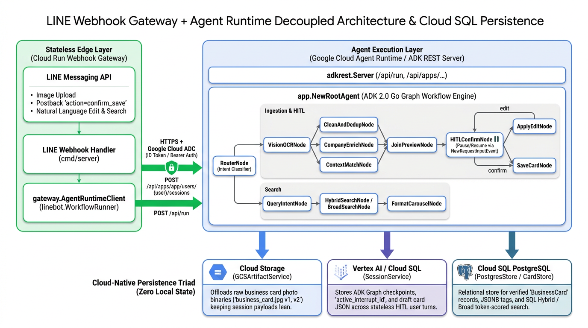
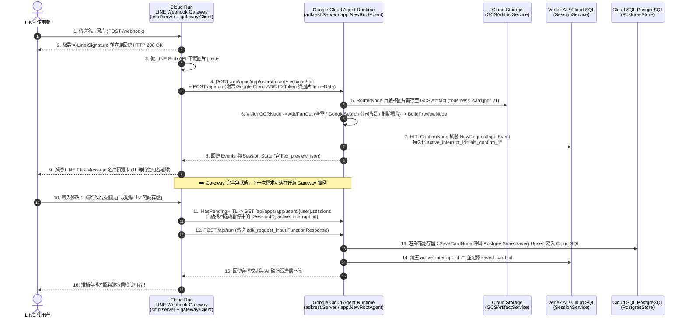

# 前情提要

在《Agent Platform 實戰》系列的前三篇文章中，我們一步步將 **LINE AI 名片王 (`line-card-assistant`)** 從概念原型推向雲端原生架構：
- **[[Agent Platform 實戰 (1)] 用 Go 與 Google ADK 2.0 Graph Workflow 打造 LINE AI 名片王](/2026/10/16/adk-graph-workflow-go/)**：我們用 `google.golang.org/adk/v2/workflow` 打造了 12 個節點的名片處理圖（Graph Workflow），涵蓋 Vision OCR、`AddFanOut` / `AddFanIn` 平行背景調查，以及 `NewRequestInputEvent` 的 HITL（Human-in-the-Loop）暫停與修改迴圈。
- **[[Agent Platform 實戰 (2)] 從單體 Cloud Run 邁向 Google Cloud Agent Runtime：用 agents-cli 與 ADK Go 重構 LINE AI 名片王](/2026/10/17/adk-graph-workflow-go-2/)**：完成 **Phase 1（[PR #10](https://github.com/kkdai/line-card-assistant/pull/10)）**，導入 `agents-cli` (`adk_go`) 標準雙通道架構，讓專案同時支援 LINE Webhook、ADK WebUI Playground 與 A2A 協定。
- **[[Agent Platform 實戰 (3)] 破解無狀態容器的 HITL 失憶症：用 ADK 2.0 GCS Artifact Service 與 Agent Platform Sessions 實現跨實例名片辨識與暫停恢復](/2026/10/20/adk-graph-workflow-go-3/)**：完成 **Phase 2 前半（[PR #11](https://github.com/kkdai/line-card-assistant/pull/11)）**，用 `artifact/gcsartifact` 將幾 MB 的名片照片移出 `Session.State`，並結合 `session/vertexai` 實作 `resolvePendingHITL`，讓無狀態容器即使縮容至 0 或切換實例，也能無縫接續 HITL 修改與確認存檔。

今天這篇系列文的第四集，我們要一口氣完成 **Phase 2 最後一塊拼圖（[Issue #5](https://github.com/kkdai/line-card-assistant/issues/5)）** 與 **Phase 3 核心架構升級（[Issue #6](https://github.com/kkdai/line-card-assistant/issues/6)）**（對應 **[PR #12](https://github.com/kkdai/line-card-assistant/pull/12)**）：
1. **雲端名片資料庫持久化（`PostgresStore` / Cloud SQL）**：將原本存在本地記憶體或容器暫存檔的名片庫，正式升級為支援 **Cloud SQL PostgreSQL** 的關聯式與 JSON 混合儲存，並打通 `HybridSearch` 與 Token 計分容錯的 `BroadSearch`。
2. **雙層解耦呼叫架構（Cloud Run LINE Webhook Gateway $\rightarrow$ Agent Runtime）**：將負責「LINE 驗章與圖片下載」的輕量邊緣層（Edge Layer），與負責「ADK 2.0 Graph Workflow 多模態推論與搜尋」的執行層（Execution Layer）徹底解耦！

---

# 一、為什麼我們需要「雲端持久化鐵三角」與「雙層解耦架構」？

當我們把 `line-card-assistant` 部署到 Google Cloud 生產環境時，如果仔細檢視系統裡的每一份資料與每一個元件的職責，會發現還有兩個關鍵問題必須解決：

## 1. 最後一個殘留的「本地狀態」：`CardStore` 名片資料庫
在上一篇（PR #11）中，我們已經把 **「原始名片照片」** 放到 **Google Cloud Storage (`GCSArtifactService`)**，並把 **「工作流執行狀態與 HITL 斷點」** 放到 **Vertex AI / Cloud SQL (`SessionService`)**。
但當使用者在 LINE 按下「✅ 確認存檔」走到 `SaveCardNode` 時，最終確認好的名片資料（`models.BusinessCard`）如果還是寫在單機記憶體 `MemoryStore` 或容器內的本地 SQLite 檔案：
- **容器重啟或 Scale-to-Zero 就清空**：一旦 Agent Runtime 實例縮容至 0，辛苦建立的人脈名片庫就會瞬間蒸發。
- **多實例無法共享搜尋結果**：當使用者在實例 A 存了一張名片，下一秒搜尋請求被路由到實例 B，`HybridSearchNode` 在實例 B 的記憶體裡根本找不到剛剛存的那張名片！

因此，我們必須補齊 **「雲端無狀態持久化鐵三角（Cloud-Native Persistence Triad）」** 的最後一角 —— **Cloud SQL PostgreSQL (`PostgresStore`)**：

| 持久化維度 | 負責儲存的內容 | 雲端後端服務 | ADK / Go 實作套件 |
| :--- | :--- | :--- | :--- |
| **1. 二進位大檔 (Artifacts)** | 原始名片照片 (`business_card.jpg` v1, v2...) | **Google Cloud Storage (GCS)** | `sessions.NewArtifactService` (`artifact/gcsartifact`) |
| **2. 對話與圖斷點 (Sessions)** | Graph Checkpoints、`active_interrupt_id`、`draft_card` | **Vertex AI Agent Engine / Cloud SQL** | `sessions.NewService` (`session/vertexai`, `session/database`) |
| **3. 結構化業務資料 (Domain DB)** | 已驗證的 `BusinessCard` 正式紀錄、JSON 產業標籤、混合檢索 | **Cloud SQL for PostgreSQL** | `store.NewStore` (`internal/store/postgres.go`) |

---

## 2. 為什麼要把 LINE Webhook Gateway 與 Agent Runtime 拆成雙層架構？

在單體（All-in-One）模式下，`cmd/server` 在同一個處理序裡同時接收 LINE Webhook、跑 Vision OCR、又跑三個平行 Grounding 搜尋節點。但在企業級 Google Cloud Agent Platform 架構中，將系統拆分為 **「Cloud Run LINE Webhook Gateway（邊緣層）」** 與 **「Google Cloud Agent Runtime（Agent 執行層）」** 有三大優勢：

1. **公開 Webhook 驗章與內部 IAM 權限隔離**：
   - LINE Messaging API 需要一個公開的 HTTPS Endpoint (`POST /webhook`) 來推送事件，並使用 `LINE_CHANNEL_SECRET` 驗證 `X-Line-Signature` 簽章，且必須在 **1~2 秒內立即回傳 `200 OK`**。
   - 而真正的 **Agent Runtime** 只需要透過 **Google Cloud IAM / Application Default Credentials (ADC)** 對內授權，完全不需要暴露在無驗證的公網流量下，也不必持有 LINE Channel Secret。
2. **多通道共用同一個有狀態（Session-backed）的遠端 Agent**：
   - 解耦之後，無論使用者是從 **LINE Bot** 傳名片照片、從企業內部的 **Gemini Enterprise (A2A)** 查詢人脈，還是開發者從 **ADK WebUI** 測試，背後呼叫的都是**同一個託管在 Agent Runtime 上的 `app.NewRootAgent`**！
3. **極致的彈性部署（All-in-One vs. Decoupled 一鍵切換）**：
   - 本機開發或小型專案時，不設定 `AGENT_RUNTIME_URL`，`cmd/server` 就自動以 **All-in-One 單體模式** 執行；
   - 到了生產環境，只要在 Cloud Run 設定 `AGENT_RUNTIME_URL=https://...`，`cmd/server` 就自動切換為 **輕量無狀態的 LINE Webhook Gateway**！

我們用一張完整的系統循序圖來看看雙層解耦下的跨層互動：



---

# 二、實戰拆解 (1)：打造 Cloud SQL PostgreSQL 名片庫 (`internal/store/postgres.go`) — Issue #5

在我們的專案中，因為先前 `sessions/sessions.go` 為了支援 `SESSION_TYPE=cloud_sql` 已經引入了 `gorm.io/gorm` 與 `gorm.io/driver/postgres`，我們完全不需要額外膨脹依賴樹，就能直接用 GORM 為 `CardStore` 打造生產級的 **`PostgresStore`**！

## 1. 擴充 `store.CardStore` 介面：讓所有後端原生支援 `BroadSearch`
在檢查原有的 [`internal/workflow/nodes_search.go`](https://github.com/kkdai/line-card-assistant/blob/main/internal/workflow/nodes_search.go) 時，我們發現原本 `BroadSearchNode` 裡有一段針對 `*store.MemoryStore` 的型別斷言（Type Assertion）：

```go
// ❌ 舊版寫法：只有 MemoryStore 支援 BroadSearch，其他 Store 只好退回 ListByUser
if memStore, ok := cardStore.(*store.MemoryStore); ok {
    cards, err = memStore.BroadSearch(ctx, userID, keywords)
} else {
    cards, err = cardStore.ListByUser(ctx, userID)
}
```

為了讓 `PostgresStore` 與 `MemoryStore` 享有完全一致的混合檢索與模糊降級體驗，我們在 [`internal/store/store.go`](https://github.com/kkdai/line-card-assistant/blob/main/internal/store/store.go) 中正式將 `BroadSearch` 納入 `CardStore` 標準介面：

```go
// CardStore defines the persistence and search interface for business cards.
type CardStore interface {
	Save(ctx context.Context, card *models.BusinessCard) error
	GetByID(ctx context.Context, id string) (*models.BusinessCard, error)
	CheckDuplicate(ctx context.Context, userID, name, company, email string) (*models.BusinessCard, bool, error)
	HybridSearch(ctx context.Context, filter models.SearchFilter) ([]*models.BusinessCard, error)
	BroadSearch(ctx context.Context, userID string, keywords []string) ([]*models.BusinessCard, error)
	ListByUser(ctx context.Context, userID string) ([]*models.BusinessCard, error)
}
```

如此一來，`BroadSearchNode` 只需要乾淨俐落地呼叫一行 `cardStore.BroadSearch(ctx, userID, keywords)` 即可！

## 2. 設計 GORM Schema 與 Upsert 機制 (`BusinessCardRecord`)
在 [`internal/store/postgres.go`](https://github.com/kkdai/line-card-assistant/blob/main/internal/store/postgres.go) 中，我們定義了對應 PostgreSQL `business_cards` 資料表的 `BusinessCardRecord`，針對常用查詢欄位（`user_id`, `name`, `company`, `email`, `met_date`, `updated_at`）加上索引，並將 `Tags []string` 序列化為 JSON 字串儲存於 `tags_json`：

```go
// BusinessCardRecord is the GORM database model for persisting a models.BusinessCard
// in PostgreSQL / Cloud SQL.
type BusinessCardRecord struct {
	ID             string    `gorm:"primaryKey;size:128"`
	UserID         string    `gorm:"index;size:128;not null"`
	Name           string    `gorm:"index;size:255"`
	Title          string    `gorm:"size:255"`
	Company        string    `gorm:"index;size:255"`
	Email          string    `gorm:"index;size:255"`
	Phone          string    `gorm:"size:64"`
	Address        string    `gorm:"type:text"`
	TaxID          string    `gorm:"size:32"`
	Website        string    `gorm:"size:512"`
	RawOCR         string    `gorm:"type:text"`
	CompanySummary string    `gorm:"type:text"`
	CompanyInfo    string    `gorm:"type:text"`
	TagsJSON       string    `gorm:"column:tags_json;type:text"`
	MetContext     string    `gorm:"type:text"`
	RawImageURL    string    `gorm:"type:text"`
	MetDate        time.Time `gorm:"index"`
	CreatedAt      time.Time `gorm:"index"`
	UpdatedAt      time.Time `gorm:"index"`
}
```

當使用者拍到一張已經存在的人脈名片（例如對方從「資深工程師」升遷為「技術副總」，經由 `CleanAndDedupNode` 識別出重複並複用原本的 `card.ID`），`PostgresStore.Save` 會透過 PostgreSQL 原生的 `ON CONFLICT (id) DO UPDATE` (`clause.OnConflict{UpdateAll: true}`) 完成原子級 Upsert：

```go
if err := s.db.WithContext(ctx).Clauses(clause.OnConflict{
	Columns:   []clause.Column{{Name: "id"}},
	UpdateAll: true,
}).Create(rec).Error; err != nil {
	return fmt.Errorf("upsert business card %q: %w", cp.ID, err)
}
```

## 3. 自動感知 Cloud SQL Unix Socket 與環境變數的 `store.NewStore(ctx)` 工廠
在 Cloud Run 或 Agent Runtime 連接 Cloud SQL 時，官方推薦透過 Cloud SQL Auth Proxy 建立的 Unix Domain Socket (`/cloudsql/<PROJECT>:<REGION>:<INSTANCE>`) 連線；而在本機或 GKE 則常使用 `DATABASE_URL` 或 `DB_HOST`。
我們在 `BuildPostgresDSNFromEnv()` 與 `store.NewStore(ctx)` 中同時支援這三種模式，且在未設定資料庫環境變數時**自動無縫降級回預載 4 張台灣範例名片的 `MemoryStore`**：

```go
// BuildPostgresDSNFromEnv resolves a PostgreSQL / Cloud SQL connection string from environment variables.
// Priority:
//  1. CARD_STORE_DSN / DATABASE_URL / POSTGRES_DSN
//  2. Cloud SQL Unix socket when INSTANCE_CONNECTION_NAME + DB_PASS are set
//  3. Standard TCP host when DB_HOST + DB_PASS are set
func BuildPostgresDSNFromEnv() string {
	for _, key := range []string{"CARD_STORE_DSN", "DATABASE_URL", "POSTGRES_DSN"} {
		if v := strings.TrimSpace(os.Getenv(key)); v != "" {
			return v
		}
	}

	dbUser := envOrDefault("DB_USER", "postgres")
	dbName := envOrDefault("DB_NAME", "postgres")
	dbPass := strings.TrimSpace(os.Getenv("DB_PASS"))
	instanceConn := strings.TrimSpace(os.Getenv("INSTANCE_CONNECTION_NAME"))
	if instanceConn != "" && dbPass != "" {
		return fmt.Sprintf(
			"host=/cloudsql/%s user=%s password=%s dbname=%s sslmode=disable",
			instanceConn, dbUser, dbPass, dbName,
		)
	}
    // ...
}
```

如此一來，只要你的環境裡已經為了 `SESSION_TYPE=cloud_sql` 設定好 `INSTANCE_CONNECTION_NAME` 與 `DB_PASS`，**`SessionService` 與 `CardStore` 就能直接共用同一個 Cloud SQL PostgreSQL 實例**，連一毛錢的額外資料庫成本都不必多花！

---

# 三、實戰拆解 (2)：打造無狀態 LINE Webhook Gateway 與遠端 `AgentRuntimeClient` (`internal/gateway/client.go`) — Issue #6

接下來是 Phase 3 最核心的工程：**如何讓 `cmd/server` 的 LINE Bot Webhook Handler 不必在本地跑 `workflow.Engine`，而是透過 HTTP 將所有名片辨識、HITL 恢復、搜尋與破冰信請求轉發給遠端的 Agent Runtime？**

還記得我們在第一版設計 `internal/linebot/handler.go` 時，就已經先見之明地把 Webhook Handler 與 Workflow Engine 之間隔了一層 **`linebot.WorkflowRunner` 介面** 嗎？

```go
// internal/linebot/handler.go
type WorkflowRunner interface {
	HasPendingHITL(userID string) bool
	RecordUserMessage(userID, text string)
	StartIngest(ctx context.Context, userID string, imageBytes []byte, recentMessages []string) (*WorkflowResponse, error)
	ResumeHITL(ctx context.Context, userID string, userReply string) (*WorkflowResponse, error)
	RunSearch(ctx context.Context, userID string, query string) (*WorkflowResponse, error)
	RunEmailDraft(ctx context.Context, userID string, cardID string) (*WorkflowResponse, error)
}
```

正因為有這個乾淨的介面，我們的 `linebot.Handler` **一行程式碼都不用改**！我們只需要在 [`internal/gateway/client.go`](https://github.com/kkdai/line-card-assistant/blob/main/internal/gateway/client.go) 中實作一個滿足 `linebot.WorkflowRunner` 介面的 **`gateway.Client`**！

## 1. 支援 Google Cloud ADC 自動簽發 Token 的 `gateway.NewClient`
當 Cloud Run 上的 LINE Webhook Gateway 要呼叫受 IAM 保護的遠端 Agent Runtime（或另一座內部 Cloud Run 上的 ADK REST Server）時，`gateway.NewClient` 會自動透過 `google.golang.org/api/idtoken`（或 `golang.org/x/oauth2/google`）取得目前 Service Account 的 Google Cloud ADC 憑證，並自動附加在每個 HTTP 請求的 `Authorization: Bearer <token>` Header 中：

```go
func NewClient(ctx context.Context, baseURL string, useADC bool, opts ...ClientOption) (*Client, error) {
	trimmed := strings.TrimRight(strings.TrimSpace(baseURL), "/")
	if trimmed == "" {
		return nil, fmt.Errorf("agent runtime baseURL cannot be empty")
	}
	if !strings.HasSuffix(trimmed, "/api") {
		trimmed += "/api"
	}

	hc := &http.Client{Timeout: 60 * time.Second}
	if useADC {
		if idClient, err := idtoken.NewClient(ctx, strings.TrimSuffix(trimmed, "/api")); err == nil {
			hc = idClient
		} else if oauthClient, err := google.DefaultClient(ctx, "https://www.googleapis.com/auth/cloud-platform"); err == nil {
			hc = oauthClient
		}
	}
    // ...
}
```

## 2. 跨層轉發名片圖片：Gateway 下載圖片 $\rightarrow$ Agent Runtime 自動寫入 GCS Artifact
當使用者在 LINE 上傳一張名片照片時：
1. Gateway 從 LINE Blob API 下載圖片 `imageBytes`。
2. `gateway.Client.StartIngest` 先呼叫遠端 ADK REST API 的 `POST /api/apps/{appName}/users/{userID}/sessions/{sessionID}` 建立工作階段。
3. 接著呼叫 `POST /api/run`，將 `imageBytes` 包裝在 `newMessage.Parts` 的 `InlineData` 中送給遠端 Agent Runtime：

```go
func (c *Client) StartIngest(ctx context.Context, userID string, imageBytes []byte, recentMessages []string) (*linebot.WorkflowResponse, error) {
	sessionID := "ingest-" + uuid.NewString()
	initialState := map[string]any{
		workflow.StateKeyInputType:      workflow.RouteIngest,
		workflow.StateKeyUserID:         userID,
		workflow.StateKeyRecentMessages: recentMessages,
	}
	if err := c.createSession(ctx, userID, sessionID, initialState); err != nil {
		return nil, err
	}

	parts := []*genai.Part{
		{Text: workflow.RouteIngest},
	}
	if len(imageBytes) > 0 {
		parts = append(parts, &genai.Part{
			InlineData: &genai.Blob{
				MIMEType: "image/jpeg",
				Data:     imageBytes,
			},
		})
	}
	msg := &genai.Content{
		Role:  genai.RoleUser,
		Parts: parts,
	}

	res, err := c.runTurn(ctx, userID, sessionID, msg, initialState)
    // ...
}
```

這時我們在上一篇（Phase 2）在 `RouterNode` 寫好的邏輯就發揮了神效：當遠端 Agent Runtime 的 `RouterNode` 收到這個帶有 `InlineData` 的請求時，它會**自動呼叫 `ctx.Artifacts().Save(ctx, "business_card.jpg", ...)` 把圖片存進 GCS Artifact Bucket**，並在 `Session.State` 裡只留下輕量的 `card_image_artifact` 與 `card_image_version`！
這意味著 **LINE Webhook Gateway 甚至不需要直接掛載 GCS Bucket 的寫入權限**，就能讓遠端 Agent Runtime 完成 GCS Artifact 的版本化歸檔！

## 3. 跨層級的無狀態 HITL 斷點探索與恢復 (`resolvePendingHITL` + `ResumeHITL`)
最精彩的部分在於：當使用者看到 LINE Flex 預覽卡，過了 5 分鐘輸入「*職稱改為技術長*」，而這筆 Webhook 請求落在了**另一台全新的 Cloud Run Gateway 實例**上時，`gateway.Client` 怎麼知道這個使用者在遠端 Agent Runtime 有一個正在等待確認的 HITL Session？

我們在 `gateway.Client.resolvePendingHITL` 中透過 ADK REST API 的 `GET /api/apps/{appName}/users/{userID}/sessions` 端點，直接向遠端 Agent Runtime 查詢該使用者的工作階段狀態，並檢視 `state["active_interrupt_id"]`：

```go
func (c *Client) resolvePendingHITL(ctx context.Context, userID string) (pendingHITL, bool) {
	// 1. 若本地快取已有 SessionID，直接向遠端 GET /sessions/{id} 取得最新的 active_interrupt_id
	//    （重要！因為每次進入 Edit 迴圈後，hitl_seq 會遞增為 hitl_confirm_2、hitl_confirm_3...）
	c.mu.RLock()
	cached, hasCached := c.pendingSession[userID]
	c.mu.RUnlock()
	if hasCached && cached.SessionID != "" {
		if fullSess, err := c.getSession(ctx, userID, cached.SessionID); err == nil && fullSess != nil {
			if activeID := readStringFromMap(fullSess.State, workflow.StateKeyActiveInterruptID); activeID != "" {
				found := pendingHITL{SessionID: cached.SessionID, InterruptID: activeID}
				c.mu.Lock()
				c.pendingSession[userID] = found
				c.mu.Unlock()
				return found, true
			}
		}
	}

	// 2. 若這是一台全新的無狀態 Gateway 實例，呼叫遠端 GET /sessions 找出帶有 active_interrupt_id 的工作階段
	sessions, err := c.listSessions(ctx, userID)
	if err != nil {
		return pendingHITL{}, false
	}
	for _, sess := range sessions {
		activeID := readStringFromMap(sess.State, workflow.StateKeyActiveInterruptID)
		if activeID == "" && sess.ID != "" {
			if fullSess, err := c.getSession(ctx, userID, sess.ID); err == nil && fullSess != nil {
				activeID = readStringFromMap(fullSess.State, workflow.StateKeyActiveInterruptID)
			}
		}
		if activeID != "" {
			found := pendingHITL{SessionID: sess.ID, InterruptID: activeID}
			c.mu.Lock()
			c.pendingSession[userID] = found
			c.mu.Unlock()
			return found, true
		}
	}
	return pendingHITL{}, false
}
```

這裡有一個我們在撰寫整合測試時抓到的真實 Bug 與關鍵細節：
- 當使用者在 Turn 1 上傳名片時，`HITLConfirmNode` 產生的第一個斷點 ID 是 **`hitl_confirm_1`**。
- 當使用者在 Turn 2（可能由 Gateway 實例 2 處理）輸入「*職稱改為技術長*」後，`ApplyEditNode` 修改完職稱並繞回 `HITLConfirmNode` 再次暫停，這時斷點 ID 會遞增為 **`hitl_confirm_2`**！
- 如果此時 Turn 3（使用者按下「✅ 確認存檔」）剛好又回到 Gateway 實例 1，若實例 1 盲目相信自己記憶體裡舊的快取（`hitl_confirm_1`），送出的 `FunctionResponse` 就不會匹配最新的斷點 `hitl_confirm_2`！
- 因此，我們在 `resolvePendingHITL` 中確保：**即使本地快取命中了 `SessionID`，也會透過 `getSession` 同步遠端最新的 `active_interrupt_id`**。這樣一來，無論請求在幾台 Gateway 實例之間如何來回跳躍、修改了幾次欄位，永遠都能精準對齊最新的 `InterruptID`！

## 4. `cmd/server/main.go`：單體模式與雙層 Gateway 模式無縫切換
最後，我們在 [`cmd/server/main.go`](https://github.com/kkdai/line-card-assistant/blob/main/cmd/server/main.go) 中加上模式判斷：

```go
	var runner linebot.WorkflowRunner
	if cfg.AgentRuntimeURL != "" {
		// 🌐 模式 A：雙層解耦 LINE Webhook Gateway 模式 (轉發至遠端 Agent Runtime)
		gwClient, err := gateway.NewClient(
			ctx,
			cfg.AgentRuntimeURL,
			cfg.AgentRuntimeUseADC,
			gateway.WithAppName(cfg.AgentRuntimeAppName),
		)
		if err != nil {
			slog.Error("failed to initialize remote Agent Runtime gateway client", "url", cfg.AgentRuntimeURL, "err", err)
			os.Exit(1)
		}
		slog.Info("running in decoupled LINE Webhook Gateway mode",
			"agent_runtime_url", cfg.AgentRuntimeURL,
			"agent_runtime_app", cfg.AgentRuntimeAppName,
			"use_adc", cfg.AgentRuntimeUseADC,
		)
		runner = gwClient
	} else {
		// 🚀 模式 B：All-in-One 本地 Engine 模式 (預設本機開發與單一容器部署)
		cardStore, err := store.NewStore(ctx)
        // ... 初始化本地 workflow.NewEngine ...
		runner = engine.LinebotRunner()
	}

	botHandler, err := linebot.NewHandler(cfg, runner)
```

---

# 四、端到端雙層架構整合測試 (`internal/gateway/client_test.go`)

為了確保 `gateway.Client` 與 ADK Go v2.6.0 官方的 `server/adkrest` REST 伺服器百分之百相容，我們在 [`internal/gateway/client_test.go`](https://github.com/kkdai/line-card-assistant/blob/main/internal/gateway/client_test.go) 中直接用 `httptest.NewServer` 啟動了一台真實的 **`adkrest.NewServer`**（掛載我們的 `app.NewRootAgentWithDeps`），並建立兩個完全獨立的 Gateway Client（`client1` 與 `client2`）進行五階段端到端測試：

1. **Turn 1 (`client1.StartIngest`)**：透過 HTTP 上傳名片照片 $\rightarrow$ 驗證遠端 `ArtifactService` 成功寫入 `business_card.jpg` $\rightarrow$ 驗證回傳 `WaitingHITL=true`（`hitl_confirm_1`）與包含「王大明」的 LINE Flex Preview JSON。
2. **跨實例狀態探測 (`client2.HasPendingHITL`)**：全新的無狀態 `client2` 透過 `GET /api/apps/app/users/{user}/sessions` 探測到 `client1` 建立的暫停工作階段。
3. **Turn 2 (`client2.ResumeHITL` — 自然語言修改)**：`client2` 發送「*職稱改為技術長*」$\rightarrow$ 驗證遠端執行 `ApplyEditNode` 並更新 `DraftCard.Title == "技術長"`，且再次暫停於 `hitl_confirm_2`。
4. **Turn 3 (`client1.ResumeHITL` — 確認存檔)**：切回 `client1` 發送 `"action=confirm_save"` $\rightarrow$ `client1` 自動同步最新斷點 `hitl_confirm_2` 並喚醒 `SaveCardNode` $\rightarrow$ 驗證名片成功寫入遠端 `CardStore` 且回傳 AI 破冰信。
5. **Turn 4 & Turn 5 (`client2.RunSearch` & `client2.RunEmailDraft`)**：透過 HTTP 呼叫遠端混合搜尋與單獨撰寫破冰信，驗證回傳 Flex Carousel JSON 與破冰信內文。

執行完整測試套件：

```bash
$ go test -race -v ./...
=== RUN   TestGatewayClient_EndToEndDecoupledIngestHITLAndSearch
--- PASS: TestGatewayClient_EndToEndDecoupledIngestHITLAndSearch (0.01s)
=== RUN   TestBusinessCardRecordRoundTrip
--- PASS: TestBusinessCardRecordRoundTrip (0.00s)
=== RUN   TestBuildPostgresDSNFromEnv
--- PASS: TestBuildPostgresDSNFromEnv (0.00s)
=== RUN   TestNewStoreFactoryFallback
--- PASS: TestNewStoreFactoryFallback (0.00s)
=== RUN   TestRankCardsByKeywords
--- PASS: TestRankCardsByKeywords (0.00s)
PASS
```

所有單元測試與跨層整合測試在開啟 `-race` 競爭檢測下全數綠燈通過！

---

# 五、總結與 Roadmap 進度盤點

完成 **[PR #12](https://github.com/kkdai/line-card-assistant/pull/12)** 後，我們回頭看 **[Roadmap Issue #9](https://github.com/kkdai/line-card-assistant/issues/9)** 的五大階段，目前 **Phase 1、Phase 2 與 Phase 3 已經 100% 全部完成**！

- [x] **Phase 1 (`agents-cli` & `adk_go` Scaffolding)**：完成 Issue [#1](https://github.com/kkdai/line-card-assistant/issues/1)、[#2](https://github.com/kkdai/line-card-assistant/issues/2)（[PR #10](https://github.com/kkdai/line-card-assistant/pull/10)）
- [x] **Phase 2 (Agent Runtime 適配與雲端持久化鐵三角)**：完成 Issue [#3](https://github.com/kkdai/line-card-assistant/issues/3)、[#4](https://github.com/kkdai/line-card-assistant/issues/4)（[PR #11](https://github.com/kkdai/line-card-assistant/pull/11)）與 Issue [#5](https://github.com/kkdai/line-card-assistant/issues/5)（[PR #12](https://github.com/kkdai/line-card-assistant/pull/12)）
- [x] **Phase 3 (LINE Webhook Gateway 與 Agent Runtime 雙層解耦架構)**：完成 Issue [#6](https://github.com/kkdai/line-card-assistant/issues/6)（[PR #12](https://github.com/kkdai/line-card-assistant/pull/12)）
- [ ] **Phase 4 (`agents-cli eval` 自動化評估與基準測試)**：Issue [#7](https://github.com/kkdai/line-card-assistant/issues/7)
- [ ] **Phase 5 (Agent Runtime 正式部署、Terraform IaC 與 Cloud Trace 可觀測性)**：Issue [#8](https://github.com/kkdai/line-card-assistant/issues/8)

在接下來的系列文章中，我們將進入 **Phase 4 與 Phase 5**，使用 `agents-cli eval` 為這套 12 節點 Graph Workflow 建立自動化品質評估飛輪（Quality Flywheel），並透過 `agents-cli deploy` 與 OpenTelemetry 將整套系統正式部署上線，敬請期待！

---

## 參考資源與延伸閱讀

- **《Agent Platform 實戰》系列文章**：
  - [[Agent Platform 實戰 (1)] 用 Go 與 Google ADK 2.0 Graph Workflow 打造 LINE AI 名片王：從 Fan-Out 平行檢索到 HITL 暫停迴圈修正](/2026/10/16/adk-graph-workflow-go/)
  - [[Agent Platform 實戰 (2)] 從單體 Cloud Run 邁向 Google Cloud Agent Runtime：用 agents-cli 與 ADK Go 重構 LINE AI 名片王](/2026/10/17/adk-graph-workflow-go-2/)
  - [[Agent Platform 實戰 (3)] 破解無狀態容器的 HITL 失憶症：用 ADK 2.0 GCS Artifact Service 與 Agent Platform Sessions 實現跨實例名片辨識與暫停恢復](/2026/10/20/adk-graph-workflow-go-3/)
- **本專案開源程式碼與 PR**：
  - GitHub Repository：[kkdai/line-card-assistant](https://github.com/kkdai/line-card-assistant)
  - Phase 2 & 3 實作 Pull Request：[PR #12: feat(phase2-3): Cloud SQL PostgresStore (#5) & Decoupled LINE Webhook Gateway (#6)](https://github.com/kkdai/line-card-assistant/pull/12)
  - 已完成 Issues：[Issue #5](https://github.com/kkdai/line-card-assistant/issues/5)、[Issue #6](https://github.com/kkdai/line-card-assistant/issues/6)、[Roadmap #9](https://github.com/kkdai/line-card-assistant/issues/9)
- **Google ADK 與 Agent Platform 官方文件**：
  - [ADK Documentation (llms.txt)](https://google.github.io/adk-docs/llms.txt)
  - [Getting Started - agents-cli](https://google.github.io/agents-cli/guide/getting-started/)
