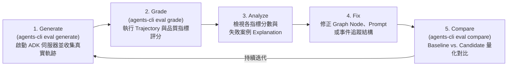

# 前情提要

在《Agent Platform 實戰》系列的前四篇文章中，我們一步步將 **LINE AI 名片王 (`line-card-assistant`)** 從單機原型推進為雲端原生、雙層解耦的 **Google Cloud Agent Platform** 架構：
- **[[Agent Platform 實戰 (1)] 用 Go 與 Google ADK 2.0 Graph Workflow 打造 LINE AI 名片王](/2026/10/16/adk-graph-workflow-go/)**：使用 `google.golang.org/adk/v2/workflow` 打造 12 個節點的名片處理圖（Graph Workflow），涵蓋 Vision OCR、`AddFanOut` / `AddFanIn` 平行背景調查，以及 `NewRequestInputEvent` 的 HITL（Human-in-the-Loop）暫停與修改迴圈。
- **[[Agent Platform 實戰 (2)] 從單體 Cloud Run 邁向 Google Cloud Agent Runtime：用 agents-cli 與 ADK Go 重構 LINE AI 名片王](/2026/10/17/adk-graph-workflow-go-2/)**：完成 **Phase 1（[PR #10](https://github.com/kkdai/line-card-assistant/pull/10)）**，導入 `agents-cli` (`adk_go`) 標準雙通道架構，同時支援 LINE Webhook、ADK WebUI Playground 與 A2A 協定。
- **[[Agent Platform 實戰 (3)] 破解無狀態容器的 HITL 失憶症：用 ADK 2.0 GCS Artifact Service 與 Agent Platform Sessions 實現跨實例名片辨識與暫停恢復](/2026/10/20/adk-graph-workflow-go-3/)**：完成 **Phase 2 前半（[PR #11](https://github.com/kkdai/line-card-assistant/pull/11)）**，用 `artifact/gcsartifact` 與 `session/vertexai` 讓無狀態容器支援跨實例 HITL 暫停與恢復。
- **[[Agent Platform 實戰 (4)] 邁向雲端雙層解耦與全持久化：用 Cloud Run LINE Webhook Gateway、Agent Runtime 與 Cloud SQL PostgreSQL 完成 LINE AI 名片王架構拼圖](/2026/10/21/adk-graph-workflow-go-4/)**：完成 **Phase 2 後半（[Issue #5](https://github.com/kkdai/line-card-assistant/issues/5)）** 與 **Phase 3（[Issue #6](https://github.com/kkdai/line-card-assistant/issues/6)，[PR #12](https://github.com/kkdai/line-card-assistant/pull/12)）**，將名片庫遷移至 Cloud SQL PostgreSQL (`PostgresStore`)，並實作無狀態的 Cloud Run LINE Webhook Gateway (`gateway.Client`)。

當架構與功能都到位、準備正式將 Agent 部署上雲端生產環境（Phase 5）之前，所有 AI 工程團隊都會面臨一個最核心的靈魂拷問：

> **「當我們修改了一行 Prompt、調整了一個 Graph Node 的路由條件，或是把底層模型從 `gemini-2.5-flash` 升級到 `gemini-3.8-flash` 時，怎麼確保名片 OCR 欄位不會漏抓、重複名片升遷偵測不會失效、HITL 修改迴圈不會卡死、混合搜尋不會退化？」**

今天這篇系列文的第五集，我們就要來實戰 **Phase 4（[Issue #7](https://github.com/kkdai/line-card-assistant/issues/7)，對應 [PR #13](https://github.com/kkdai/line-card-assistant/pull/13)）**：用 **`agents-cli eval`** 與 **ADK 2.0 Go 軌跡測試**，為 LINE AI 名片王打造一套可量化、可比較、可在 CI/CD 自動執行的 **AI Agent 品質飛輪（Quality Flywheel）**！

---

# 一、為什麼傳統 Unit Test 不夠用？認識 `agents-cli eval` 的「品質飛輪 (Quality Flywheel)」

在傳統軟體工程中，我們習慣寫 `if got != want` 的確定性單元測試（Unit Tests）。但在以 **ADK 2.0 Graph Workflow + 多模態 LLM** 驅動的 AI Agent 系統裡，我們要驗證的遠不只是單一函式的回傳值，而是整條 **「執行軌跡（Execution Trajectory）與狀態演進（State Delta）」**：

1. **多分支與平行匯聚（Fan-Out / Fan-In Trajectory）**：收到名片圖片時，`RouterNode` 是否正確走進 `VisionOCRNode`？接著有沒有同時觸發 `CleanAndDedupNode`、`CompanyEnrichNode`、`ContextMatchNode` 三個平行分支，並在 `JoinPreviewNode` 匯聚？
2. **中間狀態變更（Session `state_delta`）**：即便最終回傳給使用者的是一包 LINE Flex Message JSON，中間節點是否確實正規化了台灣手機號碼（`+886-912-345-678`）、是否偵測到了既有聯絡人升遷（`IsDuplicate=true`、`VP of Engineering` $\rightarrow$ `Chief Technology Officer (CTO)`）？
3. **Human-in-the-Loop (HITL) 暫停與多輪對話迴圈**：當 `HITLConfirmNode` 發出 `adk_request_input` 暫停事件後，使用者回覆「職稱改為技術副總，場合改為 COMPUTEX 2026 AI 論壇」並確認存檔，工作流是否真的走過 `ApplyEditNode` $\rightarrow$ `BuildPreviewNode` $\rightarrow$ `HITLConfirmNode` $\rightarrow$ `SaveCardNode`？
4. **檢索降級與內容錨定（Grounding）**：當嚴格的 `HybridSearchNode` 查無結果（0 筆）時，是否自動降級觸發 `BroadSearchNode`？產出的破冰跟進信草稿，是否真正引用了名片上的相遇場合與公司背景，而沒有發生幻覺（Hallucination）？

為了系統化解決這個問題，Google Cloud `agents-cli` 提出了 **Quality Flywheel（品質飛輪）** 的五步循環工作流：



---

# 二、揭秘 `agents-cli eval generate` 如何測試一個 Go 語言的 ADK 2.0 Agent？

很多剛接觸 `agents-cli` 的 Go 開發者會好奇：**「`agents-cli` 底層是用 Python 寫的 CLI 工具，它要怎麼去評估我用 Go 寫的 `adk/v2/workflow` Agent？」**

答案就藏在我們在 Phase 1 導入的 **`main.go`** 與 **`appinfo/appinfo.go`** 之中！當你執行：

```bash
DRY_RUN=true agents-cli eval generate --dataset eval/datasets/basic-dataset.json
```

`agents-cli` 會在背景自動完成以下四個步驟：

1. **自動編譯並啟動你的 Go Agent 伺服器**：
   `agents-cli` 讀取專案根目錄的 `agents-cli-manifest.yaml`（識別為 `template: adk_go`），在背景自動啟動：
   ```bash
   go run . web --port <random_port> api -path_prefix / a2a appinfo
   ```
2. **透過 `GET /apps/app/app-info` 反射內省 Agent 結構**：
   [`appinfo/appinfo.go`](https://github.com/kkdai/line-card-assistant/blob/main/appinfo/appinfo.go) 利用 Go 的 `reflect` 與 `unsafe` 走訪整棵 `workflowagent` 的 Edges 與 Nodes，把圖裡面鑲嵌的 `CompanyEnrichAgent`（`llmagent`）、Instruction 與工具宣告組裝成標準的 `AppInfo` JSON 回傳給 `agents-cli`。
3. **逐一建立 Session 並呼叫 `POST /run_sse` 收集事件串流**：
   針對 `eval/datasets/basic-dataset.json` 裡的每一個測試案例（`eval_case_id`），`agents-cli` 會先呼叫 `POST /apps/app/users/eval_user/sessions` 建立獨立 Session，再將測試案例的 `prompt` 送往 `POST /run_sse`，並將伺服器串流回傳的每一個 ADK Event（包含 `author`、`content`、`actions.state_delta`、`actions.requested_tool_confirmations` 等）完整錄製下來。
4. **輸出標準化軌跡檔 `artifacts/traces/traces_<timestamp>.json`**：
   測試完成後自動關閉 Go 伺服器，將完整軌跡存成 JSON，交給下一階段的 `agents-cli eval grade` 進行評分。

---

# 三、實戰設計：涵蓋 4 大核心場景的黃金評估集 (`eval/datasets/basic-dataset.json`)

為了完整覆蓋 [Issue #7](https://github.com/kkdai/line-card-assistant/issues/7) 定義的四大驗收場景，我們在 [`eval/datasets/basic-dataset.json`](https://github.com/kkdai/line-card-assistant/blob/main/eval/datasets/basic-dataset.json) 中設計了 **6 個黃金測試案例（Golden Eval Cases）**，並在每個案例的 `custom_Properties` 中標註預期的節點軌跡（`expected_nodes`）與狀態斷言：

| Eval Case ID | 對應核心場景 | 輸入 Prompt (模擬通道訊號) | 驗證重點 (`custom_Properties`) |
| :--- | :--- | :--- | :--- |
| **`case_1_ingest_fanout_fanin_ocr`** | **場景 1：名片辨識與平行增強** | `action=ingest&context=2026 Cloud Summit Taipei` | 驗證 `RouterNode` $\rightarrow$ `VisionOCRNode` $\rightarrow$ 平行 Fan-Out (`CleanAndDedupNode`, `CompanyEnrichNode`, `ContextMatchNode`) $\rightarrow$ `BuildPreviewNode` $\rightarrow$ `HITLConfirmNode` 暫停，且電話正規化為 `+886-912-345-678`。 |
| **`case_2_duplicate_promotion_detection`** | **場景 2：重複名片與升遷偵測** | `action=ingest&card=promotion_david_chen_appier&context=2026 AI DevFest Taipei` | 測試資料庫已存在 Appier 的 David Chen (`VP of Engineering`)，收到新名片 (`Chief Technology Officer (CTO)`) 時，`CleanAndDedupNode` 必須標記 `IsDuplicate=true` 並產生升遷提醒訊息。 |
| **`case_3_hitl_edit_and_confirm_loop`** | **場景 3：HITL 迴圈修正與存檔** | `action=ingest&context=2026 Cloud Summit Taipei&edit=職稱改為技術副總，場合改為 COMPUTEX 2026 AI 論壇&hitl_action=confirm` | 驗證從 OCR 預覽 $\rightarrow$ `ApplyEditNode` 語意修改職稱與場合 $\rightarrow$ `BuildPreviewNode` 重新渲染預覽 $\rightarrow$ `HITLConfirmNode` 確認 $\rightarrow$ `SaveCardNode` 寫入資料庫並產出跟進信。 |
| **`case_4a_hybrid_search_cloud_summit_ai`** | **場景 4a：自然語言混合檢索** | `幫我找在 Cloud Summit 認識做 AI 的人` | 驗證 `QueryIntentNode` 將口語轉為 `SearchFilter` $\rightarrow$ `HybridSearchNode` 命中 2 張名片 $\rightarrow$ `FormatCarouselNode` 輸出 Flex Carousel JSON。 |
| **`case_4b_broad_search_fallback`** | **場景 4b：0 筆自動降級模糊檢索** | `幫我找在東京電玩展認識做量子金融區塊鏈的張三` | 驗證當 `HybridSearchNode` 查無結果 (`0 hits`) 時，條件路由自動降級至 `BroadSearchNode` 執行 Token 模糊檢索，避免空白回覆。 |
| **`case_4c_personalized_icebreaker_email`** | **場景 4c：個人化破冰跟進信** | `action=draft_email&card_id=card-seed-1` | 驗證 `EmailDraftNode` 根據指定名片的 `MetContext` (`2026 Cloud Summit Taipei`) 與 `CompanyInfo` (`Google Cloud Taiwan`) 撰寫無幻覺的商業破冰信。 |

---

# 四、真實踩坑與偵錯實錄：為什麼第一次跑 `agents-cli eval grade` 時軌跡分數是 `0.0000`？

在寫好 [`eval/eval_config.yaml`](https://github.com/kkdai/line-card-assistant/blob/main/eval/eval_config.yaml) 與 [`eval/metrics.py`](https://github.com/kkdai/line-card-assistant/blob/main/eval/metrics.py) 之後，我們滿懷信心地跑了第一次 Baseline 評估：

```bash
DRY_RUN=true agents-cli eval run --config eval/eval_config.yaml
```

結果終端機印出的第一次 Baseline 成績單（`results_20261022_223104.json`）讓我們大吃一驚：

```text
╭─ Evaluation Summary ───────────────────────────╮
│ Metric                        Score   Valid    │
│ ────────────────────────────────────────────── │
│ workflow_trajectory_accuracy  0.0000  6/6      │
│ ocr_and_enrichment_quality    1.0000  6/6      │
│ duplicate_and_hitl_precision  0.7333  6/6      │
│ search_and_email_grounding    1.0000  6/6      │
╰────────────────────────────────────────────────╯
```

同時，在 `agents-cli eval grade` 的執行 Log 中出現了一行非常關鍵的警告訊息：

> `Dropped 26 event(s) with no content; the eval service rejects them`

### 🔍 追根究底：原來 `drop_empty_content_events` 把中間節點的事件過濾掉了！

為什麼會被丟掉 26 個事件？我們立刻檢查了 ADK Go `workflow.FunctionNode` 的實作與 `agents-cli` 的事件前處理邏輯：
1. 在我們原本的 [`internal/workflow/nodes_ingest.go`](https://github.com/kkdai/line-card-assistant/blob/main/internal/workflow/nodes_ingest.go) 與 [`internal/workflow/nodes_search.go`](https://github.com/kkdai/line-card-assistant/blob/main/internal/workflow/nodes_search.go) 中，像 `RouterNode`、`VisionOCRNode`、`CleanAndDedupNode`、`CompanyEnrichNode`、`ContextMatchNode`、`QueryIntentNode` 這些**中間處理節點（Intermediate Nodes）**，原本只負責把結果寫進 `ev.Actions.StateDelta`（例如 `ev.Actions.StateDelta["draft_card"] = ...`），而讓 **`ev.Content` 保持為 `nil`**；只有最後一個負責輸出的節點（如 `BuildPreviewNode`、`SaveCardNode`、`FormatCarouselNode`）才會設定 `ev.Content`。
2. 但在 `agents-cli eval grade` 將軌跡送入評分器之前，底層的 `drop_empty_content_events()` 為了相容雲端 Vertex AI Eval Service 的 Schema 限制，**會把所有 `event.content == null` 的事件直接從 `agent_data.turns[].events` 中剔除！**
3. 一旦中間節點事件因為 `content == nil` 被剔除，附掛在該事件上的 `actions.state_delta` 與節點執行紀錄也跟著一起消失了！導致評分器只看到最後一個節點的輸出，因此 `workflow_trajectory_accuracy` 直接拿到 `0.0000`！

### 🛠️ 優雅解法：為中間節點加上結構化軌跡摘要 `setNodeTrace`

找到根因之後，解法就非常清晰且優雅了！我們在 [`internal/workflow/nodes_ingest.go`](https://github.com/kkdai/line-card-assistant/blob/main/internal/workflow/nodes_ingest.go) 中設計了一個輕量的輔助函式 `setNodeTrace`：

```go
// setNodeTrace attaches a concise model text part to intermediate workflow node
// events so that `agents-cli eval` (which drops events with empty Content)
// retains the full node execution trajectory and state_delta history.
func setNodeTrace(ev *session.Event, nodeName, summary string) {
	if ev == nil || ev.Content != nil {
		return
	}
	ev.Content = genai.NewContentFromText(fmt.Sprintf("[%s] %s", nodeName, summary), genai.RoleModel)
}
```

接著在每一個中間節點結束前呼叫 `setNodeTrace`，例如：
- **`RouterNode`**：`setNodeTrace(ev, "RouterNode", "route="+route)`
- **`VisionOCRNode`**：`setNodeTrace(ev, "VisionOCRNode", fmt.Sprintf("ocr extracted name=%s company=%s title=%s", card.Name, card.Company, card.Title))`
- **`CleanAndDedupNode`**：`setNodeTrace(ev, "CleanAndDedupNode", fmt.Sprintf("phone=%s is_duplicate=%v", card.Phone, isDup))`
- **`CompanyEnrichNode`**：`setNodeTrace(ev, "CompanyEnrichNode", fmt.Sprintf("company_info=%s tags=%v", card.CompanyInfo, card.Tags))`
- **`ContextMatchNode`**：`setNodeTrace(ev, "ContextMatchNode", "met_context="+card.MetContext)`
- **`QueryIntentNode` / `HybridSearchNode` / `BroadSearchNode`**：記錄轉換後的 `SearchFilter` 與命中的名片數量。

同時，為了避免中間節點的 `[NodeName] ...` 軌跡文字蓋掉 `Engine.executeTurn` 最終要回傳給 LINE 呼叫端的 `ReplyText`，我們同步強化了 [`internal/workflow/graph.go`](https://github.com/kkdai/line-card-assistant/blob/main/internal/workflow/graph.go) 的狀態收斂邏輯 —— 讓 `TurnResult` 直接從最終收斂的 `Session.State` 讀取權威的 `StateKeyReplyText`、`StateKeyFlexPreviewJSON`、`StateKeyFlexCarouselJSON` 與 `StateKeyDraftEmail`！

---

# 五、轉動品質飛輪：從 Baseline 到 Candidate 四大指標全數 `1.0000`！

加上 `setNodeTrace` 並支援單輪批次 HITL 修改驗證後，我們重新執行 `DRY_RUN=true agents-cli eval run --config eval/eval_config.yaml`：

```text
Loaded 6 cases from eval/datasets/basic-dataset.json
Starting local Go ADK server...
Running 6 cases against http://127.0.0.1:56649 (app=app, concurrency=4)...
Wrote 6 traces to artifacts/traces/traces_20261022_223515.json
Loaded 6 trace(s) from artifacts/traces/traces_20261022_223515.json
Evaluating metrics: ['workflow_trajectory_accuracy', 'ocr_and_enrichment_quality', 'duplicate_and_hitl_precision', 'search_and_email_grounding']

╭─ Evaluation Summary ───────────────────────────╮
│ Metric                        Score   Valid    │
│ ────────────────────────────────────────────── │
│ workflow_trajectory_accuracy  1.0000  6/6      │
│ ocr_and_enrichment_quality    1.0000  6/6      │
│ duplicate_and_hitl_precision  1.0000  6/6      │
│ search_and_email_grounding    1.0000  6/6      │
╰────────────────────────────────────────────────╯
```

這次 **`Dropped 0 event(s)`**，所有中間節點的軌跡與 `state_delta` 100% 完整保留！我們馬上使用 Quality Flywheel 的第 5 步 **`agents-cli eval compare`**，將修復前的 Baseline 與修復後的 Candidate 進行量化對比：

```bash
agents-cli eval compare \
  --baseline artifacts/grade_results/results_20261022_223104.json \
  --candidate artifacts/grade_results/results_20261022_223515.json
```

```text
╭─ Summary Comparison ─────────────────────────────────────────────────────────╮
│ Metric                                  Baseline   Candidate      Delta      │
│ ──────────────────────────────────────────────────────────────────────────── │
│ duplicate_and_hitl_precision              0.7333      1.0000    +0.2667      │
│ ocr_and_enrichment_quality                1.0000      1.0000     0.0000      │
│ search_and_email_grounding                1.0000      1.0000     0.0000      │
│ workflow_trajectory_accuracy              0.0000      1.0000    +1.0000      │
╰──────────────────────────────────────────────────────────────────────────────╯
```

從 `0.0000` / `0.7333` 一舉推進到 **四大指標全數 `1.0000`（`+1.0000` / `+0.2667`）**，這正是 `agents-cli eval` 品質飛輪最迷人的價值 —— **讓每一次架構調整都有跡可循、有分可證！**

---

# 六、雙軌驗證：Python 自訂評分器 (`eval/metrics.py`) + Go 原生多輪軌跡測試 (`eval/eval_test.go`)

在 [`eval/`](https://github.com/kkdai/line-card-assistant/tree/main/eval) 目錄下，我們採用了 **「Python `agents-cli eval` + Go `go test` 雙軌驗證架構」**：

## 1. `eval/eval_config.yaml` 與 `eval/metrics.py`：四大自訂評估指標
在 [`eval/eval_config.yaml`](https://github.com/kkdai/line-card-assistant/blob/main/eval/eval_config.yaml) 中，我們註冊了 4 個決定性軌跡與品質評分器（外加 1 個可供線上 Vertex AI Judge 模型使用的 `card_assistant_llm_rubric`）：

```yaml
metrics_to_run:
  - workflow_trajectory_accuracy
  - ocr_and_enrichment_quality
  - duplicate_and_hitl_precision
  - search_and_email_grounding

custom_metrics:
  workflow_trajectory_accuracy:
    type: custom
    module: eval.metrics
    function: evaluate_workflow_trajectory
  ocr_and_enrichment_quality:
    type: custom
    module: eval.metrics
    function: evaluate_ocr_and_enrichment
  duplicate_and_hitl_precision:
    type: custom
    module: eval.metrics
    function: evaluate_duplicate_and_hitl
  search_and_email_grounding:
    type: custom
    module: eval.metrics
    function: evaluate_search_and_email
```

而在 [`eval/metrics.py`](https://github.com/kkdai/line-card-assistant/blob/main/eval/metrics.py) 中，我們定義了輔助函式 `_extract_executed_nodes(instance)` 與 `_merged_state_delta(instance)`，直接從 `agent_data.turns[].events` 解析出整條 Graph Workflow 實際走過的節點順序與累計的 Session State：

```python
def _extract_executed_nodes(instance: dict[str, Any]) -> list[str]:
    """Extract executed workflow node names in order from `[NodeName] ...` traces."""
    nodes: list[str] = []
    for ev in _iter_events(instance):
        content = ev.get("content") or {}
        for part in content.get("parts") or []:
            if isinstance(part, dict) and isinstance(part.get("text"), str):
                for match in NODE_TRACE_PATTERN.findall(part["text"]):
                    if not nodes or nodes[-1] != match:
                        nodes.append(match)
    return nodes
```

如此一來，`evaluate_workflow_trajectory` 就能精準檢查：
- 每個節點是否按拓撲順序（Subsequence Order）執行？
- 所有的 `expected_state_keys`（如 `draft_card`、`flex_preview_json`、`saved_card_id`、`search_results`）是否都有寫入 `state_delta`？
- 最終輸出是否同時滿足 `expected_response_substrings` 並排除 `forbidden_substrings`？

## 2. `eval/eval_test.go`：Go 原生多輪 HITL 暫停恢復與 `/app-info` 內省測試
除了透過 HTTP SSE 呼叫的 `agents-cli eval` 之外，我們也在 [`eval/eval_test.go`](https://github.com/kkdai/line-card-assistant/blob/main/eval/eval_test.go) 中撰寫了 Go 原生的 **`TestEvalDatasetAndAppInfoIntrospection`** 與 **`TestPhase4WorkflowTrajectorySuite`**，直接可以在 `go test ./...` 或 GitHub Actions CI 中毫秒級執行：

- **`TestEvalDatasetAndAppInfoIntrospection`**：驗證 `eval/datasets/basic-dataset.json` Schema 完整性，並直接呼叫 `appinfo.BuildAppInfo` 確認 `line_card_assistant` 圖內的 `CompanyEnrichAgent` 能夠被 `/apps/{app}/app-info` 正確反射內省。
- **`TestPhase4WorkflowTrajectorySuite`**：
  - `Case1_IngestFanOutFanInOCR`
  - `Case2_DuplicatePromotionDetection`
  - `Case3_MultiTurnHITLEditAndConfirmLoop`（真實分三輪呼叫 `StartIngest` $\rightarrow$ `ResumeHITL(edit)` $\rightarrow$ `ResumeHITL(confirm)` 驗證跨輪次 Pause/Resume 狀態機）
  - `Case4_SearchHybridAndBroadFallbackAndEmailDraft`

現在，只需要一行 `make eval`，就能同時跑完 `agents-cli eval run` 與 Go 原生測試套件：

```bash
$ make eval
DRY_RUN=true agents-cli eval run --config eval/eval_config.yaml
...
go test -v ./eval/...
=== RUN   TestEvalDatasetAndAppInfoIntrospection
--- PASS: TestEvalDatasetAndAppInfoIntrospection (0.00s)
=== RUN   TestPhase4WorkflowTrajectorySuite
    --- PASS: TestPhase4WorkflowTrajectorySuite/Case1_IngestFanOutFanInOCR (0.00s)
    --- PASS: TestPhase4WorkflowTrajectorySuite/Case2_DuplicatePromotionDetection (0.00s)
    --- PASS: TestPhase4WorkflowTrajectorySuite/Case3_MultiTurnHITLEditAndConfirmLoop (0.00s)
    --- PASS: TestPhase4WorkflowTrajectorySuite/Case4_SearchHybridAndBroadFallbackAndEmailDraft (0.00s)
PASS
ok  	github.com/kkdai/line-card-assistant/eval	0.436s
```

---

# 七、小結與下一篇預告（Phase 5 最終章：正式部署、Terraform IaC 與 Cloud Trace 可觀測性）

截至目前為止，我們的 **[LINE AI 名片王 Roadmap (Issue #9)](https://github.com/kkdai/line-card-assistant/issues/9)** 已經完成了前四大階段：
- [x] **Phase 1**：`agents-cli` 環境與 `adk_go` 專案 Scaffolding（[PR #10](https://github.com/kkdai/line-card-assistant/pull/10)）
- [x] **Phase 2**：ADK Go Graph Workflow 適配 Agent Runtime、GCS Artifacts、Agent Platform Sessions 與 Cloud SQL `PostgresStore`（[PR #11](https://github.com/kkdai/line-card-assistant/pull/11)、[PR #12](https://github.com/kkdai/line-card-assistant/pull/12)）
- [x] **Phase 3**：Cloud Run LINE Webhook Gateway 與 Agent Runtime 雙層解耦架構（[PR #12](https://github.com/kkdai/line-card-assistant/pull/12)）
- [x] **Phase 4**：`agents-cli eval` 自動化評估與品質飛輪（[PR #13](https://github.com/kkdai/line-card-assistant/pull/13)）

在下一篇（也是本系列的最終章 **Phase 5 — [Issue #8](https://github.com/kkdai/line-card-assistant/issues/8)**），我們將把通過 `1.0000` 滿分評估的 LINE AI 名片王，透過 `agents-cli deploy` 正式推進生產環境，並完整串接 **Terraform IaC 基礎設施即程式碼、GitHub Actions CI/CD 自動化評估部署流水線，以及 OpenTelemetry + Google Cloud Trace 全鏈路可觀測性**，敬請期待！

---

## 參考資源
- **GitHub Repository**：[kkdai/line-card-assistant](https://github.com/kkdai/line-card-assistant)
- **Phase 4 Pull Request**：[PR #13 — `feat(eval): add Phase 4 agents-cli eval suite and Go workflow trajectory tests (#7)`](https://github.com/kkdai/line-card-assistant/pull/13)
- **Google Cloud `agents-cli` 官方文件**：[The Quality Flywheel & Agent Evaluation](https://google.github.io/agents-cli/guide/lifecycle/)
- **Google ADK 官方文件**：[Graph-based Agent Workflows (`adk/v2/workflow`)](https://adk.dev/graphs/)
