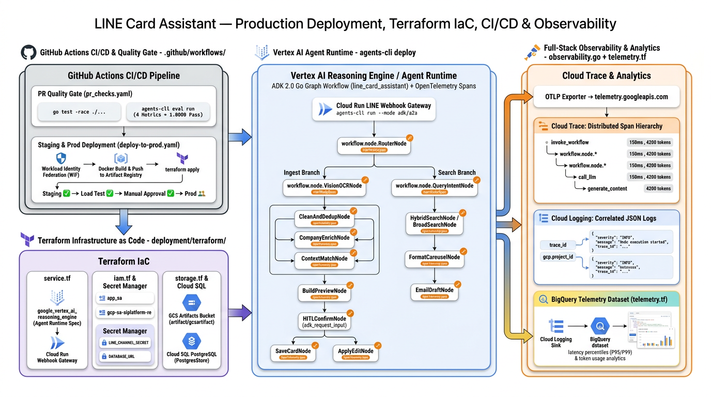
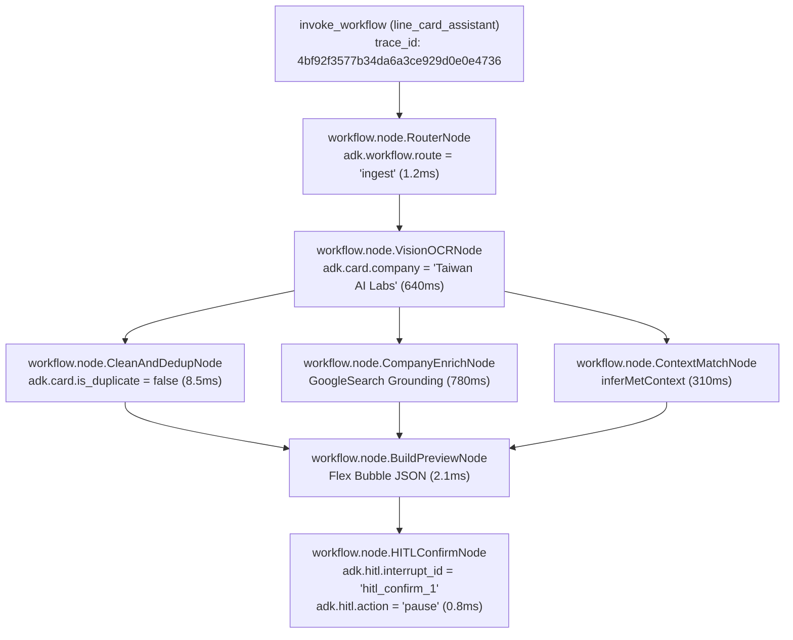
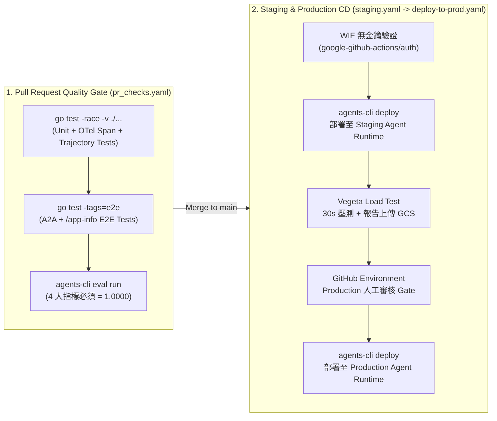

# 前情提要：從單機原型到雲端生產級 AI Agent 的五階段演進

歡迎來到《**Agent Platform 實戰**》系列的第六篇（最終章）！回顧過去五篇文章，我們帶著 **[LINE AI 名片王 (`kkdai/line-card-assistant`)](https://github.com/kkdai/line-card-assistant)** 一路闖關，完成了從本地原型到企業級 AI Agent 架構的四大階段：

1. **[[Agent Platform 實戰 (1)] 用 Go 與 Google ADK 2.0 Graph Workflow 打造 LINE AI 名片王](/2026/10/16/adk-graph-workflow-go/)**：以 `google.golang.org/adk/v2/workflow` 實作涵蓋 Vision OCR、`AddFanOut` / `AddFanIn` 平行背景調查與 `NewRequestInputEvent` HITL 互動迴圈的名片工作流圖。
2. **[[Agent Platform 實戰 (2)] 從單體 Cloud Run 邁向 Google Cloud Agent Runtime：用 agents-cli 與 ADK Go 重構 LINE AI 名片王](/2026/10/17/adk-graph-workflow-go-2/)**：完成 **Phase 1（[PR #10](https://github.com/kkdai/line-card-assistant/pull/10)）**，將專案標準化為 `agents-cli` (`adk_go`) 雙通道架構，同時支援 LINE Webhook、ADK WebUI Playground 與 A2A 協定。
3. **[[Agent Platform 實戰 (3)] 破解無狀態容器的 HITL 失憶症：用 ADK 2.0 GCS Artifact Service 與 Agent Platform Sessions 實現跨實例名片辨識與暫停恢復](/2026/10/20/adk-graph-workflow-go-3/)**：完成 **Phase 2 前半（[PR #11](https://github.com/kkdai/line-card-assistant/pull/11)）**，導入 `artifact/gcsartifact` 與 `session/vertexai` 解決無狀態容器的跨實例 HITL 恢復與圖片儲存問題。
4. **[[Agent Platform 實戰 (4)] 邁向雲端雙層解耦與全持久化：用 Cloud Run LINE Webhook Gateway、Agent Runtime 與 Cloud SQL PostgreSQL 完成 LINE AI 名片王架構拼圖](/2026/10/21/adk-graph-workflow-go-4/)**：完成 **Phase 2 後半（[Issue #5](https://github.com/kkdai/line-card-assistant/issues/5)）** 與 **Phase 3（[Issue #6](https://github.com/kkdai/line-card-assistant/issues/6)，[PR #12](https://github.com/kkdai/line-card-assistant/pull/12)）**，將名片庫遷移至 Cloud SQL PostgreSQL (`PostgresStore`)，並打造無狀態的 Cloud Run LINE Webhook Gateway (`internal/gateway`)。
5. **[[Agent Platform 實戰 (5)] 打造 AI Agent 的品質飛輪 (Quality Flywheel)：用 agents-cli eval 與 ADK 2.0 Go 為 LINE AI 名片王建立自動化評估基準](/2026/10/22/adk-graph-workflow-go-5/)**：完成 **Phase 4（[Issue #7](https://github.com/kkdai/line-card-assistant/issues/7)，[PR #13](https://github.com/kkdai/line-card-assistant/pull/13)）**，用 `agents-cli eval` 建立涵蓋 6 個黃金案例與 4 大評估指標全數 `1.0000` 的自動化品質飛輪。

今天這篇最終章，我們要一口氣完成 **[Roadmap #9](https://github.com/kkdai/line-card-assistant/issues/9)** 的最後一塊拼圖 —— **Phase 5（[Issue #8](https://github.com/kkdai/line-card-assistant/issues/8)）：Agent Runtime 正式部署、Terraform IaC、GitHub Actions CI/CD 與 Cloud Trace 全棧可觀測性**！

---

# 一、Phase 5 解決什麼問題？從「手動 `gcloud` 指令」走向「宣告式 AgentOps」

在許多 AI 專案中，即便程式碼與評估測試都寫好了，上了生產環境（Production）卻常常因為以下四個問題而變成維運惡夢：

1. **基礎設施靠手動敲指令（ClickOps / Shell Script 漂移）**：
   Vertex AI Reasoning Engine、Service Account IAM 權限、GCS Bucket、Secret Manager 密鑰與 Cloud SQL 若全靠手動下 `gcloud` 建立，Staging 與 Production 環境很容易發生設定不一致。
2. **PR 合併缺乏 AI 品質守門員（No Eval Gate in CI）**：
   只跑 `go test` 能抓出語法與邏輯錯誤，但如果有人不小心改壞了 Graph Node 的 `state_delta` 或 Prompt，如何在 PR 合併進 `main` 之前自動攔截？
3. **跨環境部署與高併發驗證（Staging $\rightarrow$ Load Test $\rightarrow$ Prod Approval）**：
   推送到 `main` 後，如何透過無金鑰的 **Workload Identity Federation (WIF)** 自動部署到 Staging、跑完高併發壓測（Vegeta Load Test）並將壓測報告歸檔至 GCS，最後經過人工審核（GitHub Environment Approval Gate）才推上 Production？
4. **Graph Workflow 節點級可觀測性（Node-Level Distributed Tracing）**：
   當一張名片從上傳到產生 Flex Message 預覽花了 2.8 秒，到底時間是花在 `VisionOCRNode`、還是平行 Fan-Out 裡的 `CompanyEnrichNode`（Google Search Grounding）？我們需要讓 ADK 2.0 Graph Workflow 的每一個節點都在 **Google Cloud Trace** 中展開成一目了然的巢狀 Span 樹，並自動匯入 **BigQuery** 進行 P95/P99 延遲與 Token 成本分析！

這正是文章開頭那張 **Phase 5 全棧架構圖** 所描繪的四大核心支柱：
- **左上（GitHub Actions CI/CD & Quality Gate）**：`.github/workflows/pr_checks.yaml`、`staging.yaml`、`deploy-to-prod.yaml`
- **左下（Terraform Infrastructure as Code）**：`deployment/terraform/single-project/`、`cicd/`、`shared/`
- **中央（Vertex AI Agent Runtime + OpenTelemetry Node Spans）**：`agents-cli deploy` + `internal/workflow/telemetry.go`
- **右側（Full-Stack Observability & Analytics）**：`observability.go` $\rightarrow$ Cloud Trace + Cloud Logging $\rightarrow$ `telemetry.tf` BigQuery Sink

---

# 二、第一步：用 `agents-cli scaffold enhance` 一鍵生成 Terraform IaC 與 CI/CD 骨架

在 Phase 1 我們曾介紹過 `agents-cli` 的 Prototype-First 理念：先保持專案輕量，等準備上雲時再執行 `agents-cli scaffold enhance` 疊加生產環境基礎設施。

我們直接在專案根目錄執行：

```bash
uvx google-agents-cli@1.10.0 scaffold enhance . \
  --cicd-runner github_actions \
  --region asia-east1 \
  --yes
```

`agents-cli` 自動偵測到我們的 `agents-cli-manifest.yaml`（`template: adk_go`, `deployment_target: agent_runtime`），在不破壞任何既有 `app/`、`internal/`、`eval/`、`sessions/` 程式碼的前提下，為專案補齊了三大模組：
1. **`deployment/terraform/single-project/` 與 `deployment/terraform/cicd/`**：完整的 Terraform 宣告式基礎設施模組。
2. **`deployment/terraform/shared/telemetry.tf` 與 `storage.tf`**：Cloud Logging 連結 Bucket、Dataset 與 BigQuery 遙測分析管線。
3. **`.github/workflows/` 與 `e2e/`**：GitHub Actions CI/CD 管線與 A2A / AppInfo / Vegeta Load Test 端到端測試套件。

接著，我們針對 **LINE AI 名片王** 的專屬需求（LINE 憑證密鑰、Cloud SQL PostgreSQL 權限、台灣 `asia-east1` 區域）進行客製化強化！

---

# 三、第二步：Terraform IaC 深度解析（Vertex AI Reasoning Engine + Secret Manager + BigQuery Telemetry Sink）

讓我們打開 `deployment/terraform/`，看看 Terraform 是如何把整座 Google Cloud Agent Platform 宣告式地建立起來的：

### 1. 宣告式定義 Vertex AI Reasoning Engine (`service.tf`)

在 [`deployment/terraform/single-project/service.tf`](https://github.com/kkdai/line-card-assistant/blob/main/deployment/terraform/single-project/service.tf) 中，我們使用 `google-beta` Provider 的 `google_vertex_ai_reasoning_engine` 資源，將 Go 專案原始碼打包並宣告為受託管的 Agent Runtime 實例，同時設定 `lifecycle { ignore_changes = [spec[0].source_code_spec] }`，讓日常的程式碼更新交由 CI/CD 的 `agents-cli deploy` 快速滾動部署，而基礎設施設定（IAM、Bucket、環境變數）由 Terraform 統一控管：

```hcl
resource "google_vertex_ai_reasoning_engine" "app" {
  provider     = google-beta
  display_name = var.project_name
  project      = var.project_id
  region       = var.region

  labels = {
    "agent-framework" = var.agent_framework
  }

  spec {
    identity_type = "AGENT_IDENTITY"
    agent_framework = var.agent_framework

    source_code_spec {
      inline_source {
        source_archive = data.archive_file.source.output_path
      }
      developer_connect_source {}
    }

    container_spec {
      image_uri = "us-docker.pkg.dev/vertex-ai/prediction/tf2-cpu.2-15:latest"
    }
  }

  lifecycle {
    ignore_changes = [
      spec[0].source_code_spec,
      spec[0].container_spec,
    ]
  }
}
```

### 2. 最小權限 IAM 與 Secret Manager 密鑰整合 (`iam.tf` & `variables.tf`)

為了不讓 `LINE_CHANNEL_SECRET`、`LINE_CHANNEL_ACCESS_TOKEN` 與 `DATABASE_URL` 以明文出現在設定檔中，我們在 [`deployment/terraform/single-project/iam.tf`](https://github.com/kkdai/line-card-assistant/blob/main/deployment/terraform/single-project/iam.tf) 與 [`variables.tf`](https://github.com/kkdai/line-card-assistant/blob/main/deployment/terraform/single-project/variables.tf) 中宣告了 **Google Cloud Secret Manager** 密鑰，並將 `roles/secretmanager.secretAccessor` 與 `roles/cloudsql.client` 同時授予 **Vertex AI Service Agent (`gcp-sa-aiplatform-re`)** 與 **Agent Identity Principal (`principal://${google_vertex_ai_reasoning_engine.app.spec[0].effective_identity}`)**：

```hcl
# Secret Manager secrets for LINE Messaging API credentials and Cloud SQL DSN
locals {
  line_card_secrets = [
    "line-channel-secret",
    "line-channel-access-token",
    "line-card-database-url",
  ]
}

resource "google_secret_manager_secret" "app_secrets" {
  for_each  = toset(local.line_card_secrets)
  project   = var.project_id
  secret_id = each.value

  replication {
    auto {}
  }

  depends_on = [resource.google_project_service.services]
}
```

如此一來，部署時只需要在 `agents-cli deploy` 傳入 `--secrets="LINE_CHANNEL_SECRET=line-channel-secret,LINE_CHANNEL_ACCESS_TOKEN=line-channel-access-token"`，Agent Runtime 就會在啟動容器時安全地從 Secret Manager 掛載密鑰！

### 3. 自動建立 Cloud Logging $\rightarrow$ BigQuery 遙測分析資料集 (`telemetry.tf`)

在 [`deployment/terraform/shared/telemetry.tf`](https://github.com/kkdai/line-card-assistant/blob/main/deployment/terraform/shared/telemetry.tf) 中，Terraform 會自動建立一個 365 天保留期的 Cloud Logging Bucket、開啟 `enable_analytics = true`，並透過 `google_logging_linked_dataset` 直接將遙測日誌映射為 **BigQuery Dataset (`telemetry_logs_dataset`)**：

```hcl
resource "google_logging_project_bucket_config" "telemetry_logs_bucket" {
  project          = each.value
  location         = "global"
  bucket_id        = "${var.project_name}-telemetry"
  retention_days   = 365
  enable_analytics = true
}

resource "google_logging_linked_dataset" "telemetry_logs_dataset" {
  bucket     = google_logging_project_bucket_config.telemetry_logs_bucket[each.key].bucket_id
  link_id    = replace("${var.project_name}_telemetry", "-", "_")
  project    = each.value
  location   = "global"
}
```

這意味著所有由 OpenTelemetry 輸出的結構化遙測資料，都不需要額外寫 ETL 腳本，就能直接在 BigQuery 用標準 SQL 分析！

---

# 四、第三步：為 ADK 2.0 Go Graph Workflow 的 14 個節點注入 OpenTelemetry 分散式追蹤 (`internal/workflow/telemetry.go`)

在 Phase 1 產生的 [`observability.go`](https://github.com/kkdai/line-card-assistant/blob/main/observability.go) 中，系統已經設定好指向 `telemetry.googleapis.com` 的 OTLP HTTP Exporter 與 Google ADC 自動驗證。然而，預設情況下我們只能看到整個 HTTP 請求或 LLM 呼叫的頂層追蹤，卻看不見 **ADK 2.0 Graph Workflow 內部各個 `FunctionNode` 的執行時間與路由決策**。

為了讓每一張名片的處理過程在 **Google Cloud Trace** 上呈現完整的瀑布圖（Waterfall Span Tree），我們新增了 [`internal/workflow/telemetry.go`](https://github.com/kkdai/line-card-assistant/blob/main/internal/workflow/telemetry.go)：

```go
package workflow

import (
	"context"

	"go.opentelemetry.io/otel"
	"go.opentelemetry.io/otel/attribute"
	"go.opentelemetry.io/otel/codes"
	"go.opentelemetry.io/otel/trace"
)

const workflowTracerName = "github.com/kkdai/line-card-assistant/internal/workflow"

const (
	AttrWorkflowNode   = attribute.Key("adk.workflow.node")
	AttrWorkflowRoute  = attribute.Key("adk.workflow.route")
	AttrInvocationID   = attribute.Key("adk.invocation.id")
	AttrSessionID      = attribute.Key("adk.session.id")
	AttrUserID         = attribute.Key("adk.user.id")
	AttrCardID         = attribute.Key("adk.card.id")
	AttrCardCompany    = attribute.Key("adk.card.company")
	AttrCardDuplicate  = attribute.Key("adk.card.is_duplicate")
	AttrHITLInterrupt  = attribute.Key("adk.hitl.interrupt_id")
	AttrHITLAction     = attribute.Key("adk.hitl.action")
	AttrSearchMatches  = attribute.Key("adk.search.matches")
	AttrSearchKeywords = attribute.Key("adk.search.keywords")
)

func startNodeSpan(ctx context.Context, nodeName string, attrs ...attribute.KeyValue) (context.Context, trace.Span) {
	baseAttrs := make([]attribute.KeyValue, 0, len(attrs)+1)
	baseAttrs = append(baseAttrs, AttrWorkflowNode.String(nodeName))
	baseAttrs = append(baseAttrs, attrs...)
	return otel.Tracer(workflowTracerName).Start(
		ctx,
		"workflow.node."+nodeName,
		trace.WithAttributes(baseAttrs...),
	)
}
```

接著，我們在 [`internal/workflow/nodes_ingest.go`](https://github.com/kkdai/line-card-assistant/blob/main/internal/workflow/nodes_ingest.go) 與 [`internal/workflow/nodes_search.go`](https://github.com/kkdai/line-card-assistant/blob/main/internal/workflow/nodes_search.go) 的所有節點中注入 `startNodeSpan` 與 `endNodeSpan`。例如在 `HybridSearchNode` 中：

```go
func newHybridSearchNode(cardStore store.CardStore) *workflow.FunctionNode {
	return workflow.NewFunctionNode(
		NodeHybridSearch,
		func(ctx agent.Context, _ any) (ev *session.Event, err error) {
			spanCtx, span := startNodeSpan(ctx, NodeHybridSearch, AttrInvocationID.String(ctx.InvocationID()))
			defer func() {
				routeAttr := ""
				if ev != nil && len(ev.Routes) > 0 {
					routeAttr = ev.Routes[0]
				}
				endNodeSpan(span, err, AttrWorkflowRoute.String(routeAttr))
			}()
			// ... 執行 cardStore.HybridSearch(spanCtx, filter) ...
			span.SetAttributes(AttrSearchMatches.Int(len(cards)))
			// ...
		},
		workflow.NodeConfig{},
	)
}
```

當使用者上傳一張名片或執行混合搜尋時，Cloud Trace 會自動繪製出如下的階層式 Span 樹，包含平行 Fan-Out 的三個子節點耗時與每個節點的業務屬性：



我們同時在 [`internal/workflow/telemetry_test.go`](https://github.com/kkdai/line-card-assistant/blob/main/internal/workflow/telemetry_test.go) 中使用 OpenTelemetry SDK 的 `tracetest.NewInMemoryExporter()` 撰寫了自動化單元測試，確保「名片辨識 + HITL 修改迴圈 + 確認存檔」以及「混合搜尋 0 筆自動降級至模糊搜尋」都會 100% 產生預期的 Span 節點與屬性標籤！

---

# 五、第四步：打造結合 `agents-cli eval` 品質守門員的 GitHub Actions CI/CD 管線 (`.github/workflows/`)

有了 Terraform IaC 與 OpenTelemetry 追蹤後，我們把 Phase 4 打造的 **`agents-cli eval` 品質飛輪** 正式嵌進 GitHub Actions CI/CD 管線中，形成兩階段自動化交付：



### 1. PR 品質守門員 (`.github/workflows/pr_checks.yaml`)

在 [`.github/workflows/pr_checks.yaml`](https://github.com/kkdai/line-card-assistant/blob/main/.github/workflows/pr_checks.yaml) 中，只要 PR 修改了 `app/**`、`internal/**`、`cmd/**`、`sessions/**` 或 `eval/**`，GitHub Actions 就會依序執行：
1. `go test -race -v ./...`：驗證所有 Go 單元測試、跨實例 HITL 恢復、OpenTelemetry Node Spans 與軌跡測試。
2. `go test -v -tags=e2e ./e2e/integration/...`：啟動真實的 ADK Universal Launcher 子程序，驗證 `/.well-known/agent-card.json`、`/a2a/invoke` 與 `/apps/app/app-info` 端點。
3. **`agents-cli eval run` 品質守門員**：執行 6 個黃金評估案例，驗證 `workflow_trajectory_accuracy`、`ocr_and_enrichment_quality`、`duplicate_and_hitl_precision`、`search_and_email_grounding` 四大指標必須維持滿分通過！

### 2. Staging 自動部署與 Vegeta 負載壓測 (`.github/workflows/staging.yaml`)

當 PR 合併進 `main` 分支後，[`.github/workflows/staging.yaml`](https://github.com/kkdai/line-card-assistant/blob/main/.github/workflows/staging.yaml) 會：
1. 透過 **Workload Identity Federation (WIF)** 無金鑰取得 GCP 短期憑證。
2. 呼叫 `uvx google-agents-cli@1.10.0 deploy` 將最新 Commit 部署至 Staging 的 Vertex AI Agent Runtime，同時掛載 Secret Manager 的 `LINE_CHANNEL_SECRET` 與 `LINE_CHANNEL_ACCESS_TOKEN`，並標記 `OTEL_RESOURCE_ATTRIBUTES=service.version=${{ github.sha }}`。
3. 啟動 [`e2e/load_test/load_test.go`](https://github.com/kkdai/line-card-assistant/blob/main/e2e/load_test/load_test.go)（基於 `tsenart/vegeta/v12`），對 Staging Agent Runtime 進行 30 秒持續壓測，檢查 HTTP 200 成功率、P50/P95/P99 延遲與 `429 Too Many Requests` 比例，並將壓測結果自動歸檔至 `gs://${LOGS_BUCKET_NAME_STAGING}/load-test-results/`。
4. 壓測通過後，自動觸發 [`.github/workflows/deploy-to-prod.yaml`](https://github.com/kkdai/line-card-assistant/blob/main/.github/workflows/deploy-to-prod.yaml)，在通過 GitHub `production` Environment 的 Required Reviewers 審核後，正式推送至 Production！

---

# 六、實戰驗證：`agents-cli deploy --dry-run` 與全套 E2E 測試全數通過！

在將程式碼提交 PR 之前，我們在本地端完整執行了三大驗證：

### 1. `agents-cli deploy --dry-run` 雲端部署預檢

```bash
$ uvx google-agents-cli@1.10.0 deploy \
    --project line-vertex \
    --region asia-east1 \
    --dry-run \
    --no-confirm-project
```

預檢輸出結果：
- **`aiplatform.googleapis.com` API**：Enabled ✅
- **Target Agent Runtime Engine**：`line-card-assistant` (`asia-east1`) ✅
- **IAM Roles & Service Account Preflight**：Passed ✅

### 2. Go 單元測試 + OpenTelemetry Span 測試 + E2E 整合測試

```bash
$ go test -v -tags=e2e ./...
```

包含新增的 `TestWorkflowOpenTelemetrySpans_IngestAndHITL`、`TestWorkflowOpenTelemetrySpans_SearchFallback` 以及 `e2e/integration` 下的 `TestA2AAgentCard`、`TestA2AMessageSend`、`TestA2AErrorHandling`、`TestAppInfo` 全數 **PASS**！

### 3. Phase 4 `agents-cli eval` 品質飛輪回歸驗證

```bash
$ DRY_RUN=true make eval
```

6 個黃金案例在 4 大自訂指標（`workflow_trajectory_accuracy`、`ocr_and_enrichment_quality`、`duplicate_and_hitl_precision`、`search_and_email_grounding`）依然維持 **`1.0000` (100% Pass)**！

---

# 七、《Agent Platform 實戰》全系列總結：五階段完整演進地圖

隨著 **Phase 5（[Issue #8](https://github.com/kkdai/line-card-assistant/issues/8)）** 的完成，我們在 **[Roadmap Issue #9](https://github.com/kkdai/line-card-assistant/issues/9)** 規劃的五個階段已經 **100% 全數達成並關閉**！讓我們最後用一張總表回顧這趟從 0 到 1 的 **Google ADK 2.0 Go + Google Cloud Agent Platform** 實戰旅程：

| 階段 | 對應 Issue / PR | 核心技術突破 | 對應部落格文章 |
| :--- | :--- | :--- | :--- |
| **原型篇** | Initial Commit | Go `adk/v2/workflow` 12 節點 Graph Workflow、平行 `AddFanOut`/`AddFanIn`、`NewRequestInputEvent` HITL 迴圈 | [實戰 (1)](/2026/10/16/adk-graph-workflow-go/) |
| **Phase 1** | [Issue #4](https://github.com/kkdai/line-card-assistant/issues/4) / [PR #10](https://github.com/kkdai/line-card-assistant/pull/10) | `agents-cli` (`adk_go`) 標準化、`app.NewRootAgent` 雙通道工廠、ADK WebUI Playground 與 A2A 協定支援 | [實戰 (2)](/2026/10/17/adk-graph-workflow-go-2/) |
| **Phase 2 (上)** | [Issue #5](https://github.com/kkdai/line-card-assistant/issues/5) / [PR #11](https://github.com/kkdai/line-card-assistant/pull/11) | `artifact/gcsartifact` 圖片零狀態膨脹、`session/vertexai` 跨實例無狀態 HITL 暫停與恢復 | [實戰 (3)](/2026/10/20/adk-graph-workflow-go-3/) |
| **Phase 2 (下) & Phase 3** | [Issue #5](https://github.com/kkdai/line-card-assistant/issues/5), [#6](https://github.com/kkdai/line-card-assistant/issues/6) / [PR #12](https://github.com/kkdai/line-card-assistant/pull/12) | Cloud SQL PostgreSQL (`PostgresStore`) 名片持久化、Cloud Run LINE Webhook Gateway (`internal/gateway`) 與 Agent Runtime 雙層解耦 | [實戰 (4)](/2026/10/21/adk-graph-workflow-go-4/) |
| **Phase 4** | [Issue #7](https://github.com/kkdai/line-card-assistant/issues/7) / [PR #13](https://github.com/kkdai/line-card-assistant/pull/13) | `agents-cli eval` 品質飛輪、`/app-info` 反射內省、6 大黃金案例與 `setNodeTrace` 軌跡修復（4 指標全數 `1.0000`） | [實戰 (5)](/2026/10/22/adk-graph-workflow-go-5/) |
| **Phase 5** | [Issue #8](https://github.com/kkdai/line-card-assistant/issues/8) / [PR #14](https://github.com/kkdai/line-card-assistant/pull/14) | `agents-cli deploy`、Terraform IaC (`deployment/terraform/`)、GitHub Actions CI/CD + WIF + Vegeta 壓測、OpenTelemetry 節點級 Cloud Trace & BigQuery 觀測 | **本篇（實戰 6）** |

完整的開源程式碼、Terraform 模組與評估資料集都已經同步在 GitHub Repo：**[`kkdai/line-card-assistant`](https://github.com/kkdai/line-card-assistant)**。如果你也正在用 Go 語言與 Google ADK 2.0 打造企業級 AI Agent，希望這個系列能成為你從本地開發一路推進到 Google Cloud Agent Platform 生產環境的最佳實戰藍圖！
