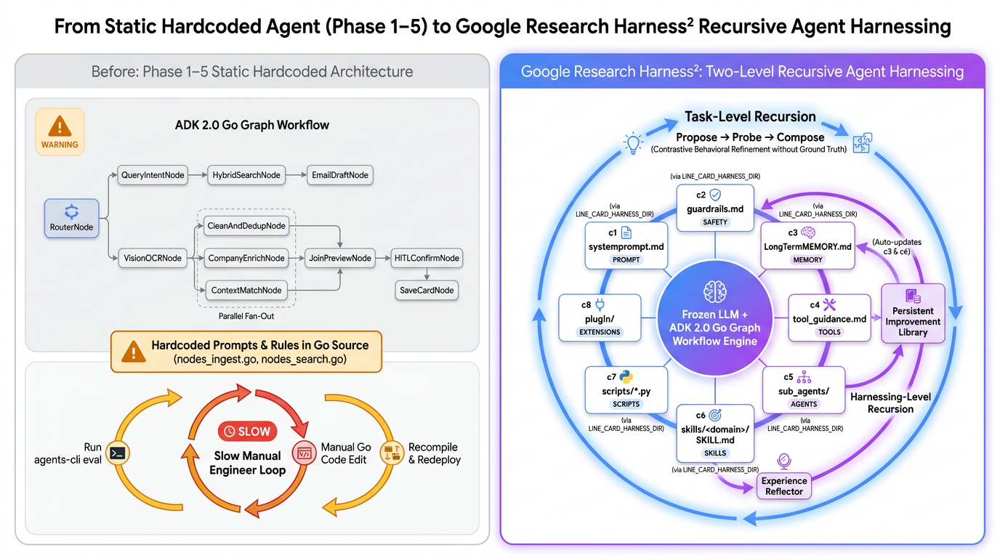
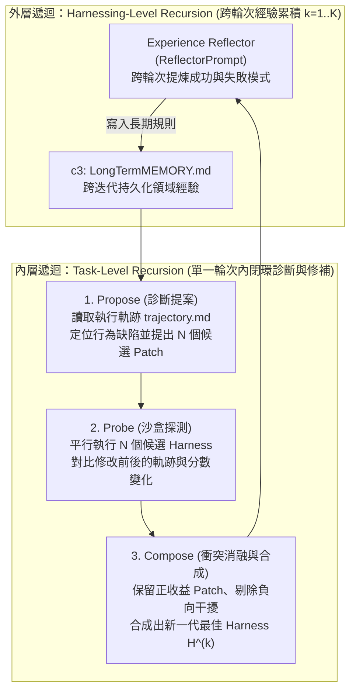
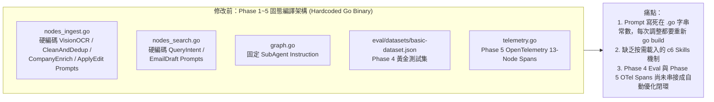

# 前言：當 AI Agent 上線之後，下一個瓶頸是什麼？

歡迎回到《**Agent Platform 實戰**》系列！在前六篇文章中，我們帶著 **[LINE AI 名片王 (`kkdai/line-card-assistant`)](https://github.com/kkdai/line-card-assistant)** 走完了從單機原型到生產級雲端部署的完整五個階段：

1. **[[Agent Platform 實戰 (1)] 用 Go 與 Google ADK 2.0 Graph Workflow 打造 LINE AI 名片王](/2026/10/16/adk-graph-workflow-go/)**：用 `google.golang.org/adk/v2/workflow` 打造具備 Vision OCR、`AddFanOut` / `AddFanIn` 平行背景調查與 `NewRequestInputEvent` HITL 互動迴圈的 13 節點有向圖。
2. **[[Agent Platform 實戰 (2)] 從單體 Cloud Run 邁向 Google Cloud Agent Runtime](/2026/10/17/adk-graph-workflow-go-2/)**：完成 **Phase 1（[PR #10](https://github.com/kkdai/line-card-assistant/pull/10)）**，將專案標準化為 `agents-cli` (`adk_go`) 雙通道架構。
3. **[[Agent Platform 實戰 (3)] 用 ADK 2.0 GCS Artifact Service 與 Agent Platform Sessions 實現跨實例名片辨識與暫停恢復](/2026/10/20/adk-graph-workflow-go-3/)**：完成 **Phase 2 前半（[PR #11](https://github.com/kkdai/line-card-assistant/pull/11)）**，解決無狀態容器的 HITL 失憶症與二進位圖片爆量問題。
4. **[[Agent Platform 實戰 (4)] 用 Cloud Run LINE Webhook Gateway、Agent Runtime 與 Cloud SQL PostgreSQL 完成架構拼圖](/2026/10/21/adk-graph-workflow-go-4/)**：完成 **Phase 2 後半 & Phase 3（[PR #12](https://github.com/kkdai/line-card-assistant/pull/12)）**，將名片庫升級至 Cloud SQL PostgreSQL 並實現雙層無狀態解耦。
5. **[[Agent Platform 實戰 (5)] 用 agents-cli eval 與 ADK 2.0 Go 建立自動化評估基準](/2026/10/22/adk-graph-workflow-go-5/)**：完成 **Phase 4（[PR #13](https://github.com/kkdai/line-card-assistant/pull/13)）**，建立黃金測試集與品質飛輪。
6. **[[Agent Platform 實戰 (6)] 用 agents-cli deploy、Terraform IaC、GitHub Actions CI/CD 與 Cloud Trace 打造全棧可觀測的 LINE AI 名片王](/2026/10/24/adk-graph-workflow-go-6/)**：完成 **Phase 5（[PR #14](https://github.com/kkdai/line-card-assistant/pull/14)）**，把 13 個 Graph Node 全數加上 OpenTelemetry Spans (`workflow.node.*`) 並透過 Terraform 與 GitHub Actions 部署上雲。

此外，我們也將未來 ADK v2.6+ 進階 Graph Workflow 原語（如 `Parallel` 動態派工、`MultiRoute` 多路扇出、反思修復迴圈與強型別節點）規劃進了 **[Future Roadmap Issue #15](https://github.com/kkdai/line-card-assistant/issues/15)**。

然而，當我們的 Agent 已經具備了 **Phase 4 的自動化評估（Evaluation）** 與 **Phase 5 的全節點追蹤（OpenTelemetry Spans）** 後，一個更深層的問題浮現了：

> **當評估發現 Agent 在某些真實世界案例（例如日英雙語名片、台灣科技業口語別稱搜尋、多子句口語 HITL 修改、或金融合規破冰信）表現不佳時，難道每次都要由工程師手動看 Log、手動改 Go 原始碼裡的 Prompt 字串、再重新編譯部署嗎？**

能不能讓一個 **Meta-Agent（裝備工程師 Agent）** 自動讀取我們的評估結果與 OpenTelemetry 執行軌跡，自己診斷失分原因、自己撰寫新技能（Skills）與長期記憶（Long-Term Memory），完成閉環的自我演化？

這正是 Google Research 最新發表並開源的 **[`google-research/harness2` (*Harness²: Recursive Harnessing for LLM Agents*, arXiv:2610.14224)](https://github.com/google-research/harness2)** 所要解決的核心命題！

本系列將以三篇文章（對應 **[Issue #16](https://github.com/kkdai/line-card-assistant/issues/16)**、**[Issue #17](https://github.com/kkdai/line-card-assistant/issues/17)**、**[Issue #18](https://github.com/kkdai/line-card-assistant/issues/18)** 與 **[PR #19](https://github.com/kkdai/line-card-assistant/pull/19)**），完整帶大家將 **Google Research `Harness²`** 導入我們的 Go ADK 2.0 專案：
- **上篇（本文，[Issue #16](https://github.com/kkdai/line-card-assistant/issues/16)）**：認識什麼是 Google `Harness²`？它能做什麼用？盤點修改前的既有架構圖，並將 Go 二進位檔中寫死的設定解耦為 `c1..c8` 可編輯 Harness 檔案樹。
- **中篇（[Issue #17](https://github.com/kkdai/line-card-assistant/issues/17)）**：將 Phase 4 的 `eval/datasets/` 與 Phase 5 的 OpenTelemetry Spans 封裝為 `Harness²` 的 `LineCardAdapter`，並剖析為什麼「零洩漏屏障」與「高解析度行為軌跡」缺一不可。
- **下篇（[Issue #18](https://github.com/kkdai/line-card-assistant/issues/18)）**：完整測試教學、`Parallel` vs `Sequential + LongTermMEMORY` 雙層遞迴實驗數據大公開（準確率從 `62.5%` 躍升至 `100.0%`），以及對 Agent 未來發展的展望。

---

# 一、什麼是 Google Research `Harness²`？它能做什麼用？

## 1. 從「微調模型權重」到「優化 Agent 裝備（Harnessing）」

在大型語言模型（LLM）時代，決定一個 AI Agent 成敗的往往不只是底層模型（如 Gemini 2.5 Flash / Pro）本身，而是包裹在模型外層的 **「裝備層（Agent Harness）」** —— 也就是系統提示詞（System Prompts）、格式與安全護欄（Guardrails）、長期領域記憶（Long-Term Memory）、工具介面說明（Tool Descriptions）、子代理設定（Sub-Agents）以及按需載入的技能庫（On-Demand Skills）。

過去的自動提示詞優化（如 PromptBreeder、TextGrad 或 DSPy）大多只針對 **單一 Prompt 字串** 進行突變；但在真實的企業級 Agent 中，如果你把所有邊界案例的修補規則全部塞進同一個 System Prompt，很快就會引發 **「上下文膨脹（Context Bloat）」**：Always-On Token 越來越多，不但擠壓了模型的輸出預算（Output Token Budget），不同規則之間還會互相干擾！

Google Research 提出的 **`Harness²` (*Recursive Harnessing for LLM Agents*, arXiv:2610.14224)** 打破了這個限制。它將整個 Agent 的裝備定義為一棵結構化的 **`c1..c8` 可編輯檔案樹（Editable Component Tree）**，並透過 **雙層遞迴（Two-Level Recursion）** 自動演化這棵檔案樹：



## 2. `Harness²` 的 `c1..c8` 八大裝備組件與 24KB 預算上限

在 [`google-research/harness2/harness.py`](https://github.com/google-research/harness2/blob/main/harness2/harness.py) 中，一個標準的 Agent Harness 由 **4 個常駐組件（Always-On Components, `c1..c4`）** 與 **4 個按需載入組件（On-Demand Components, `c5..c8`）** 組成：

| 組件代號 | 檔案路徑規則 | 載入模式 | 在 `Harness²` 中的職責 |
| :--- | :--- | :--- | :--- |
| **`c1`** | `systemprompt.md` | **Always-On (常駐)** | 定義核心角色、各節點職責與觸發 `c6` 技能的索引規則（Skill Trigger Lines）。 |
| **`c2`** | `guardrails.md` | **Always-On (常駐)** | 定義不可違反的輸出格式（如純 JSON 約束）、E.164 正規化不變量與資安/PII 護欄。 |
| **`c3`** | `LongTermMEMORY.md` | **Always-On (常駐)** | 由外層 `Experience Reflector` 跨輪次寫入的領域教訓與產業合規記憶。 |
| **`c4`** | `tool_descriptions/*.md` | **Always-On (常駐)** | 工具參數說明、搜尋策略與正規化細節（如日本長途冠碼 `(0)` 清理規則）。 |
| **`c5`** | `sub_agents/<name>/AGENT.md` | **On-Demand (按需)** | 委派子代理（如 `company_enrich`）的專屬 Instruction 與 YAML Frontmatter (`mode: subagent`)。 |
| **`c6`** | `skills/<name>/SKILL.md` | **On-Demand (按需)** | 針對特定領域或任務才動態注入的專業技能（如日文名片 OCR、竹科口語搜尋擴展）。 |
| **`c7`** | `scripts/*.py` | **On-Demand (按需)** | 輔助檢驗或資料轉換腳本。 |
| **`c8`** | `plugin/*.ts` | **On-Demand (按需)** | 執行期生命週期與 OpenTelemetry 診斷鉤子。 |

> [!IMPORTANT]
> **為什麼要區分 `c1..c4`（常駐）與 `c5..c8`（按需）？**
> `Harness²` 在 `OPENCODE_SURFACE` 中設定了一條鐵律：**`c1..c4` 常駐檔案的總位元組數絕對不能超過 `24,000 bytes`（`AlwaysOnMaxBytes = 24000`）**！
> 當 `Harness²` 發現某個失敗案例需要冗長的領域知識（例如日本企業名片的事業部職銜對照表、或台灣半導體園區口語縮寫字典）時，它不會把這些規則硬塞進 `systemprompt.md` 造成常駐 Context 爆炸，而是會自動建立一個按需載入的 **`c6` 技能檔（`skills/<name>/SKILL.md`）**，並在 `systemprompt.md` 中只留下一行輕量的觸發條件（Trigger Line）！

## 3. 雙層遞迴優化（Two-Level Recursion）是怎麼運作的？

`Harness²` 的演化引擎（[`harness2/core/recursion.py`](https://github.com/google-research/harness2/blob/main/harness2/core/recursion.py)）包含兩個層次的遞迴：

1. **第一層（內層）：Task-Level Recursion (`Propose` $\rightarrow$ `Probe` $\rightarrow$ `Compose`)**：
   - **`Propose`（診斷提案）**：優化器（Harvester LLM）觀察上一輪在基準測試中失分的任務、最終輸出（Deliverable）以及 **執行軌跡（`trajectory.md`）**，診斷出 Agent 在哪一個步驟做錯了決策，並提出多個獨立的候選修補方案（Candidate Patches，每個方案是一組針對 `c1..c8` 的檔案新增或修改）。
   - **`Probe`（沙盒探測）**：系統將每個候選 Patch 分別掛載到沙盒中實際跑一次任務，收集新的分數與新的執行軌跡，形成「修改前 vs 修改後」的行為對照（Behavioral Contrast）。
   - **`Compose`（衝突消融與合成）**：優化器比較所有候選 Patch 的實測表現，將真正帶來正向分數提升的修改合併成新一代的 Harness $H^{(k)}$，並丟棄無效或引發副作用的修改。
2. **第二層（外層）：Harnessing-Level Recursion (`Experience Reflector`)**：
   - 在多輪迭代（$k = 1 \dots K$）之間，外層的 `ReflectorPrompt` 會檢視從 $H^{(0)} \to H^{(1)} \to \dots \to H^{(k)}$ 的演化歷史：哪些類型的修改成功了？哪些跨領域的限制（例如金融業合規標頭與個資保護規範）需要在全局層面被記住？
   - 提煉出的高階經驗會被寫入 **`c3: LongTermMEMORY.md`**，指導下一輪的 `Propose` 與 Agent 執行。

---

# 二、盤點修改前的目前架構：為什麼 Phase 1~5 的 Go 實作無法直接被 `Harness²` 優化？

讓我們對照文章開頭架構圖的 **左半邊（Before: Hardcoded Go Binary Architecture）**，回顧我們在 Phase 1 到 Phase 5 完成的系統架構：



在修改前的程式碼中：
1. **`VisionOCRNode`、`CompanyEnrichNode`、`ApplyEditNode`（位於 `internal/workflow/nodes_ingest.go`）** 以及 **`QueryIntentNode`、`EmailDraftNode`（位於 `internal/workflow/nodes_search.go`）** 的所有 Prompt 模版，全部都是寫死在 Go 程式碼裡的 `fmt.Sprintf(...)` 字串常數。
2. **`CompanyEnrichAgent`（位於 `internal/workflow/nodes_ingest.go`）** 的 `llmagent.Config{Instruction: ...}` 也是寫死在 Go 函式裡的固定字串。
3. 當我們想要讓 `Harness²` 的 Python 演化迴圈去修改系統提示詞、新增一個日文名片辨識技能（`skills/jp_card_ocr/SKILL.md`）或調整電話號碼正規化指導原則（`tool_descriptions/tool_guidance.md`）時，**`Harness²` 總不可能去改寫我們的 `.go` 原始碼並每跑一個 Task 就重新 `go build` 一次**！

因此，導入 `Harness²` 的第一步（**[Issue #16](https://github.com/kkdai/line-card-assistant/issues/16)**），就是要把 Go 編譯期與 Harness 裝備期徹底解耦：
- **Go Binary 負責「圖撲結構與雙通道執行引擎」**：`RouterNode`、平行 Fan-Out/Fan-In、`HITLConfirmNode` 暫停恢復、Cloud SQL 與 GCS Artifact 存取、OpenTelemetry 埋點。
- **外部 `c1..c8` Harness 檔案樹負責「可演化的大腦與技能裝備」**：透過環境變數 `LINE_CARD_HARNESS_DIR` 在執行期動態熱載入（Hot-Reload）！

---

# 三、動手實作 Part 1：打造 `internal/harness` 載入器與 `harness/base/` 初始裝備樹

為了讓 Go ADK 2.0 Graph Workflow 原生理解 `Harness²` 的 `c1..c8` 規格，我們在專案中新增了兩個核心目錄：
- [`harness/base/`](https://github.com/kkdai/line-card-assistant/tree/main/harness/base)：存放初始未演化（$k=0$）的 `c1..c8` 基準檔案樹。
- [`internal/harness/harness.go`](https://github.com/kkdai/line-card-assistant/blob/main/internal/harness/harness.go)：負責載入 `c1..c8` 檔案樹、驗證 `OPENCODE_SURFACE` 24KB 限制與 YAML Frontmatter 規則、並為每個 Graph Node 動態組合常駐上下文與按需技能。

## 1. 建立 `harness/base/` 基準 `c1..c8` 檔案樹

我們將原本散落在 `nodes_ingest.go` 與 `nodes_search.go` 的基礎設定抽離到 `harness/base/` 目錄下：

```text
harness/base/
├── systemprompt.md                     # c1: 核心角色與各 Graph Node 職責總覽
├── guardrails.md                       # c2: JSON 輸出格式與電話正規化護欄
├── LongTermMEMORY.md                   # c3: 跨輪次長期記憶（初始為空，待 Reflector 寫入）
├── tool_descriptions/
│   └── tool_guidance.md                # c4: google_search 與 format_company_profile 指導
├── sub_agents/
│   └── company_enrich/
│       └── AGENT.md                    # c5: CompanyEnrichAgent 委派子代理定義
├── skills/                             # c6: 按需載入技能目錄（待 Propose-Probe-Compose 演化生成）
├── scripts/                            # c7: 輔助腳本目錄
└── plugin/                             # c8: 診斷外掛目錄
```

例如，`harness/base/sub_agents/company_enrich/AGENT.md` 採用了與 `google-research/harness2` 完全相容的 YAML Frontmatter 格式：

```markdown
---
mode: subagent
description: Searches Google to summarize company background and industry tags.
---
你是一位專業商業分析助理。請使用 google_search 工具查詢使用者提供的公司名稱，接著呼叫 format_company_profile 工具回傳兩句話的繁體中文公司簡介與 3 到 5 個技術或產業標籤（例如 AI, Cloud, SaaS, FinTech, Semiconductor）。
```

## 2. 實作 `internal/harness/harness.go`：24KB 常駐預算驗證與按需技能注入

在 [`internal/harness/harness.go`](https://github.com/kkdai/line-card-assistant/blob/main/internal/harness/harness.go) 中，我們實作了與 Python 版 `OPENCODE_SURFACE.validate()` 完全對齊的驗證器 `Validate()` 與節點提示詞合成器 `ComposeNodePrompt()`：

```go
// AlwaysOnMaxBytes matches google-research/harness2 OPENCODE_SURFACE.always_on_max (24,000 bytes).
const AlwaysOnMaxBytes = 24000

// AlwaysOnFiles lists the four c1..c4 always-on files mounted into the agent context.
var AlwaysOnFiles = []string{
	"systemprompt.md",
	"guardrails.md",
	"LongTermMEMORY.md",
	"tool_descriptions/tool_guidance.md",
}

// Validate enforces Google Research Harness² OPENCODE_SURFACE invariants on the c1..c8 tree.
func (h *Harness) Validate() error {
	var problems []string
	for _, reqFile := range AlwaysOnFiles {
		if strings.TrimSpace(h.Files[reqFile]) == "" {
			problems = append(problems, fmt.Sprintf("missing or empty always-on component %q", reqFile))
		}
	}
	if total := h.AlwaysOnBytes(); total > AlwaysOnMaxBytes {
		problems = append(problems, fmt.Sprintf(
			"always-on c1..c4 byte count %d exceeds cap %d (every token here competes with the agent's output budget)",
			total, AlwaysOnMaxBytes,
		))
	}

	combinedAlwaysOn := h.SystemPrompt + "\n" + h.Guardrails
	for dirName, skill := range h.Skills {
		if skill.Name != dirName {
			problems = append(problems, fmt.Sprintf("%s frontmatter name %q must match directory name %q", skill.RelPath, skill.Name, dirName))
		}
		if strings.TrimSpace(skill.Description) == "" {
			problems = append(problems, fmt.Sprintf("%s must include a non-empty description in YAML frontmatter", skill.RelPath))
		}
		if !strings.Contains(combinedAlwaysOn, dirName) {
			problems = append(problems, fmt.Sprintf("skill %q is never referenced in systemprompt.md or guardrails.md; add a trigger line naming `%s`", dirName, dirName))
		}
	}
	// ...
}
```

這裡有兩個非常關鍵的工程細節：
1. **強制檢查 Skill Trigger Reference**：如果 `Harness²` 在 `skills/jp_card_ocr/SKILL.md` 新增了一個技能，卻忘記在 `systemprompt.md` 或 `guardrails.md` 寫下何時該觸發 `jp_card_ocr`，`Validate()` 會直接報錯攔截，避免產生永遠不會被呼叫的「孤兒技能（Orphan Skill）」。
2. **節點級動態技能匹配（`MatchSkills` + `ComposeNodePrompt`）**：當 Graph Workflow 執行到 `VisionOCRNode`、`CompanyEnrichNode`、`ApplyEditNode`、`QueryIntentNode` 或 `EmailDraftNode` 時，只會注入與該節點相關的 `c6` 技能，並在 OpenTelemetry Span 上自動打上 `adk.harness.skills` 與 `adk.harness.always_on_bytes` 屬性：

```go
// composeHarnessPrompt enriches a node's base prompt with the active Harness² c1..c8 tree
// and records the active harness metadata onto the node's OpenTelemetry span.
func composeHarnessPrompt(span trace.Span, nodeName, basePrompt, taskInput string) (string, *harness.Harness) {
	h := harness.LoadActive()
	composed, skills := h.ComposeNodePrompt(nodeName, basePrompt, taskInput)
	if span != nil {
		span.SetAttributes(
			AttrHarnessRoot.String(h.RootDir),
			AttrHarnessAlwaysOnBytes.Int(h.AlwaysOnBytes()),
		)
		if len(skills) > 0 {
			span.SetAttributes(AttrHarnessSkills.StringSlice(skills))
		}
	}
	return composed, h
}
```

我們可以直接用 CLI 驗證 `harness/base` 的常駐位元組數與結構合法性：

```bash
$ go run ./cmd/harness-runner --validate-only --harness-dir=harness/base
OK (1599 always-on bytes)
```

---

# 四、小結與下一篇預告

在這篇（上篇）中，我們完成了 **[Issue #16](https://github.com/kkdai/line-card-assistant/issues/16)** 的目標：
1. 深入理解了 Google Research **`Harness²` (arXiv:2610.14224)** 如何透過 **`c1..c8` 可編輯檔案樹** 與 **雙層遞迴（Task-level `Propose-Probe-Compose` + Harnessing-level `Experience Reflector`）**，在不重新編譯主程式、也不塞爆常駐 Context 的前提下自動演化 Agent 能力。
2. 盤點了修改前 Phase 1~5 將 Prompt 與正規化邏輯寫死在 Go 二進位檔中的架構瓶頸。
3. 實作了 [`internal/harness/harness.go`](https://github.com/kkdai/line-card-assistant/blob/main/internal/harness/harness.go) 與 [`harness/base/`](https://github.com/kkdai/line-card-assistant/tree/main/harness/base)，讓 ADK 2.0 Go Graph Workflow 的 13 個節點支援透過 `LINE_CARD_HARNESS_DIR` 動態掛載 `c1..c8` 裝備樹。

有了可熱載入的 `c1..c8` 裝備樹後，下一篇 **[[Agent Platform 實戰 (8)] 當 ADK Go Graph Workflow 遇上 Google Research Harness² (中)：把 Phase 4 Eval Datasets 與 Phase 5 OpenTelemetry Spans 變成 LineCardAdapter](/2026/10/26/adk-graph-workflow-go-8/)**，我們將進入 **[Issue #17](https://github.com/kkdai/line-card-assistant/issues/17)**：揭開為什麼我們要把 Phase 4 的測試集與 Phase 5 的 OpenTelemetry Spans 封裝成 `LineCardAdapter`，以及「零洩漏屏障（Zero-Leakage Barrier）」如何防止 AI 優化器作弊！
