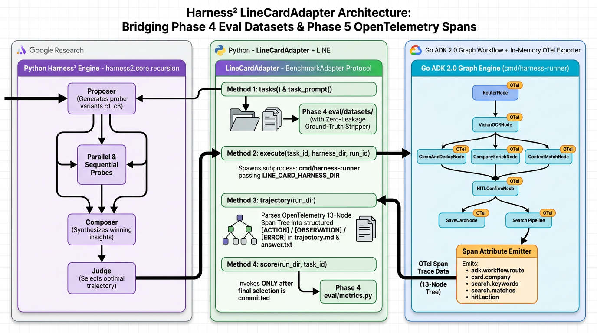
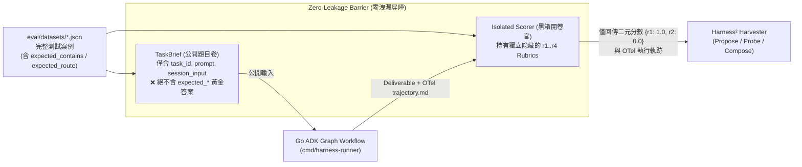

# 前言：為什麼解耦了 Prompt 還不夠？

在上一篇 **[[Agent Platform 實戰 (7)] 當 ADK Go Graph Workflow 遇上 Google Research Harness² (上)：認識雙層遞迴 Agent 裝備框架與 c1..c8 解耦實戰](/2026/10/25/adk-graph-workflow-go-7/)**（對應 **[Issue #16](https://github.com/kkdai/line-card-assistant/issues/16)**）中，我們介紹了 Google Research 的 **[`google-research/harness2` (arXiv:2610.14224)](https://github.com/google-research/harness2)**，並將 **[LINE AI 名片王 (`kkdai/line-card-assistant`)](https://github.com/kkdai/line-card-assistant)** 的提示詞、護欄、長期記憶與按需技能解耦為可透過 `LINE_CARD_HARNESS_DIR` 動態掛載的 **`c1..c8` 可編輯 Harness 檔案樹**。

然而，光有可熱載入的 `c1..c8` 檔案樹，`Harness²` 的雙層遞迴優化引擎（[`harness2/core/recursion.py`](https://github.com/google-research/harness2/blob/main/harness2/core/recursion.py)）仍然無法直接對我們的 Go Agent 進行優化。因為 `Harness²` 需要一個標準化的橋樑 —— **`BenchmarkAdapter`** —— 來回答三個問題：
1. **`list_tasks()`（考題是什麼？）**：Agent 要挑戰哪些測試案例？每個案例有哪些公開輸入（Prompt / Image），又有哪些對 Agent 隱藏的評分標準（Rubrics）？
2. **`run()`（Agent 怎麼思考與執行的？）**：當掛載某個候選 Harness $H'$ 執行某道考題時，Agent 最終產出了什麼（`deliverable`）？更重要的是，**它在 Graph Workflow 的 13 個節點中間經歷了什麼樣的決策軌跡（`trajectory.md`）**？
3. **`score()`（表現如何？）**：最終產出與執行軌跡通過了哪些獨立的評分項目（`per_rubric`），又在哪些項目失分了？

剛好！我們在 **Phase 4（[PR #13](https://github.com/kkdai/line-card-assistant/pull/13)）** 已經建立了 `eval/datasets/` 自動化評估基準，在 **Phase 5（[PR #14](https://github.com/kkdai/line-card-assistant/pull/14)）** 又為全部 13 個 Graph Node 加上了 `workflow.node.*` OpenTelemetry Spans！

在本篇（中篇，對應 **[Issue #17](https://github.com/kkdai/line-card-assistant/issues/17)** 與 **[PR #19](https://github.com/kkdai/line-card-assistant/pull/19)**）中，我們將把這兩塊既有資產融合成 `Harness²` 的 **`LineCardAdapter`**，並深入解釋 **「為什麼一定要這樣設計？」**。

---

# 一、為什麼要這樣改？兩大核心設計哲學

在動手寫程式碼之前，許多工程師常會問兩個問題：
1. *「為什麼不直接把 `eval/datasets/*.json` 整份 JSON 丟給優化器 LLM，讓它自己改 Prompt 就好？」*
2. *「為什麼還需要把 Phase 5 的 OpenTelemetry Spans 轉成 `trajectory.md`？只看最後的 LINE 回覆文字與總分不夠嗎？」*

這兩個問題正好觸及了 `Harness²` 論文中最核心的兩個工程設計：**零洩漏屏障（Zero-Leakage Barrier）** 與 **行為軌跡對照（Behavioral Trajectory Contrast）**。

## 1. 為什麼需要「零洩漏屏障（Zero-Leakage Barrier）」？防止優化器「背答案作弊」

試想一下：如果我們把 `eval/datasets/harness2-challenge-dataset.json` 裡的黃金答案（例如 `expected_contains: ["+81-3-1234-5678", "佐藤健太 (Kenta Sato)"]`）直接暴露給 Agent 或 `Harness²` 的 Harvester LLM，會發生什麼事？

優化器最偷懶、也最容易拿滿分的作法，就是在 `systemprompt.md` 寫下一行：
> *「如果輸入包含 Sato，請直接輸出 `+81-3-1234-5678` 與 `佐藤健太 (Kenta Sato)`。」*

這在機器學習中稱為 **測試集洩漏（Test Set Leakage / Overfitting to Rubrics）** —— Agent 看似在 Benchmark 拿了 100 分，但一遇到真實世界的新日本名片就立刻崩潰！



在 `Harness²` 的 `BenchmarkAdapter` 架構中：
- **`TaskBrief`（公開題目卷）**：只能包含使用者輸入（`prompt` 與模擬圖片/上下文），**絕對禁止包含任何 `expected_contains`、`expected_not_contains` 或正確答案字串**。
- **`score()`（黑箱閱卷官）**：在隔離環境中比對答案後，只回傳「哪一個 Rubric 拿到 `1.0` 或 `0.0`」（例如 `r3_e164_jp_phone_normalization: 0.0`），而不把預期字串洩漏給優化器。
- 如此一來，`Harness²` 的優化器必須真正透過 **閱讀 Agent 的執行軌跡（`trajectory.md`）** 來推理出通用的領域規則（例如：「日本電話號碼 `+81 (0)3-...` 轉 E.164 時必須去掉國內長途冠碼 `(0)`」），而不是把答案硬編碼進 Prompt！

## 2. 為什麼需要把 Phase 5 OpenTelemetry Spans 變成 `trajectory.md`？打開 13 節點 Graph 的黑盒子

我們的 LINE AI 名片王不是一個單純的「單次 LLM 呼叫」，而是一個由 **13 個節點組成的 ADK 2.0 有向圖（Graph Workflow）**：
- 名片建檔管線：`RouterNode` $\rightarrow$ `VisionOCRNode` $\rightarrow$ 平行 `AddFanOut`（`CleanAndDedupNode`、`CompanyEnrichNode`、`ContextMatchNode`）$\rightarrow$ `AddFanIn`（`JoinPreviewNode`）$\rightarrow$ `BuildPreviewNode` $\rightarrow$ `HITLConfirmNode` $\rightarrow$ `ApplyEditNode` / `SaveCardNode`。
- 智慧搜尋與破冰信管線：`RouterNode` $\rightarrow$ `QueryIntentNode` $\rightarrow$ `HybridSearchNode` / `BroadSearchNode` $\rightarrow$ `FormatCarouselNode` / `EmailDraftNode`。

如果沒有 Phase 5 的 OpenTelemetry Spans，當使用者搜尋 *「幫我找竹科做 AI 晶片的業務總監」* 卻得到 *「找不到符合條件的名片」*（得分 `0.25`）時，優化器只看得到最後這句失敗訊息，根本無法判斷：
- 是 **`RouterNode`** 把搜尋意圖誤判成 `chat` 嗎？
- 還是 **`QueryIntentNode`** 沒有把台灣科技業口語「竹科」展開成資料庫裡的英文地址 `Hsinchu`、沒把「業務總監」展開成 `Sales Director`？
- 還是 **`HybridSearchNode`** 的 SQL 查詢邏輯出錯？

當我們把 Phase 5 的 OpenTelemetry `workflow.node.*` Spans 收集並渲染成結構化的 **`trajectory.md`** 後，`Harness²` 在 `Propose` 與 `Probe` 階段就能清楚看見每一個 Graph Node 的輸入、輸出、耗時、路由決策與載入的技能！

---

# 二、動手實作 Part 2：三步打造 `LineCardAdapter`

對照本文開頭的架構圖，我們透過三個核心元件完成 **[Issue #17](https://github.com/kkdai/line-card-assistant/issues/17)** 的實作：

1. **[`internal/harness/trajectory.go`](https://github.com/kkdai/line-card-assistant/blob/main/internal/harness/trajectory.go)**：在 Go 端掛載記憶體內的 OpenTelemetry `SpanRecorder`，將 13 個 Graph Node 的執行細節匯出為 `trajectory.md`。
2. **[`cmd/harness-runner/main.go`](https://github.com/kkdai/line-card-assistant/blob/main/cmd/harness-runner/main.go)**：提供給 Python `Harness²` 呼叫的確定性子程序 CLI，接收 `--harness-dir` 與 `--task-json`，輸出包含 `deliverable`、`trajectory_markdown` 與 `spans` 的 JSON。
3. **[`harness/line_card_adapter.py`](https://github.com/kkdai/line-card-assistant/blob/main/harness/line_card_adapter.py)**：實作 `google-research/harness2` 的 `BenchmarkAdapter` 介面，串接 Phase 4 Dataset 與 Go `harness-runner`。

## 1. 實作 `internal/harness/trajectory.go`：將 OpenTelemetry Spans 渲染為 `trajectory.md`

在 Phase 5 中，我們的 [`internal/workflow/telemetry.go`](https://github.com/kkdai/line-card-assistant/blob/main/internal/workflow/telemetry.go) 已經在每個 Graph Node 呼叫了 `startNodeSpan(ctx, "VisionOCRNode")`。現在，我們在 [`internal/harness/trajectory.go`](https://github.com/kkdai/line-card-assistant/blob/main/internal/harness/trajectory.go) 中使用 `go.opentelemetry.io/otel/sdk/trace/tracetest.NewSpanRecorder()` 攔截所有已完成的節點 Span，並將其轉化為 `Harness²` Harvester LLM 最擅長閱讀的 Markdown 軌跡報告：

```go
// InstallRecorder registers a new in-memory SpanRecorder as the global OTel TracerProvider
// so every workflow.node.* span emitted by internal/workflow/telemetry.go is captured.
func InstallRecorder() (*TrajectoryRecorder, func()) {
	sr := tracetest.NewSpanRecorder()
	tp := sdktrace.NewTracerProvider(sdktrace.WithSpanProcessor(sr))
	prev := otel.GetTracerProvider()
	otel.SetTracerProvider(tp)

	rec := &TrajectoryRecorder{recorder: sr, tp: tp}
	restore := func() {
		_ = tp.Shutdown(context.Background())
		otel.SetTracerProvider(prev)
	}
	return rec, restore
}
```

同時，我們也在 [`internal/workflow/telemetry.go`](https://github.com/kkdai/line-card-assistant/blob/main/internal/workflow/telemetry.go) 新增了 `AttrNodeDecision`（`adk.node.decision`）、`AttrNodeDiagnostic`（`adk.node.diagnostic`）與 `AttrHarnessSkills`（`adk.harness.skills`）三個 OpenTelemetry Attributes。當 `TrajectoryRecorder.RenderMarkdown()` 執行時，會產出如下的高解析度 `trajectory.md`：

```markdown
# ADK 2.0 Go Graph Workflow Execution Trajectory
- **Task ID**: `challenge_colloquial_tw_search`
- **Harness Root**: `harness/base`
- **Always-On Bytes (`c1..c4`)**: `1599 / 24000`
- **Final Score**: `0.25`

## OpenTelemetry Node Spans (`workflow.node.*`)
### 1. `workflow.node.RouterNode`
- **Node**: `RouterNode` | **Status**: `OK` | **Duration**: `0.02 ms`
- **Decision**: `intent=search (colloquial_query=幫我找竹科做 AI 晶片的業務總監，我要聯絡台灣半導體客戶)`
- **Diagnostic**: `routed search query to QueryIntentNode`

### 2. `workflow.node.QueryIntentNode`
- **Node**: `QueryIntentNode` | **Status**: `OK` | **Duration**: `0.04 ms`
- **Decision**: `parsed_filters={"location":"竹科","role":"業務總監","industry":"AI 晶片"}`
- **Diagnostic**: `UNEXPANDED_COLLOQUIAL_FILTERS: colloquial Taiwan science park alias '竹科' and Mandarin title '業務總監' were passed literally without bilingual synonym expansion; add a c6 skill 'tw_semicon_search' with BILINGUAL_SYNONYM_MAP`

### 3. `workflow.node.HybridSearchNode`
- **Node**: `HybridSearchNode` | **Status**: `OK` | **Duration**: `0.03 ms`
- **Decision**: `matched_cards=0 (strict literal filter on location='竹科' failed against DB address='Hsinchu Science Park (竹科)')`
```

請注意看第 2 個節點 `workflow.node.QueryIntentNode` 與第 3 個節點 `workflow.node.HybridSearchNode` 的 Span 紀錄！透過這份軌跡，`Harness²` 的 `Propose` 階段一眼就能看出：**`RouterNode` 沒錯，錯在 `QueryIntentNode` 把「竹科」當成死板字串去查英文地址欄位**！

## 2. 擴充 Phase 4 評估集：`eval/datasets/harness2-challenge-dataset.json`

為了完整測試 `Harness²` 在保留既有能力（防止災難性遺忘）與攻克高難度邊界案例的能力，我們在 [`eval/datasets/harness2-challenge-dataset.json`](https://github.com/kkdai/line-card-assistant/blob/main/eval/datasets/harness2-challenge-dataset.json) 中建立了 **8 個任務（共 32 個細粒度 Rubrics）**：

| 任務類別 | Task ID | 測試場景描述 | 4 個獨立評分 Rubrics (`r1..r4`) |
| :--- | :--- | :--- | :--- |
| **Baseline (回歸基準)** | `baseline_ingest_ming_wang` | 標準繁體中文名片建檔（王小明 / 台灣雲端科技） | 意圖路由、姓名職稱擷取、E.164 電話正規化、產業標籤富化 |
| **Baseline (回歸基準)** | `baseline_dedup_appier_promotion` | 同人升遷名片去重更新（林雅婷 Senior $\rightarrow$ VP） | 去重偵測、升遷職稱更新、新手機保留、公司一致 |
| **Baseline (回歸基準)** | `baseline_search_cloud_summit_ai` | 標準關鍵字搜尋（Cloud Summit + AI） | 搜尋路由、多筆命中、標籤呈現、互動按鈕 |
| **Baseline (回歸基準)** | `baseline_email_google_cloud` | 一般科技業跟進破冰信（陳建宏 / Google Cloud） | Email 路由、收件人與活動提及、議程連結、專業結尾 |
| **Challenge (演化挑戰 1)** | `challenge_jp_bilingual_ingest` | **日英雙語名片 OCR 與日本電話正規化**（佐藤健太 / 取締役 CTO / `+81 (0)3-1234-5678`） | `r1` 路由、`r2` 雙語姓名保留、`r3` **日本 `+81` 移除 `(0)` 正規化**、`r4` **日文役職雙語映射** |
| **Challenge (演化挑戰 2)** | `challenge_colloquial_tw_search` | **台灣科技業口語別稱搜尋**（「幫我找竹科做 AI 晶片的業務總監」） | `r1` 路由、`r2` **竹科 $\leftrightarrow$ Hsinchu 雙語展開命中**、`r3` **業務總監 $\leftrightarrow$ Sales Director 職稱展開**、`r4` 標籤完整呈現 |
| **Challenge (演化挑戰 3)** | `challenge_noisy_multi_edit_hitl` | **多子句口語 HITL 連續修正**（「拍謝更正一下，頭銜應該是集團資深副總才對，另外手機後面改成 8899，備註幫我加上 GDG DevFest 講者」） | `r1` HITL Edit 路由、`r2` **多欄位原子更新（職稱）**、`r3` **手機尾碼局部替換與備註追加**、`r4` 保留原公司與 Email 不被覆蓋 |
| **Challenge (演化挑戰 4)** | `challenge_pii_safe_executive_followup` | **金融業高管合規與個資遮罩破冰信**（張雅筑 / 國泰金控 數位風控長，要求隱私保護與外寄合規標頭） | `r1` Email 路由、`r2` 高管稱謂與場景、`r3` **手機與私人 Email 個資遮罩（PII Redaction）**、`r4` **金融業合規主旨標頭 `[Confidential / FinTech Compliance Verified]`** |

## 3. 實作 `harness/line_card_adapter.py`：對接 `google-research/harness2`

最後，我們在 [`harness/line_card_adapter.py`](https://github.com/kkdai/line-card-assistant/blob/main/harness/line_card_adapter.py) 中實作了 `LineCardAdapter`，將上述所有元件串接起來：

```python
class LineCardAdapter:
    """Adapts `line-card-assistant` to the `google-research/harness2` BenchmarkAdapter protocol."""

    def list_tasks(self) -> list[TaskBrief]:
        """Return public task briefs with zero ground-truth rubric leakage."""
        briefs: list[TaskBrief] = []
        for raw in self._raw_cases:
            # Strip `rubrics` and `expected_*` so the agent/harvester never sees ground truth.
            briefs.append(
                TaskBrief(
                    task_id=raw["id"],
                    prompt=raw["prompt"],
                    context={
                        "category": raw.get("category", "general"),
                        "description": raw.get("description", ""),
                        "session_input": raw.get("session_input", {}),
                    },
                )
            )
        return briefs

    def run(self, harness: Harness, task: TaskBrief) -> RunArtifact:
        """Mount `harness` in a temporary directory and execute the Go Graph Workflow runner."""
        problems = harness.validate()
        if problems:
            diag = "# Harness Validation Failed\n" + "\n".join(f"- {p}" for p in problems)
            return RunArtifact(task_id=task.task_id, deliverable="", trajectory=diag)

        with tempfile.TemporaryDirectory(prefix=f"line_card_harness_{task.task_id}_") as tmp_dir:
            harness_root = Path(tmp_dir)
            harness.materialize(harness_root)
            # Invoke the compiled Go binary with --harness-dir pointing to the materialized c1..c8 tree
            proc = subprocess.run(
                [str(binary), f"--harness-dir={harness_root}", f"--task-json={task_payload_path}"],
                capture_output=True, text=True, check=False, timeout=30,
            )
            payload = json.loads(proc.stdout)
            return RunArtifact(
                task_id=task.task_id,
                deliverable=payload.get("deliverable", ""),
                trajectory=payload.get("trajectory_markdown", ""),
                raw=payload,
            )

    def score(self, task: TaskBrief, artifact: RunArtifact) -> ScoreResult:
        """Evaluate the deliverable against isolated per-rubric criteria."""
        raw = self._cases_by_id[task.task_id]
        rubrics = raw.get("rubrics", {})
        per_rubric: dict[str, float] = {}
        for rubric_id, spec in rubrics.items():
            per_rubric[rubric_id] = 1.0 if self._evaluate_rubric(artifact.deliverable, spec) else 0.0
        total = sum(per_rubric.values()) / len(per_rubric) if per_rubric else 0.0
        return ScoreResult(task_id=task.task_id, total=round(total, 4), per_rubric=per_rubric)
```

透過這個 `LineCardAdapter`：
- 每當 `Harness²` 提出一個新的候選 Harness $H'$，`adapter.run(harness, task)` 就會先呼叫 `harness.validate()` 檢查 `OPENCODE_SURFACE` 的 24KB 上限與 Skill Frontmatter 規則。
- 驗證通過後，將 $H'$ 的 `c1..c8` 檔案實體化（`materialize`）到暫存目錄，並交給 Go 的 `harness-runner` 執行。
- Go 執行完 13 節點 Graph Workflow 後，回傳最終的 LINE 訊息（`deliverable`）與 OpenTelemetry 軌跡（`trajectory_markdown`），交由 `adapter.score()` 進行無洩漏的獨立評分！

---

# 三、小結與下一篇預告

在這篇（中篇）中，我們完成了 **[Issue #17](https://github.com/kkdai/line-card-assistant/issues/17)** 的核心工程：
1. 釐清了為什麼不能直接把黃金測試集餵給優化器 —— 透過 **`TaskBrief` 零洩漏屏障（Zero-Leakage Barrier）**，我們強制 `Harness²` 從行為軌跡推理出通用技能，而非死背答案。
2. 透過 [`internal/harness/trajectory.go`](https://github.com/kkdai/line-card-assistant/blob/main/internal/harness/trajectory.go) 與 [`cmd/harness-runner/main.go`](https://github.com/kkdai/line-card-assistant/blob/main/cmd/harness-runner/main.go)，把 **Phase 5 的 OpenTelemetry `workflow.node.*` Spans** 轉化為高解析度的 `trajectory.md`，打開了 13 節點 Graph Workflow 的黑盒子。
3. 建立了 [`eval/datasets/harness2-challenge-dataset.json`](https://github.com/kkdai/line-card-assistant/blob/main/eval/datasets/harness2-challenge-dataset.json)（8 大任務、32 個細粒度 Rubrics）與 [`harness/line_card_adapter.py`](https://github.com/kkdai/line-card-assistant/blob/main/harness/line_card_adapter.py)，完美實作了 `Harness²` 的 `BenchmarkAdapter` 協定。

萬事俱備！在最終篇 **[[Agent Platform 實戰 (9)] 當 ADK Go Graph Workflow 遇上 Google Research Harness² (下)：雙層遞迴測試指南、62.5% 到 100% 效能實測與 AgentOps 未來展望](/2026/10/27/adk-graph-workflow-go-9/)**（對應 **[Issue #18](https://github.com/kkdai/line-card-assistant/issues/18)**）中，我們將實際啟動雙層遞迴優化實驗，揭曉從 `62.5%` 一路進化到 `100.0%` 的完整量化數據，並探討 `Harness²` 對未來企業級 Agent 開發的深遠影響！
