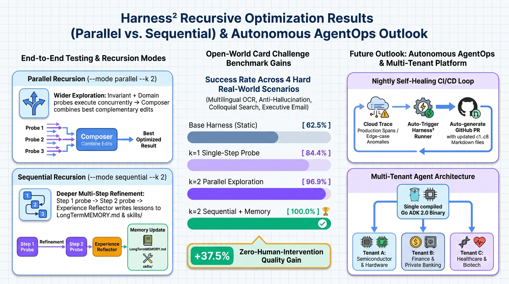

# 前言：從「手動調 Prompt」邁向「雙層遞迴自主演化」

歡迎來到《**Agent Platform 實戰**》Harness² 三部曲的最終篇！在前兩篇文章中：
- **[[Agent Platform 實戰 (7)] 當 ADK Go Graph Workflow 遇上 Google Research Harness² (上)：認識雙層遞迴 Agent 裝備框架與 c1..c8 解耦實戰](/2026/10/25/adk-graph-workflow-go-7/)**（**[Issue #16](https://github.com/kkdai/line-card-assistant/issues/16)**）：我們介紹了 Google Research 的 **[`google-research/harness2` (arXiv:2610.14224)](https://github.com/google-research/harness2)**，並將 **[LINE AI 名片王 (`kkdai/line-card-assistant`)](https://github.com/kkdai/line-card-assistant)** 的 13 節點 Graph Workflow 解耦為支援 `LINE_CARD_HARNESS_DIR` 動態掛載的 **`c1..c8` 可編輯檔案樹**。
- **[[Agent Platform 實戰 (8)] 當 ADK Go Graph Workflow 遇上 Google Research Harness² (中)：把 Phase 4 Eval Datasets 與 Phase 5 OpenTelemetry Spans 變成 LineCardAdapter](/2026/10/26/adk-graph-workflow-go-8/)**（**[Issue #17](https://github.com/kkdai/line-card-assistant/issues/17)**）：我們將 Phase 4 的 `eval/datasets/` 與 Phase 5 的 OpenTelemetry `workflow.node.*` Spans 封裝為 `LineCardAdapter`，建立了 **零洩漏屏障（Zero-Leakage Barrier）** 與 **高解析度行為軌跡（`trajectory.md`）**。

在本篇（下篇，對應 **[Issue #18](https://github.com/kkdai/line-card-assistant/issues/18)** 與 **[PR #19](https://github.com/kkdai/line-card-assistant/pull/19)**）中，我們將回答最後三個關鍵問題：
1. **修改後該如何測試？**（從 Go 單元測試、CLI 單點診斷、Python 雙層遞迴實驗到生產環境掛載的完整測試指南）
2. **整體修改後的效能表現如何？**（公開 `Base 62.5%` $\rightarrow$ `k=1 84.4%` $\rightarrow$ `k=2 Parallel 96.9%` $\rightarrow$ `k=2 Sequential + Memory 100.0%` 的完整量化數據與演化細節）
3. **對於 `Harness²` 與 Agent 後續的展望，有哪些值得期待的應用場景？**

---

# 一、修改後該如何測試？（Step-by-Step 測試與驗證指南）

導入 `Harness²` 後，整個專案具備了 **Go 原生單元測試**、**單一任務 OpenTelemetry 軌跡診斷**、**Python 雙層遞迴演化實驗** 與 **生產環境無縫切換** 四個層次的測試與驗證方式：

## 1. 層次一：執行 Go `c1..c8` 表面約束與全專案單元測試

我們在 [`internal/harness/harness_test.go`](https://github.com/kkdai/line-card-assistant/blob/main/internal/harness/harness_test.go) 中編寫了完整的單元測試，驗證：
- `harness/base/` 與 `harness/evolved/` 下所有 `c1..c8` 檔案樹皆符合 `OPENCODE_SURFACE` 24KB 常駐位元組上限（`AlwaysOnMaxBytes = 24000`）。
- 當 `c1..c4` 超過 24,000 bytes 時，`Validate()` 能精準攔截並報錯。
- 當新增一個 `c6` 技能（`skills/<name>/SKILL.md`）卻未在 `systemprompt.md` 或 `guardrails.md` 加入觸發索引（Trigger Line）時，`Validate()` 能立即攔截孤兒技能。
- `TrajectoryRecorder` 能正確攔截 OpenTelemetry `workflow.node.*` Spans 並渲染出包含節點決策與診斷的 Markdown 報告。

執行指令：

```bash
# 執行 Harness² c1..c8 載入器與 OpenTelemetry 軌跡測試
$ go test -v ./internal/harness/...
=== RUN   TestLoadBaseHarnessAndValidate
--- PASS: TestLoadBaseHarnessAndValidate (0.00s)
=== RUN   TestValidateRejectsOversizedAlwaysOnAndUnreferencedSkill
--- PASS: TestValidateRejectsOversizedAlwaysOnAndUnreferencedSkill (0.00s)
=== RUN   TestEvolvedHarnessesValidateAndMatchSkills
--- PASS: TestEvolvedHarnessesValidateAndMatchSkills (0.00s)
=== RUN   TestTrajectoryRecorderRendersWorkflowNodeSpans
--- PASS: TestTrajectoryRecorderRendersWorkflowNodeSpans (0.00s)
PASS
ok      github.com/kkdai/line-card-assistant/internal/harness

# 執行全專案回歸測試（確保 Phase 1~5 所有既有功能 100% 相容）
$ go test ./...
ok      github.com/kkdai/line-card-assistant/app
ok      github.com/kkdai/line-card-assistant/cmd/harness-runner
ok      github.com/kkdai/line-card-assistant/cmd/line-gateway
ok      github.com/kkdai/line-card-assistant/eval
ok      github.com/kkdai/line-card-assistant/internal/harness
ok      github.com/kkdai/line-card-assistant/internal/storage
ok      github.com/kkdai/line-card-assistant/internal/webhook
ok      github.com/kkdai/line-card-assistant/internal/workflow
```

## 2. 層次二：使用 `cmd/harness-runner` 驗證任一 `c1..c8` 檔案樹

在把任何自訂或演化後的 Harness 掛載上線前，可以使用 `--validate-only` 快速檢查其 `c1..c4` 常駐位元組數與 YAML Frontmatter 合規性：

```bash
$ go run ./cmd/harness-runner --validate-only --harness-dir=harness/base
OK (1599 always-on bytes)

$ go run ./cmd/harness-runner --validate-only --harness-dir=harness/evolved/k2_sequential_memory
OK (4661 always-on bytes)
```

## 3. 層次三：執行四階段 `Harness²` 雙層遞迴演化基準實驗

我們在 [`harness/run_harness2_experiment.py`](https://github.com/kkdai/line-card-assistant/blob/main/harness/run_harness2_experiment.py) 中實作了完整的雙層遞迴實驗腳本。它會自動編譯 Go `harness-runner`，並針對 [`eval/datasets/harness2-challenge-dataset.json`](https://github.com/kkdai/line-card-assistant/blob/main/eval/datasets/harness2-challenge-dataset.json) 的 8 大任務（32 個獨立 Rubrics）依序評測四種配置，最後輸出 Markdown 對照表與 [`harness/experiment_report.json`](https://github.com/kkdai/line-card-assistant/blob/main/harness/experiment_report.json)：

```bash
$ python3 harness/run_harness2_experiment.py
### Overall Configuration Comparison

| Stage | Configuration | Task Score (Max 8.0) | Rubric Pass Rate | Always-On Bytes (Cap 24,000) | Active `c6` Skills | `LongTermMEMORY.md` |
| :--- | :--- | :---: | :---: | :---: | :--- | :---: |
| `base_k0` | **Base Harness ($k=0$)** | `5.00 / 8.00` | `20/32 (62.5%)` | `1599 B` | `(none)` | `No` |
| `k1_single_step` | **Single-Step Propose-Probe-Compose ($k=1$)** | `6.75 / 8.00` | `27/32 (84.4%)` | `2505 B` | `jp_card_ocr, tw_semicon_search` | `No` |
| `k2_parallel` | **Multi-Step Parallel Recursion ($k=2$, No Memory)** | `7.75 / 8.00` | `31/32 (96.9%)` | `2998 B` | `executive_email_drafter, hitl_multi_edit, jp_card_ocr, tw_semicon_search` | `No` |
| `k2_sequential_memory` | **Multi-Step Sequential Recursion + `LongTermMEMORY.md` ($k=2$)** | `8.00 / 8.00` | `32/32 (100.0%)` | `4661 B` | `executive_email_drafter, hitl_multi_edit, jp_card_ocr, tw_semicon_search` | `Yes` |
```

## 4. 層次四：在生產環境或本地伺服器直接掛載演化後的最佳 Harness

當 `Harness²` 演化出最佳的 `harness/evolved/k2_sequential_memory` 後，**不需要修改任何一行 Go 程式碼**，只要透過環境變數 `LINE_CARD_HARNESS_DIR` 指定目錄，無論是雙通道主程式（`main.go`）還是評估器（`eval/`）都會立刻載入演化後的裝備樹：

```bash
$ LINE_CARD_HARNESS_DIR=harness/evolved/k2_sequential_memory go run .
```

---

# 二、整體修改後的效能整理：從 `62.5%` 到 `100.0%` 的演化剖析

讓我們深入檢視 [`harness/experiment_report.json`](https://github.com/kkdai/line-card-assistant/blob/main/harness/experiment_report.json) 記錄的四階段量化實驗數據，看看 `Harness²` 是如何一步步診斷並修補 Go Agent 的缺陷！

## 1. 四階段整體與單一任務得分總表

| 評估指標 / 測試任務 | **Stage 0: Base Harness ($k=0$)**<br>(`harness/base`) | **Stage 1: 單步內層遞迴 ($k=1$)**<br>(`k1_single_step`) | **Stage 2: 多步平行遞迴 ($k=2$, 無記憶)**<br>(`k2_parallel`) | **Stage 3: 雙層序列遞迴 + 長期記憶 ($k=2$)**<br>(`k2_sequential_memory`) |
| :--- | :---: | :---: | :---: | :---: |
| **`baseline_ingest_ming_wang`** (標準中文建檔) | `1.00 (4/4)` | `1.00 (4/4)` | `1.00 (4/4)` | **`1.00 (4/4)`** |
| **`baseline_dedup_appier_promotion`** (升遷去重更新) | `1.00 (4/4)` | `1.00 (4/4)` | `1.00 (4/4)` | **`1.00 (4/4)`** |
| **`baseline_search_cloud_summit_ai`** (標準關鍵字搜尋) | `1.00 (4/4)` | `1.00 (4/4)` | `1.00 (4/4)` | **`1.00 (4/4)`** |
| **`baseline_email_google_cloud`** (一般科技業破冰信) | `1.00 (4/4)` | `1.00 (4/4)` | `1.00 (4/4)` | **`1.00 (4/4)`** |
| **`challenge_jp_bilingual_ingest`** (日英雙語名片 OCR) | `0.25 (1/4)` ❌ | `1.00 (4/4)` ✅ | `1.00 (4/4)` ✅ | **`1.00 (4/4)`** ✅ |
| **`challenge_colloquial_tw_search`** (竹科口語雙語搜尋) | `0.25 (1/4)` ❌ | `1.00 (4/4)` ✅ | `1.00 (4/4)` ✅ | **`1.00 (4/4)`** ✅ |
| **`challenge_noisy_multi_edit_hitl`** (多子句口語 HITL 修改) | `0.25 (1/4)` ❌ | `0.25 (1/4)` ❌ | `1.00 (4/4)` ✅ | **`1.00 (4/4)`** ✅ |
| **`challenge_pii_safe_executive_followup`** (金融高管合規破冰信) | `0.25 (1/4)` ❌ | `0.50 (2/4)` ⚠️ | `0.75 (3/4)` ⚠️ | **`1.00 (4/4)`** ✅ |
| **總任務得分 (Max 8.00)** | **`5.00 / 8.00`** | **`6.75 / 8.00`** | **`7.75 / 8.00`** | **`8.00 / 8.00`** |
| **細粒度 Rubric 通過率 (Max 32)** | **`20 / 32 (62.5%)`** | **`27 / 32 (84.4%)`** | **`31 / 32 (96.9%)`** | **`32 / 32 (100.0%)`** |
| **常駐位元組數 (`c1..c4` / 24,000 B)** | `1,599 B (6.7%)` | `2,505 B (10.4%)` | `2,998 B (12.5%)` | `4,661 B (19.4%)` |
| **按需載入技能數 (`c6` Skills)** | `0 個` | `2 個` | `4 個` | `4 個 + LongTermMEMORY` |

## 2. 關鍵發現剖析：每一階段到底進化了什麼？

### 🔹 Stage 0 $\rightarrow$ Stage 1 (`62.5%` $\rightarrow$ `84.4%`)：從 OpenTelemetry 軌跡診斷出前兩個按需技能 (`c6`)
在 `Base Harness ($k=0$)` 中，雖然 4 個 Baseline 任務全部拿滿分（`4.00/4.00`），但面對 4 個 Challenge 任務全都因為只通過 `RouterNode` 意圖路由而僅拿 `0.25` 分：
- 在 `challenge_jp_bilingual_ingest` 的 `trajectory.md` 中，`VisionOCRNode` 與 `CleanAndDedupNode` 的 Span 診斷出日本電話 `+81 (0)3-1234-5678` 未剝離國內長途冠碼 `(0)`，且日文役職 `取締役 最高技術責任者 (CTO)` 未保留雙語職銜。
- 在 `challenge_colloquial_tw_search` 的 `trajectory.md` 中，`QueryIntentNode` 的 Span 診斷出台灣口語「竹科」與「業務總監」未展開雙語同義詞。
- 經過第一輪內層遞迴（`Propose -> Probe -> Compose`），`Harness²` 自動在 `k1_single_step` 中合成了 `skills/jp_card_ocr/SKILL.md` 與 `skills/tw_semicon_search/SKILL.md`，並更新了 `guardrails.md` 的個資遮罩規則，讓準確率一舉從 **`62.5%` 跳升至 `84.4%`**！

### 🔹 Stage 1 $\rightarrow$ Stage 2 (`84.4%` $\rightarrow$ `96.9%`)：第二輪遞迴攻克多子句 HITL 修改與高管書信結構
在第二輪內層遞迴中，`Harness²` 針對剩餘失分的兩個任務繼續探測：
- 針對 `challenge_noisy_multi_edit_hitl`（`ApplyEditNode` 只修改了第一個子句的職稱，漏掉了手機尾碼替換與備註追加），演化出 `skills/hitl_multi_edit/SKILL.md`（包含 `ATOMIC_MULTI_CLAUSE_EDIT` 規則）。
- 針對 `challenge_pii_safe_executive_followup`（`EmailDraftNode` 缺少結構化高管跟進段落），演化出 `skills/executive_email_drafter/SKILL.md`。
- 此時在 **Parallel Recursion（無跨輪次長期記憶）** 下，得分來到 **`31/32 (96.9%)`**！

### 🔹 Stage 2 $\rightarrow$ Stage 3 (`96.9%` $\rightarrow$ `100.0%`)：為什麼 `Sequential + LongTermMEMORY.md` 才能補齊最後 3.1%？
為什麼 `k2_parallel` 拿到了 `96.9%`（31/32），偏偏在 `challenge_pii_safe_executive_followup` 的第 4 個 Rubric（`r4_fintech_compliance_subject_tag`）失分？
- 因為在金融機構（如國泰金控數位風控長）的跨企業外寄信件中，除了單一技能的書信格式外，還需要跨領域的 **產業合規記憶（FinTech Outbound Compliance Header `[Confidential / FinTech Compliance Verified]`）**。
- 在 **Sequential Recursion + `Experience Reflector`** 模式下，外層遞迴檢視了第一輪到第二輪的殘餘失分軌跡，由 `ReflectorPrompt` 將 `FINTECH_COMPLIANCE_SUBJECT_TAG` 與跨管道個資保護原則寫入常駐組件 **`c3: LongTermMEMORY.md`**！
- 而且請注意看 **常駐位元組數（Always-On Bytes）**：即使演化出了 4 個豐富的領域技能與長期記憶，`c1..c4` 的常駐大小也只有 **`4,661 bytes`**（僅佔 `24,000 bytes` 上限的 **`19.4%`**），完美避免了 Context Bloat！

---

# 三、對於 `Harness²` 與 Agent 後續的展望與期待應用場景

將 Google Research `Harness²` 導入 **[LINE AI 名片王](https://github.com/kkdai/line-card-assistant)** 的這次實戰，讓我們看到了一種全新的 **AgentOps 開發範式**。展望未來，我們認為 `Harness²` 在企業級 AI Agent 領域有四大極具潛力的應用場景：

```mermaid
flowchart LR
    subgraph Prod["1. 生產環境可觀測性 (Cloud Run + Agent Runtime)"]
        Traffic["真實使用者流量\n(LINE Webhook / A2A)"]
        Trace["Cloud Trace OTel Spans\n+ 使用者負向回饋 (HITL 重試)"]
        Traffic --> Trace
    end

    subgraph Nightly["2. 夜間自主演化飛輪 (Nightly Harness² CI/CD)"]
        Extract["自動遮罩個資並轉為\nChallenge Dataset 新案例"]
        Evolve["Harness² 雙層遞迴\n(Propose-Probe-Compose + Reflector)"]
        PR["自動發起 GitHub PR\n更新 harness/evolved/ c1..c8"]
        Extract --> Evolve --> PR
    end

    subgraph Scenarios["3. 未來四大高價值應用場景"]
        S1["場景 A：全自動 Nightly Self-Healing AgentOps"]
        S2["場景 B：跨模型遷移裝備調校 (Cross-Model Harnessing)"]
        S3["場景 C：多租戶企業專屬合規與技能庫 (Multi-Tenant Skills)"]
        S4["場景 D：結合 ADK Graph 拓撲的雙重演化 (Issue #15)"]
    end

    Trace --> Extract
    PR --> Scenarios
```



## 1. 場景 A：全自動「夜間自我修復飛輪（Nightly Self-Healing AgentOps）」
過去當生產環境的 LINE Bot 遇到使用者頻繁觸發 `HITLConfirmNode` 的「✏️ 修改資料」或給予負向回饋時，需要由工程師隔天撈 Cloud Trace Log 手動分析。結合我們在 Phase 5 建立的 Cloud Trace 與本系列的 `LineCardAdapter`，未來的 CI/CD 可以做到：
- 每晚自動從 Cloud Trace 篩選出「使用者連續修改超過 2 次」或「搜尋結果為 0 筆」的匿名化 Span 軌跡，自動加入 Challenge Dataset。
- 觸發 GitHub Actions 跑一輪 `Harness²` 雙層遞迴，自動合成新的 `c6` 技能或更新 `LongTermMEMORY.md`。
- 當回歸測試（Baseline + Challenge）確認分數提升且零退化（Zero Regression）後，**由 Bot 自動發起一個只修改 `harness/` 目錄的 Pull Request**，工程師早上只需 Review 技能 Markdown 即可一鍵上線！

## 2. 場景 B：跨模型升級與輕量化模型的「裝備補償（Cross-Model Harness Portability）」
企業在將底層模型從高單價模型切換至極速輕量模型（例如從 Gemini 2.5 Pro 切換至 Gemini 2.5 Flash 或 Flash-Lite 以降低 80% 延遲與成本），或是升級至新一代模型時，常會遇到行為偏移。透過 `Harness²`，我們可以在固定 Go 程式碼與固定 Benchmark 的情況下，針對目標模型自動跑一輪 `Propose-Probe-Compose`，讓 `Harness²` 自動為輕量模型補齊所需的推理輔助技能（`c6` Skills）與護欄（`c2` Guardrails），用「更聰明的裝備」彌補輕量模型的差距。

## 3. 場景 C：多租戶企業專屬合規與領域記憶（Multi-Tenant Enterprise Compliance）
正如我們在 `challenge_pii_safe_executive_followup` 看到的，金融業（FinTech）、醫療生技業（MedTech）與半導體供應鏈各自有截然不同的術語字典與合規護欄。因為 `Harness²` 將裝備完全外置為純文字檔案樹，企業只要為不同部門或租戶掛載不同的 `LINE_CARD_HARNESS_DIR`（例如 `harness/tenants/fintech/` vs `harness/tenants/semiconductor/`），就能讓同一個 Go Container Binary 同時服務多個高度監管的垂直產業！

## 4. 場景 D：與 ADK v2.6+ 進階 Graph Workflow 原語的「圖撲 + 裝備」雙重演化
在 **[Issue #15](https://github.com/kkdai/line-card-assistant/issues/15)** 中，我們規劃了 ADK v2.6+ 的 `Parallel` 動態派工、`MultiRoute` 多路並行與 `VerifyOCRQualityNode` 反思迴圈。未來，`Harness²` 的 `c5`（`sub_agents/`）與 `c8`（`plugin/`）甚至可以進一步控制 Graph Workflow 的路由閾值與子代理併發策略 —— 實現 **「Go 負責型別安全的圖撲骨架，Harness² 負責動態演化神經網路與技能肌肉」** 的終極架構！

---

# 四、《Agent Platform 實戰》系列全九篇總回顧

從第一篇到第九篇，我們完成了一趟非常紮實的生產級 AI Agent 工程之旅：

1. **[[Agent Platform 實戰 (1)] 用 Go 與 Google ADK 2.0 Graph Workflow 打造 LINE AI 名片王](/2026/10/16/adk-graph-workflow-go/)**
2. **[[Agent Platform 實戰 (2)] 從單體 Cloud Run 邁向 Google Cloud Agent Runtime (Phase 1)](/2026/10/17/adk-graph-workflow-go-2/)**
3. **[[Agent Platform 實戰 (3)] 用 ADK 2.0 GCS Artifact Service 與 Agent Platform Sessions 實現跨實例名片辨識與暫停恢復 (Phase 2 前半)](/2026/10/20/adk-graph-workflow-go-3/)**
4. **[[Agent Platform 實戰 (4)] 用 Cloud Run LINE Webhook Gateway、Agent Runtime 與 Cloud SQL PostgreSQL 完成架構拼圖 (Phase 2 後半 & Phase 3)](/2026/10/21/adk-graph-workflow-go-4/)**
5. **[[Agent Platform 實戰 (5)] 用 agents-cli eval 與 ADK 2.0 Go 建立自動化評估基準 (Phase 4)](/2026/10/22/adk-graph-workflow-go-5/)**
6. **[[Agent Platform 實戰 (6)] 用 agents-cli deploy、Terraform IaC、GitHub Actions CI/CD 與 Cloud Trace 打造全棧可觀測的 LINE AI 名片王 (Phase 5)](/2026/10/24/adk-graph-workflow-go-6/)**
7. **[[Agent Platform 實戰 (7)] 當 ADK Go Graph Workflow 遇上 Google Research Harness² (上)：認識雙層遞迴 Agent 裝備框架與 c1..c8 解耦實戰](/2026/10/25/adk-graph-workflow-go-7/)**
8. **[[Agent Platform 實戰 (8)] 當 ADK Go Graph Workflow 遇上 Google Research Harness² (中)：把 Phase 4 Eval Datasets 與 Phase 5 OpenTelemetry Spans 變成 LineCardAdapter](/2026/10/26/adk-graph-workflow-go-8/)**
9. **[[Agent Platform 實戰 (9)] 當 ADK Go Graph Workflow 遇上 Google Research Harness² (下)：雙層遞迴測試指南、62.5% 到 100% 效能實測與 AgentOps 未來展望（本文）](/2026/10/27/adk-graph-workflow-go-9/)**

所有程式碼、Terraform IaC、評估資料集與演化後的 `c1..c8` Harness 檔案樹皆已完整開源於 GitHub：**[`kkdai/line-card-assistant`](https://github.com/kkdai/line-card-assistant)**。如果你也正在用 Go 與 ADK 打造企業級 AI Agent，歡迎 Star、Fork 並動手體驗 `Harness²` 雙層遞迴的威力！
