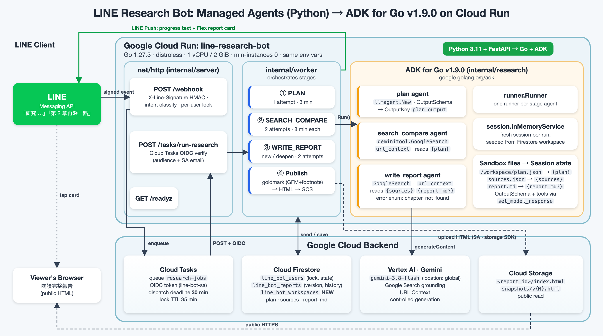
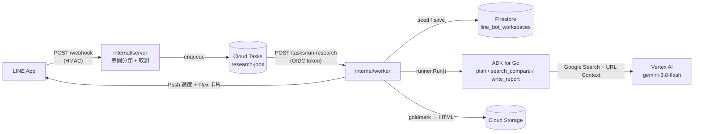

# 前情提要

在 [上一篇 Managed Agents API 全解析](https://www.evanlin.com/agents-api/) 裡，我做了一隻開源的 LINE 研究規劃師 Bot：**[`kkdai/line-research-bot`](https://github.com/kkdai/line-research-bot)**。

它的玩法很簡單：
- 在 LINE 傳「**研究 SOTA 開源向量資料庫的選型**」，Bot 會依序跑 **PLAN → SEARCH_COMPARE → WRITE_REPORT** 三個階段：先設計 4～8 組搜尋關鍵字，再用 Google Search + URL Context 讀真實網頁並交叉比對出「共識 / 分歧 / 缺口」，最後寫成一份有 footnote 引用的繁體中文 Markdown 報告。
- 報告由 Cloud Run 渲染成 HTML 丟上 Cloud Storage，LINE 收到一張附摘要、主要來源與「閱讀完整報告」按鈕的 Flex 卡片。
- 之後再傳「**第 2 章再深一點，加日文來源**」，Bot 會在同一份報告上深化、版本號 +1，舊版自動存成 snapshot。

第一版是 **Python 3.11 + FastAPI + `google-genai`（`enterprise=True`）** 打 Pre-GA 的 **Managed Agents API**，靠的是官方沙箱的 **持久化 filesystem**：`/workspace/plan.json`、`/workspace/sources.json`、`/workspace/report.md` 在同一個 `environment_id` 底下跨回合存活，深化時 Agent 自己去讀檔。

它很好玩，但跑了一陣子之後，有幾件事一直讓我不太放心：
- **Pre-GA，沒有 SLA**：`base_agent: antigravity-preview-05-2026` 這種名字一看就知道哪天會變。
- **沙箱裡的 `gsutil` 是 mock 的**（上一篇的踩坑二），結果 Agent 寫完報告還是得把整份 Markdown 塞回 JSON 給 Cloud Run 上傳。沙箱 filesystem 的價值其實只剩「跨回合記住三個檔案」。
- **一定要 `background=True` + 自己寫 polling 迴圈**，Stage 2/3 一慢就要調 timeout（我曾經從 240 秒一路調到 600 秒）。

於是這次我決定：**把整個服務改寫成 Go，所有跟 Agent 有關的事情改用 Google 官方的 [ADK for Go](https://github.com/google/adk-go)（`google.golang.org/adk` v1.9.0）來做，並且部署回原本的 Cloud Run 服務、沿用一模一樣的環境變數。** 整個過程我都記錄在原 repo 的 [Issue #1](https://github.com/kkdai/line-research-bot/issues/1)。

改寫完成後，我把 Go 版獨立成一個新的 repo，讓上一篇文章引用的 Python 版維持原樣，兩個版本可以直接對照：

| Repo | 內容 |
| :--- | :--- |
| **[`kkdai/line-research-bot`](https://github.com/kkdai/line-research-bot)** | 原本的 Python 3.11 + FastAPI + Managed Agents 版（上一篇文章的範例），以及這次遷移的 [Issue #1](https://github.com/kkdai/line-research-bot/issues/1) 紀錄 |
| **[`kkdai/line-research-bot-go`](https://github.com/kkdai/line-research-bot-go)** | 這篇的主角：Go 1.27 + ADK for Go v1.9.0，目前線上 Cloud Run 跑的就是這份程式碼 |

---

# 一、先講清楚：原本其實不是「Python ADK」

很多人（包括一開始的我）會把 Managed Agents 跟 ADK 混在一起講，但它們是兩個不同的東西：

| 比較項目 | 原 Python 版 | 新 Go 版 |
| :--- | :--- | :--- |
| **Agent 執行位置** | Google 託管的沙箱（Managed Agents API） | 自己的 Cloud Run 容器內（ADK Runner） |
| **SDK** | `google-genai`（`enterprise=True`），**沒有**用 `google-adk` | **`google.golang.org/adk v1.9.0`** + `google.golang.org/genai` |
| **Agent 定義** | `deploy/create-agent.sh` 用 curl 打 REST API 建一個 `research-planner` 資源 | 程式裡 `llmagent.New(llmagent.Config{...})` × 3 |
| **工具** | `code_execution`、`filesystem`、`google_search`、`url_context` | `geminitool.GoogleSearch{}` + `url_context` |
| **跨回合狀態** | 沙箱 filesystem（`environment_id`） | ADK Session State + Firestore `line_bot_workspaces` |
| **結構化輸出** | Prompt 裡寫「Return ONLY the JSON」+ 自己剝 code fence | `OutputSchema`（ADK 自動注入 `set_model_response`） |
| **呼叫方式** | `interactions.create(background=True)` + 每 3 秒 polling | `runner.Run()` 回傳 Go 1.23+ iterator，同步拿事件 |

所以這次與其說是「Python ADK → Go ADK」，更精確的說法是：**把託管式的 Managed Agent，換成自己掌控的 ADK Agent**。好處是沙箱裡 mock 掉的 `gsutil`、需要輪詢的 background 模式、還有 Pre-GA 的不確定性，全部都不用再擔心。

---

# 二、改寫前先立規矩：一個 Issue、先做可行性驗證

這個專案比上一篇的 linebot-helper 小很多（Python 版約 1,400 行，改寫後的 Go 約 2,000 行，不含測試），所以我沒有拆 11 個 Issue，而是開一個 [Tracking Issue #1](https://github.com/kkdai/line-research-bot/issues/1)，把「現況盤點 → 設計 → 可行性驗證 → 改寫 → 測試 → 部署 → 驗證」寫成 checklist，每完成一段就回 Issue 留言。

在動手寫任何一行 Go 之前，我先做了兩件事：

1. **`gcloud run services describe` 把線上服務設定撈出來**（Service Account、11 個環境變數、Secret Manager 綁定、記憶體、timeout），確保改寫後能 1:1 沿用。
2. **寫一支 30 行的 probe 程式**，確認 ADK for Go 在 Vertex AI 上能不能「**Google Search + URL Context + OutputSchema 三個一起開**」。這是整個設計能不能成立的關鍵，結果在第四節會講。

確認可行後，Go 版（module path `github.com/kkdai/line-research-bot-go`）的模組切分如下：

```
cmd/server/            main：組裝依賴、HTTP server、graceful shutdown
internal/research/     ADK for Go：三個 llmagent + runner + session state
  prompts/             plan / search_compare / write_report（go:embed）
internal/worker/       PLAN → SEARCH_COMPARE → WRITE_REPORT → publish、deepen、retry
internal/server/       /webhook、/tasks/run-research、/readyz
internal/state/        Firestore（users / reports 相容 + 新的 workspaces）
internal/publisher/    goldmark (GFM + footnote) → HTML → GCS（含 snapshot）
internal/linebot/      line-bot-sdk-go v8 + HMAC 驗章
internal/tasks/        Cloud Tasks（OIDC）
internal/intent, flex/ 意圖分類、Flex 卡片
```

整體資料流如下：



---

# 三、從 Managed Agents 到 ADK for Go：四個核心改寫

## 1. 從「REST 建立 Agent 資源」到「程式裡 `llmagent.New`」

Python 版的 Agent 是用 shell script 打 REST API 建出來的，三個 stage 的 system instruction 被串成一大段，靠每次輸入的第一行 stage tag（`PLAN` / `SEARCH_COMPARE` / `WRITE_REPORT`）讓 Agent 自己找對應章節：

```json
{
  "id": "research-planner",
  "base_agent": "antigravity-preview-05-2026",
  "tools": [{"code_execution": {}}, {"filesystem": {}}, {"google_search": {}}, {"url_context": {}}],
  "system_instruction": "...三個 stage 的說明串在一起..."
}
```

Go 版則是三個各司其職的 `llmagent`（[`internal/research/agents.go`](https://github.com/kkdai/line-research-bot-go/blob/main/internal/research/agents.go)），prompt 用 `go:embed` 放在 [`internal/research/prompts/`](https://github.com/kkdai/line-research-bot-go/tree/main/internal/research/prompts)，工具只給需要的 stage（規劃階段根本不需要上網）：

```go
func urlContextTool() tool.Tool {
	return geminitool.New("url_context", "Reads the content of web pages by URL.",
		&genai.Tool{URLContext: &genai.URLContext{}})
}

ag, err := llmagent.New(llmagent.Config{
	Name:         "research_planner_search_compare",
	Description:  "Searches the web and cross-compares sources.",
	Model:        llm, // gemini.NewModel(ctx, cfg.GeminiModel, &genai.ClientConfig{Backend: genai.BackendVertexAI, ...})
	Instruction:  searchPrompt,
	Tools:        []tool.Tool{geminitool.GoogleSearch{}, urlContextTool()},
	OutputSchema: searchSchema,
	OutputKey:    "search_output",
})
r, err := runner.New(runner.Config{AppName: appName, Agent: ag, SessionService: sessions})
```

ADK for Go 目前只內建 `geminitool.GoogleSearch`，**URL Context 要自己用 `geminitool.New` 包一個 `genai.Tool`**，這是我翻 `tool/geminitool` 原始碼才發現的。另外 `AGENT_ID` 這個環境變數我沒有丟掉，改當成 ADK 的 `AppName` 與 agent 名稱前綴，這樣線上的環境變數完全不用動。

## 2. 從 `background=True` + polling 到 `runner.Run()` iterator

Python 版最囉唆的就是這段：Managed Agents 不支援同步模式，所以要先 `create`，再每 3 秒 `get` 一次，直到 `completed`：

```python
created = self._client.interactions.create(
    agent=self._agent_id, input=instruction, environment=env_arg,
    stream=False, background=True, store=True,
)
while time.monotonic() < deadline:
    polled = self._client.interactions.get(created.id, include_input=False)
    if polled.status == "completed":
        return AgentResponse(...)
    time.sleep(self._poll_interval)
```

ADK for Go 的 `runner.Run()` 直接回傳 Go 1.23 的 `iter.Seq2[*session.Event, error]`，Agent 在自己的行程裡跑，事件一個一個流出來，timeout 交給 `context.WithTimeout` 就好：

```go
for ev, err := range st.runner.Run(ctx, userID, sid,
	genai.NewContentFromText(input, genai.RoleUser), agent.RunConfig{}) {
	if err != nil {
		return "", invocationID, fmt.Errorf("%w: %s: %v", ErrAgent, st.name, err)
	}
	invocationID = ev.InvocationID
	// final response 的文字當作後備；正式結果從 OutputKey 讀
}
```

原本存在 Firestore 的 `last_interaction_id` 我改存 ADK 的 `InvocationID`，欄位名稱不變，查 log 對照時一樣好用。

## 3. 沙箱 `/workspace` 檔案 → ADK Session State + Firestore（最關鍵的一步）

Managed Agents 最大的賣點是沙箱 filesystem 跨回合存活。ADK 沒有沙箱，那「第 2 章再深一點」的時候，Agent 要去哪裡找上一次的來源和報告？

答案是 **ADK 的 Session State + Instruction 模板**。ADK 的 `Instruction` 會把 `{key}` 換成 session state 的值，`{key?}` 則是「不存在也沒關係」：

```markdown
## Cross-compared sources (JSON)
{sources}

## Current report Markdown (empty for a new report)
{report_md?}
```

對照關係就變成：

| 沙箱檔案（Python 版） | ADK Session State（Go 版） | 持久化位置 |
| :--- | :--- | :--- |
| `/workspace/plan.json` | `{plan}` | Firestore `line_bot_workspaces/{userId}.plan` |
| `/workspace/sources.json` | `{sources}` | `...sources` |
| `/workspace/report.md` | `{report_md?}` | `...report_md` |

但 Cloud Run 會水平擴展、也會縮到 0，`session.InMemoryService()` 裡的東西隨時會消失。所以我的做法是：**每次執行 stage 都開一個新的 ADK session，用 Firestore workspace 播種初始 state，跑完把結果寫回 Firestore，再刪掉 session。**

```go
created, err := a.sessions.Create(ctx, &session.CreateRequest{
	AppName: a.appName,
	UserID:  userID,
	State:   map[string]any{KeySources: in.SourcesJSON, KeyReportMD: in.ReportMD},
})
```

這樣 Cloud Run instance 完全無狀態，幾小時後的深化請求打到任何一台 instance 都一樣。附帶的好處是：

- **「再發佈一次」不再需要 LLM**：Python 版的 `retry_publish` 要叫 Agent 去沙箱把 `report.md` 讀出來再回傳；Go 版直接拿 Firestore 裡的 Markdown 重新渲染上傳，省一次模型呼叫。
- **沙箱過期的處理保持一致**：舊版在 Managed Agents 建立的報告，Go 版讀不到它的沙箱檔案。我把它當成原本的「environment 過期」路徑處理：推一句「上次研究檔案已過期，重新從頭研究 🔄」然後重跑。

⚠️ **一個 ADK 模板的小陷阱**：ADK 會把 instruction 裡所有符合 `{識別字}` 的字串都當成 state 變數，找不到就直接報錯。原本的 prompt 裡有很多 JSON 範例，搬過來時一定要清乾淨。我乾脆寫了一個單元測試，掃描三份 prompt，只允許 `{plan}`、`{sources}`、`{report_md?}` 三個 placeholder 出現。

## 4. 「Return ONLY the JSON」→ `OutputSchema`

Python 版為了拿到 JSON，prompt 結尾寫「Return ONLY the JSON. No prose, no markdown fences.」，程式端還要一個 `_parse_agent_json`，依序嘗試原文、```` ```json ```` fence 內容、第一個 `{` 到最後一個 `}`。

ADK for Go 的 `OutputSchema` 更乾淨：

> When OutputSchema is set, the framework transparently injects a `set_model_response` tool so the model can still invoke other tools (function tools, RAG, agent transfer, etc.) while producing structured output.

也就是說 **ADK 會自動注入一個 `set_model_response` 工具**，模型可以先用 Google Search / URL Context 查完資料，最後呼叫這個工具交出符合 schema 的結果，再由 `OutputKey` 寫回 session state。我用 `genai.Schema` 把三個 stage 的輸出結構都定義在 [`internal/research/schema.go`](https://github.com/kkdai/line-research-bot-go/blob/main/internal/research/schema.go)，原本的 JSON parser 留著當保險。

---

# 四、模型選擇：不是每個 Gemini 都能「搜尋 + 讀網頁 + 結構化輸出」同時開

前面提到的 probe 程式，就是為了這一刻。同一支程式在我的 GCP 專案、location `global` 上跑出來的結果：

| 模型 | Google Search + URL Context + OutputSchema | 結果 |
| :--- | :---: | :--- |
| `gemini-2.5-flash` | ❌ | `400 INVALID_ARGUMENT: controlled generation is not supported with URL Context tool` |
| `gemini-3-flash-preview` | ✅ | 第一版上線使用 |
| `gemini-3.1-flash` | ❌ | `404 NOT_FOUND`（這個專案沒有這個模型） |
| `gemini-3.8-flash` | ✅ | **目前預設** |
| `gemini-3.8-pro` / `-flash-preview` / `-pro-preview` / `-flash-lite` | ❌ | 皆為 `404 NOT_FOUND` |

兩個心得：
1. **模型清單要用你的專案實際打過才算數**。文件上有的模型名稱，不代表你的專案、你的 location 拿得到，`404 Publisher model ... was not found or your project does not have access to it` 是最常見的回應。
2. **模型名稱一定要做成環境變數**。Go 版新增一個可選的 `GEMINI_MODEL`，沒設定就用程式預設值，所以線上服務原本的 11 個環境變數一個都不用改。

### 換到 gemini-3.8-flash 時抓到的一個 bug

升級到 `gemini-3.8-flash` 之後，報告明顯變長變深（約 5k → 11～12k 字元），但整合測試抓到一個很微妙的問題：請它深化一個不存在的「第 99 章」時，它回傳的是

```text
error="chapter_not_found_chapter_not_found"   available_chapters=[]
```

舊程式用 `== "chapter_not_found"` 判斷，這個值不相等，於是會**把一份空的 `report_md` 當成新版本發佈出去**。修法有三層：

1. schema 裡的 `error` 改成 **enum**（只允許 `chapter_not_found`），從源頭限制模型。
2. worker 改用 `strings.Contains` 寬鬆比對；`available_chapters` 是空的就**自己從報告的 `##` 標題抓章節**。
3. `report_md` 是空的時候，一律不發佈，改推「深化失敗，請稍後再試。」

加上 enum 之後重跑，`gemini-3.8-flash` 正確回傳 `chapter_not_found` 和完整的四個章節。**換模型不是改一個字串就好，結構化輸出的邊界情境一定要重跑整合測試。**

代價也要誠實說：三個 stage 的總耗時從約 60 秒拉長到 150～190 秒。還在 timeout 內，但使用者要多等一下。

---

# 五、gcloud 與 Cloud Run 部署：十個需要特別注意的地方

程式寫完、`go test ./...` 全綠、整合測試也打過真的 Vertex AI 之後，真正的挑戰才開始。這是一個**正在線上服務真實 LINE 使用者**的 Bot，下面是這次部署一路上踩到或差點踩到的點。

## 注意 1：先 `describe` 線上設定，不要相信 repo 裡的 `deploy.sh`

我原本以為照著 repo 裡的 `deploy/deploy.sh` 部署就好，結果一 describe 線上服務才發現**兩邊早就不一樣了**（之前除錯時直接在線上調過）：

| 設定 | repo 裡的 `deploy.sh` | 實際線上服務 |
| :--- | :--- | :--- |
| `GCS_BUCKET` | `line-reports` | 另一個 bucket |
| Memory | `1Gi` | `2Gi` |
| Timeout | `600` | `3600` |
| `--min-instances` | `1` | `0`（沒設定） |

如果直接跑 `deploy.sh`，報告會被傳到錯的 bucket、長任務會被 600 秒砍掉。**改寫服務時，「線上實際狀態」才是規格書**：

```bash
gcloud run services describe line-research-bot --region=asia-east1 --format=json \
  | jq '{sa: .spec.template.spec.serviceAccountName,
         env: [.spec.template.spec.containers[0].env[].name],
         resources: .spec.template.spec.containers[0].resources,
         timeout: .spec.template.spec.timeoutSeconds}'
```

## 注意 2：要「沿用一樣的環境變數」，最簡單的做法是**什麼都不要帶**

上一篇 linebot-helper 是部署成**新的服務**，所以要把環境變數轉成 `--env-vars-file`。這次是部署回**同一個服務**，有一個更簡單的做法：

> `gcloud run deploy --source=.` **不帶** `--set-env-vars` / `--update-secrets`，新 revision 就會完整繼承上一個 revision 的環境變數與 Secret Manager 綁定。

這樣 LINE 的 Channel Secret / Access Token 從頭到尾都不會出現在指令列或終端機輸出裡。部署完我再 describe 一次，確認環境變數名稱清單跟原本一樣是 11 個。

## 注意 3：用 `--no-traffic --tag` 做金絲雀，**tag 至少要 3 個字元**

既然是同一個服務，我不想一部署就讓所有 LINE 使用者打到新版本。Cloud Run 的做法是：

```bash
gcloud run deploy line-research-bot --region=asia-east1 --source=. \
  --no-traffic --tag=golang
```

新 revision 拿到 0% 流量，但會有一個專屬的 tag 網址可以直接打。這裡我踩了一個很蠢的雷：一開始寫 `--tag=go`，直接被擋：

```text
ERROR: (gcloud.run.deploy) service.spec.traffic[1].tag: must be at least 3 characters long.
```

在 tag 網址上做完冒煙測試（下面列出來）後，再切流量，並把上一個 revision 的名字記下來當回滾點：

```bash
gcloud run services update-traffic line-research-bot --region=asia-east1 \
  --to-revisions=<新的 revision>=100

# 回滾只要一行
gcloud run services update-traffic line-research-bot --region=asia-east1 \
  --to-revisions=<上一個 revision>=100
```

| 冒煙測試 | 預期 | 結果 |
| :--- | :---: | :---: |
| `GET /readyz` | 200 | ✅ |
| `POST /webhook` 錯誤簽章 | 401 | ✅ |
| `POST /tasks/run-research` 沒帶 OIDC token | 401 | ✅ |
| 啟動 log 的 model 欄位 | 預期的模型名稱 | ✅ |

## 注意 4：Cloud Tasks 預設的 dispatch deadline 只有 10 分鐘

這是改寫時翻 Python 版程式碼發現的潛在問題。研究任務是透過 Cloud Tasks 打回自己的 `/tasks/run-research` 執行的，Cloud Run 的 timeout 是 3600 秒沒錯，**但 Cloud Tasks 對 HTTP target 的預設 dispatch deadline 只有 10 分鐘**。超過 10 分鐘還沒回應，Cloud Tasks 會判定失敗並**重送**（queue 設定 `max-attempts=3`），同一個研究就會被重跑，Gemini 帳單跟著翻倍。

Go 版在 [`internal/tasks/dispatcher.go`](https://github.com/kkdai/line-research-bot-go/blob/main/internal/tasks/dispatcher.go) 建立 task 時直接設成上限 30 分鐘：

```go
Task: &cloudtaskspb.Task{
	DispatchDeadline: durationpb.New(30 * time.Minute),
	MessageType: &cloudtaskspb.Task_HttpRequest{HttpRequest: &cloudtaskspb.HttpRequest{ /* ... */ }},
},
```

同時，Python 版的使用者鎖 TTL 只有 300 秒，代表任務還沒跑完，使用者再傳一個題目就能拿到鎖，兩個任務同時改同一個 workspace。Go 版把 **鎖的 TTL 設成 35 分鐘（大於 dispatch deadline）**，任務結束時一樣主動釋放。

## 注意 5：`--allow-unauthenticated` 之下，Cloud Tasks 的端點要自己驗 OIDC

LINE Webhook 必須能從外部打進來，所以整個服務是 `--allow-unauthenticated`。`/webhook` 有 `X-Line-Signature` 保護沒問題，但 Python 版的 `/tasks/run-research` **完全沒有驗證**：任何知道網址的人都能 POST 一個 JSON，觸發一次要燒 Gemini 費用的完整研究。

Cloud Tasks 在建立 task 時本來就會帶 OIDC token，只是 Python 版的接收端沒有去驗。Go 版在 [`cmd/server/main.go`](https://github.com/kkdai/line-research-bot-go/blob/main/cmd/server/main.go) 用 `google.golang.org/api/idtoken` 補上：

```go
func oidcVerifier(audience, saEmail string) server.TokenVerifier {
	return func(ctx context.Context, bearer string) error {
		p, err := idtoken.Validate(ctx, bearer, audience) // audience = 服務網址 + /tasks/run-research
		if err != nil {
			return err
		}
		if email, _ := p.Claims["email"].(string); email != saEmail {
			return fmt.Errorf("unexpected token email %q", email)
		}
		return nil
	}
}
```

幾個要對齊的細節：
- **audience 兩邊要一致**：建立 task 時明確指定 `OidcToken.Audience`，接收端驗同一個值（我用 `CLOUD_RUN_SERVICE_URL + "/tasks/run-research"`）。
- **Service Account 要能 actAs 自己**：Cloud Tasks 要幫你用 `line-bot-sa` 簽 OIDC token，`line-bot-sa` 需要在自己身上有 `roles/iam.serviceAccountUser`，再加上 `roles/cloudtasks.enqueuer`。
- **`CLOUD_RUN_SERVICE_URL` 是雞生蛋問題**：第一次部署前不知道網址，所以 `deploy.sh` 是先部署、再 `gcloud run services update --update-env-vars=CLOUD_RUN_SERVICE_URL=...`。部署回同一個服務時這個值會被繼承，不用重設。

## 注意 6：這次**不需要** `--no-cpu-throttling`，最小 instance 也可以是 0

上一篇 linebot-helper 我花了一整段講「沒加 `--no-cpu-throttling`，背景 goroutine 會被凍結」。這次的架構剛好相反：

- `/webhook` 只做驗章、分類、取鎖、enqueue，**同步做完才回 200**，沒有背景 goroutine。
- 真正耗時的研究是在 **Cloud Tasks 打進來的那個 HTTP request 裡**跑完的，request 從頭到尾都開著，Cloud Run 不會限制 CPU，也不會把這台 instance 縮掉。

所以預設的「只在處理 request 時分配 CPU」完全夠用，`--min-instances` 也可以維持 0。Go 冷啟動不到 1 秒，LINE reply token 大約有 1 分鐘的有效期，來得及。**要不要開 `--no-cpu-throttling`，取決於工作是在 request 裡做還是 request 外做。**

唯一要小心的是釋放鎖：handler 結束時 `r.Context()` 可能已經被取消，所以我用 `context.WithoutCancel(ctx)` 去釋放 Firestore 的鎖，確保一定放得掉。

## 注意 7：沒有本機 Docker 也能部署，`--source=.` 會用 Cloud Build

我的筆電沒有裝 Docker。`gcloud run deploy --source=.` 看到目錄裡有 `Dockerfile` 就會直接丟給 Cloud Build 建置。這次的 Bot 不需要 Chromium 或 ffmpeg，所以可以放心用最精簡的 distroless：

```dockerfile
FROM golang:1.27 AS build
WORKDIR /src
COPY go.mod go.sum ./
RUN go mod download
COPY cmd/ ./cmd/
COPY internal/ ./internal/
RUN CGO_ENABLED=0 go build -trimpath -ldflags="-s -w" -o /out/server ./cmd/server

FROM gcr.io/distroless/static-debian12:nonroot
COPY --from=build /out/server /server
USER nonroot:nonroot
ENTRYPOINT ["/server"]
```

Go 版沒有任何外部執行檔相依，prompt 也是用 `go:embed` 編進 binary，所以最終映像檔就是一個靜態執行檔，不需要另外 COPY 任何資料檔。

## 注意 8：同一個服務，LINE Webhook 網址不用換，但要用 API 驗證

部署完我本來想去 LINE Developers Console 改 Webhook URL，後來想到：**新版是部署回同一個 Cloud Run 服務，網址根本沒變**。與其開 Console 用眼睛比對，不如用 Channel Access Token 直接問 LINE：

```bash
TOKEN=$(gcloud secrets versions access latest --secret=LINE_CHANNEL_ACCESS_TOKEN)

# 目前設定的 webhook 與是否啟用
curl -s -H "Authorization: Bearer $TOKEN" \
  https://api.line.me/v2/bot/channel/webhook/endpoint

# 請 LINE 實際打一次 webhook
curl -s -X POST -H "Authorization: Bearer $TOKEN" -H 'Content-Type: application/json' \
  -d '{"endpoint":"<YOUR_SERVICE_URL>/webhook"}' \
  https://api.line.me/v2/bot/channel/webhook/test
```

我在 script 裡直接比對 `endpoint` 是否等於「服務網址 + `/webhook`」，只印出 `MATCH` 或 `DIFFERENT`，網址本身不會出現在終端機上。test API 回 `{"success":true,"statusCode":200}`，代表 LINE 的流量已經在打 Go 版了。

## 注意 9：用假使用者做端對端測試時，別讓 LINE 推播失敗觸發整條 pipeline 重跑

冒煙測試只能證明服務活著，我還想驗證 **webhook → Cloud Tasks（OIDC）→ ADK → Firestore → GCS** 整條路在正式環境上是通的，但又不想用真實使用者測。做法是用 Secret Manager 的 Channel Secret 對一個**假的 userId** 的訊息正確簽章，直接打 `/webhook`：

```bash
SIG=$(printf '%s' "$BODY" | openssl dgst -sha256 -hmac "$SECRET" -binary | base64)
curl -X POST -H "X-Line-Signature: $SIG" -d "$BODY" "$URL/webhook"
```

LINE 的 reply 和 push 一定會因為 userId / replyToken 是假的而回 400，這是預期中的事，但這也讓我注意到一個設計問題：**最後推 Flex 卡片失敗時，如果 worker 回傳 error，handler 就會回 500，Cloud Tasks 會把整個 3 分鐘、要花錢的研究流程重跑一遍**。所以 Go 版把所有 LINE push 失敗都改成「記 log、不回錯誤」，只有 Firestore 這類基礎設施錯誤才讓 Cloud Tasks 重試。

這次端對端在正式環境約 33 秒跑完，Firestore 的 report / workspace 正確寫入、鎖有釋放、GCS 上的 `index.html` 標題與版本 banner 正確。測完記得把假使用者的 Firestore 文件跟 GCS 物件清掉。

## 注意 10：升級到最新的 Go patch 版，並用 `govulncheck` 確認

改寫時本機是 Go 1.26.1，但查了一下最新版已經是 **1.27.3**。升級很簡單，`go get` 會順便改好 `go.mod` 並自動下載 toolchain：

```bash
go get go@1.27.3 toolchain@none
go run golang.org/x/vuln/cmd/govulncheck@latest ./...
```

`Dockerfile` 的 build image 也記得從 `golang:1.26` 改成 `golang:1.27`。`govulncheck` 的結果是「**你的程式碼受影響的漏洞：0**」，但依賴模組裡還有 3 個沒有被呼叫到的漏洞：`golang.org/x/net` 的兩個升到 v0.62.0 就修掉了，`golang.org/x/crypto` 那一個官方還沒有釋出修正版本。**`govulncheck` 會區分「有沒有被呼叫到」，這比單純掃 `go.mod` 版本號實用很多。**

---

# 六、順手修掉的東西：改寫是重新審視設計的好時機

| 項目 | Python 版 | Go 版 |
| :--- | :--- | :--- |
| `/tasks/run-research` 驗證 | 無 | Cloud Tasks OIDC（audience + SA email） |
| Cloud Tasks dispatch deadline | 預設 10 分鐘，長任務會被重送 | 30 分鐘 |
| 使用者鎖 TTL | 300 秒 | 35 分鐘，任務結束主動釋放 |
| `retry_publish` | 再叫一次 Agent 讀 `report.md` | 直接用 Firestore 裡的 Markdown，不需要 LLM |
| deepen 版本號 | 相信模型回傳的 `new_version` | 程式自己算 previous + 1 |
| 報告 HTML | 模型輸出的 raw HTML 會被渲染、`<title>` 沒跳脫 | goldmark 預設不渲染 raw HTML、title 有 escape |
| LINE push 失敗 | 例外往上丟 → 500 → Cloud Tasks 重跑 | 只記 log，不觸發重跑 |
| 執行環境 | Python 3.11 slim | Go 1.27.3 distroless/static，nonroot |

測試方面，Go 版有兩層：
- **單元測試**（`go test ./...`，不需要 GCP）：worker 用 fake store / agents / LINE / publisher，涵蓋新研究、各 stage 失敗、`retry_write`、`retry_publish`、deepen、`chapter_not_found`（含模型亂回的情況）、workspace 遺失；server 涵蓋簽章、鎖、enqueue 失敗回滾、OIDC、recall / reset / 閒聊。
- **整合測試**（`go test -tags integration`）：打真的 Vertex AI 跑完三個 stage，再測一次深化不存在的章節。換模型或升級 ADK 時，這組測試是唯一能抓到前面那種模型行為差異的方法。

---

# 七、最後一個資安提醒：公開的 Issue 也不要出現 Cloud Run 網址

兩個 repo 都是公開的，Issue 跟 PR 也都是公開的。整個過程我刻意做了幾件事：
- Issue 第一段就寫明「本 issue 為公開紀錄，**不會**貼出任何 Cloud Run 服務網址、Secret 值或內部識別資訊」。
- 所有會印出網址的 `gcloud` 指令，輸出都先用 `sed -E 's#https?://[^ ]+#<url>#g'` 遮掉，或只把網址存在 shell 變數裡、只印比對結果。
- 送 PR 前 `git diff main | grep run.app`，確認新加的程式碼與文件裡沒有真實網址（被抓到的只有已刪除的 Python 測試裡的 `https://x.run.app` 假網址）。
- 開新的公開 repo 之前，把**整段 git 歷史**（`git log --all -p`）掃一遍，確認真實的服務 hostname 一次都沒出現過，才用 `gh repo create --public --source=. --push` 推上去。新 repo 是公開的，舊 commit 裡的東西也會一起公開。

`/webhook` 有 LINE 簽章、`/tasks/run-research` 有 OIDC，就算網址外洩也打不進來；但一個公開的 `.run.app` 網址還是會引來掃描器跟沒意義的流量，**能不公開就不要公開**。

---

# 八、Python Managed Agents → Go ADK 遷移自我檢查清單（Checklist）

- [ ] **1. 先盤點線上設定**：用 `gcloud run services describe` 撈出 SA、環境變數、Secret 綁定、memory、timeout，不要相信 repo 裡可能已經過時的 deploy script。
- [ ] **2. 先做模型可行性驗證**：用你的專案、你的 location 實際打一次，確認模型存在、而且支援你需要的工具組合（例如 Google Search + URL Context + OutputSchema）。
- [ ] **3. 沙箱檔案 → Session State**：把 Managed Agents 沙箱裡跨回合的檔案，對應成 ADK 的 `{state}` placeholder，並持久化到 Firestore 之類的外部儲存，讓 Cloud Run instance 保持無狀態。
- [ ] **4. 檢查 instruction 裡的大括號**：ADK 會把 `{識別字}` 當成 state 變數，搬 prompt 時把 JSON 範例清乾淨，最好寫測試擋住。
- [ ] **5. 用 `OutputSchema` 取代 prompt 約束**，但保留一個寬鬆的 JSON parser 當保險，錯誤碼欄位盡量用 enum。
- [ ] **6. 同一個服務用 `--no-traffic --tag`（tag ≥ 3 字元）**，冒煙測試通過才 `update-traffic`，並記下回滾用的 revision。
- [ ] **7. 不帶 `--set-env-vars` 就會沿用上一版的環境變數與 Secret**，部署後再 describe 確認一次。
- [ ] **8. Cloud Tasks**：dispatch deadline 設到需要的長度（最長 30 分鐘），鎖的 TTL 要大於它，接收端一定要驗 OIDC token。
- [ ] **9. 只有在 request 外還有工作時才需要 `--no-cpu-throttling`**；工作都在 Cloud Tasks 的 request 裡做的話，min-instances 0 就很夠用。
- [ ] **10. 用 LINE API 驗證 webhook**：`GET /v2/bot/channel/webhook/endpoint` + `POST .../webhook/test`，比用眼睛看 Console 可靠。
- [ ] **11. 外部通知失敗不要觸發整條 pipeline 重試**，只讓基礎設施錯誤回 5xx。
- [ ] **12. 升到最新 Go patch 版並跑 `govulncheck`**，公開 repo 的 Issue / PR / README 不留真實服務網址。

---

# 小結與開源專案連結

這次把 **[`kkdai/line-research-bot`](https://github.com/kkdai/line-research-bot)** 從 Python + Managed Agents 改寫成 Go + ADK for Go 的 **[`kkdai/line-research-bot-go`](https://github.com/kkdai/line-research-bot-go)**，幾個最值得帶走的收穫：

1. **Managed Agents 和 ADK 是兩種取捨**：前者幫你管沙箱和檔案系統，後者讓 Agent 跑在你自己的程式裡。當沙箱的價值只剩「記住三個檔案」時，ADK 的 Session State + Firestore 反而更簡單、更好測。
2. **`OutputSchema` + 內建工具是 ADK for Go 很實用的組合**：`set_model_response` 讓模型可以先上網查資料，再交出強型別的結果，但前提是你挑的模型支援。
3. **部署回同一個服務時，`--no-traffic --tag` 是最安心的切換方式**：環境變數、Secret、Webhook 網址都不用動，回滾也只要一行。
4. **改寫是重新審視設計的最好時機**：這次順手補上的 OIDC 驗證、30 分鐘 dispatch deadline、不重跑 pipeline 的 push 失敗處理，在 Python 版其實都是潛在的問題。

Go 版完整程式碼在 **[`kkdai/line-research-bot-go`](https://github.com/kkdai/line-research-bot-go)**，改寫過程的逐步紀錄在 [Issue #1](https://github.com/kkdai/line-research-bot/issues/1)，歡迎參考與交流！

## 延伸閱讀

- [Google Managed Agents API 全解析（本 Bot 的 Python 版）](https://www.evanlin.com/agents-api/)
- [`kkdai/line-research-bot-go`：本文的 Go 版完整程式碼](https://github.com/kkdai/line-research-bot-go)
- [ADK for Go on GitHub](https://github.com/google/adk-go)
- [ADK 官方文件](https://google.github.io/adk-docs/)
- [Cloud Tasks：HTTP target 的 dispatch deadline](https://cloud.google.com/tasks/docs/reference/rest/v2/projects.locations.queues.tasks#Task.FIELDS.dispatch_deadline)
- [Cloud Run：使用 revision tag 測試新版本](https://cloud.google.com/run/docs/rollouts-rollbacks-traffic-migration)
