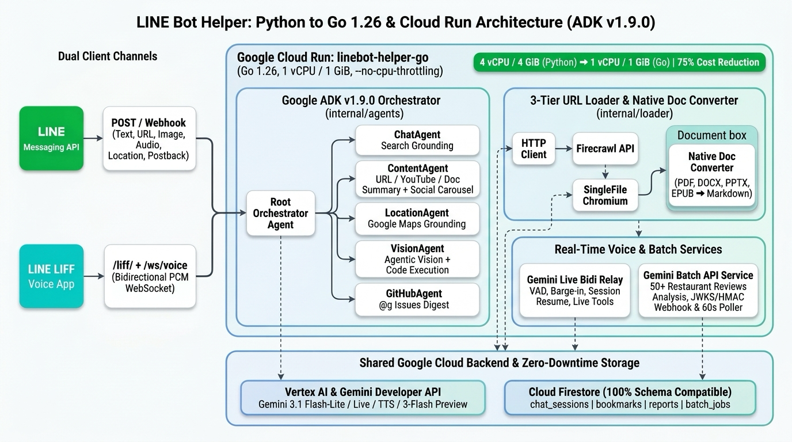
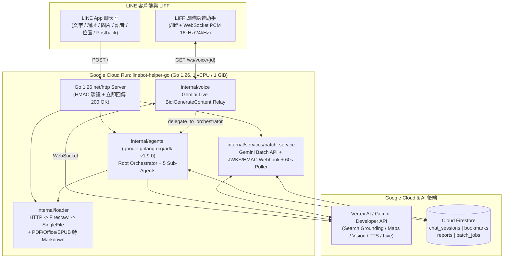

# 前情提要

我有一個自己每天重度使用的主力 LINE Bot：**[`kkdai/linebot-helper-python`](https://github.com/kkdai/linebot-helper-python)**。

最初它只是一個「丟網址進去、回傳繁體中文摘要」的小工具，但過去一年半裡，我陸續往裡面塞進了各式各樣的 Gemini 新能力：
- **多來源內容載入與文件轉檔**：網頁三層爬蟲 Fallback Chain（HTTP $\rightarrow$ Firecrawl $\rightarrow$ SingleFile Headless Chromium）、YouTube 影片摘要、PDF / Word / PPT / Excel / EPUB 自動轉 Markdown，以及一鍵產出 FB / LinkedIn / Threads 社群爆款文案 Carousel。
- **書籤與 Grounding 深度研究報告**：`/save`、`/list`、`/search` 書籤管理，點擊卡片上的「📄 詳細研究報告」就會結合 Google Search Grounding 寫出一份完整 Markdown 報告，渲染成獨立 HTML 網頁（`/reports/{id}`）並永久保存在 Cloud Firestore。
- **Google Maps Grounding 與 Gemini Batch API 美食大數據分析**：傳送 LINE 位置座標搜尋附近加油站、停車場與餐廳，還能針對特定餐廳抓出 50+ 則最新評論，丟進 **Gemini Batch API**（享 50% 成本折扣）跑深度招牌菜與雷點分析，透過 Webhook 或背景輪詢推播回 LINE。
- **Agentic Vision 視覺標註**：上傳圖片後讓 `gemini-3-flash-preview` 寫 Python Code 畫出標註框（Bounding Box），轉存成圖片推回聊天室。
- **LINE 語音訊息 TTS 與 LIFF 即時雙向語音助手**：語音訊息自動轉錄並搭配 `gemini-3.1-flash-tts-preview` + `ffmpeg` 產生 M4A 語音朗讀；打開 LIFF 還能透過 WebSocket 雙向串流 `gemini-3.1-flash-live-preview`，支援免持 VAD、Barge-in 打斷與 Live Tool Calling。

功能很爽，但代價也很明顯：**Python + FastAPI + 一大票文件解析與 AI 套件的常駐記憶體越來越高**，為了讓背景任務與多併發不卡頓，這台 Cloud Run 服務不知不覺已經開到了 **4 vCPU / 4 GiB Memory**（且開啟 `--no-cpu-throttling`）。

身為一個長期寫 Go 的人，看著一台個人日常助理吃掉 4 vCPU / 4 GiB 實在有點忍不下去了。於是決定動手做一件事：**把整套 `linebot-helper-python` 100% 改寫成 Go 1.26 最新版（[`kkdai/linebot-helper-go`](https://github.com/kkdai/linebot-helper-go)），直接部署到同一個 GCP 專案的 Cloud Run 上，並且做到與舊版共享 Firestore 資料、隨時可零停機切換。**

---

# 一、改寫前先立規矩：用 GitHub Issues 拆解 11 個里程碑

把一個將近 90KB `main.py` 外加十幾個模組的 Python 專案完整搬到 Go，如果沒有先拆好邊界、邊寫邊測，很容易寫出一座無法維護的新迷宮。

因此在建立 **[`kkdai/linebot-helper-go`](https://github.com/kkdai/linebot-helper-go)** 之後，第一件事不是寫 Code，而是對照 Python 版的所有功能，先在 GitHub 開出 **[Tracking Issue #12](https://github.com/kkdai/linebot-helper-go/issues/12)** 與 **11 個子任務 Issues（[#1](https://github.com/kkdai/linebot-helper-go/issues/1) ~ [#11](https://github.com/kkdai/linebot-helper-go/issues/11)）**，每個 Issue 對應一個獨立套件與完整的單元測試：

| 里程碑 Issue | 對應 Go 套件 | 核心職責與相容性重點 |
| :--- | :--- | :--- |
| **[#1](https://github.com/kkdai/linebot-helper-go/issues/1) 專案骨架與 Dockerfile** | `main.go`, `internal/config` | Go 1.26 `net/http`、環境變數 100% 相容 Python 版、Multi-stage Dockerfile（整合 Chromium / `single-file` / `ffmpeg`） |
| **[#2](https://github.com/kkdai/linebot-helper-go/issues/2) Gemini 雙通道客戶端** | `internal/gemini` | 同時支援 **Vertex AI (ADC)** 與 **Gemini Developer API (`GOOGLE_AI_API_KEY`)**，涵蓋 Grounding、Code Execution 與 TTS |
| **[#3](https://github.com/kkdai/linebot-helper-go/issues/3) Firestore 持久化層** | `internal/firestore`, `internal/services` | 完全相容 Python 版 `chat_sessions`、`bookmarks`、`reports`、`batch_jobs` 四大 Collection Schema，無憑證時自動降級為記憶體儲存 |
| **[#4](https://github.com/kkdai/linebot-helper-go/issues/4) LINE Messaging API 與 Flex** | `internal/line` | HMAC-SHA256 簽章驗證、Reply / Push / Loading Animation、社群文案與書籤 Flex Carousel 組裝 |
| **[#5](https://github.com/kkdai/linebot-helper-go/issues/5) 網址爬蟲與多格式文件轉換** | `internal/loader` | HTTP（含 PTT `over18=1`）$\rightarrow$ Firecrawl $\rightarrow$ SingleFile 三層時限預算 Fallback，以及 PDF / DOCX / PPTX / XLSX / EPUB / ODF 轉 Markdown |
| **[#6](https://github.com/kkdai/linebot-helper-go/issues/6) AI 工具集** | `internal/ai` | 摘要、社群爆款文案、Grounding 研究報告、YouTube 分析、Agentic Vision、GitHub Issues 彙整、Maps 搜尋 |
| **[#7](https://github.com/kkdai/linebot-helper-go/issues/7) ADK Orchestrator 與專職 Agents** | `internal/agents` | 整合官方 `google.golang.org/adk v1.9.0`，建立 Root `Orchestrator` 與 `Chat` / `Content` / `Location` / `Vision` / `GitHub` 5 個專職 Agent |
| **[#8](https://github.com/kkdai/linebot-helper-go/issues/8) 非同步 Webhook 與 Postback** | `internal/handlers` | Webhook 秒回 `200 OK`、背景 Goroutine 處理事件、9 種 Postback 分派與 `/reports/{id}`、`/images/{id}`、`/audio/{id}` 端點 |
| **[#9](https://github.com/kkdai/linebot-helper-go/issues/9) Gemini Batch API 美食分析** | `internal/services/batch_service.go` | JSONL 批次工作上傳、Static HMAC Webhook、Dynamic RS256 JWKS Webhook 驗證與 60 秒背景輪詢 |
| **[#10](https://github.com/kkdai/linebot-helper-go/issues/10) LIFF 即時語音助手** | `internal/voice`, `static/liff` | `/ws/voice/{session_id}` 雙向 WebSocket Relay、Push-to-Talk / 免持 VAD、Barge-in、Session Resumption 與 Live Tool Calling |
| **[#11](https://github.com/kkdai/linebot-helper-go/issues/11) Cloud Run 部署與驗證** | Cloud Run (`us-central1`) | 沿用 Python 版線上環境變數部署，壓測並調降容器資源規格 |

整體架構如下圖所示：



---

# 二、五個在改寫過程中特別有感的工程設計

## 1. Vertex AI 與 Developer API 雙軌並行的 Gemini Client

在這個 LINE Bot 裡，並不是所有功能都走同一個 Gemini 端點：
- **一般對話、Grounding 搜尋、Google Maps Grounding、圖片分析**：走 **Vertex AI**（使用 Cloud Run 服務帳號的 Application Default Credentials，不需 API Key）。
- **Native TTS 語音合成（`gemini-3.1-flash-tts-preview`）、Gemini Batch API 與 Gemini Live API WebSocket**：走 **Gemini Developer API**（使用 `GOOGLE_AI_API_KEY`）。
- **Agentic Vision（`gemini-3-flash-preview` + Code Execution）**：優先走 Developer API，若未設定 Key 則自動 Fallback 回 Vertex AI。

在 Go 版 [`internal/gemini/client.go`](https://github.com/kkdai/linebot-helper-go/blob/main/internal/gemini/client.go) 中，我們把這兩條路徑收斂在同一個 `gemini.Client` 底下，連 TTS 吐回來的 Raw PCM（`24kHz, 16-bit, mono`）透過 `ffmpeg` 轉成 LINE 支援的 `audio/mp4`（`.m4a`）並計算音訊毫秒數，都在同一個模組裡一氣呵成。

## 2. 100% 相容 Python 版的 Firestore Schema（實現零停機切換的關鍵）

改寫服務最怕「切換過去後，使用者的對話記憶、存了一半的書籤或之前產生的研究報告網址全部失效」。

為此，我們在 [`internal/firestore`](https://github.com/kkdai/linebot-helper-go/tree/main/internal/firestore) 與 [`internal/services`](https://github.com/kkdai/linebot-helper-go/tree/main/internal/services) 嚴格對齊了 Python 版的 4 個 Firestore Collection 名稱與欄位結構：
- `chat_sessions`：儲存多輪對話歷史與使用者最後傳送的 GPS 座標（`last_location`）。
- `bookmarks`：儲存 `/save` 書籤、社群文案候選書籤（`status: candidate` $\rightarrow$ `saved`），以及 7 天快取的 `report_id` 與 `report_generated_at`。
- `reports`：儲存 Grounding 深度研究報告渲染好的完整 HTML（支援 `/reports/{report_id}` 永久調閱）。
- `batch_jobs`：儲存 Gemini Batch API 任務 ID 與 LINE `user_id` 的映射。

這意味著 **Python 版與 Go 版可以同時掛在線上讀寫同一個 Firestore**。把 LINE Webhook 指過去的那一秒，所有舊書籤跟報告連結完全不受影響；萬一想切回 Python 版，也只需要改一行 Webhook URL。

## 3. 原生 Go 實作多格式文件轉 Markdown（告別笨重的 Python 文件套件）

Python 版用了 `anydoc` 等套件把 PDF、DOCX、PPTX、XLSX、ODT、EPUB、CSV、RTF 轉成 Markdown 再餵給 Gemini 摘要。這些套件在 Python 裡往往拉進一大串 C 擴充與相依套件。

到了 Go 版 [`internal/loader/doc_converter.go`](https://github.com/kkdai/linebot-helper-go/blob/main/internal/loader/doc_converter.go)，因為 `.docx`、`.pptx`、`.xlsx`、`.odt`、`.epub` 本質上全部都是 **ZIP 封裝的 XML 檔案**，我們直接用 Go 標準庫的 `archive/zip` + `encoding/xml` 搭配輕量的 PDF 文字提取器，不到幾百行純 Go 程式碼就把所有主流辦公文件與電子書格式乾乾淨淨轉成結構化 Markdown，編譯速度快、執行期幾乎零額外記憶體開銷！

---

# 三、誠實面對架構：Python 版的「概念型 ADK」vs. Go 版真正導入 `google.golang.org/adk v1.9.0`

在檢查程式碼時，我們發現了一個很有趣的歷史痕跡：

如果你打開原本 Python 版 [`agents/orchestrator.py`](https://github.com/kkdai/linebot-helper-python/blob/main/agents/orchestrator.py) 的開頭，會看到註解寫著：
> `Orchestrator Agent - 基於 Google ADK 的主控 Agent`

但如果你去翻 Python 版的 `requirements.txt` 與整包原始碼，會發現**裡面其實根本沒有安裝 `google-adk`**，也沒有任何一行 `from google.adk import ...`！當時的 Python 版只是「借用 ADK 的分層概念」，用純 Python Class 手刻了 `Orchestrator`、`ChatAgent`、`ContentAgent` 等類別，底層直接呼叫 `google-genai`。

這次改寫成 Go 版，我們決定玩真的——直接在 [`go.mod`](https://github.com/kkdai/linebot-helper-go/blob/main/go.mod) 引入 Google 官方最新的 **`google.golang.org/adk v1.9.0`**（搭配 `google.golang.org/genai v1.57.0`）：

| 比較項目 | 原 Python 版 (`linebot-helper-python`) | 新 Go 版 (`linebot-helper-go`) |
| :--- | :--- | :--- |
| **ADK 套件依賴** | ❌ 無（未安裝 `google-adk`） | ✅ **`google.golang.org/adk v1.9.0`** |
| **Agent 定義方式** | 自訂 Python Class | 使用 `llmagent.New(llmagent.Config{...})` 建立 `agent.Agent` |
| **Sub-Agents 階層** | 手動持有物件屬性 | Root `orchestrator` 透過 `SubAgents: []agent.Agent{...}` 掛載 5 個專職子 Agent |
| **Tools 綁定方式** | 手動方法呼叫 | 使用 `functiontool.New()` 註冊型別安全的 Go 函式工具（`load_url_content`、`summarize_youtube_video`、`search_nearby_places`） |
| **Model 介面** | 直接呼叫 `google.genai.Client` | 實作 `google.golang.org/adk/model.LLM` 與 `adkgemini.NewModel`（Vertex AI Backend） |

### 下一步：從「建立 ADK Agent 樹」走向「全面由 ADK Runner 驅動」（[Issue #13](https://github.com/kkdai/linebot-helper-go/issues/13)）

為了確保第一版遷移 100% 通過所有既有測試案例，目前 `ProcessText` 仍保留了原本的快速意圖路由。但我們已經在 **[Issue #13 (`[RFC] Google ADK (v1.9.0) 深度整合與架構演進提案`)](https://github.com/kkdai/linebot-helper-go/issues/13)** 規劃好接下來最讓人期待的 5 個 ADK 升級：

1. **用 `runner.Runner` + `SubAgents` / `agenttool` 取代硬編碼 Regex 路由**：讓使用者在 LINE 輸入複合指令（如「幫我查這篇文章提到的餐廳在哪裡，順便存進書籤」）時，由 ADK 自動轉移或平行呼叫多個 Sub-Agent。
2. **新增 `BookmarkAgent` 與研究報告 `functiontool`**：使用者不必再背 `/save`、`/search` 斜線指令，直接用自然語言說「幫我找上次存過關於 MCP 的書籤並做成研究報告」就能觸發。
3. **實作對接 Cloud Firestore 的 `adk/session.Service`**：把現有的 `firestore.KVStore` 封裝成標準 `session.Service`，讓 ADK Runner 原生管理跨輪次對話 Event 與狀態。
4. **導入 `workflowagents`（`sequentialagent` / `parallelagent`）**：將深度研究報告拆解為「擷取 $\rightarrow$ Google Search 查證 $\rightarrow$ 報告撰寫」序列工作流；將 FB / LinkedIn / Threads 爆款文案改為平行 Sub-Agents 同步產出。
5. **讓 LIFF 即時語音助手的 `delegate_to_orchestrator` 直接串聯 ADK Runner**。

---

# 四、Cloud Run 部署與瘦身：機器規格直接砍到 1/4！

完成全部 10 個核心套件與單元測試後（`go vet ./... && go test ./...` 全數通過），我們直接將 `linebot-helper-go` 部署上 Cloud Run。

來看看同一個 GCP 專案上，Python 版與 Go 版的容器資源配置對比：

| Cloud Run 服務 | 執行環境 | CPU | Memory | Concurrency | CPU 分配模式 | 相對資源成本 |
| :--- | :--- | :---: | :---: | :---: | :---: | :---: |
| **`linebot-helper-python`** | Python 3.11 + FastAPI | **4 vCPU** | **4 GiB** | 80 | Always allocated (`--no-cpu-throttling`) | `100%` (基準) |
| **`linebot-helper-go`** | **Go 1.26 原生編譯** | **1 vCPU** | **1 GiB** | **160** | Always allocated (`--no-cpu-throttling`) | **`25%` (立省 75%)** |

你可能會問：**Go 編譯出來的執行檔常駐記憶體才 20～30 MB，為什麼不乾脆開 `512 MiB` 就好，要留 `1 vCPU / 1 GiB`？**

這兩個數字背後都有實際的工程考量：
1. **為什麼是 `1 vCPU`？**
   因為 LINE Bot 需要在收到 Webhook 的瞬間秒回 `200 OK`，並在背景 Goroutine 繼續跑 Gemini 生成、研究報告渲染，加上每 60 秒還有一個輪詢 Gemini Batch API 的背景 Ticker，所以必須開啟 `--no-cpu-throttling`（CPU always allocated）。而在 Cloud Run 的規範中，開啟 `--no-cpu-throttling` 的最低 CPU 門檻就是 `1 vCPU`。
2. **為什麼是 `1 GiB Memory`？**
   Go 程式本身確實不到 30 MB，但別忘了我們的網址爬蟲第 3 層 Fallback 在容器內裝了 **`single-file` + Headless Chromium**（用來對付連 Firecrawl 都擋的動態渲染網站），再加上語音訊息合成需要呼叫 `ffmpeg`。當 Headless Chromium 偶爾被喚醒時，瞬間會吃掉 300～400 MB 記憶體。保留 `1 GiB` 既能確保 Chromium 啟動時絕不 OOM，又能把機器成本直接砍到原本 Python 版的 **1/4**！

部署指令非常乾淨：

```bash
gcloud run deploy linebot-helper-go \
  --source . \
  --project <YOUR_GCP_PROJECT_ID> \
  --region us-central1 \
  --cpu 1 \
  --memory 1Gi \
  --allow-unauthenticated \
  --no-cpu-throttling
```

---

# 五、雲端部署最容易踩坑與遺漏的 7 個魔鬼細節

把 LINE Bot 從本機測試搬上 Cloud Run、或是從舊的 Python 服務切換到新的 Go 服務時，「程式編譯得過」往往只完成了 60%。真正的雷通常藏在 Cloud Run 的執行期生命週期、網路代理、容器沙盒與外部端點設定裡。

以下整理這次部署過程中最容易被遺漏的 **7 個關鍵盲點**：

## 遺漏 1：忘了加 `--no-cpu-throttling`，或是把 `r.Context()` 傳進背景 Goroutine

LINE Webhook 規範要求伺服器在收到事件後快速回傳 `200 OK`，而我們的重度任務（例如耗時 1～2 分鐘的 Grounding 深度研究報告、Agentic Vision 寫 Code 畫圖、語音轉錄加 TTS，以及每 60 秒輪詢一次的 Gemini Batch API Poller）全部都是先回 `200 OK`、再開 `go func()` 在背景跑完後用 `PushMessage` 推播。

這裡有兩個新手與老手都極容易踩到的坑：

1. **Cloud Run 預設會在 HTTP Response 送出瞬間「凍結 CPU」**：
   如果不加 `--no-cpu-throttling`，只要 `handleWebhookCallback` 一 return `200 OK`，Cloud Run 會在幾十毫秒內把容器 CPU 降到接近 0。這時你的背景 Goroutine 就會像被按了暫停鍵一樣卡在半空中，直到幾分鐘後下一個 HTTP 請求進來才跟著動幾步，使用者永遠收不到推播！
2. **背景 Goroutine 絕對不能沿用 `r.Context()`**：
   在 Go 的 `net/http` 中，`r.Context()` 會在 HTTP Handler 結束（送出 `200 OK`）的那一刻立刻觸發 `Canceled`！如果你順手寫了 `go s.handleMessageEvent(r.Context(), event)`，背景正在呼叫 Vertex AI 或 Firestore 的請求會直接死在 `context canceled` 錯誤。

```go
// ❌ 錯誤寫法：r.Context() 在 return 200 OK 瞬間就會被 cancel，背景任務必死
go s.handleMessageEvent(r.Context(), eventCopy)

// ✅ 正確寫法：脫離 HTTP Request 生命週期，改用獨立的 Background Context（內部再依任務設 Timeout）
go s.handleMessageEvent(context.Background(), eventCopy)
```

## 遺漏 2：Vertex AI `GOOGLE_CLOUD_LOCATION=global` 的網域拼接陷阱

在沿用舊版環境變數時，我們看到 `GOOGLE_CLOUD_LOCATION=global`（因為許多 Gemini 3.x Preview 模型在 Vertex AI 是掛在 `global` Location 下）。

如果你在寫 Go 的 Vertex AI REST Client 時，直接照一般區域的習慣用 `fmt.Sprintf("https://%s-aiplatform.googleapis.com", location)`，當 `location` 為 `"global"` 時，拼出來的網址會變成：
> ❌ `https://global-aiplatform.googleapis.com`（**這個網域在 GCP 根本不存在，DNS lookup 會直接失敗！**）

在 Vertex AI 的規範中，只有區域端點（如 `us-central1`、`asia-east1`）才有前綴；當 Location 為 `global` 時，必須切換為無前綴的 `https://aiplatform.googleapis.com`：

```go
func (c *Client) vertexEndpointBase() string {
	if c.VertexBaseURL != "" {
		return strings.TrimRight(c.VertexBaseURL, "/")
	}
	if c.Location == "" || c.Location == "global" {
		return "https://aiplatform.googleapis.com"
	}
	return fmt.Sprintf("https://%s-aiplatform.googleapis.com", c.Location)
}
```

## 遺漏 3：用 `--set-env-vars` 搬移環境變數導致特殊字元截斷或密鑰外洩

要把 `linebot-helper-python` 線上十幾個環境變數原封不動搬到 `linebot-helper-go` 時，千萬不要手拼 `--set-env-vars="KEY1=VAL1,KEY2=VAL2..."`：
1. 只要 किसी Token 或 Prompt 字串裡帶有逗號 `,` 或等號 `=`，`gcloud` 的參數解析就會切錯位置甚至直接報錯。
2. 把環境變數直接攤在指令列參數裡，整串 Secret 就會留在終端機歷史紀錄或對話 Log 中。

**最穩妥的做法**：直接透過 `gcloud run services describe --format=json` 在本機背景轉出暫存的 `/tmp/env.yaml`，部署時用 `--env-vars-file=/tmp/env.yaml` 餵進去，部署完立刻 `rm -f /tmp/env.yaml`。全程既不會印出任何一把 Secret，也能 100% 保留所有特殊字元。

## 遺漏 4：忽略 Cloud Run 反向代理的 `X-Forwarded-Proto`，導致 LINE 拒收圖片與音檔

這個 LINE Bot 有四個地方需要動態組出「指向自己伺服器的公開網址」：
1. 研究報告頁面：`https://<host>/reports/{report_id}`
2. Agentic Vision 標註圖片：`https://<host>/images/{image_id}`
3. TTS 語音合成音檔：`https://<host>/audio/{audio_id}`
4. Gemini Batch API Dynamic Webhook：`https://<host>/api/gemini-callback/dynamic`

要注意的是：**LINE Messaging API 的 `ImageMessage` 與 `AudioMessage` 強制要求網址必須是 `https://`**。而在 Cloud Run 架構下，HTTPS TLS 在外層的 Google Front End (GFE) 就已經終止了，進到容器內 Go `http.Request` 時 `r.TLS` 是 `nil`。如果你沒有去讀 `X-Forwarded-Proto` 與 `X-Forwarded-Host` 標頭，組出來的 `http://` 網址傳給 LINE Push API 時會直接被拒絕！

## 遺漏 5：Go 追求極簡映像檔（`scratch` / `distroless`）卻忘了外部執行檔與 Chromium 沙盒限制

寫 Go 服務時，我們很習慣用 `FROM gcr.io/distroless/static` 把 Docker Image 壓到 20MB 以下。但在這支多功能 LINE Bot 上這樣做會立刻撞牆：
1. **缺少 `ffmpeg`**：TTS 語音合成收到 Gemini 回傳的 PCM 後呼叫 `exec.Command("ffmpeg", ...)` 轉 `.m4a` 會直接報 `executable file not found`。
2. **缺少 Headless Chromium、中文字型與容器沙盒旗標**：
   爬蟲第 3 層 Fallback 使用 `single-file` 驅動 Headless Chromium。在 Cloud Run 的容器沙盒環境裡，如果不給 Chromium 加上 `--no-sandbox`、`--disable-gpu` 與 `--disable-dev-shm-usage`（因為容器預設的 `/dev/shm` 共享記憶體很小），或者基底映像檔沒裝 `fonts-noto-cjk`（抓下來的中文網頁亂碼）與 `ca-certificates`（HTTPS 憑證驗證失敗），爬蟲在雲端就會無聲無息地 Crash。

因此我們的 [`Dockerfile`](https://github.com/kkdai/linebot-helper-go/blob/main/Dockerfile) 採用 `golang:1.26-bookworm` 編譯後，Runtime 階段選用 `debian:bookworm-slim` 並明確安裝 `ca-certificates`、`ffmpeg`、`chromium`、`fonts-noto-cjk` 與 `@single-file/cli`。

## 遺漏 6：In-Memory 暫存與 Cloud Run 自動水平擴縮（Multi-Instance）的狀態分裂

雖然我們把對話歷史、書籤、研究報告與 Batch Job 映射這四大核心狀態都持久化到了 Cloud Firestore，但有幾項「生命週期只有 5 分鐘」的二進位資料是放在 Go 記憶體 map 裡的：
- 使用者剛上傳、正在等待點選「識別圖片 / Agentic Vision」Quick Reply 的圖片（`imageTempStore`）
- 剛畫好標註框、等待 LINE 伺服器來拉取的 PNG（`/images/{image_id}`）
- 剛合成完、等待 LINE 伺服器來拉取的 M4A 音檔（`/audio/{audio_id}`）

**這在單一實例下完全沒問題，但一旦 Cloud Run 因為瞬間流量擴展成 2 個以上的 Instance，就會發生狀態分裂**：
- 使用者傳圖片打到 **Instance A**（圖片存在 A 的記憶體）。
- 3 秒後使用者按下「Agentic Vision」按鈕，Webhook 打到 **Instance B** $\rightarrow$ B 找不到圖片，直接回覆「⚠️ 圖片已過期，請重新傳送」！
- 或者 **Instance A** 產出 `/audio/{id}` 並呼叫 LINE Reply API，結果 LINE 的媒體伺服器來下載音檔時打到 **Instance B** 拿到 `404`，使用者在聊天室裡就只會看到一個無法播放的語音泡泡。

**解法**：因為 Go 單一實例就能輕鬆扛起高併發（我們將 `containerConcurrency` 設為 `160`），對於個人或中小型助理，建議將 `--max-instances` 限制為 `1`（若未來需要多實例高可用，則必須將 `/images` 與 `/audio` 的暫存改寫入 Cloud Storage 或 Firestore）。

## 遺漏 7：切換時只改了 Messaging API Webhook，卻漏了 Firebase Hosting WebSocket 限制與 LIFF Endpoint

準備從舊服務切到新服務時，最常遺漏以下三個外圍設定：

| 檢查點 | 為什麼容易遺漏？ | 實際影響與正確做法 |
| :--- | :--- | :--- |
| **1. 現有 Webhook 是否躲在 Firebase Hosting 後面？** | 我們透過 LINE API (`GET /v2/bot/channel/webhook/endpoint`) 查詢現有設定時，才發現原本的 Webhook 指在 `*.firebaseapp.com`（由 `firebase.json` rewrite 到 Cloud Run）。 | **Firebase Hosting 不支援 WebSocket 代理！** 如果 LIFF 語音助手（`/ws/voice/{id}`）走 Firebase Hosting 網域，WebSocket 握手會直接失敗。因此切換時應直接指向 Cloud Run 網址，或確保 LIFF 走直連。 |
| **2. LINE Login Channel 的 LIFF Endpoint URL** | LIFF App 的設定不在 Messaging API Channel，而是放在同一個 Provider 底下的 **LINE Login Channel** 分頁裡。 | 只改 Webhook 沒改 LIFF Endpoint 的話，聊天室打字是新的 Go 版在回，但點開語音助手卻還是連回舊的 Python 版。 |
| **3. Gemini Batch API 的靜態 Webhook / Eventarc** | 若在 GCP 有設定 Eventarc 或專案級靜態 Webhook 指到 `/api/gemini-callback/static`。 | 記得一併更新目標網址（而 Dynamic Webhook `/api/gemini-callback/dynamic` 則會自動抓取進站 Request 的 Host，無須手動修改）。 |

---

# 六、切換前盤點：從 GCP Log 抓出三個「殭屍端點」，順便規劃收編 `n8n` 排程！

在撰寫 README 的「從 Python 版切換」步驟時，原本列了一條：
> 「把呼叫 `/hn`、`/hf`、`/urls` 的外部排程改指向新服務。」

但我轉念一想：**等等，這三個端點現在真的還有被我的 `n8n` 呼叫嗎？**

我們立刻用 `gcloud logging read` 撈了 GCP 專案裡 `linebot-helper-python` 與 `n8n` 服務的執行紀錄，結果發現了一個大驚喜：
- `/hn`、`/hf`、`/urls` 是 **2024 年 11 月** 初版寫的端點，當時是讓外部排程把網址陣列 POST 進來給 LINE Bot 代為摘要並推播。
- 但現在雲端上的 `n8n` 服務（跑著 **「RSS to Sheet」**、**「每日工作(抓論文/分享影片)」**、**「Daily LINE Sender」** 與 **「AI 趨勢自動化電子報」** 四支 Active Workflows），早就已經改成**在 `n8n` 內部自己跑 Firecrawl、自己呼叫 Gemini 摘要、自己組裝 Flex JSON 並直接打 `https://api.line.me/v2/bot/message/push`**！
- 換句話說，`linebot-helper-python` 上的 `/hn`、`/hf`、`/urls` 過去幾個月**來自 `n8n` 的呼叫次數是 0**！

更有趣的是，在檢查 `n8n` 的 Debug Log 時，我們還意外抓到 `n8n` 在每天早上 6 點推播 YouTube 新影片摘要時，曾經因為 Javascript 節點組出來的 Flex Carousel 字數或縮圖格式問題，被 LINE API 回傳：
```text
Workflow execution finished with error: A message (messages[0]) in the request body is invalid
```

這個發現讓我們立刻做了兩個決定：

### 決定 1：立刻砍掉 `linebot-helper-go` 裡的 `/hn`、`/hf`、`/urls`
既然沒有任何外部服務在呼叫，留在公開的 Cloud Run 上反而只是多三個沒有簽章保護的攻擊面。直接從 `server.go` 移除後重新部署，線上打 `/hn`、`/hf`、`/urls` 全部回傳 `404 Not Found`，切換時也只需要在 LINE Developers Console 改 **Webhook URL** 跟 **LIFF Endpoint URL** 兩個地方就好！

### 決定 2：開立 [Issue #14](https://github.com/kkdai/linebot-helper-go/issues/14) ~ [Issue #19](https://github.com/kkdai/linebot-helper-go/issues/19)，把 `n8n` 的工作流收編進 `linebot-helper-go`！
既然 `linebot-helper-go` 已經是一台常駐 `1 vCPU / 1 GiB`（`--no-cpu-throttling`）的極速 Go 伺服器，裡面又有現成的三層爬蟲 `loader.Loader`、強型別 LINE Flex Builder、Gemini Batch API、Firestore `BookmarkService` 與 `ReportStore`，為什麼還要另外養一台 `n8n` + Postgres 資料庫？

更重要的是——**如果把這些每日排程全部改由 `linebot-helper-go` 透過目前同一個 LINE 官方帳號推播，就能打通「推播 $\rightarrow$ 互動」的完美閉環**：
- **[Issue #14 (`Batch Task 1/5`)](https://github.com/kkdai/linebot-helper-go/issues/14)**：建立受保護的 `POST /api/tasks/{task_name}` 排程端點与 Firestore `feed_items` 去重佇列（取代原本用 Google Sheets 比對 Row 的做法），統一使用主官方帳號推播。
- **[Issue #15 (`Batch Task 2/5`)](https://github.com/kkdai/linebot-helper-go/issues/15)**：每日 10:00 抓取 **Hugging Face Daily Papers**，在推播論文摘要卡片時直接附上 **「🔖 儲存書籤」** 與 **「📄 詳細研究報告」** 按鈕，看到好論文一鍵就能生成 Grounding 深度網頁報告。
- **[Issue #16 (`Batch Task 3/5`)](https://github.com/kkdai/linebot-helper-go/issues/16)**：每日 06:00 巡檢 **YouTube 追蹤頻道新片**，用 Go 強型別 Flex Builder 徹底解決 `n8n` 的 `400 Invalid Request Body` 問題，並在卡片直接附上 **「📝 詳細摘要」** Postback 按鈕。
- **[Issue #17 (`Batch Task 4/5`)](https://github.com/kkdai/linebot-helper-go/issues/17)**：整合 HN、Hatena IT、Google Dev Blog、LY Blog、Steam 等多來源 RSS 巡檢與每日 06:00 精選推播。
- **[Issue #18 (`Batch Task 5/5`)](https://github.com/kkdai/linebot-helper-go/issues/18)**：每週五 17:00 彙整當週精選內容與書籤，直接渲染成 `/reports/{id}` 精美網頁版 **AI 趨勢週報** 推播至 LINE。

---

# 七、最後一個資安提醒：別把 Cloud Run 真實網址留在公開 Git 歷史裡

在寫完部署紀錄與切換教學後，我做了一件很重要的收尾工作：**把 `README.md` 與 GitHub Issue 留言裡所有出現過的 `.run.app` 真實服務網址、GCP Project Number 與 LIFF ID 全部換成 `<YOUR_CLOUD_RUN_SERVICE_URL>` 佔位符，並重寫 Git Commit 歷史消除痕跡。**

原因很簡單：LINE Bot 的 Cloud Run 服務因為要接收 LINE 平台的 Webhook，必須設定為 `--allow-unauthenticated`。雖然我們的 `POST /` 有嚴格驗證 `X-Line-Signature`（沒有 Channel Secret 簽章一律擋在門外回 `400`），但把真實的 `.run.app` 網址直接寫在公開 GitHub Repo 的 README 上，還是很容易引來無謂的自動化爬蟲掃描與打流量的噪音。

**公開程式碼分享架構與實作，真實端點只留在自己的設定後台**，這才是長久維護個人 AI 助理最安心的做法。

---

# 八、Cloud Run 部署與遷移自我檢查清單（Checklist）

如果你也打算把現有的 Python LINE Bot 改寫成 Go 並搬上 Cloud Run，切換流量前可以用這份清單逐項打勾：

- [ ] **1. CPU 節流設定**：只要有背景 Goroutine（Webhook 秒回 `200 OK` 後背景推播、或是背景定時 Ticker），務必加上 `--no-cpu-throttling`（且 CPU 至少設為 `1`）。
- [ ] **2. Context 生命週期解耦**：背景 Goroutine 禁止傳入 `r.Context()`，一律改用 `context.Background()` 搭配獨立的 `context.WithTimeout`。
- [ ] **3. Vertex AI `global` 網域判斷**：若 `GOOGLE_CLOUD_LOCATION=global`，確認 Endpoint Base URL 為 `https://aiplatform.googleapis.com` 而非 `global-aiplatform.googleapis.com`。
- [ ] **4. 外部二進位工具與字型**：若容器內有呼叫 `ffmpeg`、`single-file` 或 Headless Chromium，確認最終階段 Docker Image 包含對應執行檔、`ca-certificates`、`fonts-noto-cjk` 以及 Chromium 的 `--no-sandbox --disable-dev-shm-usage` 參數。
- [ ] **5. 反向代理 HTTPS 標頭**：動態產生 `/images/{id}`、`/audio/{id}`、`/reports/{id}` 網址時，優先讀取 `X-Forwarded-Proto` 與 `X-Forwarded-Host`，確保傳給 LINE 的媒體網址必為 `https://`。
- [ ] **6. In-Memory 暫存與 Instance 數量**：若有短時效記憶體 map（如暫存圖片/音檔），建議設 `--max-instances=1` 並調高 `concurrency`，或改存 GCS / Firestore，避免多實例狀態分裂。
- [ ] **7. 雙通道 LINE 設定同步**：除了更新 **Messaging API** 的 Webhook URL 外，別忘了更新同 Provider 下 **LINE Login Channel** 的 **LIFF Endpoint URL**，並確認 WebSocket 路徑沒有被不支援 WS 的 CDN / Firebase Hosting 攔截。
- [ ] **8. 清理廢棄端點與公開資訊**：從 Cloud Logging 確認無用的舊端點（如 `/hn`、`/hf`、`/urls`）並直接移除，且確保公開 Repo 與 Git 歷史紀錄中不包含真實 `.run.app` 網址與密鑰。

---

# 小結與開源專案連結

這次從 **[`kkdai/linebot-helper-python`](https://github.com/kkdai/linebot-helper-python)** 到 **[`kkdai/linebot-helper-go`](https://github.com/kkdai/linebot-helper-go)** 的改寫之旅，幾個最值得帶走的收穫：

1. **先開 Issue 再寫扣**：11 個里程碑 Issue 讓大型語言改寫變得高度可控，每個模組都能獨立跑過單元測試再往上疊。
2. **共享資料層是零停機遷移的底氣**：只要 Firestore Collection Schema 對齊，新舊兩個語言的服務就能隨時無痛切換。
3. **Go 在 Cloud Run 上的資源效率極高**：同樣掛載 Headless Chromium 與 `ffmpeg`，從 Python `4 vCPU / 4 GiB` 換成 Go `1 vCPU / 1 GiB`，帳單直接打 25 折，回應速度還更快。
4. **切換前先看 Cloud Logging**：真實的流量 Log 不會騙人，一眼就能看出哪些端點早已退役、哪些外部 `n8n` 工作流其實更適合收編進同一個服務裡。

完整程式碼與後續的 ADK v1.9.0 / Batch Tasks 演進計畫都已開源在 GitHub：**[`kkdai/linebot-helper-go`](https://github.com/kkdai/linebot-helper-go)**，歡迎參考與交流！
