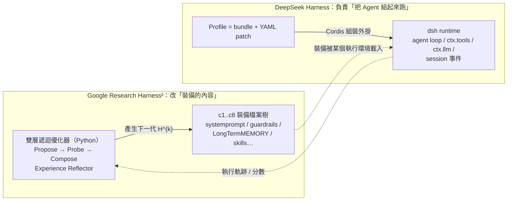
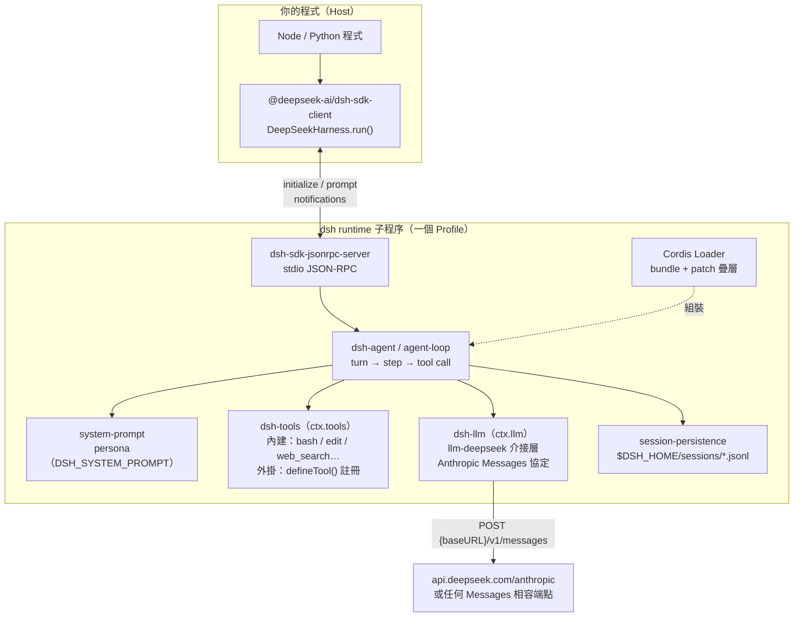
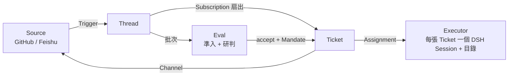
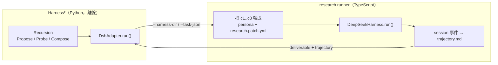

| | DeepSeek Harness（DSH） | Google Research Harness² |
| :--- | :--- | :--- |
| 一句話 | Agent 的**執行環境** | Agent 裝備的**自動優化器** |
| 「Harness」指的是 | 跑 Agent 的那套 runtime | 包在模型外面的提示詞、護欄、記憶、技能 |
| 你會改的東西 | Profile、YAML patch、外掛 | `c1..c8` 檔案樹（但通常是 Harness² 自己改） |
| 這個系列裡用在哪 | LINE 研究 Bot 的 Agent 層 | LINE AI 名片王的自我演化 |

# 前言：兩個 Harness，一週內碰到兩次

前幾天的 **Harness² 三部曲**（[上](https://www.evanlin.com/adk-graph-workflow-go-7/)、[中](https://www.evanlin.com/adk-graph-workflow-go-8/)、[下](https://www.evanlin.com/adk-graph-workflow-go-9/)），我把 Google Research 的 **[`google-research/harness2`](https://github.com/google-research/harness2)** 接上 **[LINE AI 名片王](https://github.com/kkdai/line-card-assistant)**，讓它讀 OpenTelemetry 軌跡、自己長出技能檔，準確率從 `62.5%` 一路爬到 `100.0%`。

這週又剛好碰到 DeepSeek 開源的 **[`deepseek-ai/dsh-superagent-prototype`](https://github.com/deepseek-ai/dsh-superagent-prototype)**，它建在 **[DeepSeek Harness（DSH）](https://www.deepseek.com/en/harness/)** 上。我把 **[LINE 研究 Bot](https://github.com/kkdai/line-research-bot-go)** 的 Agent 層從 ADK for Go 換成了 DSH，做成 **[`kkdai/line-research-bot-dsh`](https://github.com/kkdai/line-research-bot-dsh)**，目前已經在線上跑了。

兩個都叫 **Harness**，我一開始也以為是同一類東西。實際用過之後才發現：

> **DSH 是「馬具怎麼組裝、怎麼套在馬身上跑」；Harness² 是「自動調整馬具上的每一條皮帶」。** 兩個在不同層，甚至可以接在一起用。

因為內容太多，這次拆成兩篇：

1. **本篇**：DSH 框架到底是什麼（附框架圖），以及它跟 Google Harness² 的逐項比較。
2. **[下一篇](https://www.evanlin.com/line-research-bot-adk-to-deepseek-harness/)**：實際怎麼把 LINE 研究 Bot 從 ADK 搬到 DSH，加上踩坑清單。

---

# 一、先搞懂 DeepSeek Harness（DSH）是什麼

很多人看到 dsh-superagent 會以為它是一個 Agent SDK，其實它是兩層東西：

| 層次 | 是什麼 | 在 npm 上 |
| :--- | :--- | :--- |
| **DeepSeek Harness（DSH）** | 一個「Agent 執行環境」：負責模型呼叫、工具、Session、權限、沙箱，全部都是外掛 | `@deepseek-ai/dsh`（CLI）、`@deepseek-ai/dsh-*` 一百多個套件 |
| **dsh-superagent** | 跑在 DSH 上的一個 **bundle（外掛包）**，把 DSH 變成「幫一個 GitHub repo 做事的主動式 Agent」 | 一個 Node 套件，用 `dsh plugin add` 裝進 DSH profile |

## 1. 核心設計：一切都是 Cordis 外掛

DSH 底層是 **Cordis**（`@deepseek-ai/cordis`）這個外掛框架。模型、工具、Session 儲存、沙箱，甚至 JSON-RPC 伺服器，**全部都是一個個的外掛（plugin row）**，彼此透過 `ctx` 上的服務溝通，例如 `ctx.llm`、`ctx.tools`、`ctx.fs`、`ctx.subprocess`。

外掛怎麼組合起來，由 **Profile** 決定：

- **Bundle**：官方預先組好的一串外掛，例如 `dsh-sdk-minimal`、`dsh-base`、`web`、`tui`、`headless`。
- **Profile**：放在 `$DSH_HOME/profiles/<name>/` 底下，指定要用哪些 bundle。
- **Patch 疊層**：在 bundle 之上再疊 YAML patch，可以改某個外掛的 config、`disabled: true` 關掉它，或 `insert` 自己的外掛。用 `dsh --profile x --dump-config` 可以看到最後組出來的完整樹。

```yaml
# 一個 patch 的樣子：改模型設定、關掉 shell、插入自己的外掛
- id: llm-deepseek
  config:
    thinking: disabled
- id: persistent-bash
  disabled: true
- insert:
    - id: line-research-tools
      name: 'file:///app/dsh/plugin/index.js'
```

## 2. DSH 框架圖



從這張圖可以延伸出四個關鍵事實：

1. **Agent 跑在另一個行程裡**。不像 ADK 的 `runner.Run()` 是在你的程式裡跑，DSH 是你 spawn 一個 `dsh` runtime 子程序，用 **stdio JSON-RPC** 跟它講話。TypeScript 端是 `@deepseek-ai/dsh-sdk-client`，另外也有 Python SDK。
2. **模型層只講 Anthropic Messages 協定**。官方介接層 `llm-deepseek` 預設打 `https://api.deepseek.com/anthropic`。`baseURL` 可以換，但對面一定要是 `/v1/messages` 相容端點，**沒有 Gemini 介接層**。
3. **工具是外掛註冊的**。自己寫一個 Cordis 外掛，在 `apply(ctx)` 裡 `ctx.tools.register(defineTool({...}))`，參數 schema 由 DSH 驗證，驗不過會以錯誤結果回給模型，讓它自己修正。
4. **Session 是事件流**。每一次 `run()` 都會回傳完整的 session 事件：`turn/start`、`tool/call`、`tool/result`、`assistant/message`、`turn/end`……要拿結構化結果、要除錯，都靠這個。

## 3. dsh-superagent 在 DSH 上做了什麼

dsh-superagent 是 DeepSeek 團隊內部用的「主動式 coding agent」原型。它的 README 自己講得很清楚：**research prototype，不是正式產品**。它的領域模型長這樣：



- **Source** 把 GitHub 通知、Feishu 訊息轉成 **Trigger**。
- **Eval** 依照 **Policy**（誰可以下指令、在哪裡、強度多少）決定要不要接單，接了就開一張 **Ticket**。
- 每張 Ticket 由一個 **Executor Session** 在自己的目錄裡做事，結果透過 **Channel** 回到原本的對話，例如開一個 PR。
- 旁邊還有一個 Web 面板，顯示哪些事情需要人來決定。

它的執行模型是**一個長駐行程 + SQLite + 只聽 127.0.0.1 的管理 API**，而且一定要有 GitHub repo 跟 agent 帳號。這也是為什麼我搬 LINE Bot 時只借了 DSH，沒有 fork dsh-superagent，細節留到[下一篇](https://www.evanlin.com/line-research-bot-adk-to-deepseek-harness/)。

> 💡 **心得**：講到 DSH 時要分清楚是**執行環境（harness）**還是**上面那個應用（superagent）**。大部分人想借用的其實是前者。

---

# 二、快速回顧：Google Research Harness² 在做什麼

詳細內容可以看 [Harness² 上篇](https://www.evanlin.com/adk-graph-workflow-go-7/)，這裡只抓重點：

- **它把「Harness」定義成一棵可編輯的檔案樹**：`c1..c4` 是常駐組件（`systemprompt.md`、`guardrails.md`、`LongTermMEMORY.md`、`tool_descriptions/`），總和不能超過 **24,000 bytes**；`c5..c8` 是按需組件（`sub_agents/`、`skills/`、`scripts/`、`plugin/`）。
- **它用雙層遞迴自動改這棵樹**：
  - 內層 **Propose → Probe → Compose**：讀失敗任務的執行軌跡（`trajectory.md`）、提出多個候選 patch、在沙盒各跑一次、留下有正收益的合成下一代 $H^{(k)}$。
  - 外層 **Experience Reflector**：跨輪次提煉經驗，寫進 `c3: LongTermMEMORY.md`。
- **它透過 `BenchmarkAdapter` 跟你的 Agent 接起來**：`run()` 要回答「掛上某一版 Harness 跑某道題，產出了什麼、中間經歷了什麼」。在名片王裡，我是寫一個 Go 的 `cmd/harness-runner` 子程序 CLI，讓 Python 的 Harness² 呼叫。
- **零洩漏屏障**：黃金答案不給 Agent、也不給 Harvester LLM，逼它從軌跡推理出通用規則。

---

# 三、DSH vs Harness²：逐項比較

## 1. 「Harness」這個字，兩邊指的不是同一件事

這是整篇最重要的一點：

| | DSH 的 Harness | Harness² 的 Harness |
| :--- | :--- | :--- |
| 指的是 | **跑 Agent 的程式**：agent loop、工具執行、模型呼叫、Session、權限 | **餵給 Agent 的內容**：提示詞、護欄、記憶、工具說明、技能 |
| 型態 | 一個 Node 行程（runtime） | 一個資料夾（`c1..c8` 檔案） |
| 類比 | 馬具的扣環、韁繩怎麼組裝 | 馬具上每條皮帶的長度怎麼調 |
| 誰改它 | 工程師寫 Profile / patch / 外掛 | Harness² 的優化器自己改 |

所以兩者不是「二選一」的競爭關係，而是**上下兩層**。Harness² 要優化的那棵檔案樹，最後總要被某個 runtime 載入執行；DSH 正好就是一種 runtime。

## 2. 全面比較表

| 項目 | DeepSeek Harness（DSH） | Google Research Harness² |
| :--- | :--- | :--- |
| **出身** | DeepSeek 開源，dsh-superagent 的底座 | Google Research 論文開源（arXiv:2610.14224） |
| **語言** | TypeScript / Node（另有 Python SDK） | Python |
| **定位** | Agent 執行環境（runtime） | Agent 裝備的離線優化器 |
| **核心抽象** | Cordis 外掛、Profile、Bundle、Patch | `c1..c8` 組件、`BenchmarkAdapter`、Recursion |
| **主要產出** | 一次 Agent 執行的結果 + session 事件 | 一棵更好的 Harness 檔案樹 |
| **何時執行** | 線上，每個請求都跑 | 離線，對著評估集跑多輪 |
| **需不需要評估集** | 不需要 | **一定要**（還要有 rubric 與軌跡） |
| **模型** | Anthropic Messages 相容端點（預設 DeepSeek） | 被優化的 Agent 用什麼都行，Harvester 另外指定 |
| **對既有 Agent 的侵入程度** | 高：Agent 要跑在 DSH 裡 | 低：寫一個 Adapter，把設定外移成檔案即可 |
| **怎麼看 Agent 在做什麼** | `tool/call`、`tool/result`、`turn/end` 等 session 事件 | `trajectory.md`（我在名片王是從 OpenTelemetry Spans 產生的） |
| **成熟度** | `0.2.1-rc.5`，pre-release，參數會改名 | 研究程式碼，介面以論文實驗為主 |
| **這個系列裡** | LINE 研究 Bot 線上服務的 Agent 層 | LINE AI 名片王的離線自我演化 |

## 3. Harness² 的 `c1..c8`，在 DSH 裡對應到哪裡？

既然 DSH 也是「把一堆東西組成一個 Agent」，可以試著把 Harness² 的八個組件對過去。下表是我這次實際用 DSH 的理解，**沒有對應的我就寫沒用到**：

| Harness² 組件 | 在 DSH 裡的位置 | 我在 LINE 研究 Bot 怎麼用 |
| :--- | :--- | :--- |
| **`c1` systemprompt.md** | `system-prompt` 外掛，可以用 `DSH_SYSTEM_PROMPT` 帶入 persona | `prompts/persona.md` 當 persona，三個 stage 的指示放在 user message |
| **`c2` guardrails.md** | 兩個地方：工具參數的 **schema 驗證**（`required`、`enum`），以及 patch 把危險工具 `disabled: true` | `submit_report` 的 `error` 欄位用 `enum` 擋掉亂填的值；關掉 bash 與 editor |
| **`c3` LongTermMEMORY.md** | DSH 的 session 是**單次執行的事件流**，不是跨輪次記憶 | 沒用到；跨 stage 的資料放 Firestore |
| **`c4` tool_descriptions/** | `defineTool()` 的 `description` 與參數 schema，模型直接看到 | `web_research`、`submit_*` 的說明 |
| **`c5` sub_agents/** | DSH 內建有 `subagent` 工具（完整的 `sdk` profile 裡看得到） | 沒用到，`sdk-minimal` 裡也關掉了 |
| **`c6` skills/** | 這次沒研究到對應機制 | 沒用到 |
| **`c7` scripts/** | 等於讓 Agent 跑 shell（`persistent-bash` 等工具） | 刻意關掉 |
| **`c8` plugin/** | **這就是 DSH 的本體**：Cordis 外掛 | `dsh/plugin/index.js` 註冊研究工具 |

對完之後最有意思的發現是：**Harness² 的 `c8` 在 DSH 裡是主角**，而 Harness² 最在意的 `c1..c3`，DSH 反而只提供最基本的掛載點。這也呼應了兩邊的定位：DSH 在意「執行面」能不能被組裝，Harness² 在意「內容面」能不能被演化。

## 4. 共同點：兩邊都把「Agent 的裝備」從程式碼裡搬出來

雖然層次不同，兩邊有幾個很像的設計直覺：

1. **設定外移成檔案**。名片王導入 Harness² 的第一步，就是把寫死在 `.go` 裡的 Prompt 抽成 `harness/base/`；DSH 則是把「用哪些外掛、關掉哪些工具」抽成 Profile + YAML patch。兩邊都不想為了改 Agent 的行為而重新編譯。
2. **用子程序隔開**。名片王裡 Harness² 是呼叫 Go 的 `harness-runner` 子程序；DSH 本身就是一個被 SDK spawn 的子程序。這樣不管 Host 用什麼語言，都可以接上。
3. **都要看得到 Agent 的過程，不只是結果**。Harness² 靠 `trajectory.md` 做診斷；我在 DSH 上拿結構化輸出、確認 patch 有沒有生效，靠的也是 session 事件。**能觀察到中間過程，才有辦法優化或除錯。**

## 5. 差異：一個管「怎麼跑」，一個管「跑什麼」

- **DSH 的難點在工程**：外掛路徑解析、SDK 參數改名、模型協定只有 Messages。這些都是「讓它跑起來」的問題，我在[下一篇](https://www.evanlin.com/line-research-bot-adk-to-deepseek-harness/)整理了十個坑。
- **Harness² 的難點在資料**：要有夠好的評估集、rubric、零洩漏的設計、高解析度的軌跡。這些都是「讓它變更好」的問題。
- **DSH 每個請求都在跑**，要在意延遲與成本；**Harness² 是離線跑**，可以花比較多 token 換一棵更好的檔案樹，上線時成本為零。

---

# 四、能不能接在一起用？

可以，而且概念上很自然。以 LINE 研究 Bot 為例，如果想讓它像名片王一樣自我演化，大概會長這樣：



1. 仿照名片王的 `cmd/harness-runner`，寫一個 TypeScript 的 runner CLI，吃 `--harness-dir` 與 `--task-json`。
2. Runner 把 `c1` 轉成 `DSH_SYSTEM_PROMPT`、把 `c4` 寫進工具說明、把 `c2` 的一部分變成 patch（例如關掉哪些工具）。
3. 跑完把 `tool/call` / `tool/result` 等 session 事件渲染成 `trajectory.md`，連同報告一起回給 Python 端的 Adapter。

這部分我**還沒有實作**，只是把兩篇的經驗疊在一起之後覺得可行。DSH 的 session 事件本來就比 OpenTelemetry Spans 更貼近「Agent 決策」，拿來當 trajectory 應該會很好用。

---

# 五、什麼時候用哪一個？

| 你的狀況 | 建議 |
| :--- | :--- |
| 想要一個能組裝、能關掉危險工具、能換模型端點的 Agent 執行環境 | **DSH**（注意它是 pre-release，模型層只講 Messages） |
| Agent 已經上線，想讓提示詞、技能、記憶根據評估結果自動進化 | **Harness²**（前提是有評估集與執行軌跡） |
| 已經用 ADK 跑得很好，只是想調整品質 | 先上 **Harness²**，不用換框架 |
| 兩個都想要 | DSH 當 runtime、Harness² 當離線優化器，中間用 Adapter + 子程序接起來 |

---

# 小結

1. **同樣叫 Harness，DSH 是 runtime，Harness² 是 runtime 要載入的內容加上它的優化器**。先弄清楚這點，就不會拿它們互相比「誰比較強」。
2. **DSH 的設計重點是可組裝**：Cordis 外掛 + Profile 疊層，關掉、換掉、插入任何一塊都只要一段 YAML；代價是 Agent 跑在另一個行程，要用 JSON-RPC 跟它溝通。
3. **Harness² 的設計重點是可演化**：把裝備拆成有預算限制的 `c1..c8`，用軌跡驅動雙層遞迴去改它。
4. **兩邊都在做同一件事的不同面向**：把 Agent 的行為從程式碼裡解放出來。一個解放「怎麼跑」，一個解放「跑什麼」。

下一篇會進入實作：**[把 LINE 研究 Bot 從 Go ADK 搬到 DeepSeek Harness：搬遷對照與踩坑全紀錄](https://www.evanlin.com/line-research-bot-adk-to-deepseek-harness/)**。

## 延伸閱讀

- [Harness² 上篇：認識雙層遞迴 Agent 裝備框架與 c1..c8 解耦實戰](https://www.evanlin.com/adk-graph-workflow-go-7/)
- [Harness² 中篇：LineCardAdapter、零洩漏屏障與行為軌跡](https://www.evanlin.com/adk-graph-workflow-go-8/)
- [Harness² 下篇：62.5% 到 100% 的雙層遞迴實測](https://www.evanlin.com/adk-graph-workflow-go-9/)
- [`deepseek-ai/dsh-superagent-prototype`](https://github.com/deepseek-ai/dsh-superagent-prototype)
- [DeepSeek Harness](https://www.deepseek.com/en/harness/)
- [`google-research/harness2`](https://github.com/google-research/harness2)
- [`kkdai/line-research-bot-dsh`](https://github.com/kkdai/line-research-bot-dsh)
