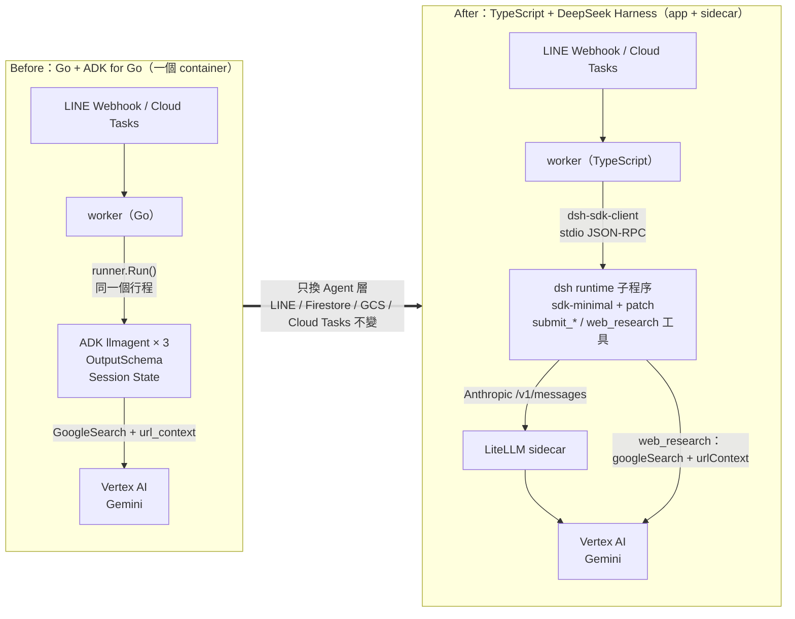
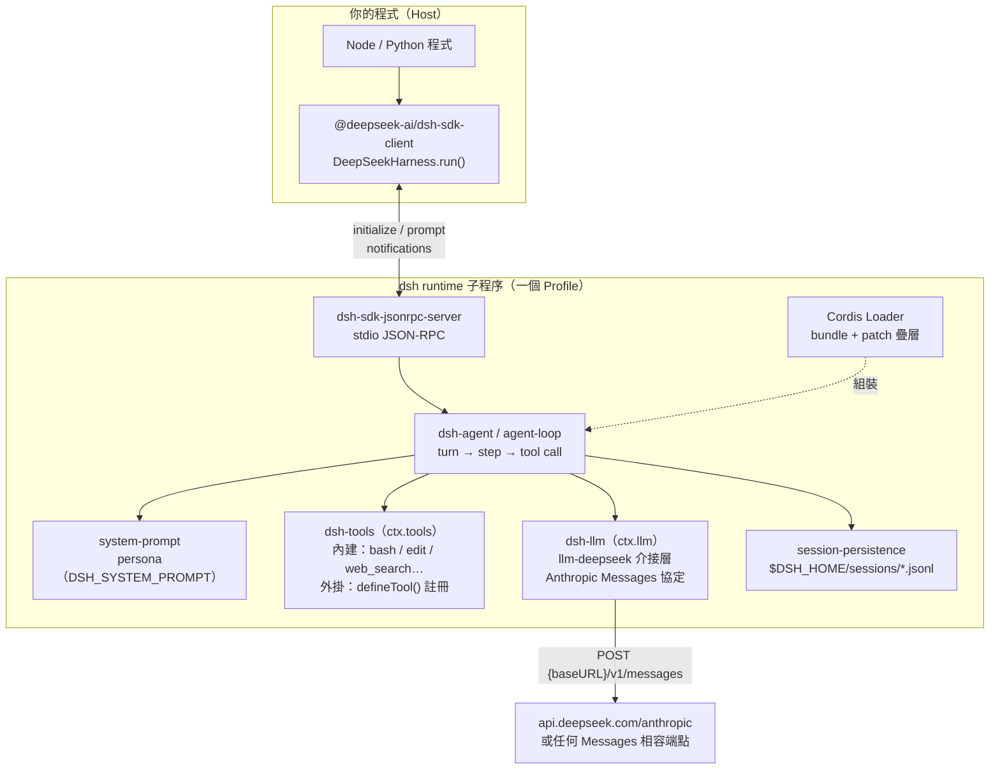
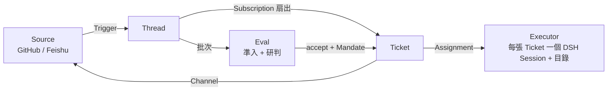
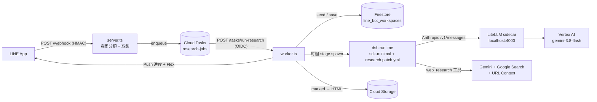

| | Before（ADK for Go） | After（DeepSeek Harness） |
| :--- | :--- | :--- |
| Agent 跑在哪 | 同一個 Go 行程 | 每個 stage 一個 `dsh` 子程序 |
| 怎麼接 Gemini | 直連 Vertex AI | DSH（Messages 協定）→ LiteLLM sidecar → Vertex AI |
| 結構化輸出 | `OutputSchema` | `submit_*` 工具 + 讀 session 事件 |
| Google Search | ADK 內建 `geminitool` | 自寫 `web_research` 工具 |
| Cloud Run | 1 個 container | 2 個 container（app + LiteLLM），一樣可以縮到 0 |

# 前情提要

在 [上一篇](https://www.evanlin.com/line-research-bot-python-to-go-adk/) 裡，我把 LINE 研究規劃師 Bot 從 Python + Managed Agents 改寫成 **Go + [ADK for Go](https://github.com/google/adk-go)**，也就是 **[`kkdai/line-research-bot-go`](https://github.com/kkdai/line-research-bot-go)**。

玩法沒變：
- 在 LINE 傳「**研究 SOTA 開源向量資料庫的選型**」，Bot 依序跑 **PLAN → SEARCH_COMPARE → WRITE_REPORT** 三個階段，最後丟一張有摘要、主要來源與「閱讀完整報告」按鈕的 Flex 卡片。
- 再傳「**第 2 章再深一點，加日文來源**」，同一份報告深化、版本號 +1，舊版存成 snapshot。

剛好 DeepSeek 開源了 **[`deepseek-ai/dsh-superagent-prototype`](https://github.com/deepseek-ai/dsh-superagent-prototype)**，它是建在 **[DeepSeek Harness（DSH）](https://www.deepseek.com/en/harness/)** 上的「超級 Agent」原型。我很好奇這套框架拿來做 LINE Bot 會是什麼樣子，所以給自己出了一個題目：

> **LINE Bot 功能跟 Cloud Run 設定都沿用原本的，只把 Agent 框架從 ADK 換成 dsh-superagent 這一套。**

先講結論：**做得到，而且已經在線上跑了**，但做法跟我一開始想的不一樣。這篇會分三塊：

1. **DSH 框架到底是什麼**（附框架圖），以及 dsh-superagent 在它上面做了什麼。
2. **怎麼從 ADK 搬過去**：概念對照與實際程式碼。
3. **會遇到哪些問題**：我實際踩到的坑，整理成清單。

| Repo | 內容 |
| :--- | :--- |
| **[`kkdai/line-research-bot-go`](https://github.com/kkdai/line-research-bot-go)** | 上一篇：Go 1.27 + ADK for Go v1.9.0 |
| **[`kkdai/line-research-bot-dsh`](https://github.com/kkdai/line-research-bot-dsh)** | 這篇的主角：TypeScript（Node 24）+ DeepSeek Harness 0.2.1-rc.5，目前 LINE webhook 指向的就是這份 |

---

# 一、先搞懂 DeepSeek Harness（DSH）是什麼

很多人看到 dsh-superagent 會以為它是一個 Agent SDK，其實它是兩層東西：

| 層次 | 是什麼 | 在 npm 上 |
| :--- | :--- | :--- |
| **DeepSeek Harness（DSH）** | 一個「Agent 執行環境」：負責模型呼叫、工具、Session、權限、沙箱，全部都是外掛 | `@deepseek-ai/dsh`（CLI）、`@deepseek-ai/dsh-*` 一百多個套件 |
| **dsh-superagent** | 跑在 DSH 上的一個 **bundle（外掛包）**，把 DSH 變成「幫一個 GitHub repo 做事的主動式 Agent」 | 一個 Node 套件，用 `dsh plugin add` 裝進 DSH profile |

## DSH 的核心設計：一切都是 Cordis 外掛

DSH 底層是 **Cordis**（`@deepseek-ai/cordis`）這個外掛框架。模型、工具、Session 儲存、沙箱、甚至 JSON-RPC 伺服器，**全部都是一個個的外掛（plugin row）**，彼此透過 `ctx` 上的服務溝通，例如 `ctx.llm`、`ctx.tools`、`ctx.fs`、`ctx.subprocess`。

外掛怎麼組合起來，由 **Profile** 決定：

- **Bundle**：官方預先組好的一串外掛，例如 `dsh-sdk-minimal`、`dsh-base`、`web`、`tui`、`headless`。
- **Profile**：放在 `$DSH_HOME/profiles/<name>/` 底下，指定要用哪些 bundle。
- **Patch 疊層**：在 bundle 之上再疊 YAML patch，可以改某個外掛的 config、`disabled: true` 關掉它，或 `insert` 自己的外掛。用 `dsh --profile x --dump-config` 可以看到最後組出來的完整樹。

```yaml
# 一個 patch 的樣子：改模型設定、關掉 shell、插入自己的外掛
- id: llm-deepseek
  config:
    thinking: disabled
- id: persistent-bash
  disabled: true
- insert:
    - id: line-research-tools
      name: 'file:///app/dsh/plugin/index.js'
```

## DSH 框架圖



幾個從這張圖延伸出來、對搬遷很關鍵的事實：

1. **Agent 跑在另一個行程裡**。不像 ADK 的 `runner.Run()` 是在你的程式裡跑，DSH 是你 spawn 一個 `dsh` runtime 子程序，用 **stdio JSON-RPC** 跟它講話。TypeScript 端是 `@deepseek-ai/dsh-sdk-client`，另外也有 Python SDK。
2. **模型層只講 Anthropic Messages 協定**。官方介接層 `llm-deepseek` 預設打 `https://api.deepseek.com/anthropic`。`baseURL` 可以換，但對面一定要是 `/v1/messages` 相容端點，**沒有 Gemini 介接層**。
3. **工具是外掛註冊的**。自己寫一個 Cordis 外掛，在 `apply(ctx)` 裡 `ctx.tools.register(defineTool({...}))`，參數 schema 由 DSH 驗證，驗不過會以錯誤結果回給模型，讓它自己修正。
4. **Session 是事件流**。每一次 `run()` 都會回傳完整的 session 事件：`turn/start`、`tool/call`、`tool/result`、`assistant/message`、`turn/end`……之後拿結構化結果就靠這個。

## dsh-superagent 在 DSH 上做了什麼

dsh-superagent 是 DeepSeek 團隊內部用的「主動式 coding agent」原型。它的 README 自己講得很清楚：**research prototype，不是正式產品**。它的領域模型長這樣：



- **Source** 把 GitHub 通知、Feishu 訊息轉成 **Trigger**。
- **Eval** 依照 **Policy**（誰可以下指令、在哪裡、強度多少）決定要不要接單，接了就開一張 **Ticket**。
- 每張 Ticket 由一個 **Executor Session** 在自己的目錄裡做事，結果透過 **Channel** 回到原本的對話，例如開一個 PR。
- 旁邊還有一個 Web 面板，顯示哪些事情需要人來決定。

這套設計非常完整，而且有一個 `SourceKind` 擴充點（`docs/008-cookbook.md`），理論上可以加一個 LINE Source 進去。

---

# 二、可行性評估：為什麼我沒有直接 fork dsh-superagent

一開始的直覺是：fork dsh-superagent、加一個 LINE Source、部署到 Cloud Run。實際翻完文件跟程式碼之後，發現它跟 Cloud Run 的假設幾乎完全相反：

| 項目 | dsh-superagent | 原本的 Cloud Run 架構 |
| :--- | :--- | :--- |
| 執行模型 | **一個長駐行程**（`scripts/dsh-superagent start` 用 tmux 跑起來） | 無狀態、會縮到 0 |
| 狀態 | `stateDir` 底下的 **SQLite** + lock 檔 | Firestore |
| 事件來源 | **主動 polling** GitHub 通知、Feishu 長連線 | LINE **Webhook 推進來** |
| HTTP | 管理 API **只聽 127.0.0.1**，還有同源檢查 | 必須對外公開 `/webhook` |
| 必要設定 | **一定要有 GitHub repo 與 agent 帳號**，否則 runtime 停在「等待設定」 | 只有 LINE Channel |
| Agent 權限 | `danger-full-access`，以 OS 使用者身分跑 shell | 只需要上網查資料 |
| 模型 | Anthropic Messages（DeepSeek） | Vertex AI Gemini |

如果硬要 fork，得做這幾件事：拿掉 GitHub 的強制設定、自己開一個驗簽的公開 webhook、Cloud Run 固定 `min = max = 1` 常駐，再掛 Filestore 放 SQLite。**等於放棄 scale-to-zero，還把一個 alpha 版、可以跑任意 shell 的行程直接放上網路。**

所以我在兩個方案之間做了選擇：

- **方案 A：Fork dsh-superagent，加 LINE Source。** 保留 Eval / Ticket / 面板，但成本最高、最脆弱。
- **方案 B：保留 Cloud Run 架構，只把 Agent 層換成 DSH。** ✅ 採用。LINE webhook、Cloud Tasks、Firestore、GCS 都不動，三個研究 stage 各跑一個 DSH Session。

模型的部分，我選擇**繼續用 Vertex AI 上的 Gemini**，中間放一個 LiteLLM 當翻譯。這個決定的影響在第三節講。

> 💡 **心得**：「把框架 A 換成框架 B」之前，先分清楚你要換的是**執行環境（harness）**還是**上面那個應用（superagent）**。這次我要的其實是前者。

---

# 三、從 ADK 搬到 DSH：架構與對照

## 搬遷後的架構



Cloud Run 上是**一個服務、兩個 container**：`app`（ingress）加上 `litellm` sidecar，彼此用 localhost 溝通。服務一樣可以縮到 0。

## ADK → DSH 對照表

| 概念 | ADK for Go（上一篇） | DeepSeek Harness（這篇） |
| :--- | :--- | :--- |
| **Agent 執行位置** | 同一個行程，`runner.Run()` | 每個 stage spawn 一個 `dsh` runtime 子程序，用 stdio JSON-RPC 驅動 |
| **Agent 定義** | `llmagent.New(...)` × 3 | 一個 profile（`sdk-minimal` + patch）+ persona，stage 指示放在 user message |
| **模型** | `gemini.NewModel` 直連 Vertex AI | DSH Messages 介接層 → **LiteLLM sidecar** → Vertex AI Gemini |
| **Google Search / URL Context** | `geminitool.GoogleSearch{}` + `url_context` | 自寫外掛工具 **`web_research`**（Gemini + googleSearch + urlContext） |
| **結構化輸出** | `OutputSchema`（自動注入 `set_model_response`） | 自寫 **`submit_plan` / `submit_sources` / `submit_report`** 工具，從 session 事件讀回參數 |
| **Stage 間交接** | Session State `{plan}`、`{sources}`、`{report_md?}` | Firestore workspace，直接填進 stage prompt |
| **追蹤 ID** | ADK `InvocationID` | DSH `sessionId`（一樣存在 `last_interaction_id`） |
| **工具權限** | 只給需要的工具 | patch 關掉 bash、editor、working-directory，只剩研究工具 |
| **語言** | Go 1.27 | TypeScript（Node 24 直接跑 `.ts`，不需 build） |

LINE 那一側，也就是意圖分類、Flex 卡片、Firestore 文件格式、GCS 路徑、Cloud Tasks 流程、deepen / retry，都是從 Go **1:1 移植**的，連訊息文字都一樣。所以這次真正的重點只有 Agent 層的四個改寫。

## 改寫 1：`runner.Run()` → `DeepSeekHarness.run()`

ADK 是在行程裡跑 Agent；DSH 則是每個 stage 起一個 runtime，跑完就關（[`src/research/agents.ts`](https://github.com/kkdai/line-research-bot-dsh/blob/main/src/research/agents.ts)）：

```ts
const harness = new DeepSeekHarness({
  profile: 'sdk-minimal',
  patches: [patch],                 // 啟動時 render 好的 research.patch.yml
  dshHome: this.opts.dshHome,       // Cloud Run 上是 /tmp/dsh-home
  cwd: workdir,                     // 每個 stage 一個空的暫存目錄
  provider: 'deepseek-official',    // 走 llm-deepseek 介接層
  model: this.opts.model,           // gemini-3.8-flash，LiteLLM 認得的別名
  maxTokens: 32_000,
  env: {
    ...runtimeEnv(process.env),     // 拿掉 LINE secrets
    DEEPSEEK_BASE_URL: this.opts.llmBaseURL,   // http://127.0.0.1:4000
    DEEPSEEK_API_KEY: this.opts.llmApiKey,     // LiteLLM master key
    DSH_SYSTEM_PROMPT: PERSONA,
  },
})
try {
  const result = await harness.run(stagePrompt)
  assertTurnCompleted(result.events)
  return extractSubmission(result.events, 'submit_plan')
} finally {
  await harness.close()
}
```

`provider: 'deepseek-official'` 看起來很怪：明明是 Gemini，怎麼寫 DeepSeek？因為這只是 **DSH 介接層的路由名稱**，代表「走 Messages 協定那條路」。真正打去哪裡，由 `DEEPSEEK_BASE_URL` 決定，而它指向 LiteLLM。

> ⚠️ **SDK 沒有「中途取消」**。timeout 的做法是把 runtime `close()` 掉。我用 `AbortSignal` 接上這件事，每個 stage 一樣有 3 / 10 / 8 分鐘的上限。

## 改寫 2：`OutputSchema` → `submit_*` 工具

ADK 的 `OutputSchema` 很方便，DSH 沒有對應的東西。但仔細想，ADK 本來就是「自動注入一個 `set_model_response` 工具」，所以**我自己做一樣的事**：

```js
// dsh/plugin/index.js：一個 Cordis 外掛
export const name = 'line-research-tools'
export const inject = ['tools']

export function apply(ctx) {
  ctx.tools.register(defineTool({
    name: 'submit_plan',
    description: 'Submit the research plan. Call exactly once when the plan is final.',
    parameters: {
      topic: { type: 'string', required: true },
      queries: { type: 'array', required: true, items: { type: 'object', additionalProperties: true,
        properties: { q: { type: 'string', required: true }, source_category: { type: 'string', required: true },
                      lang: { type: 'string', required: true } } } },
      source_count: { type: 'integer', required: true },
    },
    output: ack,
    async execute() { return { received: true } },
  }))
}
```

DSH 會先**用 schema 驗證參數**，驗不過就以錯誤回給模型，讓它自己修正再呼叫一次。Host 端只要從 session 事件裡找「最後一次沒有被拒絕的 `submit_plan` 呼叫」（[`src/research/submission.ts`](https://github.com/kkdai/line-research-bot-dsh/blob/main/src/research/submission.ts)）：

```ts
for (const e of events) {
  if (e.type === 'tool/call' && e.data.name === tool) calls.set(e.data.callId, e.data.arguments)
  else if (e.type === 'tool/result' && e.data.message.isError) failed.set(e.data.message.toolCallId, text)
}
const accepted = [...calls].filter(([id]) => !failed.has(id))
```

這樣做還有一個附帶好處：上一篇提到 `chapter_not_found_chapter_not_found` 那種模型亂回 enum 的情況，在這裡 **`enum` 由 DSH 在工具層就擋下來了**，模型會被要求重送。

## 改寫 3：LiteLLM sidecar，讓 DSH 接上 Gemini

DSH 只會講 Anthropic Messages，Vertex AI 的 Gemini 不會。中間放一個 **[LiteLLM](https://github.com/BerriAI/litellm)** 剛好：它對外開 `/v1/messages`，對內用 `vertex_ai/gemini-3.8-flash`，認證直接吃 Cloud Run 的 Service Account（ADC）。

```yaml
model_list:
  - model_name: gemini-3.8-flash
    litellm_params:
      model: vertex_ai/gemini-3.8-flash
      vertex_project: <your-project>
      vertex_location: global
litellm_settings:
  drop_params: true
general_settings:
  master_key: os.environ/LITELLM_MASTER_KEY
```

Cloud Run 的多 container 用 `service.yaml` 宣告，加一個 `container-dependencies` 讓 app 等 LiteLLM 起來再啟動：

```yaml
annotations:
  run.googleapis.com/container-dependencies: '{"app":["litellm"]}'
containers:
  - name: app          # ingress，port 8080
  - name: litellm      # sidecar，port 4000，startupProbe: /health/liveliness
```

## 改寫 4：`web_research` 工具，保住 Google Search grounding

這是我最在意的一塊。ADK 版的品質很大一部分來自 **Google Search + URL Context grounding**。但走 LiteLLM 的 Messages 翻譯之後，這些 Gemini 專屬工具基本上就沒了。

解法是**不要讓 grounding 經過翻譯層**：寫一個 `web_research` 工具，在工具裡直接用 `@google/genai` 打 Vertex AI，開 `googleSearch` 跟 `urlContext`：

```js
const res = await ai.models.generateContent({
  model: researchModel,
  contents: prompt,
  config: { tools: [{ googleSearch: {} }, { urlContext: {} }], abortSignal: exec.signal },
})
// groundingChunks 的網址是 vertexaisearch 轉址，HEAD 一次拿到真實網址
```

於是變成「**Gemini（經 DSH）負責思考與規劃，Gemini（經工具）負責上網查資料**」。DSH 會讓模型平行呼叫多次 `web_research`（工具標了 `isConcurrencySafe`），搜尋階段比我預期的快。

---

# 四、會遇到的問題：踩坑清單

下面這些都是這次**實際踩到**的。DSH 目前是 `0.2.1-rc.5`，很多行為文件沒寫，或寫的是舊版。

## 坑 1：SDK 參數改名，舊參數被「靜默忽略」

`@deepseek-ai/dsh-sdk-client` 的 README 範例是這樣寫的：

```ts
new DeepSeekHarness({ launch: { command: 'node', args: ['lib/bin.js', 'cordis.yml'] }, ... })
```

照抄之後一切看起來都正常，模型也回話了，但我請它列出自己的工具時，冒出一堆 `bash`、`subagent`、`create_goal`、`web_search`……**我的 patch 完全沒生效**。翻 SDK 原始碼才發現 rc.5 早就改成 `profile` / `patches` / `dshHome` / `env`：**`launch` 不會報錯，只會被忽略，然後默默用功能全開的 `sdk` profile**。

> ✅ **驗證方法**：從 `request/header` 事件把 `tools[].name` 印出來，確認模型實際拿到的工具清單。我修好之後只剩 `read_image, web_research, submit_*`。

## 坑 2：外掛名稱是從 `$DSH_HOME/profiles/<profile>/` 解析的

PoC 一切正常，正式的整合測試卻失敗：

```text
AgentError: every submit_plan call was rejected: Error: unknown tool "submit_plan"
```

直接起 runtime 看 stderr 才找到原因：

```text
line-research-tools: failed to import: Cannot find package 'line-research-tools'
imported from /tmp/.../profiles/sdk-minimal/
```

**DSH 是從 profile 目錄往上找 `node_modules` 來解析外掛的**。PoC 時 `DSH_HOME` 剛好放在專案目錄底下，才「碰巧」找得到；Cloud Run 上 `DSH_HOME=/tmp/dsh-home`，一定會壞。

接著想用 `name: !!js process.env.XXX` 動態給路徑，又被擋：

```text
disabling profile plugin row "line-research-tools": its declared dsh requirements cannot be validated: name.startsWith is not a function
```

**`name` 會在 `!!js` 求值之前就被檢查，必須是字面字串**。最後的做法是：啟動時把 patch 模板 render 一份到 `DSH_HOME`，把外掛的**絕對 `file://` URL** 寫死進去。

> 💡 這是整次搬遷最值得記住的一坑：**PoC 的環境跟正式環境差一個目錄，結果就完全不同**。整合測試一定要用跟正式環境一樣的 `DSH_HOME` 位置。

## 坑 3：`apiKeyEnv` 在 patch 裡改了沒用

我在 patch 裡把 `llm-deepseek` 的 `apiKeyEnv` 改成 `LITELLM_API_KEY`，`--dump-config` 也顯示改成功了，但執行時還是報：

```text
MISSING_CREDENTIAL: no API key for provider route "deepseek-official"; ... export DEEPSEEK_API_KEY
```

最後直接用 **`DEEPSEEK_API_KEY` / `DEEPSEEK_BASE_URL` 環境變數**餵 LiteLLM 的 key 跟網址就好了。另外，patch 的 `config` 是**整段取代**，不是合併，所以原本的 `defaultContextWindow`、`streamIdleTimeoutMs` 要自己補回去。

## 坑 4：不同 profile 不能共用同一個 sessions 目錄

```text
session artifact ".../session.v4.jsonl.zstd" uses .jsonl.zstd, but this backend is configured for compression "none"
```

`sdk` profile 會壓縮 session（zstd），`sdk-minimal` 不壓縮。**同一個 `DSH_HOME` 先後跑過兩種 profile，就會互相讀到對方的檔案**。正式環境只跑一種 profile 沒事，但本機實驗時要記得清 `$DSH_HOME/sessions`。

## 坑 5：Node 型別剝除不支援 constructor 參數屬性

Node 24 可以直接 `node src/main.ts`，不用 build，很爽。但它只做「**可擦除語法**」的型別剝除，下面這種寫法會直接失敗：

```ts
constructor(private readonly store: Store) {}   // ❌ TS1294
```

在 `tsconfig.json` 開 `erasableSyntaxOnly: true`，讓 `tsc` 提早抓出來。另外，**`node_modules` 底下的 `.ts` 不會被剝除型別**，所以 DSH 外掛要寫成純 JS。

## 坑 6：`npx node@24` 不會真的用 Node 24

想確認容器上的 Node 24 跑得動，結果 `npx node@24 --version` 印出 `v26.0.0`：npx 還是用 PATH 上的 `node`。最後是直接從 nodejs.org 抓 Node 24 的 tarball（記得對 SHASUMS256）來跑測試，順便確認 DSH runtime 在 Node 24 上啟動沒有錯誤。

## 坑 7：LiteLLM 要自己補 Vertex AI 的相依套件

`pip install 'litellm[proxy]'` 起來之後，第一個請求就是：

```text
litellm.APIConnectionError: No module named 'google'
```

Vertex AI 路徑需要 **`google-auth` + `google-cloud-aiplatform`**，image 裡要自己加，版本也要鎖死（我用 `litellm 1.106.6`、`google-auth 2.62.1`、`google-cloud-aiplatform 2.7.0`）。另外新版 LiteLLM **沒有 master key 會拒絕啟動**，而且沒帶 key 的請求回的是 **500 不是 401**（缺 `prisma`），雖然一樣會被擋下來。好在 sidecar 只在 instance 內部聽 localhost，外面打不到。

## 坑 8：Agent 子程序不需要你的 secrets

DSH runtime 預設繼承整個 `process.env`，等於 **LINE Channel Secret / Access Token 都進到 Agent 的行程裡**。雖然我已經關掉 shell 工具，還是寫了一個 `runtimeEnv()` 把它們拿掉，並加了單元測試。這跟 dsh-superagent 文件裡講的一樣：**wrapper 和目錄只是預設值，不是安全邊界**，能不給就不給。

## 坑 9：速度比 ADK 版慢

整合測試（規劃 → 搜尋 → 撰寫 → 深化找不到章節）跑了 **約 7.5 分鐘**，ADK 版大約是 150～190 秒。原因包括：每個 stage 多一次 runtime 啟動（約 1～2 秒）、多一層 LiteLLM、`web_research` 被呼叫很多次。都還在 Cloud Tasks 30 分鐘的 dispatch deadline 內，但 stage timeout 我從 ADK 版的 3 / 8 / 6 分鐘放寬到 3 / 10 / 8 分鐘。

## 坑 10：Pre-release 依賴一定要鎖版本

DSH 在 npm 上同時有 `latest`（0.0.1-rc.1 或 0.1.x）、`next`（0.2.1-rc.5）、`alpha`（0.2.2-alpha.3）三條線，而且**各套件的 `latest` 指的版本不一樣**。坑 1 的 SDK 參數改名就是這樣來的。我全部鎖在 `next` 那條線：`@deepseek-ai/dsh`、`dsh-sdk-client`、`dsh-tools` 都是 `0.2.1-rc.5`。

---

# 五、部署與切換：沿用原本服務的環境變數

部署方式跟上一篇不同：這次是**新開一個 Cloud Run 服務**，因為多了 sidecar，container 結構不一樣。但設定全部沿用原本的服務：

1. **先 `describe` 原服務**：拿到 Service Account、bucket、queue、LINE secrets 的 Secret Manager 綁定。
2. **新服務直接沿用**：同一個 SA、同一個 bucket、同一個 queue、同一組 LINE secrets，**Firestore 用同一組 collections**。這樣切過去之後，使用者既有的報告可以直接「深化」。唯一新增的 secret 是 `LITELLM_MASTER_KEY`。
3. **Cloud Build 建兩個 image**（我的筆電一樣沒有 Docker），用 `gcloud run services replace service.yaml` 部署。`CLOUD_RUN_SERVICE_URL` 用 Cloud Run 固定的 `https://<service>-<專案編號>.<region>.run.app` 格式先算好，不用部署兩次。
4. **冒煙測試**：`/readyz` 200、錯誤簽章 401、沒帶 OIDC token 401、用真的 Channel Secret 簽章 200，兩個 container 的 startup probe 都通過。
5. **用 LINE API 切 webhook**，一樣不開 Console：

```bash
TOKEN=$(gcloud secrets versions access latest --secret=LINE_CHANNEL_ACCESS_TOKEN)
curl -s -X PUT -H "Authorization: Bearer $TOKEN" -H 'Content-Type: application/json' \
  -d '{"endpoint":"<NEW_SERVICE_URL>/webhook"}' \
  https://api.line.me/v2/bot/channel/webhook/endpoint
curl -s -X POST -H "Authorization: Bearer $TOKEN" -H 'Content-Type: application/json' -d '{}' \
  https://api.line.me/v2/bot/channel/webhook/test
```

6. **用 log 確認流量真的過來了**：切換後新服務收到 `LineBotWebhook/2.0` 的請求，舊服務歸零。接著第一個真實使用者的研究任務在新服務上從 `job start` 跑到 `job done`，**約 6 分 43 秒**，中間沒有任何錯誤。Gemini 的呼叫經過 LiteLLM sidecar 全部回 200，GCS 上多了一份約 29 KB 的 `index.html` 報告。

回滾只要把 webhook 改回原服務的網址，**兩邊共用 Firestore，來回切換不會遺失資料**。

---

# 六、ADK → DSH 搬遷自我檢查清單（Checklist）

- [ ] **1. 先分清楚要換的是 harness 還是上面的 app**：dsh-superagent 是 GitHub coding agent，Cloud Run 上的聊天 Bot 要的是 DSH 本身。
- [ ] **2. 先做 PoC，而且用正式環境的目錄結構**：`DSH_HOME` 放在專案外面（例如 `/tmp`），才測得出外掛解析問題。
- [ ] **3. 印出模型實際拿到的工具清單**（`request/header` 事件），確認 patch 有生效、危險工具真的關掉了。
- [ ] **4. SDK 參數照型別定義寫，不要照 README**：rc 版之間參數會改名，而且舊參數不會報錯。
- [ ] **5. 外掛 `name` 用絕對 `file://` URL 的字面字串**，`!!js` 在這裡不能用。
- [ ] **6. `OutputSchema` → `submit_*` 工具**：讓 DSH 驗 schema，Host 從 `tool/call` / `tool/result` 事件取「最後一次被接受」的呼叫。
- [ ] **7. 非 DeepSeek 模型用 Messages 相容閘道**（LiteLLM），憑證用 `DEEPSEEK_API_KEY` / `DEEPSEEK_BASE_URL`；patch 的 config 是整段取代。
- [ ] **8. 供應商專屬能力（Google Search grounding）放進工具裡**，不要期待翻譯層幫你保留。
- [ ] **9. Agent 子程序的環境變數要過濾**，不要把 Channel Secret 交給它。
- [ ] **10. Pre-release 套件全部鎖同一條 dist-tag 的版本**，容器的 Node 版本要實際跑過一次。
- [ ] **11. 新服務沿用舊服務的 SA / bucket / queue / secrets / Firestore**，用 LINE API 切 webhook、用 log 確認流量，回滾只要改回 webhook。
- [ ] **12. 公開的 repo、Issue、文章不要出現真實的 `.run.app` 網址**。

---

# 小結與開源專案連結

這次把 **[`kkdai/line-research-bot-go`](https://github.com/kkdai/line-research-bot-go)** 的 Agent 層從 ADK for Go 換成 DeepSeek Harness，做成 **[`kkdai/line-research-bot-dsh`](https://github.com/kkdai/line-research-bot-dsh)**，幾個最值得帶走的收穫：

1. **DSH 是「可組裝的 Agent 執行環境」**：Cordis 外掛 + Profile 疊層的設計很乾淨，關掉、換掉、插入任何一塊都只要一段 YAML。代價是 Agent 跑在另一個行程，要用 JSON-RPC 跟它溝通。
2. **dsh-superagent 是一個很完整的「主動式 Agent」設計參考**（Source / Eval / Ticket / Mandate），但它的執行模型是長駐行程 + SQLite，跟 Cloud Run 不合。借它的 harness，不要硬搬它的 app。
3. **ADK 有的東西，在 DSH 上大多可以用「工具」重新做出來**：`OutputSchema` 變 `submit_*`，Google Search grounding 變 `web_research`。工具層的 schema 驗證，甚至比 prompt 約束更可靠。
4. **pre-release 框架最大的風險不是功能，是「靜默失效」**：參數被忽略、外掛載入失敗變成「unknown tool」。每一層都要有能直接觀察的驗證方法。

完整程式碼在 **[`kkdai/line-research-bot-dsh`](https://github.com/kkdai/line-research-bot-dsh)**，設計取捨也寫在 repo 的 [`docs/design.md`](https://github.com/kkdai/line-research-bot-dsh/blob/main/docs/design.md)，歡迎參考與交流！

## 延伸閱讀

- [上一篇：把 LINE 研究 Bot 從 Python Managed Agents 改寫成 Go ADK](https://www.evanlin.com/line-research-bot-python-to-go-adk/)
- [`kkdai/line-research-bot-dsh`：本文的完整程式碼](https://github.com/kkdai/line-research-bot-dsh)
- [`deepseek-ai/dsh-superagent-prototype`](https://github.com/deepseek-ai/dsh-superagent-prototype)
- [DeepSeek Harness](https://www.deepseek.com/en/harness/)
- [LiteLLM：Anthropic `/v1/messages` 相容端點](https://docs.litellm.ai/)
- [Cloud Run：多 container（sidecar）部署](https://cloud.google.com/run/docs/deploying#sidecars)
