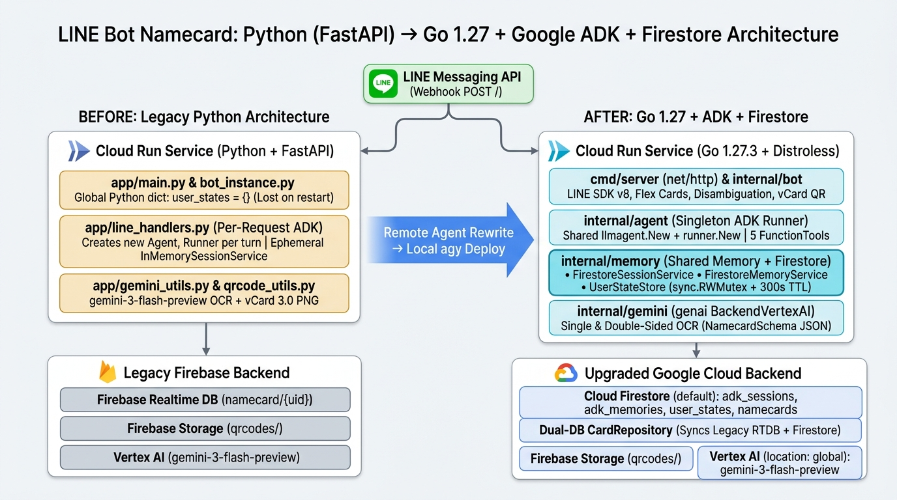

# 前情提要

這陣子陸續把幾個日常主力服務從 Python 改寫成 Go，這回輪到我平常整理名片的 LINE 機器人：**[`kkdai/linebot-namecard-python`](https://github.com/kkdai/linebot-namecard-python)**。

這隻機器人過去已經演進了好幾輪：從最初的 [Gemini Vision 辨識 + vCard QR Code 匯入通訊錄](https://www.evanlin.com/linebot-namecard-qrcode/)、搬上 [Vertex AI 擺脫配額限制](https://www.evanlin.com/aistudio-to-vertexai/)、導入 [Python 版 ADK 動態閉包 Tools](https://www.evanlin.com/namecard-adk/)，一路加上 [Structured Output 與消歧義清單](https://www.evanlin.com/namecard-structure-output/) 和 [正反雙面名片合併辨識](https://www.evanlin.com/gemini-image-namecard-enhance/)。

但這次重構成 Go 版（[`kkdai/linebot-namecard-go`](https://github.com/kkdai/linebot-namecard-go)），我想挑戰一個不太一樣的工作流：**先把架構改寫與單元測試丟給 Google Antigravity 的 Remote Agent 在雲端自動跑完，等我回到電腦前，再由本機的 `agy` CLI 接手部署到 Cloud Run 並切換 LINE Webhook。**

實際跑過一輪之後，成果很驚豔——Remote Agent 在雲端 17 分鐘就把整套 Go 1.27 + `google.golang.org/adk` + Firestore 架構與測試寫完推上 GitHub；但同時也實地驗證了一個非常關鍵的邊界限制：**你可以用 `agy` 呼叫 Remote Agent，卻「無法」把同一個 Remote Agent 對話切換成本地 Agent 繼續。**

這篇文章上半部先把 **Antigravity Remote Agents** 的用法、雲地隔離原因與兩種實務解法一次講清楚；下半部再完整拆解這次 `linebot-namecard-python` → `linebot-namecard-go` 的系統架構升級與實際交接部署踩坑紀錄。

---

# 一、認識 Antigravity Remote Agents：把重活交給雲端隔離 VM

依據 Google Antigravity 官方文件（[Remote Agents](https://antigravity.google/docs/remote-agents/)），**Remote Agents** 的核心概念是把自主開發任務從你本機的筆電，搬到 **Google 代管的雲端隔離虛擬機（Cloud Sandbox VM）** 裡執行。

這對長時間重構、大範圍測試或跨語言改寫非常有用：
- **非同步離線執行**：任務在雲端 VM 跑，就算你闔上筆電、電腦休眠或斷網，Agent 依然會繼續寫扣、跑測試與改檔案。
- **跨裝置監看與解鎖**：你可以在桌機或 CLI 派工後出門，中途用手機瀏覽器打開 `antigravity.google.com` 看進度、批准權限或補充指令，最後直接拿到一個完整的 GitHub Commit / PR。
- **雲端資源掛載（Remote Resources）**：因為 Agent 跑在雲端隔離沙盒，存取檔案透過三種方式掛載：
  1. **GitHub Repositories**：透過 OAuth 授權後自動 clone 並掛載進遠端專案環境。
  2. **Google Drive**：可直接在對話中讀取 Google Docs、Sheets、Slides、PDF 與資料夾。
  3. **上傳本地檔案**：直接把檔案傳到遠端專案（單檔上限 8 MiB、每個專案最多 50 檔 / 100 MiB、帳號總上限 2 GiB），檔案會持久掛載在 `/home/antigravity/upload`。

### 1. 可以用 `agy` CLI 呼叫 Remote Agent 嗎？

**可以。** 依據 [Remote Agents 官方文件](https://antigravity.google/docs/remote-agents/)，使用前須符合兩個條件：
- **CLI 版本**：`agy` CLI **v1.4.12 以上**（我目前本機執行的 `agy` 為 `1.5.3`）。
- **帳號資格**：須登入具備 **Google AI Pro** 或 **Google AI Ultra** 訂閱的個人 Google 帳號（**不支援免費版、Google AI Plus，也不支援 Google Workspace / Cloud 企業帳號**）。

常用指令如下：

```bash
# 啟動遠端對話
agy --remote-agent

# 指定既有的遠端專案，或建立全新的遠端專案
agy --remote-agent --project="專案名稱或ID"
agy --remote-agent --new-project

# 接續先前的遠端對話
agy --remote-agent -c
agy --remote-agent --conversation=<conversation_id>
```

進入遠端對話後，也可以使用 `/projects` 切換遠端專案，或附加 GitHub repository、Google Drive 檔案與上傳本地檔案。

---

# 二、關鍵限制：為什麼「無法」把 Remote Agent 對話切換成本地 Agent 繼續？

很多開發者第一次用 `--remote-agent` 時都會有個直覺想法：「*我先在雲端用 Remote Agent 把程式碼寫完，回到電腦前再把同一場對話切回本地 Agent，讓它直接用我本機的 `gcloud` 權限幫我部署上線！*」

實測與對照官方文件後的結論是：**兩者的執行環境與對話紀錄是完全隔離的，無法在同一個對話中從雲端切換回本機接續執行。** 背後有三個硬性原因：

1. **會話模式嚴格隔離**
   官方文件明確指出：以 `--remote-agent` 啟動的 CLI **只會開啟遠端對話**；未帶 `--remote-agent` 的 CLI **只會開啟本地對話**。兩邊的對話紀錄儲存位置不同（遠端對話存在雲端遠端專案，而非本機磁碟），目前沒有任何指令可以把進行中的遠端會話遷移或接續到本地 Agent。
2. **環境與檔案系統隔離**
   Remote Agent 跑在 Google 代管的雲端隔離環境，只能操作遠端專案掛載的資源（GitHub repo、Google Drive、上傳到 `/home/antigravity/upload` 的檔案），**完全碰不到你本機的資料夾、未提交的本地修改，也無法使用本機安裝的 MCP servers、plugins、skills，或是你本機已經登入好的 `gcloud` / `kubectl` / SSH 憑證**。
3. **無法透過 `/fork` 轉移**
   在本地對話中，我們可以用 `/fork <project_id>` 把對話分支到另一個專案繼續；但 `/fork` 目前被列入 **Remote Agent 不支援的功能清單**（同清單還包含 `/diff`、`/rewind`、`/btw`、`--print`、`!` 執行本機指令等），因此也無法把進行中的遠端對話 fork 回本地專案。

## 實務上的兩種替代方案

既然無法直接切換同一場對話，實務上可以依照你的工作習慣選擇下面兩條路：

| 比較項目 | 方案 A：Remote Agent + GitHub 交接（本篇實戰） | 方案 B：[Remote Control](https://antigravity.google/docs/remote-control/) |
| :--- | :--- | :--- |
| **啟動方式** | `agy --remote-agent`（或 `antigravity.google.com`） | `agy --remote-control` / 對話內 `/remote-control` / `agy remote-control start` |
| **Agent 執行位置** | Google 雲端隔離 VM | **你自己的本機電腦** |
| **電腦可以關機／休眠嗎？** | **可以**（雲端繼續跑） | **不行**（主機必須保持開機與連線） |
| **可存取本機檔案 / `gcloud` / MCP？** | 不行（僅限遠端掛載資源） | **可以**（原生使用本機完整工具鏈與憑證） |
| **回到電腦能否接續同一場對話？** | 不行（須改開本地 `agy` 新對話並 `git pull`） | **可以**（手機或瀏覽器遙控的本來就是本機那場對話） |
| **最適合的場景** | 出門在外／睡前把大量重構丟給雲端跑，寫完 push 上 GitHub | 人在外面想遙控家裡電腦跑測試、部署，或需要存取本機私密環境變數與權限 |

- **想要「離線／關機讓雲端先跑，之後回本機接手開發」 → 透過 GitHub 交接程式碼**
  在遠端專案綁定 GitHub repository，讓 Remote Agent 把修改與交接指南（例如一份 `HANDOFF.md`）commit / push 到遠端分支或開 PR。回到電腦後，在本機 `git clone` / `git pull` 該分支，再開啟本地 `agy`（不加 `--remote-agent`）開新對話接手執行部署。
- **想要「人在外面操控、回到電腦無縫接著同一個本地環境與對話跑」 → 改用 [Remote Control](https://antigravity.google/docs/remote-control/)**
  一開始就執行本地 Agent，並透過 `agy --remote-control`、對話中輸入 `/remote-control`，或是使用 `agy remote-control start` 常駐背景服務。這樣 Agent 本身一直跑在你自己的電腦上，你可以透過手機或瀏覽器（`antigravity.google.com`）遠端監看與下指令，回到電腦前就能直接在同一場本地對話無縫繼續。

這次重構 `linebot-namecard-go`，我走的就是 **方案 A**：讓雲端 Remote Agent 專心把整個 Go 專案與交接文件寫完推上 GitHub，再由本機 `agy` CLI 接下第二棒完成 Cloud Run 部署與 LINE Webhook 切換。

---

# 三、先看架構對照：`linebot-namecard-python` vs. `linebot-namecard-go`

在進入實作細節前，先把這次從 **Python + FastAPI** 遷移到 **Go 1.27 + Google ADK + Cloud Firestore** 的架構差異攤在一張表上看清楚：

| 比較項目 | 原 Python 版（[`linebot-namecard-python`](https://github.com/kkdai/linebot-namecard-python)） | 新 Go 版（[`linebot-namecard-go`](https://github.com/kkdai/linebot-namecard-go)） |
| :--- | :--- | :--- |
| **語言與 Web 框架** | Python + FastAPI + `AsyncLineBotApi` (`aiohttp`) | **Go 1.27.3** (`cmd/server`) + 標準庫 `net/http` + `line-bot-sdk-go/v8` |
| **容器基礎映像檔** | Python Image（含 Pillow 等相依套件） | Multi-stage `golang:1.27-bookworm` → **`gcr.io/distroless/static-debian12`** |
| **ADK Agent & Runner 生命週期** | **每次收到訊息**才在 `handle_smart_query` 裡動態重建閉包、`Agent` 與 `Runner` | **伺服器啟動時單例常駐**共用的 `llmagent.New` + `runner.New`，搭配 5 個強型別 `functiontool` |
| **ADK Session & Memory 記憶** | 每次請求 `new` 一個臨時 `InMemorySessionService()`（**請求結束就忘記**，沒有跨對話記憶） | **雙層共通記憶體 + Cloud Firestore 持久化**：`FirestoreSessionService`（`adk_sessions`，支援冷啟動 Hydrate）+ `FirestoreMemoryService`（`adk_memories`） |
| **多步驟互動狀態 (`UserState`)** | 全域 Python `dict`（`user_states = {}`），容器重啟或多實例立即遺失 | `UserStateStore`（`sync.RWMutex` 記憶體快取 + Firestore `user_states` 集合 + 300 秒 TTL 自動清理 `SweepExpiredStates`） |
| **名片資料庫策略** | 僅支援 Firebase Realtime Database (`namecard/{user_id}`) | **雙資料庫相容 (`CardRepository`)**：同時支援讀寫既有 Firebase RTDB 與 Cloud Firestore (`namecards/{user_id}/cards/{card_id}`)，舊名片零搬遷直接相容 |
| **Gemini Vision OCR** | `google-genai` (Python) + `NAMECARD_SCHEMA` + Pillow | `google.golang.org/genai` (`BackendVertexAI`, `gemini-3-flash-preview`) + `NamecardSchema()` + Go 標準庫 `image/jpeg` |
| **部署與回退機制** | 手動 `gcloud run deploy`、手動貼 Webhook URL | 一鍵腳本 [`scripts/deploy_and_switch_webhook.sh`](https://github.com/kkdai/linebot-namecard-go/blob/main/scripts/deploy_and_switch_webhook.sh) 自動複製環境變數、切換並測試 LINE Webhook，支援 `--rollback` 秒退 |

---

# 四、第一棒（雲端 Remote Agent）：17 分鐘完成改寫與交接設計

從 GitHub 的 Commit 紀錄看這次雲端 Remote Agent 的節奏，真的只能用「兇猛」形容：
- `16:21`：建立空的 `kkdai/linebot-namecard-go`（Initial commit）
- `16:38`：**僅花 17 分鐘**，一口氣提交 22 個檔案、**4,432 行** Go 程式碼、完整單元測試、[ROADMAP.md](https://github.com/kkdai/linebot-namecard-go/blob/main/ROADMAP.md) 與 `Dockerfile`
- `16:45`：補上部署與 LINE Webhook 切換腳本 `scripts/deploy_and_switch_webhook.sh`
- `16:56`：寫好專給本機 `agy` CLI 接手的 [`HANDOFF.md`](https://github.com/kkdai/linebot-namecard-go/blob/main/HANDOFF.md)

除了把功能 100% 移植過來之外，Remote Agent 這次幫我們順手修掉了 Python 版留下來的三個架構債務：

## 1. 終結 Python 版「每問一句就失憶」：`FirestoreSessionService` + `FirestoreMemoryService`

回頭看舊版 Python 的 `app/line_handlers.py`，當時為了快速串接 ADK，寫法其實長這樣：

```python
# ❌ 舊版 Python 寫法：每次收到訊息都重建一個全新的 InMemorySessionService
runner = Runner(
    app_name="namecard_bot_app",
    agent=agent,
    session_service=InMemorySessionService()
)
```

這導致一個很明顯的問題：**使用者問完「幫我找王大明」，下一句追問「那他的電話是多少？」時，Agent 根本不記得上一輪在找誰**（因為上一個請求結束時 `InMemorySessionService` 就被垃圾回收了）。

到了 Go 版 [`internal/memory/memory.go`](https://github.com/kkdai/linebot-namecard-go/blob/main/internal/memory/memory.go)，我們實作了官方 `google.golang.org/adk/session.Service` 與 `memory.Service` 介面，打造出**雙層共通記憶體 + Cloud Firestore 持久化**架構：
- **熱路徑讀寫記憶體**：平時讀寫直接命中 `session.InMemoryService()`，維持毫秒級延遲。
- **異動同步寫入 Firestore**：每次 `Create` 或 `AppendEvent` 後，會把對話事件與 State 同步存入 `adk_sessions` 集合；每輪結束後再由 `FirestoreMemoryService` 將摘要同步至 `adk_memories`。
- **冷啟動自動還原（Hydration）**：當 Cloud Run 縮到 0 重新冷啟動、記憶體是空的，只要 `Get` 沒命中記憶體，就會自動呼叫 `hydrateFromFirestoreIfNeeded` 從 Firestore 把歷史對話與 State 拉回來重建，真正做到跨對話、跨冷啟動的連續追問。
- **測試友善設計**：當 `DocumentStore` 為 `nil`（例如本機跑 `go test` 沒有連雲端）時，自動純跑記憶體模式，不需任何 Mock Server 就能測完整流程。

```go
// internal/memory/memory.go：冷啟動時自動從 Firestore 還原 ADK Session
func (s *FirestoreSessionService) Get(ctx context.Context, req *session.GetRequest) (*session.GetResponse, error) {
	s.mu.Lock()
	defer s.mu.Unlock()

	resp, err := s.inMemory.Get(ctx, req)
	if err == nil {
		return resp, nil
	}
	// 記憶體未命中（例如 Cloud Run 冷啟動），嘗試從 Firestore adk_sessions 還原
	s.hydrateFromFirestoreIfNeeded(ctx, req.AppName, req.UserID, req.SessionID)
	return s.inMemory.Get(ctx, req)
}
```

## 2. 互動狀態機 `UserStateStore`：記憶體快取 + Firestore + 300 秒 TTL 清理

名片機器人有很多「跨回合狀態」，例如：
- 傳完正面照片後等待確認「這張名片還有背面嗎？」（`pending_backside_confirm`）與等待上傳背面（`awaiting_backside_image`，含正面圖片 `FrontImageBytes`）
- 點擊按鈕後準備輸入備忘錄（`adding_memo`）或修改特定欄位（`editing_field`）
- AI 工具觸發修改前的安全確認（`pending_update`）

在 Python 版這些全部塞在全域 `user_states = {}` 字典裡；Go 版 [`UserStateStore`](https://github.com/kkdai/linebot-namecard-go/blob/main/internal/memory/memory.go) 改用 `sync.RWMutex` 保護的記憶體快取搭配 Firestore `user_states` 集合，並在每次 Webhook 進入時觸發 `SweepExpiredStates`，自動清除超過 300 秒未完成的正面圖片暫存。

## 3. 從「每次建閉包」升級為「常駐單例 ADK Runner + 5 個強型別 `functiontool`」

Python 版為了隔離不同 LINE 使用者的名片資料，每次收到文字訊息都要重新呼叫 `make_adk_tools(user_id, found_card_ids)` 產生 5 個閉包函式再包進新 `Agent`。

在 Go 版 [`internal/agent/agent.go`](https://github.com/kkdai/linebot-namecard-go/blob/main/internal/agent/agent.go) 中，我們在 `main.go` 啟動時只建立**一組常駐共用的 `llmagent.New`（`gemini-3-flash-preview`）與 `runner.New`**，並註冊 5 個強型別 `functiontool`：
- `get_all_namecards`
- `get_namecard_by_id`
- `display_namecard`
- `update_namecard_memo`
- `update_namecard_field`

工具執行時直接透過 ADK 傳入的 `adkagent.ToolContext` 取得 `tctx.UserID()` 隔離不同使用者資料，同時在 Vertex AI 或網路異常時自動觸發 `FallbackKeywordSearch` 本機關鍵字備援搜尋。

## 4. 雙資料庫相容 `CardRepository` + 強制 `GOOGLE_CLOUD_LOCATION=global`

為了確保舊使用者的名片在切換當下不會消失，[`internal/storage/storage.go`](https://github.com/kkdai/linebot-namecard-go/blob/main/internal/storage/storage.go) 的 `StoreRepository` 同時支援 **Firebase Realtime Database (`namecard/{user_id}`)** 與 **Cloud Firestore (`namecards/{user_id}/cards/{card_id}`)**：
- 查詢時優先相容既有 Firebase RTDB 資料，並支援讀取 Firestore；新增與修改時同步寫入兩邊。
- 並在 [`internal/config/config.go`](https://github.com/kkdai/linebot-namecard-go/blob/main/internal/config/config.go) 的 `Load()` 第一行強制寫死 `_ = os.Setenv("GOOGLE_CLOUD_LOCATION", "global")`，避免從舊服務複製過來的區域變數蓋掉 `gemini-3-flash-preview` 所需的 `global` 端點。

## 5. 雲地交接的精髓：讓 Remote Agent 寫好「可直接貼給本地 `agy` 的交接書」

因為 Remote Agent 很清楚自己身處雲端沙盒、沒有 `gcloud` 與 LINE API 權限，它在最後一個 Commit 主動產出了兩樣關鍵交接物：
1. [`scripts/deploy_and_switch_webhook.sh`](https://github.com/kkdai/linebot-namecard-go/blob/main/scripts/deploy_and_switch_webhook.sh)：自動化撈取舊服務環境變數、部署 Cloud Run、檢查 `GET /` Health Check、呼叫 LINE Messaging API 更新並測試 Webhook（還附帶 `--rollback` 參數）。
2. [`HANDOFF.md`](https://github.com/kkdai/linebot-namecard-go/blob/main/HANDOFF.md)：整理好已完成進度、待驗證的 GCP 權限，以及一段**可以直接複製貼給本機 `agy` CLI 的啟動 Prompt**。

---

# 五、第二棒（本機 `agy` CLI）：接手交接檔、排查暗坑與零停機上線

回到電腦前，我開啟本機的 `agy` CLI（沒有加 `--remote-agent`，走本地 Agent 模式），把 `HANDOFF.md` 的交接 Prompt 直接貼進去。本地 Agent 接手後依序完成驗證、部署與切換，過程中也抓出幾個「只有在本機看真實 GCP 環境才會發現的細節」：

## 細節 1：舊服務其實沒設 `GOOGLE_APPLICATION_CREDENTIALS_JSON`，而是走預設服務帳戶 ADC

交接文件原本假設要從舊服務撈取 `GOOGLE_APPLICATION_CREDENTIALS_JSON`，但本機 `agy` 用 `gcloud run services describe <OLD_CLOUD_RUN_SERVICE>` 實查線上設定後，發現環境變數清單長這樣：
- `ChannelAccessToken`、`ChannelSecret`
- `FIREBASE_URL`、`FIREBASE_STORAGE_BUCKET`
- `PROJECT_ID: <YOUR_GCP_PROJECT_ID>`、`LOCATION: global`
- `GOOGLE_CLOUD_PROJECT: <YOUR_GCP_PROJECT_ID>`、`GOOGLE_CLOUD_LOCATION: <YOUR_GCP_REGION>`、`GOOGLE_GENAI_USE_VERTEXAI: True`

舊服務完全沒有塞 JSON Key，而是直接使用 Cloud Run 執行服務帳戶 `<PROJECT_NUMBER>-compute@developer.gserviceaccount.com` 的 **Application Default Credentials (ADC)**！我們進一步檢查該服務帳戶的 IAM 角色，確認已經具備 `roles/datastore.user`、`roles/aiplatform.user`、`roles/firebase.admin`、`roles/storage.admin`，而且 `(default)` Firestore（Native 模式，位於同區域）也早已建立完成。

另外，注意到舊服務環境變數裡同時帶著 **`GOOGLE_CLOUD_LOCATION: <YOUR_GCP_REGION>`**，這如果在其他沒處理的程式裡很容易讓 `gemini-3-flash-preview` 找不到模型；幸好前一步 Go 版的 `config.Load()` 會在啟動時強制把 `GOOGLE_CLOUD_LOCATION` 覆寫為 `global`，剛好完美接住這個潛在坑！

## 細節 2：macOS `mktemp` 的後綴陷阱 & 舊 Webhook 其實躲在 Firebase Hosting 後面

在執行部署腳本前檢查了兩件事：
1. **macOS BSD `mktemp` 行為差異**：腳本第 46 行寫了 `mktemp /tmp/cloudrun_env.XXXXXX.yaml`。在 Linux GNU `mktemp` 可以這樣用，但在 macOS 的 BSD `mktemp` 下，**`XXXXXX` 後面只要接了 `.yaml` 副檔名，就不會被替換成隨機字元**，而是固定產出 `/tmp/cloudrun_env.XXXXXX.yaml`。雖然這支腳本有 `trap 'rm -f "${ENV_FILE}"' EXIT` 會清掉暫存檔不影響本次執行，但未來寫跨平台腳本建議改用無後綴的 `mktemp /tmp/cloudrun_env.XXXXXX` 或由 Python `tempfile.NamedTemporaryFile` 處理。
2. **切換前先查 LINE 目前真正的 Webhook Endpoint**：用 `GET https://api.line.me/v2/bot/channel/webhook/endpoint` 一查，發現原本的 Webhook 並不是直接指到舊版 Python Cloud Run 服務的 `.run.app` 網址，而是指在 **`https://<YOUR_FIREBASE_APP>.firebaseapp.com`**（透過 Firebase Hosting rewrite 轉給 Python Cloud Run），且狀態為 `"active": true`。先查清楚原貌，之後萬一需要復原就能心裡有底（而腳本的 `--rollback` 則會切回舊版 Python Cloud Run 的直連 URL）。

## 細節 3：一鍵 Cloud Build 部署 `golang:1.27-bookworm` 與 Webhook 切換實測

在本機執行 `./scripts/deploy_and_switch_webhook.sh` 後：
1. **環境變數匯出**：自動從舊版 Python Cloud Run 服務匯出所有設定至暫存 YAML。
2. **Cloud Build 編譯與部署**：`Dockerfile` 裡的 `FROM golang:1.27-bookworm AS builder` 在 Cloud Build 上順利拉取並靜態編譯（`CGO_ENABLED=0 GOOS=linux`）打包進 `gcr.io/distroless/static-debian12`，成功建立新版 Go Cloud Run 服務（`100%` 流量已切換至新 revision）。
3. **Health Check 與 LINE API 驗證**：
   - `GET https://<YOUR_CLOUD_RUN_SERVICE_URL>/` → `{"status":"ok"}`
   - `PUT /v2/bot/channel/webhook/endpoint` → `{}`
   - `POST /v2/bot/channel/webhook/test` → `{"success":true,"statusCode":200,"reason":"OK","detail":"200"}`

最後再看一次 `gcloud run services logs read` 與 `gcloud logging read`：

```text
2026-11-08T09:08:26.864683Z  2026/11/08 09:08:26 Cloud Firestore & Firebase Admin SDK initialized successfully.
2026-11-08T09:08:26.868408Z  2026/11/08 09:08:26 Starting LINE Bot Namecard Go + ADK server on port 8080...
2026-11-08T09:08:26.879115Z  Default STARTUP TCP probe succeeded after 1 attempt for container "<NEW_CLOUD_RUN_SERVICE>-1" on port 8080.
2026-11-08T09:08:29.410974Z  INFO GET 200
2026-11-08T09:08:30.147730Z  INFO POST 200
```

一氣呵成，完全零報錯！現在直接在 LINE 聊天室傳訊息或名片照片，打到的就是這台 Go + ADK + Firestore 機器人。

---

# 六、Remote Agent 雲地接力與無痛遷移檢查清單（Checklist）

如果你也想用 **Antigravity Remote Agent + 本地 `agy` CLI** 來重構並切換線上服務，照著這份清單走可以少走很多冤枉路：

- [ ] **1. 先選對遠端工作模式**：想讓電腦關機／出門讓 AI 自己重構並發 PR，用 **`agy --remote-agent`**（需 Google AI Pro / Ultra 個人帳號、`agy >= 1.4.12`）；想隨時從手機遙控本機跑 `gcloud` 部署或沿用同一場對話，改用 **`agy --remote-control`**。
- [ ] **2. 別指望直接切換同一場對話**：Remote Agent 與本地 Agent 的對話、檔案系統與工具鏈完全隔離，且不支援 `/fork`、`/diff`、`/rewind`、`/btw`、`--print` 與 `!` 本機指令；一開始就把**「GitHub + `HANDOFF.md`」**當成標準交接介面。
- [ ] **3. 讓 Remote Agent 產出可執行的交接 Prompt 與部署腳本**：在請雲端收尾時，要求它把測試指令、環境需求、一鍵部署腳本（含 `--rollback`）與「貼給下一棒本地 Agent 的 Prompt」一併寫進 `HANDOFF.md`。
- [ ] **4. 接手後先查 IAM、Firestore 與區域變數**：別盲目假設舊服務有設 `GOOGLE_APPLICATION_CREDENTIALS_JSON`，先用 `gcloud run services describe` 與 `gcloud projects get-iam-policy` 確認預設服務帳戶是否已有 `roles/datastore.user` 與 `roles/aiplatform.user`；若模型用 `gemini-3-flash-preview` 等 preview 模型，務必確認程式有處理 `GOOGLE_CLOUD_LOCATION=global`。
- [ ] **5. 注意跨平台腳本與原 Webhook 路徑**：在 macOS 上跑自動化腳本時留意 BSD `mktemp` 不支援模板後綴隨機化；切換 LINE Webhook 前先呼叫 `GET /v2/bot/channel/webhook/endpoint` 記錄原本端點（是否經過 Firebase Hosting 或 API Gateway），確保驗證與退回都有依據。

完整 Go 版程式碼、雙層共通記憶體實作與部署腳本皆已開源在 GitHub：**[`kkdai/linebot-namecard-go`](https://github.com/kkdai/linebot-namecard-go)**，原本的 Python 版亦保留在 **[`kkdai/linebot-namecard-python`](https://github.com/kkdai/linebot-namecard-python)** 供架構對照，歡迎參考與交流！
