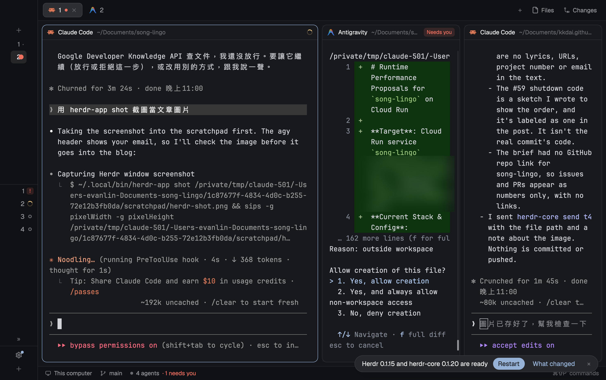
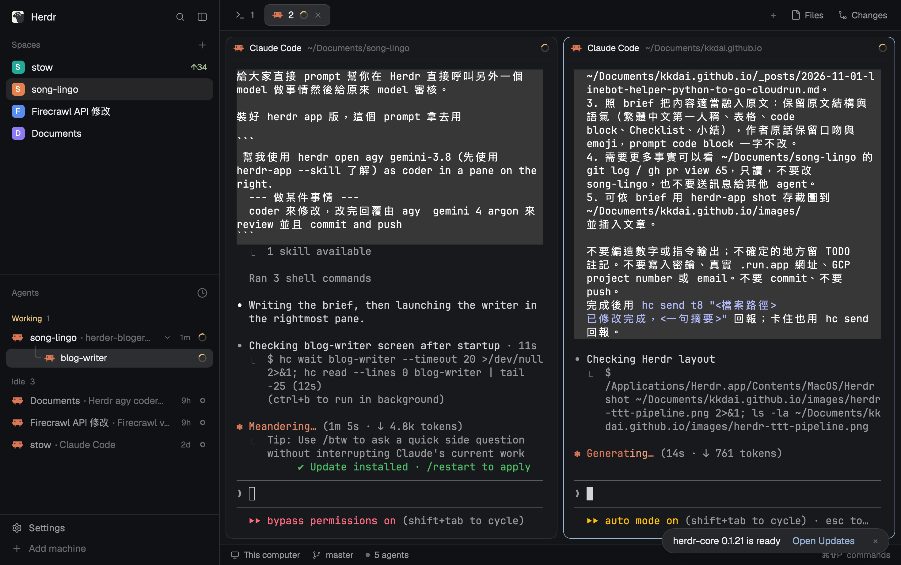
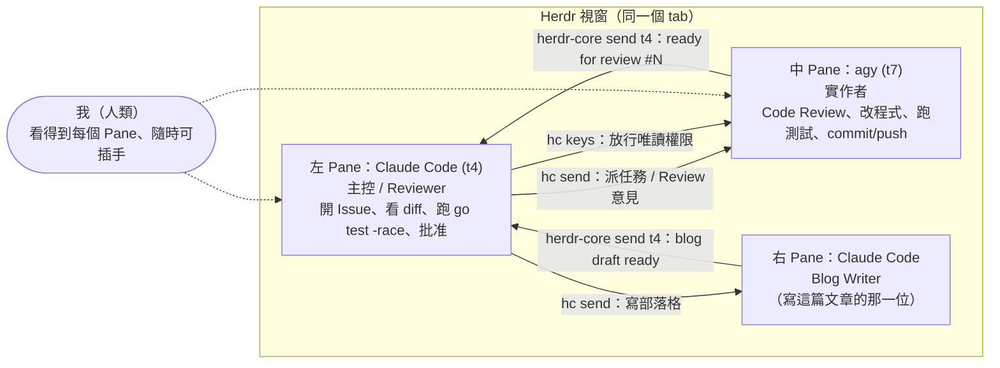
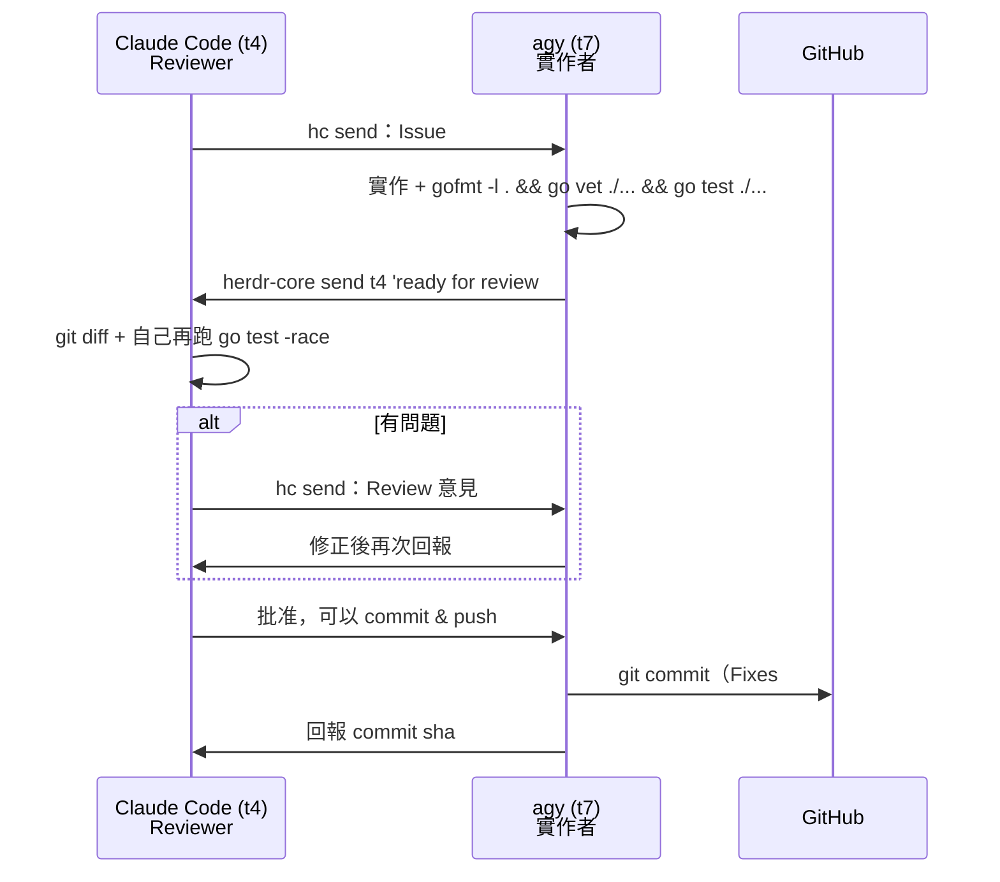
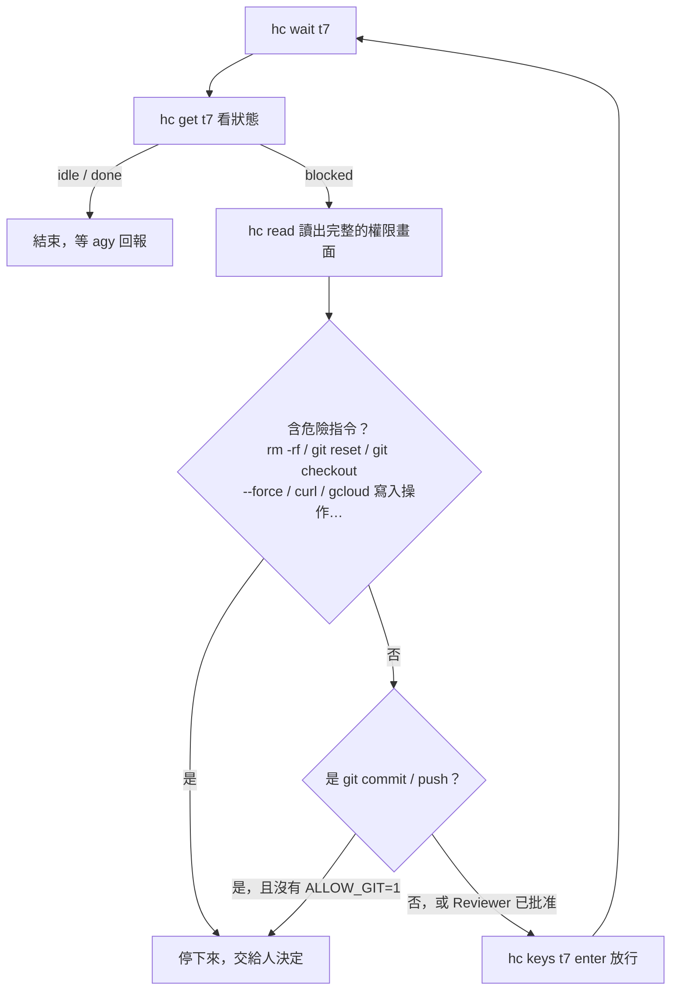

# 前情提要

最近迷上使用 **TTT（Terminal Text Tool）**，也就是大家俗稱的 **AI Terminal Editor**，第一個使用的就是 **Herdr**。

昨天用它（Master Agent 是 **Claude Opus 5.5**）由他來分配工作，請 **Gemini 4 Argon** 去實作來優化程式碼，最後再由 **Claude Code** 來審核，最後再請 **Claude Agent** 將相關過程寫成文章，一次完成（還會自動幫我截圖附上）。


整條流水線長這樣：

| 階段 | 誰負責 | 做什麼 |
| :--- | :--- | :--- |
| 1. 分派 | Master Agent（Claude Opus 5.5，左 Pane） | 拆任務、開 Issue、決定誰做什麼 |
| 2. 實作 | Gemini 4 Argon（透過 agy，中 Pane） | 改程式、跑測試 |
| 3. 審核 | Claude Code | 看 diff、自己再跑測試、通過才放行 commit/push |
| 4. 寫文章 | Claude Agent（blog-writer，最右邊 Pane） | 把整個過程寫成這篇文章，順便用 `herdr-app shot` 截圖附上 |



沒錯，你現在讀的這篇文章，就是上圖最右邊那個 Pane 裡的 Claude Agent 寫的（連這張截圖也是它自己拍的）。用下來也能了解，為什麼一些高手可以使用這些 TTT 來打造一條線的流水線工作架構——這部分我在第八節會再展開。

真的蠻讚～ 其他身邊同事不是玩 rex + Pi，就是一直叫我去玩 Orca 🤣

---

## 這次的實驗場：song-lingo

**song-lingo** 是我自己做來學日文歌的小工具：貼上一支 YouTube MV，Gemini 會幫我聽寫歌詞、標註羅馬拼音、繁中翻譯與文法，再用 Gemini TTS 產生「老師示範音」；我錄音跟讀之後，Gemini 會轉錄我的發音並逐字評分。

前幾天，我才在同一個 Claude Code session 裡把整個後端從 **Python + Next.js API routes 全部改寫成 Go 1.26**（Issues #44–#49、Tracking Issue #50、PR #51–#56）。改寫完之後的架構長這樣：

- **Next.js 只剩前端**，用 rewrite 把 `/api` 轉給同一個容器裡的 Go server（`127.0.0.1:8081`）。
- 部署在 **Cloud Run（`asia-east1`）**，資料放在 Cloud Storage bucket，透過 **gcsfuse 掛在 `/data`**；學習進度存在 **Firestore**；前面用 **IAP** 限制只有我能登入。
- Go 版的幾個重點：`genai` SDK、Gemini REST（voices / interactions）、Firestore transaction、用 `kagome` 斷詞轉平假名、自己寫的 Hepburn 羅馬拼音表，以及把 Python `difflib.SequenceMatcher` 移植成 Go（用 **400 組 Python 產出的 golden 測試**對齊評分）。

改寫完、能動、測試也過了。但「自己寫、自己審」總是有盲點。剛好這次想試試 **Herdr**——一個讓多個 AI Agent 在同一個視窗裡、各自佔一個 Pane 協作的工具。於是我做了一個實驗：

> **讓 Claude Code 在左邊當主控與 Reviewer，讓 Antigravity CLI（`agy`）在右邊當實作者，兩個 Agent 透過 Herdr 互相傳訊，把 song-lingo Go 後端從 Code Review 一路做到 Cloud Run 上線。**

---

# 一、Herdr 是什麼？第一次用的上手筆記

## 1. 兩個執行檔：`herdr-app` 與 `herdr-core`

Herdr 分成兩層：

| 元件 | 角色 | 說明 |
| :--- | :--- | :--- |
| **`herdr-app`** | 桌面 App | 管理 **spaces > tabs > panes** 的畫面配置，可以把 pane 往左右切、直接在新 pane 裡跑程式 |
| **`herdr-core`**（CLI 叫 `hc`） | 終端機核心 | 負責跑「**不會因為視窗關掉而死掉的 terminal**」，提供 run / send / wait / read / keys / get 等指令讓 Agent 操作其他 terminal |

一個小插曲：我一開始叫 Claude Code「先使用 `herdr --skill` 了解」，結果 `herdr` 這個指令根本找不到——實際的執行檔是 `~/.local/bin/herdr-app` 與 `~/.local/bin/herdr-core`。

## 2. `--skill`：寫給 AI Agent 看的操作手冊

我覺得 Herdr 最聰明的設計是：**兩個 CLI 都有 `--skill` 參數**，執行 `herdr-app --skill` 與 `herdr-core --skill` 會印出一份「給 AI Agent 看的操作手冊」。

所以 Claude Code 的第一步不是亂試指令，而是**先把兩份手冊讀完再動手**。手冊裡寫了很多很有分寸的規範，例如：背景 Agent 一定要 `--bg`、要給名字與明確範圍、不要讓子 Agent 再開子 Agent、等待時用 `hc wait` 而**不要 sleep 輪詢**。

## 3. 核心指令速查表

| 指令 | 用途 |
| :--- | :--- |
| `$HC_TERMINAL_ID` | 每個 terminal 都有位址，Claude Code 自己是 **`t4`** |
| `hc run --bg --name xxx <agent> "<task>"` | 在背景開一個有名字的 Agent 並交代任務 |
| `herdr-app do pane.split --direction right --pane <id> --argv [...]` | 在畫面上把 pane 往右切，並直接在新 pane 裡跑程式 |
| `hc send <t> "..."` | 貼上文字並按 Enter，用來派任務、給 Review 意見 |
| `hc wait <t>` / `hc wait --children all` | 等對方做完（取代 sleep 輪詢） |
| `hc read <t> --lines 0` | 讀對方目前的整個螢幕 |
| `hc keys <t> enter` | 送出按鍵，例如回答權限對話框 |
| `hc get <t>` | 查狀態：`idle` / `working` / `blocked` / `done`；`blocked` 時還會附上 `msg`，例如 `Approve RunCommand: ...` |

## 4. Agent 對 Agent 的訊息通道

這是整個協作最關鍵的一塊。我在交代任務時會要求 agy：「做完請執行 `herdr-core send t4 '...'` 回報」。agy 做完之後，那段訊息會**直接出現在 Claude Code 的輸入裡**，長得像這樣：

```text
<hc from="t7">ready for review #57 ...</hc>
```

換句話說，Claude Code 不需要一直盯著右邊的螢幕，agy 做完自己會「敲門」。回報是非同步的、而且每一則都帶著來源位址，可以追蹤。

## 5. 畫面配置

我第一次讓 Claude Code 開 agy 時，它是用 `hc run --bg` 在背景跑的——功能上沒問題，但我看不到 agy 在做什麼。所以第二次我特別要求「**in a pane on the right**」，Claude Code 改用 `herdr-app do pane.split` 把 agy 開在右邊。最後的配置是：



## 6. 教學：用指令建立 Pane、在 Pane 裡起 Agent、互傳訊息

上面的速查表偏「Agent 怎麼操作 Agent」，這裡整理一份**自己動手開 Pane** 的指令。以下都是這次實際在用的：

> 註：`herdr-app` 預設不在 PATH 裡，App 版的實際路徑是 `/Applications/Herdr.app/Contents/MacOS/Herdr`，可以自己 alias 成 `herdr-app`。

### 先看懂現在的畫面

```sh
herdr-app --skill                      # 給 AI 看的操作手冊（hc --skill 是 herdr-core 的）
herdr-app ls                           # spaces > tabs > terminals，含 pane ID
herdr-app status                       # 目前焦點 pane、layout
```

### 開 Pane、在 Pane 裡跑 Agent

```sh
herdr-app do pane.go --direction right # 焦點移到右邊 pane（重複到最右邊）
herdr-app do pane.split --direction right --pane <pane-id>      # 從某個 pane 往右切一個新 terminal
herdr-app do terminal.open --place right --argv '["agy"]'       # 在焦點 pane 右邊開一個跑 agy 的 terminal
herdr-app do tab.new --name "fix login" --argv '["claude"]' --task "Look at the login bug"
herdr-app shot herdr-shot.png          # 存下視窗畫面（文章截圖就是這樣來的）
```

### 背景 Agent、搬進 Pane、互傳訊息

```sh
hc run --bg --name coder --cwd /path/to/repo agy                # 背景起一個 agent（不加 --bg 整個畫面會灌進輸出）
hc run --bg --outlive-parent --name blog-writer claude "<任務>"  # 主控結束後仍繼續跑
herdr-app do terminal.keep --terminal <t-id> --place right      # 把背景 agent 放進右邊 pane 讓人看得到
hc send coder "改這個…"                 # 傳訊息給另一個 agent
hc wait --children any                 # 等子 agent 回報，不要 sleep/輪詢
hc read --lines 200 coder              # 讀它的畫面與歷史
```

幾個要注意的地方：

| 重點 | 說明 |
| :--- | :--- |
| **ID vs 名字** | `herdr-app do` 的 terminal 參數要用 **ID**（例如 `t12`），不是名字；`hc` 則可以直接用名字（例如 `coder`） |
| **一定要 `--bg`** | `hc run` 不加 `--bg`，對方整個畫面會灌進你的輸出 |
| **`--outlive-parent`** | 像 blog-writer 這種「主控結束後還要繼續寫」的 Agent 要加 |
| **背景 → 看得見** | 先 `hc run --bg` 起起來，再 `terminal.keep --place right` 搬到右邊 Pane，人就能隨時看、隨時插手 |
| **等待** | 用 `hc wait`，不要 sleep 輪詢 |

## 7. 直接可用的 prompt

裝好 herdr app 版，這個 prompt 拿去用——在 Herdr 裡直接呼叫另外一個 model 做事情，然後交給原來的 model 審核：

```
 幫我使用 herdr open agy gemini-3.8 (先使用 herdr-app --skill 了解) as coder in a pane on the right.
  --- 做某件事情 ---
  coder 來修改，改完回覆由 agy  gemini 4 argon 來 review 並且 commit and push
```

把中間「做某件事情」換成你的任務就好。重點是那句「**先使用 `herdr-app --skill` 了解**」——讓主控 Agent 先讀手冊，後面開 Pane、傳訊息、等回報就會照規矩來。

---

# 二、第一回合：讓 agy 當 Reviewer

第一個任務很單純：請 agy 審 `backend/` 底下的 Go 程式碼，**唯讀、不開 subagent**，把結果寫到檔案，完成後 `hc send t4` 回報。

agy 的介面顯示它跑的是 **Claude Sonnet 5.5（plan 模式）**，最後產出了 **17 項問題，依重要性排序**。Claude Code 幫我整理成三大類：

| 類別 | agy 找到的問題 |
| :--- | :--- |
| **併發與資料正確性** | Re-annotate 期間（一次 Gemini 呼叫最長 5 分鐘）若我在校對頁修改歌詞，寫回時會被蓋掉——兩邊用的是**不同的 mutex**；`EditLine` 的全域鎖跨過了 Firestore 呼叫；`WriteAtomic` 的暫存檔名固定是 `.tmp` |
| **資源上限與洩漏** | TTS 產生沒有並行上限（這可是付費 API）；失敗快取只增不減而且重複存兩份；429 沒帶 `Retry-After` 時完全不限流；`TeacherVoice` 每次重讀 `voices.json` 且在網路呼叫期間持有全域鎖；request body 沒有 `MaxBytesReader`；背景 job 用 `context.Background()`，關機時不會被取消 |
| **效能與結構** | `listSongs` 依序解析所有歌、逐首讀 progress；示範音整個讀進記憶體再回傳；同樣的 Error 型別有 3–4 份；CLI 的 `speak` 和 `tts.Service` 邏輯重複 |

這裡有一個我很喜歡的細節：**Claude Code 沒有照單全收**。在開 Issue 之前，它先自己 grep 驗證最重要的那一條——「re-annotate 與 review 用的是不同 mutex」——確認屬實，才開始動手開 Issue。Reviewer 的結論也需要被 Review。

---

# 三、第二回合：開 Issue → agy 修 → Claude Code 審 → 通過才 commit

我給 Claude Code 的指示是：

> 「開 issue 然後依序修改，主要讓右方 agy pane 去修改，你負責 review 給意見，你通過才讓 agy 去 commit and push。」

## 1. 17 項整併成 5 個 Issue

Claude Code 把 17 項整併成 **5 個 Issue（#57–#61）**，全部在同一個 branch `go-review-fixes` 上進行，**一個 Issue 一個 commit**，commit 訊息帶 `Fixes #N`。

## 2. 每一輪的協作流程



## 3. Review 實際抓到了什麼？

這是整篇最想分享的部分。5 個 Issue 裡，**3 個需要第二輪修正、2 個一次通過**：

| Issue | 主題 | Review 結果 | Commit |
| :--- | :--- | :--- | :--- |
| **#57** | Per-song lock | 設計正確，但**沒寫測試** → 要求補 | `e5df5f4` |
| **#58** | TTS 並行上限與失敗快取 | 抓到**錯誤訊息 regression** → 要求修正並補測試 | `d67ec5a` |
| **#59** | Request 上限、timeout、優雅關機 | 抓到**關機順序與時間預算錯誤** → 重新設計 | `de38741` |
| **#60** | Song list 並行、示範音串流 | ✅ 一次通過 | `bc1615a` |
| **#61** | 統一錯誤型別、CLI 重構、signal 處理 | ✅ 一次通過 | `deb1fb7` |

### #57：設計對了，但測試在哪？

agy 的 per-song lock 設計是對的。Claude Code 還特別確認了一件事：手動翻譯與 `reviewed` 旗標也都會寫進 transcript，所以「寫回前比對整份 transcript」確實能抓到所有編輯。

但 agy 沒寫測試。於是 Claude Code 要求把邏輯抽成 `saveAnnotation`，並補上兩個案例：**未被變更時正常寫入**、**被編輯時回傳衝突且不寫入**。

### #58：刪掉一個 map，前端就不知道為什麼失敗

agy 在整理失敗快取時，把 server 端的 `recentErrors` 刪掉了。測試全過，但 Claude Code 抓到一個 regression：

> 當 TTS 額度用完時，**「其他從來沒產生過的句子」** 去查 `?error`，會拿到 `{error: null}`——前端就沒辦法顯示「額度用完」的原因。

修正方式是讓 `LastError` 在**沒有該句失敗紀錄時，回傳仍然有效的 quota 錯誤**，並補上測試。

### #59：Cloud Run 只給你約 10 秒，你卻排了 20 秒

這是我覺得最有價值的一個抓蟲。agy 寫的優雅關機是：`srv.Shutdown` 等 10 秒，再等背景 jobs 10 秒。問題有兩個：

1. **Cloud Run 送出 SIGTERM 後大約只有 10 秒**，兩段加起來根本超過預算。
2. **重新分析是同步跑在 HTTP request 裡的**。`srv.Shutdown` 會等它結束，但它的 context 還沒被取消——等於自己等自己。

Claude Code 要求改成**單一 9 秒期限**，並調整順序：

```go
// 單一期限，留一點餘裕給 Cloud Run 的 SIGTERM 寬限期
ctx, cancel := context.WithTimeout(context.Background(), 9*time.Second)
defer cancel()

runner.Cancel()      // 1. 先取消背景與進行中的分析工作
srv.Shutdown(ctx)    // 2. 再關 HTTP server（同步跑的分析已經被取消，不會卡住）
runner.Wait(ctx)     // 3. 最後在同一個期限內等 jobs 收尾
```

（上面是示意，表達順序與單一期限的概念。）

### #60、#61：一次通過

- **#60**：Song list 改成 **bounded concurrency 8**，單首 progress 讀取失敗不會拖垮整個清單；已產生的示範音改用 `*os.File` + `ModTime` 交給 `http.ServeContent` 串流（順便拿到 Range 與 Last-Modified）。
- **#61**：統一錯誤型別為 `apierr.Error`、CLI `speak` 改用 `tts.Service.GenerateAll`、改用 `signal.NotifyContext`、Daily quota 判斷改用型別欄位而不是字串比對。

回頭看這三個被退件的 Issue，有一個共通點：**它們全部都是「測試會過、但上線才會痛」的問題**——測試缺口、前端錯誤訊息 regression、關機順序。這正是「一個寫、一個審」最大的價值。

---

# 四、第三回合：PR、合併、部署與驗證

5 個 commit 都通過後，開了 **PR #62** 合併，#57–#61 自動關閉。接著用 `gcloud run deploy --source .` 部署新 revision。

部署後的驗證是 Claude Code 透過**已登入 IAP 的 Chrome** 直接跑 `fetch` 完成的：

| 驗證項目 | 結果 | 對應改動 |
| :--- | :--- | :--- |
| 首頁 `/api/songs` | `200`（10 首） | #60 並行讀取 |
| 學習頁 | `200` | — |
| 已產生的示範音 | `200 audio/wav` | #60 串流 |
| 示範音 Range 請求 | `206` | #60 `http.ServeContent` |
| 帶 `If-Modified-Since` | `304`（**新功能**：現在有 `Last-Modified`） | #60 `ModTime` |
| PATCH 塞 70 KB | `413`「請求內容太大。」 | #59 `MaxBytesReader` |
| Cloud Logging | 只有兩筆 WARNING，都是測試請求本身 | — |

上一版 revision 也保留著，隨時可以切回。

---

# 五、第一次用 Herdr 踩到的 6 個魔鬼細節

## 細節 1：`agy "prompt"` 會直接 exit 2

直覺上會這樣開 agy：

```bash
agy "請審 backend/ 的 Go 程式碼..."
```

結果直接報錯退出（exit 2）：

```text
Prompts are read only from -p/--print, -i/--prompt-interactive, or stdin
```

正確做法是 **`agy -i "..."`**——互動式啟動並帶入初始任務。Herdr 的手冊也提醒**不要用 `-p` 一次性模式**，因為 Agent 要保持「可觀察、可再追問」，才能接著做 Review 來回。

## 細節 2：第一次進資料夾的 Trust 對話框

第一次在某個資料夾啟動 agy，會跳出「**Do you trust the contents of this project?**」。這時 `hc get` 的狀態會變成 `blocked`（auth）。由 Claude Code 用 `hc keys go-review enter` 確認即可。

## 細節 3：看起來沒送出的 prompt，其實已經送到了

用 `pane.split` 開出 agy 後，畫面看起來是 idle，初始 prompt 好像沒送出去。Claude Code 想用 `hc send` 補送一次，結果被 hc 擋下來：

```text
t7 is blocked (permission)... typing would answer its dialog; read its screen first
```

原來任務早就送到了，agy 正卡在等權限。**hc 這個保護機制，避免了把一段任務文字誤打進權限對話框**——如果真的打進去，後果可能是莫名其妙地同意或拒絕了某個指令。

## 細節 4：Plan mode 只能看、不能改

agy 在 plan mode（唯讀研究）時只能分析。要它開始改程式，必須按 `shift+tab` 切換模式；Claude Code 用 `hc keys t7 shift+tab` 幫它切。第一回合的 Code Review 剛好適合 plan mode，第二回合要修改時才切出去。

## 細節 5：權限放行 Driver——從「看狀態列」進化到「讀整個畫面」

agy 每一個 shell 指令都要權限。一個一個按 Enter 太累，所以 Claude Code 寫了一個小 driver script，邏輯如下：



這個 script 在過程中被修了幾次，每一次都是很實際的教訓：

1. **狀態列的 `msg` 會被截斷**：一開始只看 `hc get` 回傳的 status msg，但它會被截成「…」，截斷的部分可能藏著第二個指令。改成 **`hc read` 讀整個權限畫面**再判斷。
2. **`gcloud A; gcloud deploy` 單行 grep 會漏判**：改成把組合指令拆開、**逐條判斷是否唯讀**（`describe` / `list` / `read` / `ls` / `du`）。
3. **誤擋也要修**：`gcloud storage ls`、`gcloud storage du` 其實是唯讀的，一開始被擋下來，後來加入白名單。

## 細節 6：權限放行的分寸

自動化放行的界線是這樣畫的：

- **唯讀指令**：自動放行。
- **`git commit` / `push`**：預設擋住，**只有 Claude Code Review 通過後**才用 `ALLOW_GIT=1` 放行。
- **需要打外部 API 的指令**（例如 agy 想用 access token 打 Google Developer Knowledge API 查文件）：停下來，由人決定。

Agent 之間可以互相信任到「你可以跑測試」，但「寫入 git、寫入雲端、對外發請求」這種事，一定要過 Reviewer 或人。

---

# 六、多 Agent 協作自我檢查清單（Checklist）

如果你也想用 Herdr（或類似工具）讓兩個 Agent 一寫一審，可以參考這份清單：

- [ ] **1. 先讀手冊再動手**：讓主控 Agent 先跑 `herdr-app --skill`、`herdr-core --skill`，確認實際執行檔路徑。
- [ ] **2. 子 Agent 開在看得到的 Pane**：用 `pane.split` 把實作 Agent 開在旁邊，人隨時可以看、可以插手。
- [ ] **3. 用互動模式啟動**：`agy -i "..."`，不要用位置參數，也不要用 `-p` 一次性模式。
- [ ] **4. 任務範圍要明確**：唯讀與否、不要開 subagent、「不要 commit」、完成後用 `herdr-core send <主控位址>` 回報。
- [ ] **5. 用 `hc wait`，不要 sleep 輪詢**；送文字前若對方是 `blocked`，先 `hc read` 看畫面。
- [ ] **6. Reviewer 的結論也要驗證**：開 Issue 前先 grep 確認最重要的發現屬實。
- [ ] **7. Reviewer 自己再跑一次測試**：例如 `go test -race`，不要只看實作者的回報。
- [ ] **8. 權限 Driver 讀整個畫面**：不要依賴會被截斷的狀態列；組合指令要逐條判斷。
- [ ] **9. Git 與雲端寫入要閘門**：commit/push 只在 Review 通過後放行；外部 API 呼叫交給人。
- [ ] **10. 部署後實測新行為**：不只看 200，也要驗證新加的限制（413）、新加的標頭（304 / 206），並保留上一版 revision。
- [ ] **11. 開 Pane 用 ID、傳訊息用名字**：`herdr-app do` 吃 terminal ID（`t12`），`hc send` / `hc read` 可以用名字。
- [ ] **12. 背景 Agent 要搬到看得見的地方**：`hc run --bg` 之後用 `terminal.keep --place right` 放進 Pane，流水線才不會變黑箱。

---

# 七、後續：Cloud Run 冷啟動優化（PR #65，已合併）

上一版文章寫到這裡時，右邊的 agy 正在跑下一個任務：用它的 GCP skill 分析 song-lingo 在 Cloud Run 上的執行效能——服務設定、cold start、gcsfuse、Firestore 等——提出方案，每個方案附上證據、預期效益、成本與風險，再由 Claude Code 決定要修哪些。

這一輪最後收斂成 **PR #65「web: faster cold start (standalone output, gcsfuse cache, 512Mi)」**，在 **2026-11-11 合併**（Fixes #63、#64）：

| 改動 | 內容 |
| :--- | :--- |
| **首頁不 prefetch** | `web/app/page.tsx` 的歌曲連結加上 `prefetch={false}`，首頁不再預先抓每一首歌的頁面 |
| **`next.config.ts` → `next.config.mjs`** | 設定一樣，但改成純 ESM，啟動時不用再跑 TypeScript 轉譯 |
| **Next.js standalone output** | `output: "standalone"`，Dockerfile 只複製 `.next/standalone` + static + public |
| **gcsfuse in-memory file cache** | Cloud Run 部署的 gcsfuse 掛載加上記憶體檔案快取（README 部署指令一起更新） |
| **記憶體 512Mi** | 部署指令改成 `--memory=512Mi` |

PR 裡記錄的前後對照：

| 項目 | Before | After |
| :--- | :--- | :--- |
| 啟動時載入 next config | 995–1132 ms | 約 0.7 ms |
| 映像檔裡的 `web/` | 約 770 MB | 約 46 MB |

<!-- TODO: 部署後實際的 Cloud Run 冷啟動時間（端到端）尚未量測，有數據再補。 -->

這個 PR 的風險也標得很清楚：Docker 映像只在 Cloud Build 上驗證過，如果新 revision 起不來，Cloud Run 會繼續由上一版 revision 服務——跟第四節「保留上一版 revision」是同一個思路。

---

# 八、為什麼 TTT 流水線比直接呼叫 Sub-Agent 好？

這樣來打造流水線，除了可以**混合不同家的模型**之外，還可以**避免像是直接呼叫 Sub-Agent 方式的黑箱方式**來工作，看到有問題也可以馬上自己介入並且給予修正的指令。

| 比較項目 | 直接呼叫 Sub-Agent | TTT 流水線（Herdr Pane） |
| :--- | :--- | :--- |
| **模型選擇** | 通常只能用同一家的模型 | 可以混用不同家：Claude 分派與審核、Gemini 實作 |
| **過程可見度** | 黑箱，只看得到最後回傳的結果 | 每個 Agent 一個 Pane，正在跑什麼指令即時看得到 |
| **人類介入** | 要等它跑完才能修正 | 看到有問題，馬上在那個 Pane 下修正指令 |
| **溝通方式** | 一次性呼叫、回傳一段結果 | `hc send` / `hc wait` 非同步互傳，每則訊息都帶來源位址 |
| **權限控管** | 跟著主 Agent 的權限走 | 每個 Pane 的權限對話框分開，可以由 Reviewer 或人逐一放行 |
| **生命週期** | 跟著主 Agent 結束 | `--outlive-parent` 讓 blog-writer 這類 Agent 主控結束後繼續跑 |

---

---

# 小結

第一次用 Herdr，最大的感想是：**多 Agent 協作終於「看得見」了**。

1. **一個寫、一個審，比自己寫自己審更容易抓到盲點**：5 個 Issue 裡有 3 個被退件，抓到的全是「測試會過、上線才會痛」的問題——測試缺口、錯誤訊息 regression、Cloud Run 關機順序。
2. **Agent 對 Agent 的訊息讓協作非同步又可追蹤**：`herdr-core send t4 'ready for review #N'` 讓實作者自己來敲門，Reviewer 用 `hc wait` 等待，不用輪詢。
3. **Pane 讓人保持在迴圈裡**：我可以在右邊即時看到 agy 正在跑什麼指令，必要時直接插手。
4. **權限放行要有分寸**：唯讀可以自動化，寫入 git、寫入雲端、對外發請求，一定要過 Review 或人。
5. **TTT 流水線不是黑箱**：可以混用不同家的模型，每一步都看得到，有問題隨時自己介入下修正指令——這是直接呼叫 Sub-Agent 做不到的。

而這篇文章本身，也是 Herdr 裡最右邊那個 Pane 的 Claude Code 寫的——寫完之後，它會用 `herdr-core send` 跟左邊的主控回報一聲；這次補上 TTT 心得、Pane 教學與 PR #65 的修改，也是同一個 blog-writer 在同一個 Pane 裡完成的。
