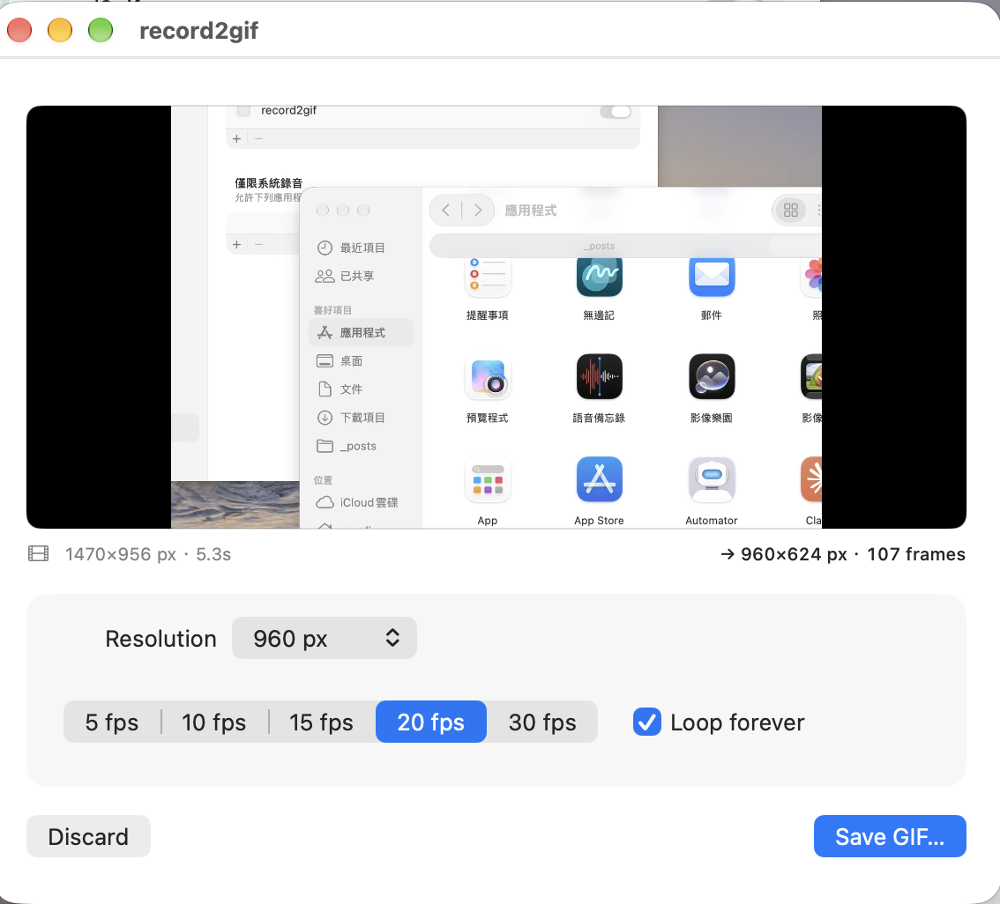
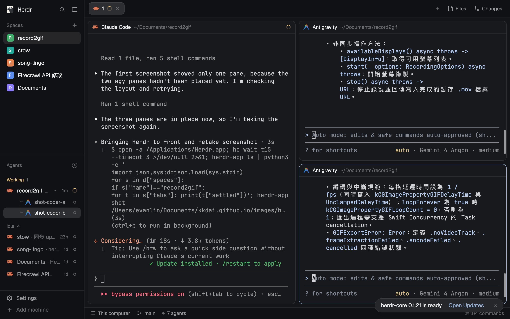
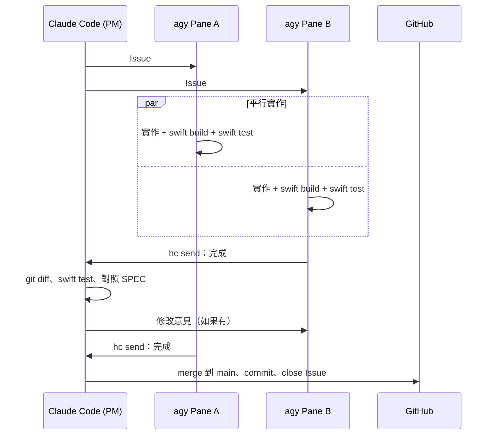
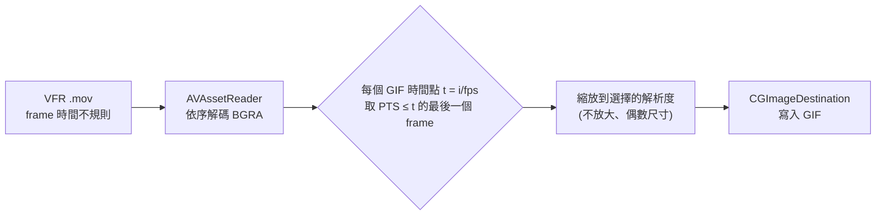

# 前情提要

寫部落格、回 Issue 的時候，常常需要錄一小段操作畫面。macOS 內建的 QuickTime（或 ⌘⇧5）錄出來是 `.mov`，每次都還要再丟去別的工具轉 GIF、調尺寸，非常麻煩。

所以我想要一個很單純的小工具：

> **介面像 QuickTime 的「新增螢幕錄影」，可以錄整個桌面或框選範圍，錄完直接產生 GIF，而且可以選 GIF 的解析度。**

剛好上一篇[第一次用 Herdr](/herdr-claude-code-agy-collab/) 用得很順，這次就把規模再拉大一點：

- **Claude Code 當 PM**：開 remote GitHub repo、寫 SPEC、開 Issue、review、commit、push。
- **agy 當 coder，而且一次開兩個 Pane**：同時解兩個 Issue。
- 每個 coder 做完都要回報給 Claude Code，review 通過才會 commit。

成果在這裡：[kkdai/record2gif](https://github.com/kkdai/record2gif)，從開 repo 到 GIF 成功存到桌面，大概一天。

---

# 一、record2gif 做了什麼？

| 功能 | 說明 |
| :--- | :--- |
| **QuickTime 風格控制列** | 小小一條浮動視窗：錄整個螢幕 / 錄選取範圍、Options、紅色 Record 按鈕 |
| **框選範圍** | 全螢幕半透明遮罩，拖一個方框，顯示像素尺寸，可以調整後再錄 |
| **錄影中** | 控制列自動隱藏（不會被錄進去），選單列顯示 ⏹ + `mm:ss`，點一下或按 **⌃⌘Esc** 停止 |
| **匯出視窗** | 循環預覽、**解析度**（原尺寸 / 1280 / 960 / 640 / 480 / 320 px / 自訂寬度，維持比例、絕不放大）、**影格率**（5–30 fps）、**無限循環**開關、預估輸出尺寸 |
| **存檔** | 預設存到桌面，檔名 `Recording 2026-11-14 at 15.13.43.gif`，有進度條、可以取消、存完可以在 Finder 顯示 |

技術選擇刻意保持簡單，**完全沒有第三方套件**：

| 部分 | 技術 |
| :--- | :--- |
| 專案 | Swift Package Manager（沒有 `.xcodeproj`），macOS 14+ |
| UI | SwiftUI + AppKit（`NSPanel`、`NSStatusItem`、遮罩視窗） |
| 錄影 | **ScreenCaptureKit**（`SCStream`）→ `AVAssetWriter` 寫 H.264 `.mov` 暫存檔 |
| 轉 GIF | `AVAssetReader` 逐格解碼 + **ImageIO**（`CGImageDestination`）編碼 |
| 全域快捷鍵 | Carbon `RegisterEventHotKey`（不需要輔助使用權限） |
| 測試 | Swift Testing，19 個測試 |

錄影時一律用**原生像素解析度**錄（points × scale），縮小只在匯出 GIF 的時候做，所以同一段錄影可以匯出好幾種尺寸。

---

# 二、PM 的工作：先寫 SPEC，再拆 Issue

兩個 coder 平行寫程式，最怕的就是「各寫各的，最後接不起來」。所以 Claude Code 第一件事不是開 coder，而是寫一份 `SPEC.md`，裡面最重要的是兩件事：

1. **固定的目錄結構**：哪個 Issue 只能動哪個資料夾（例如只有 #4 可以改 `Recording/`、只有 #5 可以改 `Export/`）。
2. **Issue 之間的介面合約**：先把 `ScreenRecorder`、`GIFExporter`、`GIFSizing` 的 public API 直接寫在 SPEC 裡。

```swift
public final class GIFExporter: Sendable {
    public init()
    public func export(video: URL, to output: URL, options: GIFExportOptions,
                       progress: @escaping @Sendable (Double) -> Void) async throws
}
```

有了合約，做 UI 的 coder 不用等錄影引擎寫完，就知道要呼叫什麼。

接著拆成 5 個 Issue、分三輪：

| # | Issue | 相依 | 輪次 |
| :--- | :--- | :--- | :--- |
| 1 | 專案骨架、App shell、打包 script | – | 第 1 輪 |
| 2 | ScreenCaptureKit 錄影引擎 | 1 | 第 2 輪（Pane A） |
| 3 | GIF 匯出（解析度 / fps） | 1 | 第 2 輪（Pane B） |
| 4 | QuickTime 風格錄影 UI | 1, 2 | 第 3 輪（Pane A） |
| 5 | 匯出視窗：解析度選擇、預覽、存檔 | 1, 3 | 第 3 輪（Pane B） |

---

# 三、兩個 agy Pane 平行開發

## 1. 每個 coder 一個 git worktree

兩個 agy 同時在同一個資料夾改檔案一定會打架，所以每個 Issue 都開一個獨立的 git worktree / branch，coder 只在自己的 worktree 裡工作：

```sh
git worktree add ../record2gif-wt/issue-2 -b issue-2
git worktree add ../record2gif-wt/issue-3 -b issue-3
```

## 2. 開 coder Pane

上一篇學到的 `agy` 啟動方式這次直接沿用：

```sh
hc run --bg --outlive-parent --name coder-a --cwd ../record2gif-wt/issue-2 \
  agy --dangerously-skip-permissions -i "$TASK"
herdr-app do terminal.keep --terminal <ID> --place right   # 第一個放右邊
herdr-app do terminal.keep --terminal <ID> --place down    # 第二個疊在下面
```

畫面就變成：左邊 Claude Code（PM），右邊上下兩個 agy。



幾個這次的小變化：

| 項目 | 說明 |
| :--- | :--- |
| **`-i`** | `agy "prompt"` 會直接 exit 2，要用 `agy -i "..."` |
| **`--dangerously-skip-permissions`** | 上一篇是寫 driver script 逐條放行權限；這次 coder 都關在自己的 worktree 裡、而且不能 commit/push，所以我直接選擇跳過權限，不然兩個 Pane 一直卡在權限對話框 |
| **Trust 對話框** | 新資料夾第一次開 agy 還是會問要不要信任，`hc keys <t> enter` 處理 |
| **等回報** | `hc wait --children any`：哪個 coder 先做完就先 review 哪個 |

## 3. Review 流程



`hc wait --children any` 的好處是：A 還在寫的時候，PM 就可以先 review B，不會互相卡住。

---

# 四、`make run` 之後才是真正的開始

5 個 Issue 都合併、19 個測試全過，`make app` 也打包出 `build/record2gif.app`。結果我實際按下去：

| # | 現象 | 根因 |
| :--- | :--- | :--- |
| 6 | 控制列視窗變成 900×450 的大白框 | SwiftUI `Window` 預設尺寸 |
| 7 | 按下 Record，App 直接消失 | 最後一個視窗被藏起來，SwiftUI 自動結束 App |
| 8 | 螢幕錄影權限怎麼勾都沒用 | ad-hoc 簽章每次 build 都變 |
| 9 | 錄影中選單列沒有秒數 | 物件連接順序的 race |
| 10 | GIF 匯出失敗 | 螢幕錄影是**可變影格率**影片 |

**測試全過，跟「真的能用」差很遠。** 這 5 個 bug 一樣開 Issue、交給 coder 修、PM review。下面一個一個講。

## Bug #6：控制列變成 900×450

SwiftUI 的 `Window` 場景如果沒特別設定，會給一個預設大小。QuickTime 那種小小一條的控制列，要加：

```swift
Window("record2gif", id: "main") { ... }
    .windowResizability(.contentSize)
```

讓視窗貼著內容大小。

## Bug #7：按 Record，App 就「當掉」了

我一開始以為是 crash，但 `~/Library/Logs/DiagnosticReports` 裡沒有任何 `.ips`。去看 unified log 才發現，App 是**自己正常結束**的。

> 小提醒：在我的 zsh 裡 `log` 被 shell 蓋掉了，要用 `/usr/bin/log show --predicate 'process == "Record2Gif"'`。

原因是：錄影時要把控制列藏起來（不然會被錄進去），而**只有一個 `Window` 的 SwiftUI App，最後一個視窗不見時會自動結束**。解法是在 AppDelegate 裡關掉這個行為：

```swift
func applicationShouldTerminateAfterLastWindowClosed(_ sender: NSApplication) -> Bool {
    false
}
```

這顆雷其實是 PM 自己埋的：在 review #4 的時候，Claude Code 要求 coder 把 `WindowGroup` 改成單一 `Window`（避免開出多個控制列），卻沒想到這個副作用。

## Bug #8：螢幕錄影權限設了等於沒設

這個是整個專案最煩的一個。在「系統設定 → 隱私權與安全性 → 螢幕錄製」裡把 record2gif 打開，重新 build 之後又沒權限了。

原因是：**macOS 的 TCC 權限是綁在 App 的程式碼簽章上（Designated Requirement）**。一開始打包 script 用 ad-hoc 簽章（`codesign -s -`），每次 build 出來的 CDHash 都不一樣，macOS 就當成「另一個 App」。

解法是建一張**本機自簽的程式碼簽章憑證**，`scripts/build-app.sh` 有找到就用它簽：

```sh
# 一台機器只要做一次，完整指令在 README
# cert.conf 設定 CN = record2gif Local Signing、extendedKeyUsage = codeSigning
openssl req -x509 -newkey rsa:2048 -nodes -days 3650 -config cert.conf ...
openssl pkcs12 -export -legacy ... -out cert.p12
security import cert.p12 -k ~/Library/Keychains/login.keychain-db -T /usr/bin/codesign

# 清掉舊的 ad-hoc 紀錄、重新打包、授權一次
tccutil reset ScreenCapture com.kkdai.record2gif
make app && open build/record2gif.app
```

之後 Designated Requirement 會固定成 `identifier "com.kkdai.record2gif" and certificate leaf = H"..."`，再怎麼 rebuild 權限都還在。打包 script 也會印出 `codesign -dr -` 的結果，方便確認。

## Bug #9：選單列沒有秒數

錄影中選單列應該要顯示 ⏹ `00:12` 這樣的秒數。程式碼看起來都有寫，但就是不會出現。

原因是 AppDelegate 裡兩個物件的**連接順序**：`AppModel` 在錄影狀態改變時會去通知 `StatusItemController`，但通知的當下，`statusItemController` 還沒被設定進去，訊息就丟掉了。修法是在兩邊的 `didSet` 都互相連接，不管誰先建立都會接上，並且讓 `phase` 的 `didSet` 跟 `recorder.$elapsed` 成為更新選單列的唯一來源。

## Bug #10：GIF 匯出失敗

最後一關，錄完按 Save GIF，跳出：

```text
GIF export failed: The operation couldn't be completed. (Record2GifCore.GIFExportError error 1.)
```

先抱怨一下錯誤訊息本身：`error 1` 對使用者完全沒有意義，所以順手讓 `GIFExportError` 實作 `LocalizedError`，給可讀的訊息。

真正的原因是：**ScreenCaptureKit 錄出來的是可變影格率（VFR）影片**。畫面沒變化的時候它就不送新的 frame，所以 frame 的時間戳是不規則的。原本用 `AVAssetImageGenerator.images(for:)` 一次要一批固定時間點的畫面，碰到 VFR 影片就會失敗。

改成用 `AVAssetReader` **從頭到尾依序解碼**，對每個 GIF 時間點 `t = i / fps`，取「時間戳 ≤ t 的最後一個 frame」：



這樣不管原始影片 frame 多不規則，輸出的 GIF 都是固定影格率。也補了 VFR 的測試。

這顆雷也是 PM 埋的：在 review #3 的時候，Claude Code 建議 coder 改用批次的 `images(for:)` API，當時的測試影片都是固定影格率，所以測試全過。

改完之後：**「可以了，GIF 成功存到桌面」** 🎉

---

# 五、PM 也會出錯

回頭看這 10 個 Issue，有兩個 bug（#7、#10）其實是 **PM 在 review 時提的修改意見造成的**。這點我覺得很值得記下來：

- **Reviewer 的意見也需要驗證**。上一篇說「Reviewer 的結論也要被 Review」，這次是反過來：Reviewer 提的修改也會引入 bug。
- **單元測試抓不到這兩種問題**。App 生命週期（最後一個視窗關掉）跟真實錄影檔的特性（VFR），都要實際跑起來才會發現。
- **所以人一定要按一次**。這 5 個 bug 全部都是我實際操作時發現的，Agent 之間的 review 再仔細也取代不了。

---

# 六、平行多 Agent 開發 Checklist

- [ ] **1. 先寫 SPEC，把介面合約寫死**：public API、目錄結構、哪個 Issue 能改哪個資料夾。
- [ ] **2. 照相依關係分輪**：同一輪的 Issue 彼此不能相依。
- [ ] **3. 每個 coder 一個 git worktree**：避免同時改同一個資料夾。
- [ ] **4. coder 不 commit、不 push**：由 PM review 後統一處理，這也是可以放心 `--dangerously-skip-permissions` 的前提。
- [ ] **5. `hc wait --children any`**：誰先做完先 review 誰。
- [ ] **6. 測試全過之後，一定要實際打包、實際操作一次**。
- [ ] **7. macOS 需要權限的 App，第一天就處理簽章**：不然每次 rebuild 都要重新授權。
- [ ] **8. 錯誤型別要實作 `LocalizedError`**：不然使用者只會看到 `error 1`。
- [ ] **9. Reviewer 的修改意見也可能是 bug 來源**：特別是牽涉到框架行為（App 生命週期、影片格式）的建議。

---

# 小結

1. **SPEC + 介面合約是平行開發的關鍵**：兩個 agy Pane 同時寫錄影引擎跟 GIF 匯出，合併的時候幾乎沒有衝突。
2. **Herdr 讓「一個 PM、兩個 coder」看得見**：左邊 PM 派工、review，右邊兩個 coder 各自在做什麼即時看得到。
3. **「測試全過」只是開始**：真正按下去才冒出 5 個 bug，其中 2 個還是 PM 自己 review 時埋的。
4. **macOS 的眉角**：螢幕錄影權限綁程式碼簽章、只有一個視窗的 SwiftUI App 會自己結束、ScreenCaptureKit 錄出來是 VFR。

record2gif 已經開源在 [kkdai/record2gif](https://github.com/kkdai/record2gif)，`make app` 就能自己打包。之後部落格裡的操作 GIF，應該都會用它來錄了。
