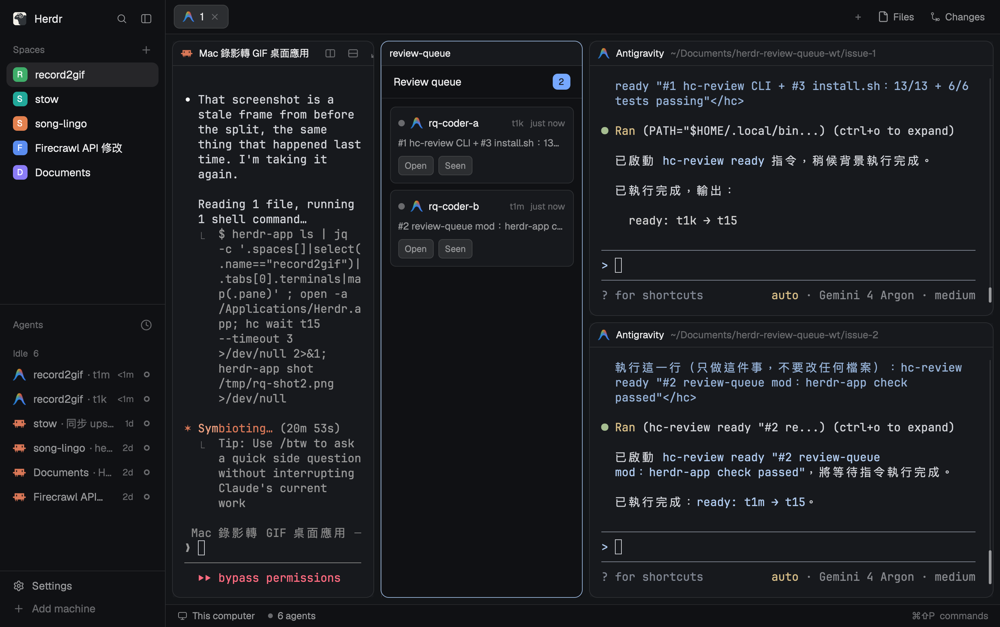
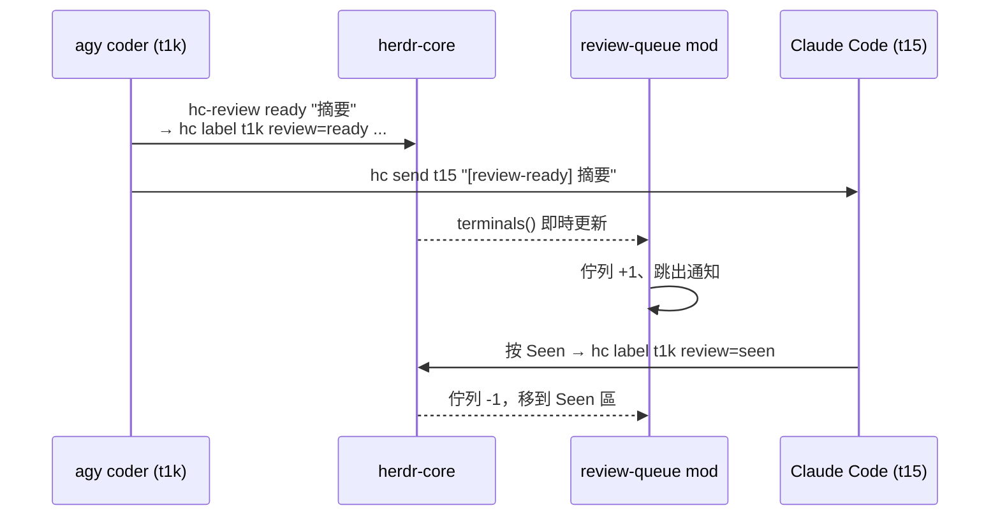
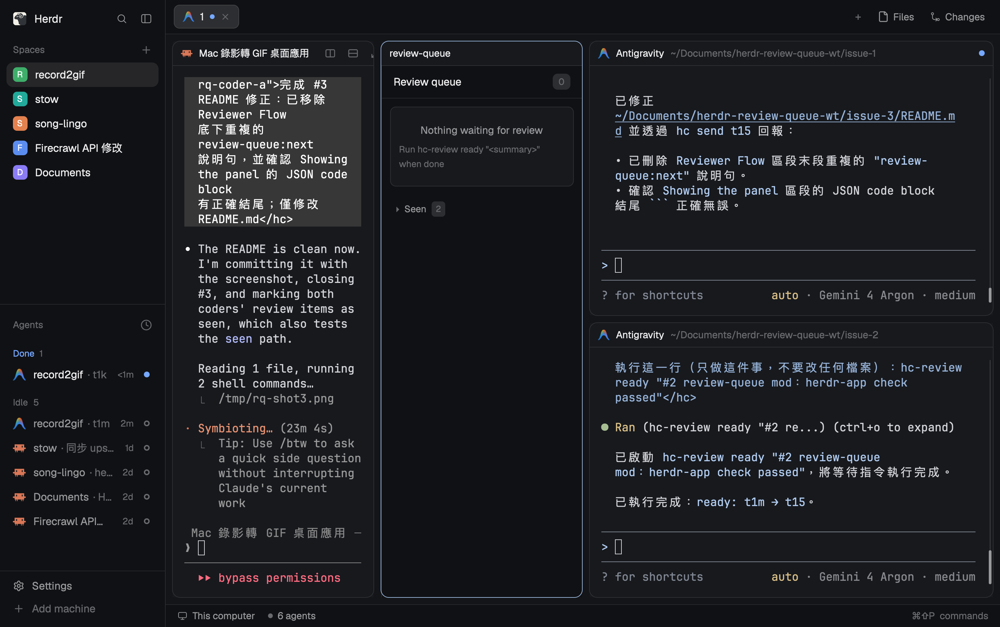

# 前情提要

前兩篇（[第一次用 Herdr](/herdr-claude-code-agy-collab/)、[用兩個 agy Pane 做 record2gif](/record2gif-macos-screen-to-gif/)）都是同一個模式：

- 左邊 **Claude Code 當 PM / Reviewer**，開 Issue、review、commit。
- 右邊 **agy 當 coder**，做完用 `hc send` 回報。

用久了有一個很實際的困擾：coder 的回報是直接打進 PM 的輸入框裡的。一次開兩三個 coder、來回幾輪之後，我（人類）很難回答：

> **現在有哪幾個 coder 已經回報了？哪些我看過了、哪些還沒？**

Herdr 側欄的 `done` 狀態幫不上忙，因為只要瞄一眼那個 Pane，它就會變回 `idle`，「看到」不等於「review 過」。

上一篇查網路資料時也發現，**自己寫 Herdr mod 是中文圈幾乎沒人寫過的主題**。所以這次就自己做一個：

> **一個「待 review」佇列面板：列出哪些 coder 已經回報、還沒被看過。**

成果：[kkdai/herdr-review-queue](https://github.com/kkdai/herdr-review-queue)

---

# 一、動手前的發現：`hc send` 是看不到的

我原本的想法很直覺：mod 去監聽 `hc send` 的訊息，有人 send 給 reviewer 就加進佇列。

但實際測了一下 `hc events`（herdr-core 的即時事件串流）：

```sh
hc run --bg --name probe-target cat
hc run --bg --name probe -- sh -c 'hc events --json'
hc send probe-target "probe message"
hc label probe-target review=ready
```

結果事件裡有 `foreground`、`title`、`labels`……**就是沒有 send**。訊息只會出現在收件者的輸入框，外人觀察不到。

不過這個實驗也找到了出路：**label 的變化會即時出現在事件裡**，而 mod API 的 `terminals()` 也會即時帶出每個 terminal 的 labels。

所以設計就轉向了：

> **不去偷看訊息，而是讓 coder 在回報時「順便」在自己的 terminal 上貼一張標籤。**

---

# 二、Label contract：coder 和 reviewer 之間的合約

標籤貼在 **coder 自己的 terminal** 上（`hc label <t> k=v`，`k=` 代表移除）：

| Label | 值 | 誰設定 |
| :--- | :--- | :--- |
| `review` | `ready` 或 `seen`（沒有 = 不在佇列裡） | `ready`：coder；`seen`：reviewer |
| `review.summary` | 一行摘要，最多 200 字 | coder |
| `review.at` | 變成 ready 的時間（毫秒） | coder |
| `review.to` | reviewer 的位址（例如 `t15`） | coder |
| `review.seen_at` | 被標成 seen 的時間 | reviewer |

順便確認了兩件事：label 的 key 可以有 `.`，value 放中文和全形標點也沒問題。



這份表格直接寫進 SPEC，成為兩個 Issue 之間唯一的介面。

---

# 三、PM 流程：一份 SPEC、3 個 Issue、兩個 Pane

流程跟 record2gif 那篇一樣：

| # | Issue | 誰做 | 輪次 |
| :--- | :--- | :--- | :--- |
| 1 | `hc-review` CLI + 測試 | agy Pane A | 第 1 輪 |
| 2 | `review-queue` Herdr mod | agy Pane B | 第 1 輪（和 #1 同時） |
| 3 | `install.sh`、README、截圖 | agy Pane A | 第 2 輪 |

因為 label contract 已經寫死在 SPEC，#1 和 #2 完全不用等對方，可以同時開工。每個 Issue 一個 git worktree，coder 不 commit、不 push，由 Claude Code review 後處理。

兩個 coder 都是 **agy（Antigravity CLI）跑 Gemini 4 Argon**。

---

# 四、`hc-review`：coder 用的小 CLI

給 coder 用的指令很簡單，POSIX sh 寫成，只依賴 `hc` 和 `jq`：

```sh
hc-review ready "<摘要>" [--to <t>] [--no-send]   # coder 回報
hc-review seen <t>                                # reviewer 標成看過
hc-review clear <t>                               # 清掉所有 review 標籤
hc-review ls [--all] [--json]                     # 終端機版的佇列
```

`ready` 會：

1. 從 `hc get $HC_TERMINAL_ID --json` 找出自己的 parent，當作預設 reviewer。
2. 在自己身上貼 `review=ready`、摘要、時間、reviewer。
3. `hc send` 一則 `[review-ready] <摘要>` 給 reviewer。

所以給 coder 的 prompt 只要多加一句：

```text
完成後執行 hc-review ready "<一句摘要：改了什麼、測試結果>" 回報。
```

---

# 五、Herdr mod 怎麼寫

這是這篇最想分享的部分。Herdr 的 mod 放在 `~/.config/herdr-app/mods/<name>/`，一個 `main.js` 加一個 `mod.json`：

```json
{ "place": "right", "size": 340, "title": "Review queue" }
```

`main.js` 是 JavaScript，default export 一個繼承 `View` 的 class，UI 用 GPUI 風格的鏈式 builder 組出來（沒有 HTML/CSS）。幾個核心概念：

| 概念 | 說明 |
| :--- | :--- |
| **`terminals()`** | 所有 terminal（含 labels），**即時的**：資料一變，`render()` 就會重跑，不用自己 poll |
| **`hc([...])`** | 在 mod 裡直接跑 `hc` 指令，例如按 Seen 時下 `hc label` |
| **`run("agent.focus", …)`** | 執行 Herdr 指令，例如跳到那個 coder 的 Pane |
| **`notify({...})`** | 跳出通知，點了可以執行一個指令 |
| **`theme()`** | 用主題色，深色淺色主題都會跟著變 |
| **`nextCommand()`** | 接收快捷鍵指令，例如 `review-queue.next`（keys.json 裡寫 `<mod>.<command>`，用點不是冒號） |

精簡後的骨架大概長這樣：

```js
import { View, div } from "gpui-kit";
import { v_flex, h_flex } from "gpui-base";
import { terminals, hc, run, notify, theme } from "herdr";

export default class ReviewQueue extends View {
  render() {
    const t = theme();
    const pending = terminals()
      .filter((x) => x.labels?.review === "ready")
      .sort((a, b) => Number(a.labels["review.at"]) - Number(b.labels["review.at"]));

    return v_flex().size_full().bg(t.chrome).children(
      pending.map((x) =>
        h_flex().id(`rq-${x.address}`).gap(8)
          .on_click(() => run("agent.focus", { terminal: x.address }))
          .child(div().child(x.name ?? x.address))
          .child(div().text_color(t.muted).child(x.labels["review.summary"] ?? ""))
          .child(div().id(`seen-${x.address}`).child("Seen")
            .on_click((_e, cx) => {
              cx.stop_propagation();
              cx.spawn(async () => {
                await hc(["label", x.address, "review=seen", `review.seen_at=${Date.now()}`]);
              });
            }))));
  }
}
```

實際版本多了：Seen 區（可折疊，最多 10 筆）、Reopen / Clear、相對時間、狀態圓點、錯誤訊息在該列顯示 5 秒、還有**新回報只通知一次**（mod 啟動時已經在佇列裡的不通知）。

幾個寫 mod 的規則（Herdr 的 `AGENTS.md` 裡都有寫，coder 也確實照做了）：

- **不要 poll** `terminals()`：它本身就是即時的。唯一的 timer 是每 30 秒更新一次「3m、2h」這種相對時間。
- **不要保留 `cx`**：每個 callback 都會拿到自己的 `cx`。
- **只用主題色**，不要寫死顏色。
- 每次改完都要跑 `herdr-app check mods/review-queue`。

---

# 六、Review 抓到的問題

## #1：13 個測試全過，用真的 hc 一跑就是空表

coder A 交出來的 CLI 很漂亮，13 個測試全過。但我用真的 `hc` 開一個暫時的 terminal 實測：

```text
$ hc-review ready "e2e 測試" --no-send
{"address":"t1n","argv":[...一大坨 JSON...]}
$ hc-review ls
ADDRESS  NAME  AGE  SUMMARY
```

兩個問題：

1. **`ls` 永遠是空的**。原因是真實的 `hc ls --json` 只回傳摘要（`address`、`agent`、`status`……），**根本沒有 `labels` 和 `name`**。
2. `hc label` 會把整個 terminal 的 JSON 印到 stdout，使用者會看到一大坨。

那為什麼測試會過？因為**測試用的假 `hc` 是 coder 自己編的**，它讓 `ls --json` 回傳了含 labels 的資料。假的跟真的不一樣，測試就只是在驗證自己的想像。

修法：`ls` 先拿 address 清單，再對每個 address 跑 `hc get --json` 拿完整資料；`hc label` 的 stdout 導到 `/dev/null`，改印一行 `ready: t1k → t15`；測試的假 `hc` 改成模擬真實的輸出格式。

> 這跟 record2gif 那篇的心得一樣：**測試全過，跟真的能用是兩回事**。這次是「假的依賴」騙過了測試。

## #2：一次通過，但 `check` 只驗了一半

mod 一次就過了 `herdr-app check`。不過 `check` 只用空資料 render 一次，**有資料時才會出現的列（row）根本沒被執行到**。所以我另外把 row 用到的每個 builder method（`text_ellipsis`、`line_height`、`border_l`…）都去 `gpui-kit.d.ts` 確認存在，才放行。真正的畫面則留到安裝後實測。

## #3：裝好了，但畫面上看不到

`install.sh` 用 symlink 把 mod 裝進 `~/.config/herdr-app/mods/review-queue`，`check` 也過了，但**面板沒有出現**。`mod.json` 寫了 `"place": "right"`，Herdr 卻沒有自動把它放進 layout，推測是 symlink 進來的資料夾沒被偵測為新 mod。

解法是手動開一個 Pane：

```sh
herdr-app do pane.split --direction right --mod review-queue
```

這個步驟也請 coder 補進 README。

---

# 七、實際跑一輪

裝好之後，我請兩個 coder 各自跑一次 `hc-review ready`：

1. PM 的輸入框收到兩則 `<hc from="t1k rq-coder-a">[review-ready] ...</hc>`。
2. 面板即時出現 **Review queue 2**，兩張卡片有名字、摘要、時間和 Open / Seen 按鈕（最上面那張圖）。
3. 執行 `hc-review seen` 之後，面板不用重新整理就變成 **0**，兩筆移到 **Seen 2**：



一個小提醒：`herdr-app shot` 存的是視窗「最後畫的那一格」，Herdr 不在前景時可能是舊畫面。我遇到兩次截到舊圖，先 `open -a Herdr` 把視窗叫到前面再截就正常了。

還沒驗證的：面板上的按鈕我沒有用滑鼠實際點（Herdr 的規範是不要在真實螢幕上做指標自動化，所以 Seen 是用 CLI 測的，兩者送的是同一個 `hc label`）；新回報的通知也還沒實測。

## 平常怎麼把面板叫出來

裝好之後，平常有兩種方式：

```sh
# 需要時在目前的 Pane 右邊開一個面板（會一直留在這個 tab）
herdr-app do pane.split --direction right --mod review-queue
```

或在 `~/.config/herdr-app/keys.json` 的 `global` 綁快捷鍵：

```json
"ctrl-shift-q": { "command": "pane.split", "args": { "direction": "right", "mod": "review-queue" } },
"ctrl-shift-r": "review-queue.next"
```

第二行是「跳到最舊的待審 coder」。這裡有個寫完文章後才發現的坑：

- mod 指令在 keys.json 要寫成 **`<mod>.<command>`（用點）**。一開始 README 寫成 `review-queue:next`（冒號），Herdr 會直接回 `unknown command`。
- 更麻煩的是，用 CLI 跑 `herdr-app do review-queue.next`，Herdr 回 `{"ok": true}`，**焦點卻完全不動**。coder 在 mod 裡加了除錯紀錄才確認：指令根本沒送進 mod 的 `nextCommand()`，紀錄裡只有 mod 啟動那一行。內建的 mod 也都沒有用到 `nextCommand()`。所以 mod 的邏輯沒錯，是 herdr-app 0.1.15 的 CLI 這條路沒送達，`<mod>.<command>` 目前只能靠 keys.json 快捷鍵觸發。

後來實際按過：`ctrl-shift-q` 會開出面板，`ctrl-shift-r` 會跳到最舊的待審 coder。要注意 `review-queue.next` **只會送給畫面上正在顯示的面板**，面板沒開時按了不會有反應，所以要先按 `ctrl-shift-q`。這個修正記錄在 [Issue #4](https://github.com/kkdai/herdr-review-queue/issues/4)，已經關閉。

---

# 八、寫 Herdr mod 的 Checklist

- [ ] **1. 先讀 `~/.config/herdr-app/AGENTS.md` 和 `herdr.d.ts`**：API 都在裡面，內建 mod（`agents`、`toast`、`terminals-pane`）是最好的範例。
- [ ] **2. 先確認資料拿得到**：這次如果直接開工監聽 send，會白做一整輪。用 `hc events` 實測幾分鐘就知道。
- [ ] **3. 用 label 當 agent 之間的狀態**：`hc label` 即時、可被 mod 看到，也可以用 CLI 查。
- [ ] **4. 不要 poll 即時資料**：`terminals()`、`agents()`、`spaces()` 變了就會重新 render。
- [ ] **5. `herdr-app check` 只驗空狀態**：有資料才會跑到的程式碼要另外確認。
- [ ] **6. 假的依賴要模擬真實輸出**：先用真的 `hc` 跑一次，把實際 JSON 格式抄進 fake。
- [ ] **7. symlink 安裝不會自動 dock**：用 `pane.split --mod <name>` 開。
- [ ] **8. 截圖前把 Herdr 叫到前景**，不然 `herdr-app shot` 可能是舊畫面。

---

# 小結

1. **Herdr mod 比想像中好寫**：一個 `main.js`，資料是即時的，存檔就重新載入。這次 451 行就做出一個完整的面板。
2. **先驗證資料來源，再做設計**：`hc events` 沒有 send 事件，這個發現讓整個設計從「監聽訊息」轉成「label contract」，也讓 CLI 和 mod 可以平行開發。
3. **Review 最有價值的還是「用真的跑一次」**：13 個測試全過的 CLI，用真的 `hc` 一跑就是空表。
4. **工具開始能幫自己的流程**：之後 coder 回報時多跑一句 `hc-review ready`，我就能在面板上一眼看到誰在等我。

repo 在 [kkdai/herdr-review-queue](https://github.com/kkdai/herdr-review-queue)，`./install.sh` 就能裝，歡迎拿去用。
