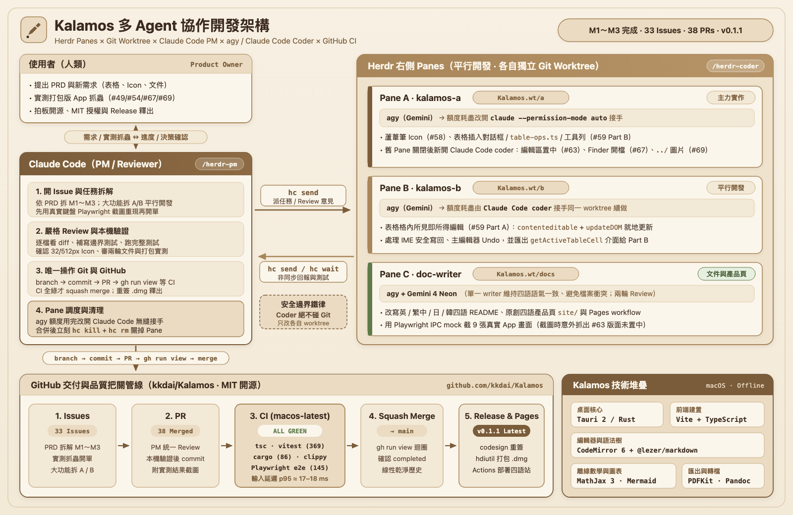
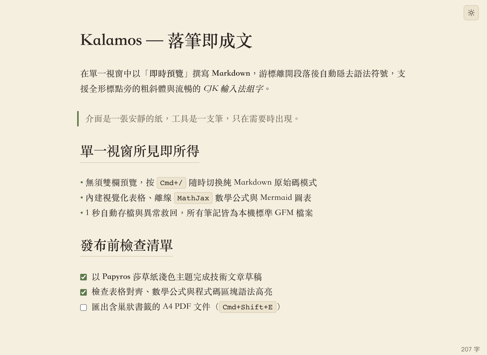
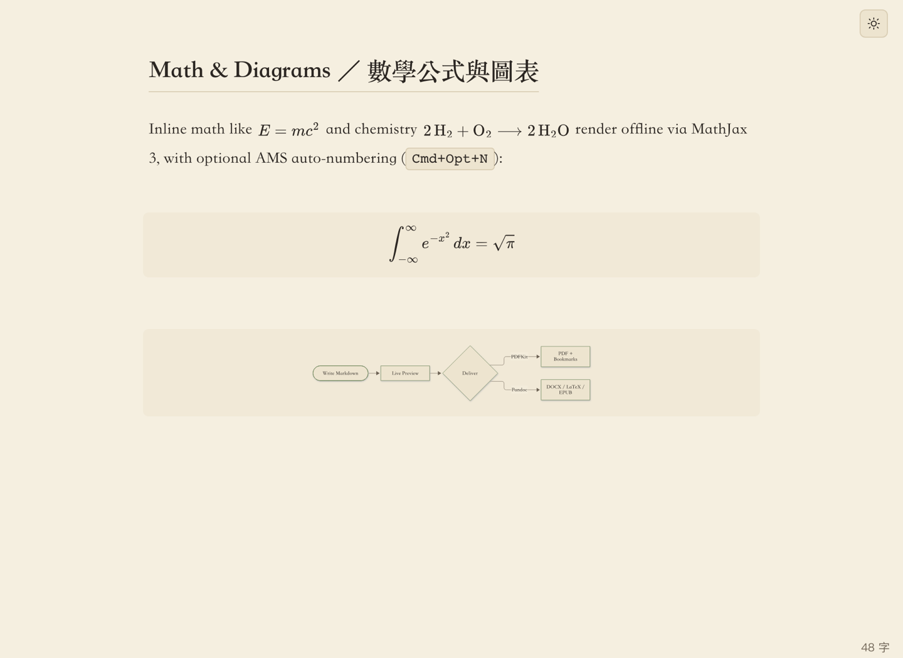
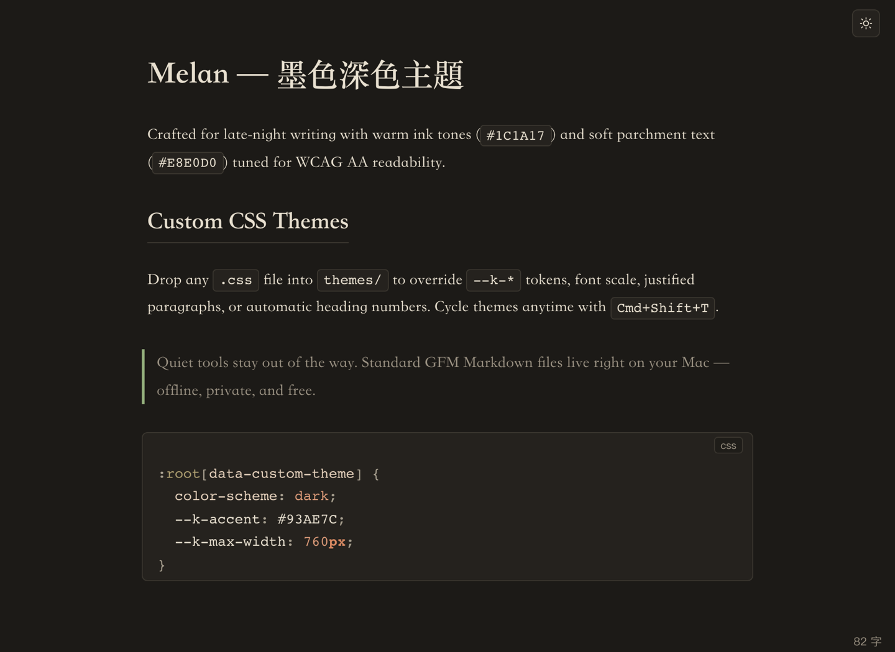
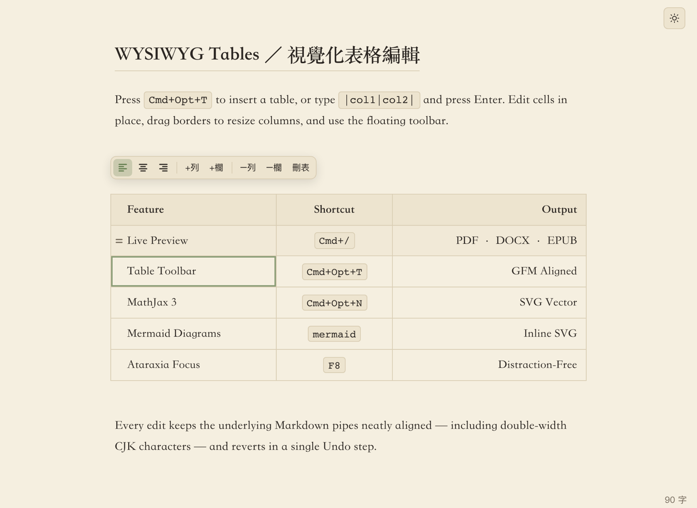

# 前情提要

前面三篇 Herdr 實戰（[第一次用 Herdr](/herdr-claude-code-agy-collab/)、[用兩個 agy Pane 做 record2gif](/record2gif-macos-screen-to-gif/)、[自己寫一個 Herdr mod：review-queue](/herdr-review-queue-mod/)），我從單一後端 Code Review 一路玩到一天做出 macOS 錄影轉 GIF 工具，甚至替自己的工作流寫了專屬的 Herdr 佇列面板。

驗證完「左邊 Claude Code 當 PM、右邊多個 Pane 平行寫程式」的節奏之後，這次我想拿一個**真正每天都要用、而且複雜度高出一個等級**的題目來壓力測試這套流程：

> **照著一份完整的 `docs/PRD.md`，自己做出一個 Typora 風格、單一視窗所見即所得（WYSIWYM）的 macOS Markdown 編輯器。**

我幫它取名叫 **Kalamos**（古希臘文 *κάλαμος*，在莎草紙上寫字用的蘆葦筆）——介面像一張安靜的紙，游標離開就隱去 Markdown 語法符號，完全免費、離線、無帳號、無遙測，存檔就是乾淨標準的 GFM。

結果從 2026-11-19 動工到 2026-11-21，三天內走完 **M1～M3 全部里程碑**，累積 **33 個 Issue、38 個合併 PR**，從專案骨架一路做到 MIT 開源、四語產品頁上線，還正式打包釋出 **`v0.1.1`**。

成果先放前面：

- GitHub Repo：[kkdai/Kalamos](https://github.com/kkdai/Kalamos)
- 四語產品頁：[kkdai.github.io/Kalamos](https://kkdai.github.io/Kalamos/)
- 正式版下載：[Release v0.1.1](https://github.com/kkdai/Kalamos/releases/tag/v0.1.1)



---

# 一、Kalamos 做了什麼？技術選型與 M1～M3 里程碑

動手之前先把技術選型定下來，原則跟 PRD 一致：**本機優先、標準 GFM、中英混排友善、完全離線可用**。

| 層級 | 技術選型 | 說明 |
| :--- | :--- | :--- |
| **桌面框架** | Tauri 2（Rust） | 輕量 macOS 原生殼、檔案系統監視、安全存檔、原生 PDFKit 匯出 |
| **前端核心** | Vite + TypeScript | 快速建置，搭配記憶體 IPC mock 可在瀏覽器直接跑開發與 E2E |
| **編輯引擎** | CodeMirror 6 + `@lezer/markdown` | GFM 基礎加上自訂 math、CJK 強調、front matter、footnote 語法擴充 |
| **數學與圖表** | MathJax 3 + Mermaid（`strict` + DOMPurify） | 全部離線渲染 SVG；Mermaid 以外也支援 `flow` 與 `sequence` |
| **其他元件** | `gemoji` + Pandoc（選用） | 離線 `:emoji` 自動完成；有裝 Pandoc 就能匯出匯入 DOCX / EPUB / LaTeX 等 |

照著 `docs/PRD.md` 的優先級，整個產品分成三個里程碑推進，最後 M1～M3 全部收工：

| 里程碑 | 涵蓋功能 |
| :--- | :--- |
| **M1（核心編輯）** | 單一視窗即時預覽與原始碼模式（`Cmd+/`）、清單與可勾選任務清單、連結與標題書籤、GFM 視覺化表格、100+ 語言程式碼區塊、離線 MathJax 公式、圖片行內顯示與拖放貼上、側欄（檔案樹 / 檔案列表 / 大綱）、Papyros / Melan 主題與自訂 CSS、原子存檔（temp + rename）與當機救回 |
| **M2（交付能力）** | 原生 PDF 匯出（含巢狀標題書籤、數學與圖表渲染）、Pandoc 多格式匯出與匯入（DOCX / ODT / LaTeX / MediaWiki / EPUB）、Mermaid / flowchart / sequence 圖表、圖片尺寸調整與靜態部落格根目錄、YAML Front Matter / 註腳 / `[TOC]`、Ataraxia 專注模式（`F8`）與 Stichos 打字機模式（`F9`）、字數與選取統計 |
| **M3（順手優化）** | 離線 Emoji 自動完成、中英文括號與 Markdown 符號自動配對、自訂 CLI 圖床上傳（設定檔限定以確保安全） |





---

# 二、多 Agent 協作模式：PM、雙 Worktree 與「額度用完無縫換將」

這次的協作架構沿用前幾篇打磨出來的心法，但紀律更嚴格，也加入了我自己整理好的 `/herdr-pm` 與 `/herdr-coder` 技能：

1. **左邊是 Claude Code（PM / Reviewer）**：讀 PRD、拆 Issue、定介面合約、看 diff、補測試、跑驗證，**全場只有 PM 會碰 git**（建 branch → commit → 開 PR → 等 CI → squash merge）。
2. **右邊在 Herdr 開兩個 coder Pane（`kalamos-a`、`kalamos-b`）**：各自綁一個獨立的 git worktree（`Kalamos.wt/a`、`Kalamos.wt/b`），彼此檔案完全隔離，用 `hc send` / `hc wait` 非同步派工與回報。
3. **新增一條衛生規則**：這次我特別要求 PM「**做完工作就把 Pane 關掉**」。每個任務合併進 `main` 後，PM 就會執行 `hc kill` + `hc rm` 把對應的 Pane 清掉，畫面不會越開越亂。

## 實戰插曲：agy 額度用完怎麼辦？

大型專案開發到一半，一定會遇到一個現實問題：一開始兩個 coder Pane 跑的都是 **agy（Gemini）**，跑了幾輪大功能之後，跳出了 **`Individual quota reached`**。

換作以前單一工具的工作流，大概只能停下來等額度恢復，或是整包對話脈絡重來一次。但在 Herdr 裡，因為 **worktree 還在、Issue 規格還在、PM 的進度掌握也還在**，PM 直接把額度耗盡的 coder 換成 **Claude Code（`claude --permission-mode auto`）** 進駐同一個 worktree 接手，整個開發流水線完全沒中斷。

這也再次驗證了[第一篇](/herdr-claude-code-agy-collab/)聊過的 **TTT（Terminal Text Tool，AI Terminal Editor）流水線**優勢：**Agent 是可抽換的執行單元，流程跟狀態留在 worktree、Issue 與 PM 手上。**

---

# 三、使用者實測抓到的第一批地雷（#49、#54、#56）

跟上次做 record2gif 一樣，所有功能做完、單元測試全綠之後，真正的考驗是「我親自打開來打幾個字」。一打字就立刻抓出三個關鍵問題：

## 1. 所見即所得「不夠像 Typora」（#49、#54）

我試打的時候馬上抱怨：「WYSIWYG 編輯器沒辦法直接顯示 Markdown 效果，例如 `- ` 應該立刻顯示成清單、`*test*` 應該馬上變斜體！」

原本的實作太保守，游標只要停在那一整行，整行的語法標記就全部露出來，用起來的感覺跟雙欄編輯器差不多。PM 接到回報後**沒有急著憑想像開 Issue，而是先用真實鍵盤的 Playwright 腳本打字並截圖重現**，確認精確行為後才拆成兩個 P0 Issue：

- **#49（區塊標記）**：`- `、`1. `、`- [ ] `、`## `、`> ` 打完空白立刻渲染成清單 / 標題 / 引用，**只有游標真的停在標記本身上才露出原始碼**；在空白清單項目按 Enter 或在標記後按 Backspace 就會自然跳出清單或引用。
- **#54（行內標記）**：`*斜體*`、`**粗體**`、`` `code` `` 在關上結尾符號的瞬間馬上渲染隱藏符號，**只有游標嚴格落在 span 內部才展開原始碼**；站在已渲染的 span 後面按 Backspace 會**先展開語法再刪除**，完整還原 Typora 的手感。

## 2. CI 偶發報錯：IME 組字後的 `RangeError`（#56）

在加上 GitHub Actions CI（#53）前後，測試偶爾會爆出一個很棘手的錯誤：

```text
RangeError: Position 55 is out of range for changeset of length 53
```

追進去 `blocks.ts` 的 `mapPos` 才找到根因：在 footnote、diagram、math 三個 `StateField` 處理 **IME 組字（composition）的分支裡，程式碼直接複製了舊的 `parsedTo`，而不是對它做 `changes.mapPos`**。只要輸入法組字把文件長度縮短，留著的舊位置就會超過文件尾端，下一筆 transaction 一做 `mapPos` 就直接炸掉。

修法很紮實：除了把三個組字分支都補上正確的 map，還獨立抽出 `src/editor/positions.ts`，讓專案裡所有儲存下來的位置都走同一層防護：

```ts
export function clampPos(pos: number, length: number): number {
  if (!Number.isFinite(pos) || pos < 0) return 0;
  return pos > length ? length : pos;
}

export function mapPosClamped(changes: ChangeDesc, pos: number, assoc = -1): number {
  return clampPos(changes.mapPos(clampPos(pos, changes.length), assoc), changes.newLength);
}
```

而且 PM 要求 coder **先寫出在舊程式上必紅的回歸測試**（vitest 與 e2e 各 3 個案例，再用 Playwright `--repeat-each 20` 反覆測試），確認修完變綠才放行。

---

# 四、這兩天的大工程：蘆葦筆 Icon 與把「表格所見即所得」拆成兩半平行做

核心體驗穩住之後，我又丟了兩個最在意的需求：一個是門面（App Icon），一個是所有 Markdown 編輯器最難寫的魔王關（視覺化表格）。

## 1. 手寫 SVG 蘆葦筆 App Icon（#58）

我想要一個呼應 Kalamos 名字的米色系蘆葦筆圖示。這裡沒有去裝額外的轉圖套件，而是交給 coder 走一條很乾淨的管線：

1. 直接手寫向量 SVG：米色 squircle 底、斜放的竹節筆桿、斜切筆尖，以及筆尖滴落的一滴墨。
2. 利用專案原本就裝好的 Playwright Chromium（`scripts/render-icon.mjs`）把 SVG 渲染成 1024×1024 透明背景 PNG。
3. 執行 `npx tauri icon` 一次產出 macOS `.icns` 與所有尺寸。
4. PM 親自看 32px（Dock / 小圖示辨識度）與 512px 預覽確認才合併。

<p align="center">
  
</p>

## 2. 表格所見即所得（#59，P0）：先設計評估，再拆 A / B 兩半平行開發

原本的表格（#7）雖然能渲染成 HTML 表格，但只要滑鼠點進去，整張表就會退回 `| a | b |` 純文字原始碼，寫起來非常出戲。

這個需求體積不小，PM 把它拆成兩個邊界清楚的子任務，交給 `kalamos-a` 與 `kalamos-b` 平行推進：

| 部分 | 負責 Pane | 內容與合約 |
| :--- | :--- | :--- |
| **Part A（#61）** | `kalamos-b` | 格內直接編輯、`updateDOM` 就地更新、IME 安全寫回、鍵盤導覽；**匯出 `getActiveTableCell` / `focusTableCell`** 給 Part B 呼叫 |
| **Part B（#62）** | `kalamos-a` | `Cmd+Opt+T` 插入對話框（含格子 picker）、`|a|b|` + Enter 自動成表、`table-ops.ts` 純函式、浮動工具列與右鍵選單、表格結構快捷鍵 |

### Part A：先讓 coder 評估技術方案再動手

這次我特別喜歡 PM 的一個動作：在 `kalamos-b` 寫第一行程式碼前，先請它評估「**格內編輯該用 `contenteditable` span，還是每格塞一個 nested CodeMirror `EditorView`？**」

coder 最後選了 **`contenteditable` span**，理由非常清楚：

1. CodeMirror 會自動忽略 widget 內部的 DOM mutation，不會互相干擾。
2. 瀏覽器原生的 `contenteditable` 讓 CJK 輸入法（IME）組字順暢無比，只要在 `compositionend` 時再把文字寫回底層 Markdown。
3. 所有編輯與結構操作都直接走主編輯器的 history，**天然整合 Undo / Redo**。
4. 一張 10×5 的表如果開 50 個 nested `EditorView`，效能跟記憶體都太重。

再加上用 `updateDOM` 就地更新非聚焦儲存格，打字時整張表不會重建、焦點不會跳掉，同時處理好 `|` ↔ `\|` 與換行 ↔ `<br>` 的跳脫處理。

### Part B：純函式結構操作，與被 E2E 抓到的快捷鍵衝突

`kalamos-a` 則把插刪列欄、左中右對齊、左右移欄、刪表全部寫成 `table-ops.ts` 純函式，每個操作都是單一 transaction（**一次 `Cmd+Z` 就能整步復原**），寫回時還會算 CJK 全形寬度把 Markdown 的 pipe 自動對齊。

開發過程也發生一個很真實的小插曲：對齊快捷鍵一開始設成 `Cmd+Opt+Shift+L / C / R`，結果 `Cmd+Opt+Shift+R` 直接撞到先前做好的「清除圖片根目錄」快捷鍵。還好既有的 Playwright E2E 測試馬上把這組衝突抓出來，改成了直覺的 `Cmd+Opt+Shift+← / ↑ / →`。

### Review 抓到的三個魔鬼細節

表格這兩張 PR（#61、#62）在 Review 階段抓到的三個問題，全都是「只看規格不會想到、動手實測才暴露」的經典案例：

1. **在格內照字面打 `<br>` 會變成換行**：PM 自己寫了一個 round-trip 小測試，發現如果在表格裡想寫教學文字「`<br>` 標籤」，存回 Markdown 再讀進來就真的斷行了！最後改成照字面輸入的 `<br>` 存成 `&lt;br>`；順手也修掉「格內結尾有奇數個 `\` 會把結尾 pipe `|` 跳脫掉」的邊界條件（補上空白）。
2. **列拖曳把手把第一欄擠歪了**：原本列拖曳把手佔了版面寬度，導致第一欄的內容比表頭往右縮了一截。改成絕對定位、滑鼠 hover 才浮現，整張表的垂直對齊瞬間清爽。
3. **浮動工具列會蓋住表格上方的標題**：點進表格時，浮在表格上面的工具列直接壓在上一行標題上。修法是在表格 active 時動態保留 **38px** 的上方空間給工具列，並同步做**捲動補償（scroll compensation）**，避免畫面突然往下跳、正在打字的儲存格跑位。



表格合併完成時，專案已經累積到 **vitest 353、e2e 137**，而且 10,000 行效能基準的輸入延遲 **p95 落在 17～18 ms**，遠低於 PRD 訂的 50 ms 預算。

---

# 五、Doc Writer 上線、截圖抓出 CSS Bug（#63），以及「為什麼不多開一個 Writer」

功能都齊了，接著該替產品準備門面：開一個獨立的 **`doc-writer` Pane**（跑 **agy + Gemini 4 Neon**，掛在 `Kalamos.wt/docs` worktree），一口氣交辦四件事：

- 改寫四語 README（英文、繁體中文、日文、韓文）。
- 製作四語靜態產品頁 `site/`（參考 Typora 產品頁的留白與大截圖節奏，但文字、配色、排版與圖全部原創）。
- 寫 Playwright IPC mock 腳本，直接截真實 App 渲染出來的畫面。
- 加上 GitHub Pages 部署 workflow。

PM 審了兩輪，抓到不少藏在細節裡的瑕疵：

- README 裡列出的功能與快捷鍵表格，逐一跟程式碼對照核對。
- HTML 原始碼裡為了排版在中文句子中間換行，瀏覽器渲染時會在 **CJK 全形標點後面多出一個半形空白**，全部整理乾淨。
- GitHub Pages workflow 補上 `paths` 過濾，避免以後改 Rust 程式也一直重跑網站部署。
- 首頁 hero 截圖改成英 / 繁中 / 日 / 韓四種語言各截一張，切換語系時連畫面裡的示範文章都會跟著變。

## 意外收穫：截圖順手抓到 App 本身的版面 Bug（#63）

最有趣的是，當 `doc-writer` 用 Playwright 截出第一批 App 畫面時，一眼就看到不對勁：**編輯區文字整個貼齊視窗左緣，側欄打開時還會直接蓋住文字！**

明明 `editor.css` 裡有寫 `.cm-content { margin: 0 auto; }` 啊？一查 DOM 才破案：

> CodeMirror 6 的 base theme 會動態注入 `.ͼ1 .cm-content { margin: 0; padding: 4px 0; }`（CSS 權重 specificity **`0,2,0`**），而且注入時間比我們自己的 stylesheet 還晚，直接把只有 `0,1,0` 的 `.cm-content` 蓋掉了！

解法非常乾淨，不靠醜陋的 `!important`，直接提高一層選擇器權重到 **`0,3,0`**，並讓側欄開啟時從外層容器扣掉寬度，紙面欄再自動在剩餘空間置中：

```css
/* .ͼ1 .cm-content (0,2,0) 較晚注入會蓋掉單純的 .cm-content */
/* 改用 0,3,0 贏過 CodeMirror base theme，不依賴 !important */
.cm-editor .cm-scroller .cm-content {
  width: 100%;
  max-width: var(--k-max-width, 720px);
  margin: 0 auto;
  padding-block: 56px 120px;
  padding-inline: var(--k-content-padding-x, 32px);
}
```

PR #64 把這個 Bug 修掉並補上 `center-content.spec.ts` 之後，`doc-writer` 重截了全部 9 張圖，畫面立刻有了「一張安靜的紙」的氣質。

## 管理決策：要不要多開一個 Writer 分攤？

寫四語文件和產品頁花的時間比較長，中途我有問 PM：「要不要再開第二個 writer 分攤？」

PM 評估完果斷說**不要**，理由很實在：

1. 工作已經進入收尾階段。
2. 兩個 writer 同時改同一批 README 與 `site/` 檔案，只會製造大量 merge conflict。
3. 新開的 writer 要從頭重讀整個 codebase，重新熟悉的成本比直接讓原本那位做完還高。
4. 四國語言的文案語氣與名詞翻譯會變得不一致。

多 Agent 協作不是「Pane 越多越好」，**能切出乾淨介面邊界的才平行（像表格 Part A / B），高度耦合的收尾工作交給單一專責 Agent 反而更快。**

---

# 六、踩到的坑：PM 失誤、開源檢查、macOS 簽章，與拿來寫部落格抓出的最後兩顆雷

進入開源與正式打包發布階段，又冒出一連串「不真的走完最後一哩路絕對遇不到」的坑。

## 坑 1：PM 自己的失誤——`gh pr checks --watch` 斷線騙過了合併閘門

合併表格 Part A（#61）的時候，PM 照慣例用 `gh pr checks --watch` 等 GitHub Actions 跑完。結果中途遇到網路 `connection reset`，`--watch` 提早結束回傳，PM 沒留意 CI 其實還在跑，直接按了 merge！

雖然事後 `main` 的 CI 是綠的、沒有出事，但這是一個流程漏洞。PM 當場改掉習慣：**之後不再信任 `--watch` 的結束碼，改成用 `gh run view` 迴圈明確檢查 `status == completed` 且結論是 `success` 才允許合併。**

## 坑 2：從 Private 轉公開開源與 GitHub Pages

本來 repo 是 private 的，準備開 GitHub Pages 時才撞到 GitHub 免費方案限制：private repo 不能開 Pages。PM 列出三個選項給我挑：

1. 直接公開原本的 repo。
2. 另開一個 public repo 只放產品頁。
3. 升級 GitHub Pro。

最後我選了直接公開 repo。公開之前，PM 先把整個 git 歷史（含各分支共 67 個 commit）完整掃過一遍：

- 確認沒有任何 API token、金鑰或憑證。
- 測試裡用到的都是虛構路徑，沒有洩漏本機環境資訊。
- 唯一需要我拍板的是 **commit author email 會隨著公開歷史一起公開**。我確認沒問題、照原樣公開，補上 MIT License（#66），並透過 GitHub Actions 部署四語產品頁。

## 坑 3：v0.1.0 → v0.1.1 與 macOS ad-hoc 簽章「已損毀」危機

第一次把打包好的 `Kalamos.app` 裝進 `/Applications` 時，跑 `codesign -v` 就立刻報錯：

```text
code has no resources but signature indicates they must be present
```

這種不完整的 ad-hoc 簽章，其他人下載 `.dmg` 解開後，macOS 很可能直接跳「應用程式已損毀，無法打開」，連右鍵開啟都不給。因此在發布 **`v0.1.0` pre-release** 之前，就已經先把重簽章與重包 `.dmg` 加進發布流程：

```sh
codesign --force --deep -s - Kalamos.app
# 再用 hdiutil 重新打包成 .dmg
```

後來修完 #67、#69 準備發布 **`v0.1.1`** 時沿用同一套重簽流程；確認沒問題後，刪掉舊的 `v0.1.0` pre-release，把 `v0.1.1` 正式設成 Latest。

## 坑 4：從 Finder 開 `.md` 時，Kalamos 是灰的（#67）

把打包好的 App 拖進 `/Applications`，想說在 Finder 對 `.md` 檔按右鍵「打開檔案的應用程式」試用看看，結果清單裡的 **Kalamos 是灰的、根本選不了**！

查下去有兩層原因：

1. `tauri.conf.json` 沒有設定 `fileAssociations`，打包出來的 `Info.plist` 缺少 `CFBundleDocumentTypes` 與 Markdown 的 UTI 宣告，macOS 不知道它能開 `.md`。
2. 就算選得到，Rust 端還沒處理 macOS 的 `RunEvent::Opened` 事件，從 Finder 點兩下或冷啟動開檔會石沉大海。

PR #68 一次補齊：登記 `md`、`markdown`、`mdown`、`mkd`、`mkdn`、`mdwn`、`mdtxt` 七種副檔名與 imported UTI `net.daringfireball.markdown`；Rust 收到開檔事件時，如果前端還沒初始化完成就先排進 queue，等前端 ready 後再取出，走既有的開檔流程（目前文件有未存變更時一樣會先詢問）。最後實際用打包版驗證冷啟動 `open -a Kalamos file.md` 通過。

## 坑 5：拿 Kalamos 開「這個部落格」，立刻抓到 `../images/` 破圖（#69）

最後一個 Bug 特別有宿命感。我終於把 Kalamos 拿來開**這個部落格的上一篇文章**（`_posts/2026-11-15-herdr-review-queue-mod.md`），結果文章裡所有 `../images/xxx.png` 全部顯示「**圖片載入失敗**」！

原因是 Tauri 的 `asset` protocol scope 為了安全，原本只放行文件所在資料夾（也就是 `_posts/`）。Jekyll 部落格習慣把文章放 `_posts/`、圖片放平行的 `images/`，路徑往上一層 `../images/` 就被擋在門外。

但修法絕對不能偷懶「把整個上層資料夾全部放行」（萬一使用者開的是家目錄底下的檔案，等於把整個資料夾暴露給 WebView）。PR #70 的做法很克制：

1. 在 Rust 新增 `allow_asset_file` 指令：對路徑做 `fs::canonicalize` 解開 `..` 與符號連結，確認它是一個真實檔案，且副檔名在圖片白名單裡。
2. 通過檢查後，**只把那一張圖片檔單獨放進 `asset_protocol_scope`**，絕不放行整個上層資料夾。
3. 前端載入不在文件目錄內的本機圖片前，先呼叫 `allow_asset_file`（加上快取與失敗重試一次）。

```rust
#[tauri::command]
pub fn allow_asset_file(app: tauri::AppHandle, path: String) -> Result<(), AppError> {
    use tauri::Manager;
    let requested = Path::new(&path);
    let canonical = check_asset_file(requested)?; // canonicalize + 檔案檢查 + 圖片副檔名白名單
    let scope = app.asset_protocol_scope();
    let to_err = |e: tauri::Error| AppError::new(crate::error::ErrorKind::Io, e.to_string());
    scope.allow_file(&canonical).map_err(to_err)?;
    if requested != canonical {
        scope.allow_file(requested).map_err(to_err)?;
    }
    Ok(())
}
```

修完後 PM 直接用打包好的 App 開啟同樣的 `_posts/ + ../images/` 目錄結構實測驗證，圖片順利載入，這才安心切出正式版 `v0.1.1`。

---

# 七、最終驗收數字與這次學到的多 Agent 協作 Checklist

到 `v0.1.1`（最新 `main`）為止，所有自動化防線與基準測試全部亮綠燈：

| 檢查項目 | 結果 | 說明 |
| :--- | :--- | :--- |
| **Vitest 單元測試** | **369 passed** | 涵蓋 parser、table-ops、positions、export、image 邏輯 |
| **Playwright E2E** | **145 passed** | 含真實鍵盤打字、表格、置中、IME 反覆測試 |
| **Rust `cargo test`** | **86 passed** | 原子存檔、檔案關聯佇列、asset scope 白名單與 symlink 防護 |
| **Rust Clippy** | **0 warnings** | `cargo clippy --all-targets -- -D warnings` |
| **GitHub Actions CI** | **全綠（`macos-latest`）** | 每次 PR 自動跑 `tsc` / `vitest` / `build` / `cargo test` / `clippy` / Playwright |
| **輸入延遲 p95** | **17～18 ms** | 10,000 行長文基準，遠低於 50 ms 目標 |

把這三天跑大專案多學到的經驗，整理成一份進階版的 Herdr 協作 Checklist：

- [ ] **1. 複雜功能先讓 coder 做設計評估再寫扣**：像表格先比過 `contenteditable` 與 nested `EditorView`，省下整輪走錯路的成本。
- [ ] **2. 大需求拆成「介面合約 + 雙 worktree 平行」**：Part A 匯出 `getActiveTableCell` / `focusTableCell`，Part B 就能同時開工，合併幾乎零衝突。
- [ ] **3. 額度用完不必停工，直接換模型進同一個 worktree**：agy 撞到 `Individual quota reached`，立刻換 `claude --permission-mode auto` 接棒。
- [ ] **4. 不要為了收尾硬開第二個 Agent**：高度耦合的翻譯與產品頁收尾，單一專責 writer 反而比雙開更快、語氣也更一致。
- [ ] **5. 不要只信 `gh pr checks --watch`**：網路中斷會提早結束，合併前用 `gh run view` 明確檢查 `status == completed`。
- [ ] **6. 任務合併就關 Pane**：用 `hc kill` + `hc rm` 養成收尾習慣，Herdr 視窗才不會堆滿閒置終端機。
- [ ] **7. 修 Bug 先寫「在舊程式上會紅」的回歸測試**：像 #56 的 IME 越界與 #59 的 `<br>` round-trip，有紅轉綠才算真的修好。
- [ ] **8. 截圖與「開自己的真實專案」是最強的驗收**：截圖抓出 #63 的 CSS 權重蓋版，開自己的部落格抓出 #67 與 #69。
- [ ] **9. macOS 釋出前必檢 `codesign` 與 `Info.plist`**：檢查 ad-hoc 簽章是否完整、檔案關聯 UTI 與 `RunEvent::Opened` 是否都接好。

---

# 小結

回頭看這四篇 Herdr 實戰的演進，其實很有趣：

1. **從修 Bug 到做完整產品**：第一篇修既有後端，第二篇做小工具，第三篇替流程寫 mod，第四篇三天內把一份完整的桌面編輯器 PRD（M1～M3）從零做到 MIT 開源與 `v0.1.1` 正式版。
2. **模型只是插槽，流程才是資產**：開發到一半 agy 額度耗盡，換上 Claude Code coder 進同一個 worktree 無縫續跑——只要規格、合約、測試跟 git 紀律在 PM 手上，換哪家模型都能接著做。
3. **「測試全過」之外，永遠還需要真實使用者的那一雙手**：如果我沒有親自打字、沒有叫 doc-writer 截圖、沒有拿它來開這個部落格的上一篇文章，#49、#54、#63、#67、#69 這幾個最影響使用體驗的問題，光靠 CI 根本抓不到。
4. **工具終於回到自己手上**：Kalamos 已經可以從 Finder 直接點兩下打開這個部落格的 `.md` 檔，也能正確載入 `../images/` 的截圖——之後寫文章，就能用自己和 Agent 們一起做出來的編輯器來寫了。

歡迎下載試玩，也歡迎到 repo 逛逛或給顆星星：

- GitHub Repo：[kkdai/Kalamos](https://github.com/kkdai/Kalamos)
- 產品頁：[https://kkdai.github.io/Kalamos/](https://kkdai.github.io/Kalamos/)
- 正式版下載：[Release v0.1.1](https://github.com/kkdai/Kalamos/releases/tag/v0.1.1)

**同系列前情回顧：**

- [\[Herdr 實戰\] 第一次用 Herdr：讓 Claude Code 當 Reviewer、agy 當實作者](/herdr-claude-code-agy-collab/)
- [\[Herdr 實戰\] 用 Herdr 開兩個 agy Pane 平行開發：一天做出 record2gif](/record2gif-macos-screen-to-gif/)
- [\[Herdr 實戰\] 自己寫一個 Herdr mod：用 label 做出「待 review」佇列](/herdr-review-queue-mod/)
