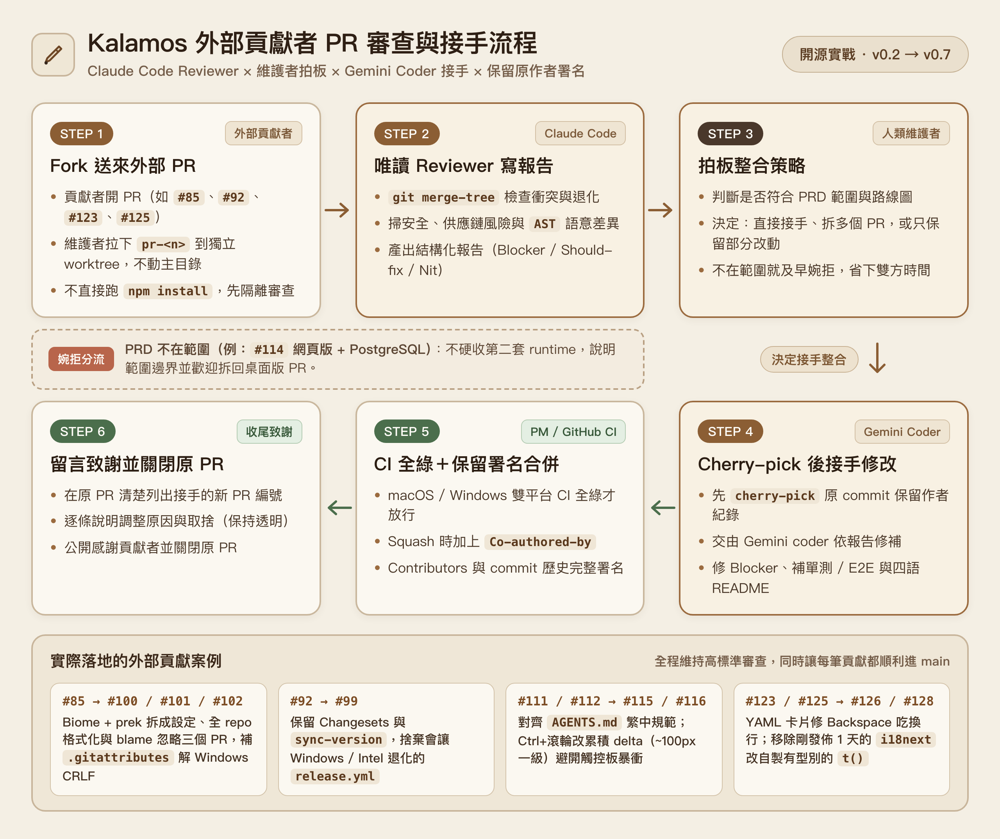
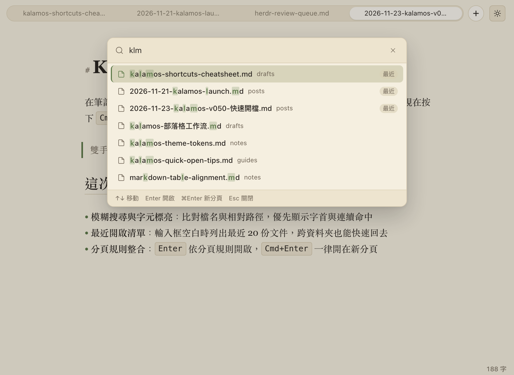
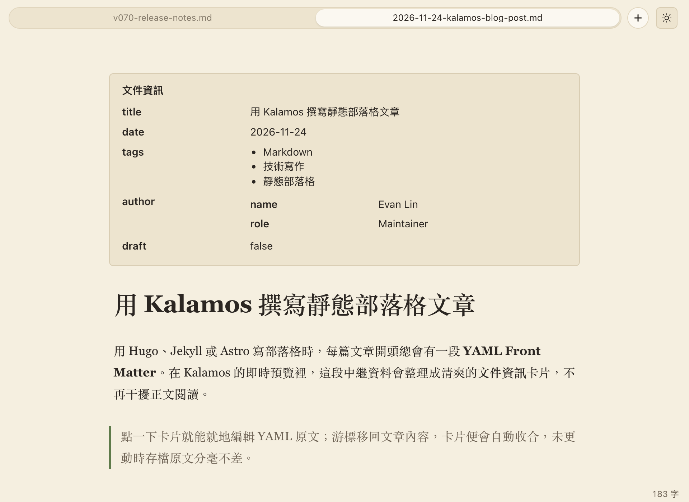
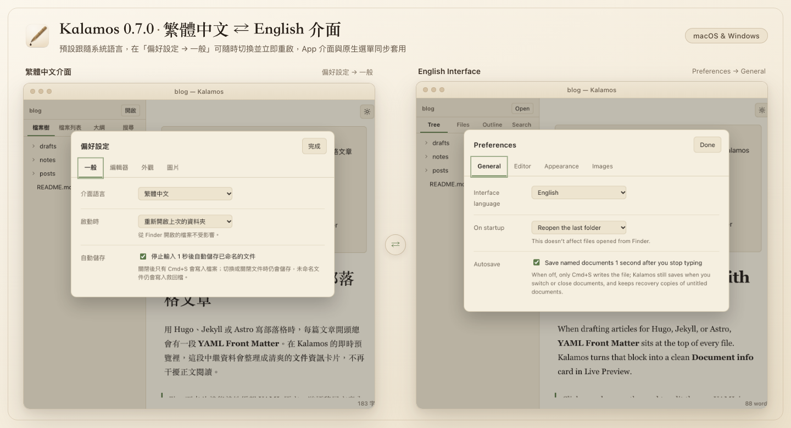

# 前情提要

在[上一篇開發紀錄](/kalamos-typora-style-markdown-editor-herdr/)裡，我用 Herdr 讓 Claude Code 當 PM、右邊開兩個 worktree coder Pane，三天內從零做出 Typora 風格的 Markdown 編輯器 **Kalamos**，完成了 M1～M3 里程碑、MIT 開源，並釋出第一個正式版 `v0.1.1`。

原本以為開源之後就是自己慢慢修修補補，沒想到專案公開才過一天，不只我自己開始拿 Kalamos 寫日常文件、邊寫邊補日常剛需（搜尋、選單、分頁、快速開檔），社群也馬上出現外部貢獻者——`@mingchuanhuang-xpc` 送來 Windows 移植 PR，而 `@narumiruna` 更是連續送出了 Biome、Changesets、Issue/PR 範本、`AGENTS.md`、Ctrl+滾輪縮放、YAML 文件資訊、多語系介面，甚至連網頁版原型都做了出來。

短短幾天內，專案從 `v0.1.1` 一路推到 `v0.7.0`。開源後的開發節奏跟閉門造車完全不同：**一方面要維持自己產品的步調，另一方面得建立一套既能守住品質與安全、又能善待外部貢獻者的 PR 處理流程。**

這篇會聚焦在三個主題：

1. **v0.2 到 v0.7 的功能演進時間軸**，以及每個大功能在 Review / 實測時抓到的有趣問題。
2. **外部貢獻者 PR 的審查與接手流程**（這篇的重頭戲）：怎麼用 Claude Code 審查、維護者拍板、Gemini coder 接手，同時完整保留原作者署名；以及為什麼我們決定先不做網頁版（#114）。
3. **發版與工具鏈的進化**：導入 Biome（踩到 Windows CRLF 的坑）、Changesets 自動版本 PR、修掉 `sync-version` 打壞格式（#110），以及讓 `CHANGELOG.md` 去掉多餘的 commit hash。

> 這次會分成三篇來寫：這篇聊功能演進、外部 PR 協作與發版流程；接下來兩篇會分別深入記錄 [**Windows 實作的注意事項**](/kalamos-dev-windows-support/)（對應 `v0.4.0`）以及 [**應用程式內自動更新需要注意的地方**](/kalamos-dev-auto-update/)（對應 `v0.8.x`）。

---

# 一、開源後的功能演進：從 v0.2 到 v0.7 時間軸

先用一張時間軸看 `v0.1.1` 之後，Kalamos 怎麼一步步從「自己能寫文章」長成「每天都離不開的桌面編輯器」：

| 版本 | 日期（台灣時間） | 核心功能與對應 Issue / PR | Review / 實測抓到的代表性問題 |
| :--- | :--- | :--- | :--- |
| **v0.2.0** | 2026-11-22 | 單檔尋找與取代（#73 / #76）、資料夾搜尋（#77）、原生 macOS 選單列與偏好設定（#74 / #78） | **#76 表格內搜尋**不能只靠 CodeMirror 原生標記；**#78 偏好設定** `display: flex` 蓋掉 `hidden` 屬性 |
| **v0.3.0** | 2026-11-23（UTC 11-22） | 多文件分頁（#81，拆成 #82 A 與 #83 B） | **#83 `Cmd+Q` 攔截**：改自訂 action + `quit_app`，但 `tao` 攔不到 Dock 右鍵結束 |
| **v0.4.0** | 2026-11-23（UTC 11-22） | Windows 10/11 支援（#94、#97，接手 `@mingchuanhuang-xpc` 的 #79）與跨平台 tag 自動發佈（#93） | 細節見[下一篇 Windows 實作專文](/kalamos-dev-windows-support/) |
| **v0.5.0** | 2026-11-23 | `Cmd+P` 快速開檔與最近開啟清單（#104 / #106）、Workflow 強化、Biome 與 Changesets（#99～#102） | 輕量列檔 `list_markdown_paths` 不讀檔內容、萬檔內 16ms 模糊搜尋；Biome 撞 Windows CRLF |
| **v0.6.0** | 2026-11-24 | `Ctrl` + 滾輪縮放（接手 `@narumiruna` 的 #112 → #116；未單獨發版，隨 v0.7.0 一併釋出） | 每個 `wheel` 事件直接跳一級，觸控板與高解析度滑鼠一滑就衝到 50% / 300% |
| **v0.7.0** | 2026-11-24 | YAML 文件資訊預覽（接手 #123 → #126）、繁體中文與英文介面（接手 #125 → #128） | **#126 Backspace 吃掉隱藏換行**；**#128 `i18next` 才發佈一天的供應鏈風險**；後續 **#131 被 `setTimeout` 清掉的錯誤提示** |

每個版本都有不少有意思的工程細節，下面挑出幾個最值得記錄的 Review 現場。

## v0.2.0：尋找與取代（#73）＋原生選單與偏好設定（#74）

開源後拿去日常寫作，第一時間發現兩個最大缺口：沒有 `Cmd+F` 找字，也沒有 macOS 上方的原生選單列與 `Cmd+,` 偏好設定。我們照慣例把 #73 拆成「單檔尋找與取代（#76）」和「側欄資料夾搜尋（#77）」兩個 PR 推進，#74（#78）則一次補齊原生選單列、防快捷鍵重複觸發的 dispatcher 與四頁即時生效的偏好設定。

- **有趣問題（#76 表格內的搜尋）**：Kalamos 的視覺化表格是自訂的 `contenteditable` widget，一般段落的搜尋結果靠 `@codemirror/search` 標記沒問題，但**只要關鍵字落在表格儲存格裡，CodeMirror 原生的 highlight 根本畫不進 widget 內部 DOM**。最後的解法是結合 **CSS Custom Highlight API** 把表格儲存格內的命中片段獨立標出來，並擴充既有的 `focusTableCell` 接受選取範圍，跳到該筆結果時直接把焦點送進儲存格、選取那段文字；同時加上 IME 組字中不觸發搜尋、全部取代塞進同一個 transaction（一次 `Cmd+Z` 全部還原）。
- **順手抓到的實測小雷（#78 偏好設定）**：單元測試和 E2E 原本只檢查分頁面板的 `hidden` attribute，結果一打開實機畫面點切換分頁，**四個分頁的內容全部疊在畫面上完全沒切換**！原來是 `.k-pref-panel` 寫了 `display: flex`，CSS 優先級直接蓋掉了 HTML 原生的 `hidden` 屬性。修完後立刻把 E2E 改成檢查實際可見性（visibility），不靠屬性自欺欺人。

## v0.3.0：多文件分頁（#81）

參考 Typora 的習慣，只有一份文件時不顯示分頁列，按 `Cmd+T` / `Cmd+N` 開第二份文件才出現分頁列；每個分頁獨立保存內容、Undo 歷史、游標、捲動位置與搜尋狀態，並支援拖曳排序、中鍵關閉與未儲存小圓點。一樣拆成兩半合併：核心分頁模型（#82）與開檔規則、選單、關閉視窗檢查（#83）。

- **有趣問題（#83 `Cmd+Q` 攔截與底層邊界）**：有了多文件分頁之後，使用者按 `Cmd+Q` 結束程式，如果背景分頁還有沒存檔的草稿，直接結束會丟資料。我們把 `Cmd+Q` 從系統預設的 predefined quit 改成自訂選單 action，先在前端掃過所有分頁、列出未儲存清單（提供「全部儲存 / 不儲存 / 取消」），確定放行才呼叫新增的 Rust 指令 `quit_app`。
  但在 Review 時也追到底層發現一個框架邊界：**Tauri 底層的 `tao` 沒有暴露 macOS 的 `applicationShouldTerminate` 事件**，所以從 Dock 右鍵點「結束」或系統登出關機時，程式本身攔截不到。我們沒有假裝它修好了，而是把這個限制誠實寫進 Release Notes 與測試清單，並靠「已命名檔案自動儲存＋未命名分頁定期寫入救回檔」把遺失風險降到最低。

## v0.5.0：`Cmd+P` 快速開檔（#104 / PR #106）

部落格或筆記資料夾文章一多，靠側欄一層層點太慢了，於是加上類 VS Code 的 `Cmd+P` / `Ctrl+P` 快速開檔面板：模糊搜尋目前資料夾的 Markdown 檔、檔名命中優先並標亮命中字元；輸入框空白時直接列出最近開啟的 20 個檔案（跨資料夾有效，同步連動「檔案 > 打開最近使用」子選單）。



這裡的效能設計也刻意避開了一個常見陷阱：原本側欄的 `list_files` 會讀取每個檔案的內容來產摘要，資料夾一大就會拖慢。PR #106 另外寫了一個輕量的 Rust 指令 `list_markdown_paths`，只回傳相對路徑、不讀內容（略過隱藏資料夾與 `node_modules`、不跟隨 symlink、上限 20,000 筆），前端拿到後做快取，只在開新資料夾或收到檔案系統 watch 事件時重掃，讓 10,000 個檔案下的每次模糊搜尋都能壓在 ~16ms 內，輸入中文注音組字時按 Enter 也不會誤開檔案。

## v0.6.0 / v0.7.0：滾輪縮放、YAML 文件資訊與繁英雙語介面

這兩版的功能（0.6.0 沒有單獨發佈，變更一併收在 v0.7.0 釋出）全部都是先由外部貢獻者 `@narumiruna` 提案與實作，再由我們審查、接手微調後合併進 `main`。每個功能在 Review 階段都抓出了非常精彩的細節：

### 1. Ctrl + 滾輪縮放（#112 → #116）：觸控板與高解析度滑鼠一滑就暴衝

原 PR 的架構很乾淨，直接沿用既有的縮放狀態與 `ZOOM_LEVELS`（50%–300%），也把 `preventDefault()` 的條件縮得很嚴謹。但 Reviewer 一看 `onZoomWheel` 就指出問題：**每收到一個 `wheel` 事件就直接跳一級**。

在傳統有段滑鼠上沒問題，但在 macOS 觸控板、Magic Mouse、高解析度／自由滾動滑鼠，以及 **Windows 精確式觸控板的捏合手勢**（Chromium / WebView2 會把捏合合成為大量微小 `deltaY` 的 `ctrl+wheel` 事件）上，一次手勢就會送出幾十個事件，畫面瞬間從 100% 衝到 300% 或 50%。接手後我們改成依 `deltaMode` 正規化（LINE ×40、PAGE ×800）並累積約 **100px** 才跳一級，方向反轉或停頓 300ms 自動歸零，並補上「連送 10 個小 delta 只跳一級」的單元測試。

### 2. YAML 文件資訊預覽（#123 → #126）：Backspace 吃掉看不見的換行

寫 Jekyll、Hugo、Astro 文章時，檔頭總會有一段 YAML Front Matter。這項功能在即時預覽裡把有效的 YAML 渲染成清爽的「文件資訊」卡片，支援清單與巢狀欄位，點一下就能就地編輯原文，存檔時不改寫原始 Markdown 位元組（包含註解與 CRLF）。



- **有趣問題（#126 Backspace 吃掉隱藏換行）**：Claude Code Reviewer 在審查 #123 時，不是只靠肉眼看 diff，而是寫了 6 個暫時性的 Playwright 邊界探測腳本，一測就抓到一個極隱蔽的互動 bug：
  當正文第一行緊接在結尾 `---` 下一行時（例如 `---\ntitle: a\n---\n# H`），把游標停在 `# H` 的行首按一下 Backspace，編輯器會把卡片後方**使用者看不見的換行符 `\n`** 刪掉，原文瞬間黏成 `---# H`——結尾 fence 失效，整張文件資訊卡片突然消失退回純文字！
  接手 PR #126 把這個邊界補上：當游標在 `preview.to + 1` 按 Backspace（或在隱藏範圍內按 Delete）時，攔截這次刪除，改為展開進入編輯模式並把游標停在結尾 fence，不再誤刪隱藏換行；同時也順手把 YAML 的 `null` 值顯示成 `—`（與空字串 `""` 區分）、把 `yaml` 套件改為 lazy import，直接幫主 bundle 瘦身約 **33 KB gzip**。

### 3. 繁體中文與英文介面（#125 → #128）：`i18next` 才發佈一天的供應鏈風險

原本 Kalamos 的介面與原生選單全寫死繁體中文，為了讓不熟中文的使用者也能順手使用，加上英、日、韓 README 都已經上線，多語系介面成了很自然的下一步。PR #125 的整體架構很漂亮：前後端共用同一份扁平 JSON 字典、啟動時鎖定 active locale、設定檔讀寫獨立上鎖。



- **有趣問題（#128 供應鏈風險與過度依賴）**：Reviewer 審查 `package.json` 時一查版本發佈時間，立刻亮出 Blocker：**新增依賴 `i18next@^27.2.6` 是昨天（2026-11-23）才剛發佈的版本**，還帶了 `^` 範圍，有明顯的供應鏈風險；而且把 diff 翻過一輪發現，整個專案實際上只用到 `t()` 查扁平 key、`{{var}}` 插值與 fallback，完全沒用到 i18next 龐大的外掛與複數引擎（Rust 端本來就是自己查字典）。
  所以我們在接手 PR #128 時果斷**移除 `i18next`**，改寫成極輕量、自製且帶 `keyof typeof zhTW` 型別保護的 `t()`——不僅零外部依賴，連字典 key 打錯字都能在 `tsc` 階段直接報錯，加上 Rust 單元測試檢查每一個 `with_message_key` 都在兩份字典裡存在。此外也藉機把預設語言改成「尚未設定時跟隨系統語言（`sys-locale` crate：`zh*` 用繁中，其餘英文）」，並保留既有使用者的舊設定相容性。

### 4. 延伸彩蛋（#131）：被 `setTimeout` 秒清掉的錯誤提示

`#128` 合併到 `main` 後，我們注意到 E2E 測試 `interface-language.spec.ts` 偶爾會紅燈（跑 25 次大概失敗 3 次）：測試模擬「儲存介面語言失敗」，預期畫面要顯示「無法儲存介面語言，請再試一次。」，但抓出來的文字卻是空字串。

這種 flaky 測試最忌諱直接拉長 timeout 或加 retry 掩蓋過去。我們派 coder 下去追根因，果然抓出一個真正的 App race condition：

> 打開偏好設定視窗時，程式會排一個 `setTimeout(..., 0)` 去同步選單狀態，它會呼叫 `preferences.sync()`；而介面語言那一列的 syncer **每次被呼叫都會把提示文字重設清空**。如果這個 `setTimeout` 剛好在「寫入失敗、剛顯示錯誤訊息」之後才跑，錯誤提示瞬間就被洗掉了！

PR #131 把根因修掉：寫入語言或重啟進行中時跳過語言列的 sync，並且保留錯誤提示直到使用者重新選擇、語言被外部變更或關閉重開視窗；再用 Playwright `--repeat-each=20` 連跑 100 次全部通過，從此再也沒看過這支測試抖動。

---

# 二、重頭戲：如何審查並接手外部貢獻者的 PR？

開源後收到外部貢獻是很開心的事，但也很快就會面臨一個現實考驗：**專案前期 `main` 動得非常快**（一天可能合進四五個大 PR），外部貢獻者從 fork 切出來的分支很快就會落後 `main`、產生衝突，或是跟剛定好的跨平台規範、安全原則有落差。

如果照傳統做法，在 PR 底下留 10 條修改意見、叫貢獻者自己 rebase 解決 27 處衝突、重跑雙平台測試，常常來回兩三天雙方都精疲力竭，好不容易寫好的貢獻最後變成放著生灰塵的 stale PR。

為了同時做到**「絕不放水品質與安全」**又**「不讓外部貢獻者白忙一場」**，我們在 Herdr 的多 Agent 工作流裡演進出一套固定流程（也就是最上面那張架構圖）：

1. **獨立 worktree 隔離拉取**：把外部 PR 拉成獨立的 `pr-<n>` 分支與獨立 git worktree，完全不動主目錄，也**不直接執行 `npm install`**（避免未經審查的依賴在開發機上跑 install script）。
2. **開唯讀 Claude Code Reviewer 寫審查報告**：派一個「只能讀檔與跑既有測試、禁止修改程式碼」的 Claude Code 審查者，輸出結構化的 `pr<n>-review.md`，固定檢查五件事：
   - 用 `git merge-tree --write-tree origin/main pr-<n>` 在不改工作區的前提下精確列出衝突檔與衝突點。
   - 對照目前 `main` 與 Roadmap，確認會不會讓既有平台（例如 Windows 或 Intel Mac）或功能退化。
   - **安全與供應鏈審查**：檢查 GitHub Actions SHA pinning、是否誤用 `pull_request_target`、新套件的發佈時間與依賴樹、XSS / DoS / 路徑穿越風險。
   - 把問題嚴格分成 **Blocker / Should-fix / Nit**，並列出實測結果（包含針對邊界寫暫時探測腳本驗證）。
   - 給出具體的「接手修改清單」或「給作者的回覆重點」。
3. **人類維護者拍板決策**：我讀完審查報告後做產品與流程決策——要直接收、拆成多個 PR、取其精華捨棄衝突部分，還是因為超出 PRD 範圍而先婉拒。
4. **Cherry-pick 原 commit ＋ 由 Gemini Coder 接手修改**：決定接手後，PM 先在最新的 `main` 上切新分支，**把原作者的 commit 用 `git cherry-pick` 拉過來保留原始作者紀錄**（或在新分支上標註原 PR），再把修改清單派給 **Gemini coder（agy）** 在 worktree 裡逐項修完 blocker、補齊單元測試、E2E 與四語 README。
5. **雙平台 CI 全綠＋Squash 時加 `Co-authored-by`**：確認 macOS 與 Windows CI 全綠後，squash merge 進 `main`，並在 commit message 明確加上原作者的 `Co-authored-by:`，讓 GitHub Contributors 清單與 `git log` 都完整保留貢獻紀錄。
6. **回到原 PR 留言致謝並關閉**：在原 PR 清楚列出接手的新 PR 編號、具體改了哪些地方與為什麼這麼取捨，公開感謝原作者後關閉原 PR。

這套流程在過去幾天實戰驗證了四組非常典型的案例（非常感謝 `@narumiruna` 與 `@mingchuanhuang-xpc` 的熱情貢獻！）：

## 案例 1：#85（Biome & prek）→ 拆成三個 PR（#100、#101、#102）

`@narumiruna` 送來的 #85 規模很大（125 個檔案，+7222 / −2242），涵蓋了 Actions 安全強化、`biome`、`prek`（Rust 版 pre-commit）與全 repo 格式化。但 Claude Code Reviewer 一跑檢查就發現幾個硬傷：

- PR 基於 `v0.3.0`，而 `main` 剛合進了 Windows 移植（#94、#97），`git merge-tree` 報出 **13 個檔案、27 處衝突**，手動解衝突幾乎不可能逐行審查。
- Reviewer 用 AST 比對（忽略空白、引號、import 順序）抓出：**19 個檔案的手動語意修正（例如移除 `!`、改用 `matchAll`）跟上百個純格式檔案混在同一個 commit 裡**。
- `prek.toml` 引入了當時剛建立約 7 週的非官方 Rust port `tsc-rs@0.8.0`，與專案 `build` 用的官方 TypeScript 編譯器不同，供應鏈信任度也低。
- 還有一個很容易被忽略的開發環境地雷：我們本機的 `.git/hooks/pre-commit` 裝了隱私掃描腳本，所有 worktree 又共用同一份 `hooks/`，README 直接叫人跑 `prek install` 卻沒提醒不要用 `--overwrite`，一不小心就會把隱私掃描默默洗掉。

我們沒有要作者重做整包大 PR，而是決定接手**拆成三個乾淨的 PR** 依序落地：

1. **PR #100**：只做 `ci.yml` / `pages.yml` 的 SHA pinning、`permissions: contents: read`、`persist-credentials: false`，以及把 `@biomejs/biome` 精確版本放進 `devDependencies`、`prek.toml` 改回 repo 自己的 `npx tsc --noEmit`、zizmor 固定 SHA、clippy 移到 `pre-push`，README 補上 hook 共存說明——完全不動任何原始碼。
2. **PR #101**：在最新 `main` 上重新跑一次機械式 `npx biome check --write`（128 檔），外加 5 個等價手動修正，並把 `npx biome ci` 正式接進 CI。
3. **PR #102**：補上 `.git-blame-ignore-revs`，把 #101 的格式化 commit 加進忽略清單，才不會洗掉整個專案的 `git blame`。

## 案例 2：#92（Changesets）→ 留精去蕪的 #99

`@narumiruna` 的 #92 想幫專案導入 Changesets 自動化發版，但提交的時候剛好撞上我們前一步在 `main` 剛合併的跨平台發版流程（#93）。Reviewer 的比對表一眼就看清取捨：

| 面向 | `main` 既有的 #93 | 外部 PR #92 |
| :--- | :--- | :--- |
| **建置平台** | macOS（arm64 + x64）＋ Windows（NSIS + MSI） | 只有 macOS arm64 |
| **驗證關卡** | `check-release-version.mjs`、codesign `--verify --deep --strict`、DMG 檢查、`SHA256SUMS.txt` | 無簽章／DMG 驗證，無校驗碼 |
| **發佈方式** | 推 tag 建立 **Draft Release**，實機驗完再手動 Publish | 合併版本 PR 直接公開發佈 |
| **版本號與紀錄** | 人工改 3～4 個檔，手動填更新摘要 | **Changesets 自動產生 `CHANGELOG.md`＋`sync-version.mjs` 一次同步 5 個版本檔** |

如果直接採用 #92 的 `release.yml`，會讓 Windows 和 Intel Mac 安裝檔直接消失，也會繞過我們因為 `v0.1.1` ad-hoc 簽章事故刻意設立的 Draft 審核關卡。

於是維護者拍板：**捨棄 #92 的 `release.yml`，完整保留 Changesets、`changesets.yml`（只開版本 PR、不自動建 tag 發佈）與 `scripts/sync-version.mjs`**。Gemini coder 在 PR #99 裡把 #92 的原 commit cherry-pick 進來（保留 `main` 的 `release.yml`），讓 `generate-release-notes.mjs` 自動從 `CHANGELOG.md` 抓取更新摘要，並幫 `sync-version.mjs` 補上 CRLF 支援與單元測試——兩套設計的優點直接合體。

## 案例 3：#111 / #112 與 #123 / #125（以及 #108）

除了大型基礎設施，功能與文件類的 PR 也走同一條流水線：

- **#111（`AGENTS.md`）→ #115**：Reviewer 特別提醒，`AGENTS.md` 是會被 AI agent 自動載入的高影響力檔案。原 PR 寫「文件或內部變更不加 changeset」且沒規定語言，結果馬上在 #112 看到 agent 寫出英文 changeset。接手後對齊成繁體中文格式（`**標題**：說明（#PR）`）、附上範例，並補上「外部 PR 沒附 changeset 不擋合併」與「文件／內部變更由維護者決定」。
- **#112（Ctrl+滾輪縮放）→ #116**：接手補上 `deltaMode` 正規化與 100px 累積門檻、四語 README 快捷鍵表格與 macOS 輔助使用縮放衝突提醒。
- **#108（繁中 Issue / PR 範本）→ #119**：接手修掉未包進註解的 `{{ }}` 佔位符，並改成中英並列標題、歡迎英文填寫。
- **#123（YAML 文件資訊）→ #126** 與 **#125（繁英雙語介面）→ #128**：前者修掉 Backspace 吃隱藏換行並改 lazy import `yaml`；後者移除剛發佈一天的 `i18next` 改用自製型別安全 `t()`，並加上預設跟隨系統語言。

每一筆接手 PR 都有清楚的 `Co-authored-by`，也在原 PR 留下逐條說明的感謝留言，雙方的協作非常順暢。

## 為什麼 #114（網頁版）先不做？守住 PRD 的「不在範圍」

開源專案最難的其實不是修 bug，而是**決定什麼不做**。

有社群朋友在 #103 許願 Linux / Web / Mobile 與跨裝置同步，`@narumiruna` 非常驚人地直接送了一個大型 PR #114：用 Docker Compose + PostgreSQL 做出一套本機網頁版 Markdown 工作區，連檔案匯入、衝突保護、Mermaid 燈箱跟 YAML 文件資訊預覽都做出來了。

老實說看到這個 PR 的時候真的很佩服，但翻開專案最初就寫好的 `docs/PRD.md` 第 4 節 **Out of scope（不在範圍）**，裡面清清楚楚寫著：

- 行動版（iOS / Android）與**網頁版**
- 自建雲端同步（交由 Dropbox、iCloud 等第三方）
- 即時多人協作與評論

Kalamos 的定位從頭到尾都是**「本機、離線、直接讀寫純 `.md` 檔的桌面編輯器（macOS / Windows）」**。一旦收進一個綁著後端伺服器與 PostgreSQL 資料庫的網頁工作區，維護團隊就得長期扛下兩套完全不同的 runtime、資料庫與發佈測試矩陣，這超出了我們目前的維護負荷。

因此我們決定**先不做網頁版**，不把這套架構收進主線。而 `@narumiruna` 另外把 #114 裡的「YAML 文件資訊預覽」拆成桌面版的 Issue #122 與 PR #123，順利在 `v0.7.0` 進入主線，後來也自行關閉了 #114。

---

# 三、發版流程的進化：從手動敲版本號，到 Biome + Changesets 自動化

前面提到我們在 #99～#102 陸續把 Biome 和 Changesets 接進來，但工具鏈真正上線跑了兩輪發版（`v0.5.0` → `v0.7.0`）之後，立刻又踩出三個很真實的自動化坑，一一修掉後現在這套發版管線才算真正順手。

## 坑 1：Biome 一進 CI，Windows Runner 全部亮紅燈（CRLF 問題）

在 PR #101 把 `npx biome ci` 加進 GitHub Actions 後，macOS job 一次就全綠，**`windows-latest` job 卻報出幾乎整個 repo 的檔案都格式不符！**

一查原因很經典：Windows runner 上的 Git 預設開啟 `core.autocrlf`，checkout 程式碼時會自動把所有檔案的 LF 轉成 CRLF，而 Biome 預設檢查行尾是 LF，於是每一個檔案全部被判違規。

解法非常乾淨：在專案根目錄補上 `.gitattributes`，明確鎖死文字檔行尾為 LF（同時標記二進位圖片與字型檔不轉換）：

```gitattributes
* text=auto eol=lf
```

因為 repo 內本來就沒有任何檔案需要以 CRLF 儲存（所有 CRLF round-trip 測試都是在記憶體裡動態組字串測的），加上 `.gitattributes` 後，Windows CI 的 `biome ci` 立刻轉綠。

## 坑 2：Changesets 自動版本 PR，與 `sync-version` 打壞 JSON 格式（#110）

導入 Changesets 後，現在的發版節奏省心很多：

1. 每個有使用者向改動的 PR 附上一份 `.changeset/<name>.md`（寫繁體中文 `**標題**：說明`；外部貢獻者沒附也不擋合併，由維護者補）。
2. PR 合進 `main` 後，`.github/workflows/changesets.yml` 自動執行 `npm run version-packages`（`changeset version && node scripts/sync-version.mjs`），更新 `CHANGELOG.md` 並同步五個版本檔（`package.json`、`package-lock.json`、`src-tauri/tauri.conf.json`、`src-tauri/Cargo.toml`、`src-tauri/Cargo.lock`），自動開出或更新 `chore(release): bump version` 版本 PR。
3. 合併版本 PR 後，維護者在本機 `git tag vX.Y.Z && git push origin vX.Y.Z`，觸發 `.github/workflows/release.yml` 打包雙平台並建立 Draft Release。

> **一個 GitHub Actions 常見眉角**：因為 `changesets.yml` 用預設的 `GITHUB_TOKEN` 開版本 PR，依 GitHub 防遞迴機制，**這張自動開出來的版本 PR 不會自動觸發 CI**。合併前我們實際的做法是先在本機 checkout 版本 PR 的 branch，跑過 `node scripts/check-release-version.mjs`、`npx biome ci` 與 `node --test` 確認無誤後才合併（如果想讓 GitHub Actions 上也觸發一次 CI，也可以照 `docs/release.md` 寫的替代方案，手動 Close 再 Reopen PR 或推一個空 commit）。

就在第一次用這套流程發 `v0.5.0`（PR #109）時，馬上撞到一個尷尬的 bug：**版本 PR 一跑 CI，`npx biome ci` 直接紅燈！**

打開 diff 一看就破案了：原本的 `scripts/sync-version.mjs` 讀進 `src-tauri/tauri.conf.json` 後，是用 `JSON.stringify(data, null, 2)` 整份重寫，結果把原本符合 Biome 風格的**單行短陣列全部展開成多行**，反而被自己剛裝好的 Biome 擋了下來。當時在 #109 只好臨時多補一個 `biome format --write` commit 救場，事後立刻開 Issue #110（PR #120）根治：

- `sync-version.mjs` 改成精確定位 JSON 裡 `version` 欄位的位置，**只替換版本號那一段字串**，不再整份 `JSON.stringify` 重寫（`package.json` 由 changeset 自己寫，只讀不改）。
- 縮排、短陣列排版、key 順序、結尾換行與 CRLF / LF 通通原封不動保留；找不到 `version` 欄位就直接 throw，不靜默略過。
- 測試直接拿 repo 裡真實的五個 manifest 檔複製到暫存目錄同步版本，驗證 **diff 只有版本號那幾行**，而且再丟給 `biome` 檢查零差異，連 CRLF 案例一併涵蓋。

## 坑 3：讓 `CHANGELOG.md` 去掉 commit hash（#129）

Changesets 預設的 `@changesets/cli/changelog` 產生器，會在每一筆變更前面加上短短的 git commit hash（例如 `- 79eec45: ...`）。對開發者看還好，但因為我們的 `scripts/generate-release-notes.mjs` 會直接把 `CHANGELOG.md` 對應版本的段落搬進 GitHub Release Notes 給一般使用者看，前面掛一串 hash 實在不好看。

PR #129 的解法只有短短 26 行：在 `.changeset/changelog.cjs` 寫一個自訂的 changelog generator，單純輸出 `- ${firstLine}`（完全拿掉 commit hash），並把 `.changeset/config.json` 指向它。從 `v0.7.0` 開始，每次版本 PR 產出的 `CHANGELOG.md` 跟 Draft Release 的更新摘要都直接是乾乾淨淨的繁體中文條列，完全不需要再人工修格式。

---

# 四、這次學到的開源協作 Checklist

從閉門做出 `v0.1.1` 到開源協作推進到 `v0.7.0`，多 Agent 工作流加上外部社群貢獻，整理出幾條很實用的心法：

- [ ] **1. 外部 PR 先在獨立 worktree 唯讀審查，不直接 `npm install`**：用 `git merge-tree` 查衝突、AST 確認語意差異、逐一查新套件發佈時間與安全風險（這次就靠這步抓出剛發佈一天的 `i18next`）。
- [ ] **2. 給 Reviewer 權限寫「暫時探測腳本」抓互動邊界**：#123 的「Backspace 吃掉隱藏換行」只看程式碼很難想像，用 Playwright 腳本實際按鍵一測就重現。
- [ ] **3. 面對快速移動的 `main`，維護者接手比來回催 rebase 有效率**：用 `git cherry-pick` 保留原 commit、squash 時必加 `Co-authored-by`，再回原 PR 透明說明修改內容並致謝，既保住品質也不消磨貢獻者熱情。
- [ ] **4. 格式化 PR 一定要拆開，並配 `.git-blame-ignore-revs`**：設定歸設定、機械格式化歸機械格式化、手動語意重構歸手動修正，才審得動也不洗掉歷史。
- [ ] **5. 跨平台專案啟用 Formatter CI，第一時間加 `.gitattributes` 鎖 LF**：避免 Windows runner 的 `core.autocrlf` 把整個 repo 判紅。
- [ ] **6. 守住 PRD 的「不在範圍」**：把專案定位寫清楚，碰到超出維護負荷的方向（例如多一套後端與資料庫）就照範圍原則果斷取捨，才不會讓主線失焦。
- [ ] **7. Flaky E2E 別急著加 timeout，先懷疑是不是 App 真有 race condition**：#131 的 `setTimeout` 同步清掉錯誤訊息就是活生生的例子。
- [ ] **8. 自動改 JSON 的工具別偷懶 `JSON.stringify` 重寫**：只替換目標字串、保留原檔格式，並拿真實專案檔案寫整合測試對 `biome` 驗證。

---

# 小結

開源之後的這五個版本（`v0.2` → `v0.7`），其實比前三天的從零打造更讓我有感。

從零寫出一個能動的編輯器很過癮，但真正讓它成為一個「活著的開源專案」，靠的是後面這些看似瑣碎、卻決定長遠生命力的細節：表格裡找得到字、`Cmd+P` 秒開一萬份筆記、按 Backspace 不會默默吃掉 YAML 的換行、把剛發佈一天的依賴擋在門外、讓每一位外部貢獻者的心血都能帶著署名乾淨落進 `main`。

再次特別感謝開源初期就大力幫忙的外部貢獻者 `@narumiruna` 與 `@mingchuanhuang-xpc`——不管是 Biome、Changesets、`AGENTS.md`、滾輪縮放、YAML 文件資訊、雙語介面，還是 Windows 支援，都讓 Kalamos 比我一個人悶頭寫走得快太多、也穩太多。

接下來同系列還有兩篇硬核的踩坑紀錄：

- **下一篇（2026-11-24）**：[Windows 實作的注意事項](/kalamos-dev-windows-support/)（單一執行個體、路徑與選單差異、無頭 Edge / Chrome 匯出 PDF、雙平台 CI）。
- **第三篇（2026-11-25）**：[自動更新需要注意的地方](/kalamos-dev-auto-update/)（minisign 簽章分離、即時密碼學驗章、Draft Release 與 ad-hoc 簽章重授權）。

歡迎到 repo 逛逛、試玩新版，或提 Issue / PR 一起交流：

- GitHub Repo：[kkdai/Kalamos](https://github.com/kkdai/Kalamos)
- 四語產品頁：[https://www.evanlin.com/Kalamos/](https://www.evanlin.com/Kalamos/)
- 歷次發佈與下載：[GitHub Releases](https://github.com/kkdai/Kalamos/releases)

**同系列前情回顧：**

- [\[Herdr 實戰\] 三天做出 Typora 風格的 macOS Markdown 編輯器 Kalamos：Claude Code 當 PM、雙 Coder Pane 平行開發、額度用完無縫換將，一路做到開源與 v0.1.1 發布](/kalamos-typora-style-markdown-editor-herdr/)
- [\[Herdr 實戰\] 自己寫一個 Herdr mod：用 label 做出「待 review」佇列](/herdr-review-queue-mod/)
