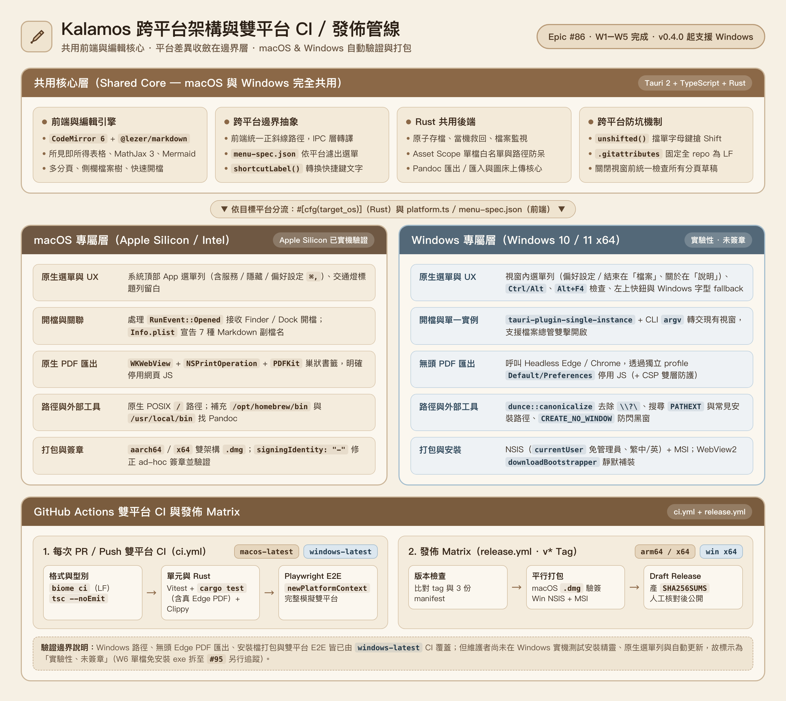

# 前情提要

在[上一篇 Kalamos 的起點記錄](/kalamos-typora-style-markdown-editor-herdr/)裡，我們花了三天把這款 Typora 風格、所見即所得的 Markdown 桌面編輯器做到 MIT 開源與 `v0.1.1`——當時的目標很單純，只做 macOS。

沒想到開源沒幾天，社群就送來一份大禮：外部貢獻者 `@mingchuanhuang-xpc` 提交了 **PR #79**，一口氣把 Windows 移植的核心工程（磁碟機路徑、無頭 Edge 匯出 PDF、單一執行個體、`PATHEXT` 搜尋、`windows-latest` CI）都寫了出來。

這一系列文章分成三篇來記這段時間的演化：[上一篇（2026-11-23）](/kalamos-dev-open-source-collaboration/)聊開源後的功能推進、審查與接手外部 PR 的流程，以及 Biome 與 Changesets 的發版自動化；**這一篇專門聚焦在「把一個原本只跑在 macOS 的 Tauri 2 桌面軟體，認真搬上 Windows 10/11（x64）到底要注意哪些事」**；至於最後一塊拼圖——應用程式內自動更新（W5），則留到[下一篇（2026-11-25）](/kalamos-dev-auto-update/)專文拆解。

專案與第一個附帶 Windows 安裝檔的版本連結先放前面：

- GitHub Repo：[kkdai/Kalamos](https://github.com/kkdai/Kalamos)
- 產品頁：[www.evanlin.com/Kalamos](https://www.evanlin.com/Kalamos/)
- 首次附 Windows 安裝檔：[Release v0.4.0](https://github.com/kkdai/Kalamos/releases/tag/v0.4.0)

---

# 一、規劃：把 Windows 支援拆成 W1–W6，先做不衝突的發佈管線

拿到外部 PR #79 之後，我們沒有急著直接 merge 就宣稱「支援 Windows」。

當時主線剛好也在推進兩個大改動：**#78（原生選單與偏好設定視窗）** 與 **#81（多文件分頁）**，兩者都還沒被 #79 看見；更重要的是，從 `v0.1.1` 到 `v0.3.0` 我們都還在手動打包 macOS `.dmg`，連一條能自動產出 Windows 安裝檔的發佈管線都沒有。

與其把「App 移植、UX 調整、安裝打包、文件更新、自動更新、單檔 exe」全攪在同一張大 PR 裡互相卡死，我們先開了一張總 Epic（**[#86](https://github.com/kkdai/Kalamos/issues/86)**），把整個 Windows 支援拆成六個邊界清楚的階段 **W1–W6**：

| 階段 | Issue / PR | 範圍與依賴 | 目前狀態 |
| :--- | :--- | :--- | :--- |
| **W1** | [#87](https://github.com/kkdai/Kalamos/issues/87) → [PR #93](https://github.com/kkdai/Kalamos/pull/93) | 發佈流程自動化：`release.yml`、macOS 雙架構 `.dmg` + Windows NSIS / MSI、`SHA256SUMS.txt`、Draft Release | 已完成 |
| **W2** | [#88](https://github.com/kkdai/Kalamos/issues/88) → [PR #94](https://github.com/kkdai/Kalamos/pull/94) | Windows App 移植核心：以 `@mingchuanhuang-xpc` 的 PR #79 為基礎接手並整合 #78、#81 | 已完成 |
| **W3** | [#89](https://github.com/kkdai/Kalamos/issues/89) → [PR #97](https://github.com/kkdai/Kalamos/pull/97) | Windows 使用體驗：視窗內選單列、快捷鍵文字、標題列與分頁列、`Alt+F4` 結束檢查、字型（依賴 W2） | 已完成 |
| **W4** | [#90](https://github.com/kkdai/Kalamos/issues/90) → [PR #96](https://github.com/kkdai/Kalamos/pull/96) | 四語 README 與產品頁加入 Windows 安裝說明與分平台下載按鈕（依賴 W1、W2） | 已完成 |
| **W5** | [#91](https://github.com/kkdai/Kalamos/issues/91) | 應用程式內自動更新 `tauri-plugin-updater`（依賴 W1，排在最後，詳見下一篇） | 已完成 |
| **W6** | [#95](https://github.com/kkdai/Kalamos/issues/95) | Windows 免安裝單檔 exe（`windows-gnu` 嵌入 `WebView2Loader.dll`，P2，從 #79 拆出） | 開放追蹤中 |

這個順序裡有兩個很關鍵的安排：

1. **先做 W1，再接手 #79（W2）**：`release.yml` 與 `tauri.conf.json` 的打包設定跟 #79 的 App 程式碼完全不衝突。先把 W1 合併、用 `workflow_dispatch` 試跑確定 CI 真的打得出 macOS `.dmg` 與 Windows NSIS / MSI，後面每完成一個階段都有真實安裝檔可下載，也不會跟 #79 打架。
2. **W4 寫完先不合併，等 `v0.4.0` 發佈才按下去**：PR #96 早就準備好了，但我們刻意按著不 merge，直到第一個真的附上 Windows 安裝檔的 `v0.4.0` 正式公開後才合併，避免產品頁上的 Windows 下載按鈕連去一個還沒有 Windows 產物的 Release。

同時也在 Epic #86 裡明講**不在這輪範圍內**的事：Windows 程式碼簽章（如 Azure Trusted Signing）、Apple 公證、Linux / ARM64 Windows、Microsoft Store / winget。先把邊界劃清楚，才不會做到一半無限膨脹。

---

# 二、審查外部 PR #79：先讀 `build.rs` 再 build，與抓出的四個關鍵問題

先說結論：`@mingchuanhuang-xpc` 的 [PR #79](https://github.com/kkdai/Kalamos/pull/79) 是一份非常有誠意、完成度也很高的移植工作（35 個檔案、+1358 / −167）。裡面不只處理了 `C:/` 與 `file:///C:/` 路徑、`dunce::canonicalize` 去除 Windows `\\?\` 前綴、headless Edge / Chrome PDF 匯出、`tauri-plugin-single-instance` 與檔案總管開檔、`PATHEXT` 搜尋與 `CREATE_NO_WINDOW` 防閃黑窗，還順手修掉一個真正的 UI Bug——深色主題選單裡的「Papyros」選項與淺色選單裡的「Melan」選項原本因為按鈕掛了 `data-theme` 屬性而套到錯誤字色、幾乎看不見。

## 安全審查紀律：先讀 `build.rs`，確認安全才在本機 build

審查來自外部 fork 的 Rust / Tauri PR，有一條很硬的安全底線：**在沒讀完 `build.rs` 之前，絕對不在本機執行 `cargo test` 或 `npm run build`。**

因為 Rust 的 `build.rs` 在編譯階段就會直接以本機權限執行任意程式碼。我們在獨立的只讀 worktree 裡先把三件事檢查完，才放行本機測試：

1. **逐行讀完 `src-tauri/build.rs`**：確認它只在 `target_os = "windows" && target_env = "gnu"` 時做事，內容只有輸出 linker 參數和複製 `WebView2Loader.dll`——**沒有網路存取、沒有 `Command` 執行、沒有下載行為、也沒有讀取任何環境秘密**。
2. **確認沒有夾帶二進位檔**：用 `git diff --numstat` 檢查沒有任何 binary 項目。`WebView2Loader.dll` 來自 crates.io 上的 `webview2-com-sys`（內附 Microsoft 官方 NuGet 套件）與 `tauri-build`，`Cargo.lock` 都有 checksum 鎖定。
3. **核對新增相依與 CI workflow**：新增的 `dunce 1.0.5` 與 `tauri-plugin-single-instance 2.5.5` 都是知名或官方 crate；CI 改動沒有使用 `pull_request_target`、沒碰 secrets、也沒引入新的第三方 action。

安全關過了，才在本機 macOS 跑完整套 `vitest`、`cargo test`、`clippy`、`build` 與 `Playwright`，確認 macOS 沒有功能退化。

## 細看程式碼抓出的四個問題

接著對照主線與安全模型逐項審查，抓出四個必須先處理的問題：

1. **`windows-gnu` 單檔 exe 的 `build.rs` 目錄層數算錯（Blocker）**
   PR 為了產出免安裝單檔 exe，在 `src-tauri/build.rs` 裡寫死用 `ancestors().nth(4)` 從 `OUT_DIR` 往上找 `WebView2Loader.dll`。但在 stable Cargo 的目錄結構 `target/<profile>/build/<pkg>-<hash>/out` 底下，`ancestors().nth(4)` 指到的是 `target/`（或 `target/<triple>/`），**不是** `target/<profile>/`（只有 nightly 新結構才剛好對到）。找不到檔案會直接編譯失敗；更糟的是如果殘留過舊檔，還會默默嵌進過期的 DLL。加上 GitHub Actions 的 `windows-latest` 預設走 MSVC，這條 `windows-gnu` 分支完全沒被 CI 編譯過，註解寫了 `--allow-multiple-definition` 程式裡也實際沒加上。
   → **做法**：先把 `webview2_embed.rs` 與 `build.rs` 的 GNU 單檔 exe 拆成獨立 Issue **W6（[#95](https://github.com/kkdai/Kalamos/issues/95)）**，未來比照 `tauri-build` 用 `find(|p| p.file_name() == "build").parent()` 找目錄，並補上 `x86_64-pc-windows-gnu` CI job。

2. **DLL 落地只比對檔案大小（Should-fix）**
   `webview2_embed.rs` 把內嵌的 `WebView2Loader.dll` 解壓寫到 `%LOCALAPPDATA%\io.kalamos.app\` 前，**只比對磁碟上的檔案大小**決定要不要覆寫，而且找不到 `LOCALAPPDATA` 時還會退回 `temp_dir()`。這代表在同使用者權限下，若有其他程式換成同大小的惡意 DLL，Kalamos 每次啟動都會用 `LoadLibraryW` 載入它，變成常駐據點。雖然威脅模型偏低、且只在 GNU 分支編譯，但修法非常簡單：改比對 SHA-256（或每次覆寫）、用暫存檔加 rename 原子寫入，找不到 `LOCALAPPDATA` 就直接回錯不退回 `temp_dir()`——這些規格一併寫進 #95。

3. **README 寫了當時還不存在的 Windows 下載（Should-fix）**
   PR 裡的 README 寫著「從 Releases 下載最新 Windows 安裝檔」，但那時候根本還沒有 Windows 的 release 產物；另外寫了「Windows 10 / 11 已內建 WebView2」，其實 Windows 11 才保證內建，部分 Windows 10（例如 LTSC 或較久未更新的環境）不一定有；英文版建置需求也漏寫 Windows 條件，和中英文版不同步。

4. **macOS 也出現左上角浮動按鈕（Should-fix）**
   PR 在畫面左上角放了「切換側欄」和「開檔」兩顆浮動按鈕，但在所有平台都會顯示。`#78` 合併後 macOS 已經有完整的原生頂部選單，這等於未經產品決策就改動了 macOS UI。我們決定改成只在 `IS_WINDOWS` 顯示；同時把拖放 `.md` 開檔、拖放 `.docx` 匯入這些新增行為寫清楚並補上 Playwright 測試。

因為主線已經合併了 #78 與 #81，我們在 PR #79 留下詳細 review 意見後，另開 **[PR #94](https://github.com/kkdai/Kalamos/pull/94)**（W2）接手：第一筆 commit 直接 cherry-pick `@mingchuanhuang-xpc` 的原 commit（保留原作者的 author 欄位），並在 cherry-pick 時順手解掉與 #78、#81 的衝突；第二筆 commit 則專注套用上述所有 review 修正（最後 squash merge 進 `main` 時再加上 `Co-authored-by` 署名）。接著推上 GitHub Actions——**好戲才正要開始。**

---

# 三、Windows CI 實際踩到的五個坑

在 macOS 本機跑完 480+ 個單元測試、100+ 個 Rust 測試和 180+ 個 Playwright E2E 全部綠燈之後，一進 GitHub Actions 的 `windows-latest` runner，我們陸續撞上了五個非常紮實的跨平台地雷。這五個坑每一個都有清楚的根因，也幾乎不可能光靠 macOS 腦補出來。

## 坑 1：`Path::new("/").is_absolute()` 在 Windows 上是 `false`

審查 #79 時，我們順手幫 `src-tauri/src/images.rs` 的 `check_asset_dir` 補上 `!path.is_absolute()` 檢查，防止相對路徑以 process cwd 當基準放行目錄。在 macOS 上跑單元測試一切正常，一上 `windows-latest` 就紅了。

**原因**：測試裡寫了 `check_asset_dir(Path::new("/"), Some(&home))`，預期拿到 `TOO_BROAD_MESSAGE`（「圖片根目錄範圍過廣」）。但在 Windows 上，沒有磁碟機代號的 `"/"` 是 **drive-relative path**（相對於目前磁碟機的根目錄，例如相對於 `C:` 或 `D:`），不是完整的絕對路徑，所以 Rust 標準庫的 `Path::new("/").is_absolute()` 直接回傳 `false`！測試在第一關「必須是絕對路徑」就被攔下來，根本沒走到 `is_too_broad`。

**修法**：不要寫死 `"/"`，改從測試用的 `home` 路徑一路往上取真實的作業系統根目錄（Unix 會拿到 `/`，Windows 會拿到 `C:\`），兩邊測的才是同一件事：

```rust
// The filesystem root (`/` on Unix, `C:\` on Windows) is always too broad.
let fs_root = home.ancestors().last().expect("filesystem root");
let err = check_asset_dir(fs_root, Some(&home)).unwrap_err();
assert!(err.message.starts_with(TOO_BROAD_MESSAGE));
```

## 坑 2：headless Edge 加上 `--blink-settings=scriptEnabled=false` 就不輸出 PDF

這個坑特別有戲劇性——它是我們**自己在 review 裡要求的改動**引爆的。

**原因**：macOS 的 PDF 匯出在 `WKWebView` 明確設定了 `setAllowsContentJavaScript(false)`。審查 #79 時，我們希望 Windows 的 headless Edge 也比照辦理，於是要求拿掉 `--allow-file-access-from-files`，並加上 `--blink-settings=scriptEnabled=false`。結果上 `windows-latest` 跑真實的 headless Edge 匯出測試，Edge **直接以 exit code 0 正常結束，卻完全沒有寫出 PDF 檔案**！原來這個 Blink flag 會直接弄壞 Chromium / Edge 的 `--print-to-pdf` 管線。

**修法**：拿掉 `--blink-settings=scriptEnabled=false`，改在已經隔離好的 `--user-data-dir` 暫存 profile 裡，預先寫入 Chromium 的 Content Settings（`Default/Preferences`），將 `javascript` 設成 `2`（封鎖），再搭配 `src/export/html.ts` 本來就帶有的嚴格 CSP（`default-src 'none'`）形成雙層防護；同時把瀏覽器的 exit code 與 stderr 尾端帶進錯誤訊息，以後出事不再盲猜：

```rust
pub(super) fn prepare_no_js_profile(profile: &Path) -> Result<(), AppError> {
    let default_dir = profile.join("Default");
    fs::create_dir_all(&default_dir)?;
    fs::write(
        default_dir.join("Preferences"),
        r#"{"profile":{"default_content_setting_values":{"javascript":2}}}"#,
    )?;
    Ok(())
}
```

## 坑 3：CodeMirror 單一字母快捷鍵忽略 Shift，`Ctrl+O` 搶走 `Ctrl+Shift+O`

過了 Rust 測試，接著換 `windows-latest` 上的 Playwright E2E 報錯：測試按下 `Ctrl+Shift+O`（開啟資料夾），結果跳出來的卻是 `Ctrl+O`（開啟檔案）！

**原因**：追進 CodeMirror 6 的 `keymap` 實作才真相大白。CodeMirror 處理單一字元鍵時，會故意忽略 `Shift-` 修飾鍵（內部邏輯是 `modifiers(name, event, !isChar)`），因為一般鍵盤按下 Shift + `o` 會送出大寫的 `event.key === "O"`，靠字元大小寫就能區分。但只要遇到兩種情境——**使用者開著 Caps Lock**，或是 **Windows 上的合成鍵盤事件**（例如 Playwright 送出 `Control+Shift+o`）——瀏覽器送進來的就會是小寫 `key: "o"` 卻帶著 `shiftKey: true`。這時候沒帶 Shift 的 `Mod-o` 綁定就因為忽略 `Shift-` 而直接命中，比 `Mod-Shift-O` 或外層 window listener 更早把事件吃掉；同樣的狀況也會發生在 `s`、`f`、`e`、`g` 等單字母快捷鍵。

**修法**：在 `src/editor/keymaps.ts` 加上一個最高優先級（`Prec.highest`）的 `keydown` handler，在 CodeMirror `keymap` 跑之前先把這次事件的 `event.shiftKey` 記在 `WeakMap<EditorView, boolean>` 裡；接著寫一個小包裝函式 `unshifted(cmd)` 套在所有不該吃 Shift 的單字母綁定（`Mod-o`、`Mod-s`、`Mod-n`、`Mod-b`、`Mod-i`、`Mod-k`、`Mod-f`、`Mod-g` 等）上，並移除它們原本無條件的 `preventDefault: true`（CodeMirror 在指令真的回傳 `true` 時本來就會呼叫 `preventDefault`）：

```ts
const lastKeydownShift = new WeakMap<EditorView, boolean>();

export const trackKeydownExtension = Prec.highest(
  EditorView.domEventHandlers({
    keydown(event, view) {
      lastKeydownShift.set(view, event.shiftKey);
      return false;
    },
  }),
);

export function unshifted(cmd: Command): Command {
  return (view) => {
    if (lastKeydownShift.get(view)) return false;
    return cmd(view);
  };
}
```

最後補上模擬 Win32 平台的回歸 E2E 測試，`Ctrl+Shift+O` 終於乖乖開啟資料夾，不再被 `Ctrl+O` 攔胡。

## 坑 4：Playwright E2E 只改 UA 不夠，Windows runner 上 `navigator.platform` 還是 `Win32`

進到 W3（[PR #97](https://github.com/kkdai/Kalamos/pull/97)）時，我們幫雙平台介面寫了一批 Playwright E2E，在同一個測試檔裡同時驗證「模擬 macOS」與「模擬 Windows」兩種情境。macOS 本機全綠，一推上 `windows-latest` 又炸了。

**原因**：看看 `src/platform.ts` 怎麼偵測平台就懂了：

```ts
if (/Windows NT|Win64|WOW64/i.test(ua) || /^Win/i.test(plat))
  return "windows";
```

原本的測試只呼叫 `browser.newContext({ userAgent: macUA })`。在 macOS 本機上 `navigator.platform` 本來就是 `"MacIntel"`，完全看不出漏洞；但換到 Windows runner 上跑，「模擬 macOS」的 BrowserContext 雖然換了 User-Agent，底層的 `navigator.platform` 卻還是 `"Win32"`，於是 `detectPlatform()` 依然把它判成 Windows！

**修法**：在 `tests/e2e/helpers.ts` 抽出共用的 `newPlatformContext(browser, "macos" | "windows")`，除了設定 `userAgent`，再用 `ctx.addInitScript` 一次把 `navigator.platform`（`"MacIntel"` / `"Win32"`）與 `navigator.userAgentData`（`"macOS"` / `"Windows"`）一起覆寫乾淨：

```ts
export async function newPlatformContext(
  browser: Browser,
  target: keyof typeof PLATFORM_PROFILES,
): Promise<BrowserContext> {
  const profile = PLATFORM_PROFILES[target];
  const ctx = await browser.newContext({ userAgent: profile.userAgent });
  await ctx.addInitScript(({ platform, uaDataPlatform }) => {
    Object.defineProperty(navigator, "platform", {
      configurable: true,
      get: () => platform,
    });
    Object.defineProperty(navigator, "userAgentData", {
      configurable: true,
      get: () => ({
        brands: [],
        mobile: false,
        platform: uaDataPlatform,
        getHighEntropyValues: async () => ({ platform: uaDataPlatform }),
      }),
    });
  }, profile);
  return ctx;
}
```

從此不管測試跑在 macOS 還是 Windows runner，平台模擬的行為完全一致。

## 坑 5：Biome 在 Windows 上因為 `core.autocrlf` 把每個檔案都判成格式錯誤

最後一個坑出現在導入 Biome 到 CI 的時候（[PR #101](https://github.com/kkdai/Kalamos/pull/101)，接手外部貢獻者 `@narumiruna` 的 #85 第二部分）。我們在 `ci.yml` 加上 `npx biome ci`，macOS 零錯誤，但 `windows-latest` 一跑下去，幾乎整個 repo 的每個檔案都被 Biome 判成格式錯誤！

**原因**：GitHub Actions 的 `windows-latest` runner 預設開啟 Git 的 `core.autocrlf`，`actions/checkout` 拉下來時會自動把所有文字檔的 LF 換行轉成 CRLF，Biome 檢查行尾風格就當場整片爆紅。檢查過整個 repo，其實沒有任何檔案需要以 CRLF 儲存（驗證檔案 CRLF 保留行為的測試全都是在記憶體裡組字串的）。

**修法**：在 repo 根目錄補上 `.gitattributes`，用 `* text=auto eol=lf` 把所有文字檔強制固定為 LF，同時明確標記圖片、圖示、PDF 與字型檔為 `binary`，避免 Git 動到二進位資產：

```gitattributes
* text=auto eol=lf

# Binary assets (images, icons, fonts)
*.png binary
*.jpg binary
*.ico binary
*.icns binary
*.pdf binary
*.woff2 binary
*.ttf binary
```

把這五個 Windows CI 踩坑濃縮成一張速查表：

| # | 踩坑現象 | 真正原因 | 修法 | PR |
| :--- | :--- | :--- | :--- | :--- |
| 1 | `check_asset_dir` 測試報錯不是「太廣」 | Windows 上 `Path::new("/").is_absolute()` 為 `false`（drive-relative） | 用 `home.ancestors().last()` 取得該 OS 真實根目錄 | [#94](https://github.com/kkdai/Kalamos/pull/94) |
| 2 | headless Edge exit 0 卻沒有 PDF | `--blink-settings=scriptEnabled=false` 會弄壞 `--print-to-pdf` | 寫入隔離 profile 的 `Default/Preferences` 關閉 JS，配 CSP 雙層防護 | [#94](https://github.com/kkdai/Kalamos/pull/94) |
| 3 | `Ctrl+Shift+O` 誤觸發 `Ctrl+O` | CodeMirror 單字母鍵忽略 Shift，Caps Lock 或合成事件下會被搶走 | `Prec.highest` 記錄 `shiftKey` + `unshifted()` 包裝單字母綁定 | [#94](https://github.com/kkdai/Kalamos/pull/94) |
| 4 | Windows runner 上模擬 macOS E2E 失敗 | 只改 UA 不夠，`navigator.platform` 仍是 `Win32` | 共用 `newPlatformContext` 同步覆寫 UA、`platform` 與 `userAgentData` | [#97](https://github.com/kkdai/Kalamos/pull/97) |
| 5 | `biome ci` 在 Windows 全 repo 報紅 | `windows-latest` 的 `core.autocrlf` 把 LF 轉成 CRLF | 補上 `.gitattributes` 用 `* text=auto eol=lf` 鎖定 LF | [#101](https://github.com/kkdai/Kalamos/pull/101) |

---

# 四、Windows 的 UX 細節：不是「能編譯」就叫支援 Windows（W3）

核心功能在 Windows CI 跑綠之後，緊接著是 **W3（[#89](https://github.com/kkdai/Kalamos/issues/89) / [PR #97](https://github.com/kkdai/Kalamos/pull/97)）**。如果直接把 macOS 的介面搬去 Windows，使用者一打開就會滿臉問號：選單列裡出現「服務」和「隱藏其他」、提示寫著 `⌘S` 和 `⌥⇧⌘←`、按 `Alt+F4` 沒問就直接把未儲存草稿關掉。

我們把 Windows UX 拆成四個具體項目逐一補齊：

## 1. 原生選單依平台產生，共用同一份規格檔

Kalamos 的選單定義集中在 `src/menu/menu-spec.json`，由 Rust（`src-tauri/src/menu.rs`）和前端共用。W3 幫每個選單節點加上可選的 `"platforms"` 欄位（`["macos"]` 或 `["windows", "linux"]`）：

- **macOS**：維持原本的系統頂部 App 選單列（包含「關於」、「偏好設定」、「服務」、「隱藏」、「隱藏其他」、「全部顯示」、「結束」）。
- **Windows**：以視窗內原生選單列呈現，自動過濾掉 macOS 專用項目；依照 Windows 使用者的習慣，把「偏好設定（`Ctrl+,`）」與「結束（`Ctrl+Q`）」放進 **檔案** 選單，把「關於」（以及後來 W5 加入的「檢查更新…」）放進 **說明** 選單。
- 原本在 macOS 上只靠選單 accelerator 觸發的快捷鍵，前端也補上 fallback `keydown` 並透過共用規格去重，避免按一次觸發兩次，也確保所有快捷鍵在 Windows 上都按得到。

## 2. 快捷鍵文字改成 `Ctrl / Alt / Shift`，路徑顯示轉回反斜線

前端裡所有提示文字（偏好設定、尋找列 tooltip、分頁、側欄、主題選單、表格工具列）原本都寫成 macOS 符號或字樣（`⌘`、`⌥`、`⇧`、`Cmd+Opt+T`）。我們統一透過 `src/platform.ts` 的 `shortcutLabel()`，在偵測到 Windows / Linux 時自動改寫成 `Ctrl+Alt+Shift+…`（例如 `⌥⇧⌘←` → `Ctrl+Alt+Shift+←`），編輯器底層的 CodeMirror `Mod-` 綁定本來就會自動對應到 `Ctrl`。

路徑則採「**內部統一、邊界轉換**」的策略：前端內部邏輯一律操作正斜線路徑（`C:/Docs/note.md`），在 IPC 邊界透過 `toSlashPath` / `toNativePath` 轉換；面向使用者的顯示位置（例如兩個不同資料夾的同名分頁顯示上層路徑）再轉回 Windows 習慣的反斜線。檔案換行方面，新建檔案仍維持 LF，開啟原本就是 CRLF 的檔案則原樣保留。

## 3. `Alt+F4`、關閉按鈕與 `Ctrl+Q` 統一走未儲存檢查

在 Windows 上關掉一個 App 常見有三條路：點右上角 `X`、按 `Ctrl+Q`，或是按 `Alt+F4`。

為了避免任何一條路繞過多文件分頁的草稿保護，我們把三條路徑全部接回同一套未儲存確認流程：

- 視窗關閉按鈕由 Tauri 的 `onWindowCloseRequested` 攔截，只要使用者在「以下 N 份文件有未儲存的變更」對話框點選取消，就呼叫 `event.preventDefault()` 留住視窗。
- 在 `src/main.ts` 補上 Windows 專屬的 `Alt+F4` `keydown` 攔截，與選單的 `Ctrl+Q` 一樣先結算所有分頁的未儲存變更才真正結束程式。

## 4. 字型 fallback 與版面微調

在 `src/styles/tokens.css` 與列印樣式裡補齊 Windows 繁中與英文字型 fallback：

- 內文與介面字型加入 `"Segoe UI"`、`"Microsoft JhengHei UI"`、`"Microsoft JhengHei"`。
- 程式碼等寬字型加入 `"Cascadia Mono"`、`"Cascadia Code"`、`Consolas`。

另外，Windows 使用原生標題列、沒有 macOS 左上角三顆交通燈，因此確認分頁列與右上角主題按鈕的對齊間距，並維持左上角快速按鈕（切換側欄、開檔）只在 Windows 顯示，讓 macOS 的外觀與行為維持 100% 不變。

---

# 五、發佈策略，以及至今仍缺 Windows 實機驗證的誠實說明

發佈這一段（W1 **[PR #93](https://github.com/kkdai/Kalamos/pull/93)** 與 W4 **[PR #96](https://github.com/kkdai/Kalamos/pull/96)**）把過去手動打包的痛點一次清掉：推一個 `v*` tag（或用 `workflow_dispatch` 手動試跑），`.github/workflows/release.yml` 就會先檢查 tag 與 `package.json`、`tauri.conf.json`、`Cargo.toml` 版本號一致，接著平行跑三個 target——macOS `aarch64`、macOS `x86_64`（同時靠 `bundle.macOS.signingIdentity: "-"` 從根本修掉前一篇提過的 ad-hoc 簽章損毀問題，並在 CI 自動跑 `codesign --verify --deep --strict` 與 `.dmg` 內容檢查），以及 Windows `x86_64`（產出 NSIS `-setup.exe` 與 WiX `.msi`）——最後彙整 `SHA256SUMS.txt` 建立 **Draft Release**，由維護者人工核對後才按下公開。所有第三方 action 都釘死在 commit SHA，也只有最後建立 Release 的 job 才授予 `contents: write`。

Windows 安裝檔的設計做了三個務實選擇：

1. **WebView2 使用 `downloadBootstrapper`（靜默模式）**
   在 `src-tauri/tauri.conf.json` 設定 `webviewInstallMode: { "type": "downloadBootstrapper", "silent": true }`。Windows 11 本來就內建 WebView2；對於部分沒有預載 WebView2 的 Windows 10（例如 LTSC 或久未更新的機器），安裝程式會在需要時自動下載並安裝，同時又不會把完整離線 Runtime 塞進安裝檔讓檔案暴增。
2. **NSIS 採 `currentUser` 安裝模式**
   設定 `installMode: "currentUser"`，使用者不需要系統管理員權限（免 UAC 提權）就能安裝，並內建英文與繁體中文（`["English", "TradChinese"]`）。安裝程式會透過 `fileAssociations` 自動註冊 7 種 Markdown 副檔名（`.md`、`.markdown`、`.mdown` 等），搭配 `tauri-plugin-single-instance` 與 CLI `argv` 解析，在檔案總管雙擊 `.md` 就能直接開在執行中的視窗。
3. **未簽章與 SmartScreen 提示**
   目前尚未購買 Windows 程式碼簽章憑證，所以 Windows 使用者執行 `-setup.exe` 或 `.msi` 時，一定會跳出 **Windows Defender SmartScreen** 警告。與其讓大家看到藍畫面嚇到直接關掉，我們在四語 README、產品頁與每份 Release Notes 都把「**實驗性、未簽章**」寫在最前面，明確說明「點選『其他資訊』→『仍要執行』」，並附上 `SHA256SUMS.txt` 讓需要的人自己驗校驗碼。

## 一件必須老實說的事：至今仍缺 Windows 實機驗證

寫到這裡，一定要把驗證邊界講清楚，不打模糊仗：

> **從 `v0.4.0` 到最新的 `v0.8.1`，Kalamos 的 Windows 版本至今都還沒有經過我的 Windows 實機驗證。**

我平常開發跟實測手邊只有 macOS。目前所有 Windows 的品質保證，全部來自 `windows-latest` CI（Vitest、`cargo test` 含真實 headless Edge PDF 匯出測試、Clippy、Playwright E2E 雙平台模擬，以及 `tauri build` 打包 NSIS / MSI）。自動化 CI 幫我們抓出了第三節那五個硬坑，非常有用；但桌面軟體最後那一哩路——**實際在 Windows 10 / 11 上點開 NSIS 安裝精靈、看視窗內原生選單列的排版與高 DPI 字型、在檔案總管雙擊 `.md` 測試單一執行個體，以及驗證 Windows 的應用程式內自動更新**——光靠無頭 CI 是驗不到的。

這也是為什麼我們在 README、產品頁與 Release Notes 都誠實標註「Windows 版為實驗性、未簽章」。如果你手邊剛好有 Windows 電腦，非常歡迎到 [GitHub Releases](https://github.com/kkdai/Kalamos/releases/latest) 下載試玩，不管順利還是踩雷，都歡迎直接開 Issue 回報給我們！

---

# 六、把 macOS Tauri App 搬上 Windows 的 Checklist

把這輪從 W1 做到 W4 學到的教訓整理成一份實戰 Checklist，給正在做跨平台 Tauri 桌面軟體的人參考：

- [ ] **1. 審查外部 Rust PR，先讀 `build.rs` 再跑任何編譯或測試**：確認沒有網路存取、子程序執行或二進位夾帶，再進本機建置。
- [ ] **2. 大型跨平台工作先拆階段，把 CI / 發佈管線排在最前面**：像 W1 跟 App 程式碼零衝突，先讓 Windows 安裝檔能自動產出，後面每一步都有回饋。
- [ ] **3. 別假設 `Path::new("/")` 是絕對路徑**：在 Windows 上它是 drive-relative，跨平台測試要從真實路徑（如 `home.ancestors().last()`）推導根目錄。
- [ ] **4. 用 headless Edge / Chrome 印 PDF，不要加 `--blink-settings=scriptEnabled=false`**：會靜默 exit 0 卻不產檔；改在隔離 `--user-data-dir` 寫入 `Default/Preferences` 關閉 JS，再配嚴格 CSP。
- [ ] **5. CodeMirror 單字母快捷鍵要小心 Shift 被吃掉**：開 Caps Lock 或 Windows 合成事件會讓 `Mod-o` 搶走 `Mod-Shift-O`，用最高優先級 keydown 記下 `shiftKey` 防護。
- [ ] **6. Playwright 跨平台模擬不能只改 `userAgent`**：務必用 `addInitScript` 同時覆寫 `navigator.platform` 與 `navigator.userAgentData`，不然上 Windows runner 就會露餡。
- [ ] **7. 雙平台 CI 跑 formatter（Biome / Prettier）一定要放 `.gitattributes`**：用 `* text=auto eol=lf` 壓掉 `core.autocrlf` 把 LF 轉成 CRLF 的整片假紅。
- [ ] **8. 沒跑過實機就誠實標註「實驗性」**：CI 能把關邏輯與打包，但安裝精靈、原生選單與 SmartScreen 體驗要誠實告訴使用者現況。

---

# 小結

回頭看這趟幫 Kalamos 加上 Windows 支援的過程，收穫最多的其實是三件事：

1. **開源社群把門推開了一大步**：如果沒有 `@mingchuanhuang-xpc` 的 PR #79 打下紮實基礎（以及後續 `@narumiruna` 在 #85 協助導入 Biome 讓我們在雙平台 CI 順手堵住 CRLF 坑），Windows 支援不會在這麼短的時間內從無到有。
2. **雙平台 CI 是最誠實的裁判**：你在 macOS 上寫得再仔細，`Path::new("/")`、headless Edge flag、CodeMirror Shift、`navigator.platform`、`core.autocrlf` 這五顆雷，全都是把 `windows-latest` 拉進 CI 才一個一個現形的。
3. **跨平台靠的是把差異關在邊界裡**：前端內部統一正斜線、選單共用 `menu-spec.json`、快捷鍵統一走 `shortcutLabel()`、Rust 平台細節收在 `platform.rs` 與 `#[cfg(target_os)]`——讓 90% 的核心功能維持單一實作，維護成本才不會跟著平台數翻倍。

Windows 的架構、UX 與打包就記錄到這裡；[下一篇](/kalamos-dev-auto-update/)我們會接著聊最後一塊拼圖——**W5 應用程式內自動更新（`tauri-plugin-updater`）在設計、金鑰隔離與實機升級時需要注意的地方**。

- GitHub Repo：[kkdai/Kalamos](https://github.com/kkdai/Kalamos)
- 產品頁：[https://www.evanlin.com/Kalamos/](https://www.evanlin.com/Kalamos/)
- 下載最新版：[GitHub Releases](https://github.com/kkdai/Kalamos/releases/latest)

**同系列文章：**

- [\[Herdr 實戰\] 三天做出 Typora 風格的 macOS Markdown 編輯器 Kalamos](/kalamos-typora-style-markdown-editor-herdr/)
- [\[Kalamos 開發過程\] 開源之後：從 v0.2 到 v0.7 的功能演進，以及如何用多 Agent 審查並接手外部貢獻者的 PR](/kalamos-dev-open-source-collaboration/)
- [\[Kalamos 開發過程\] 自動更新需要注意的地方：私鑰隔離、Build 與簽章分離、換金鑰與 CI 排隊的實戰踩坑紀錄](/kalamos-dev-auto-update/)
