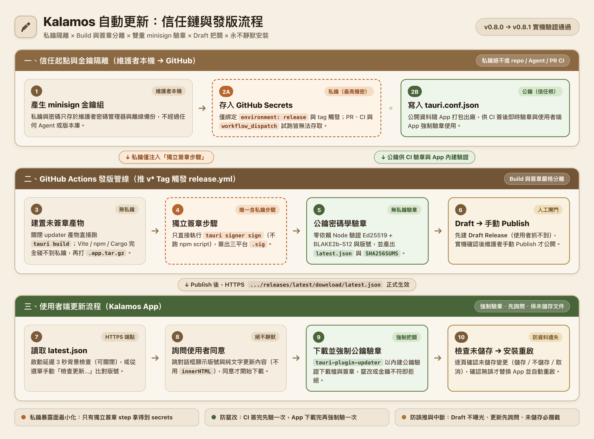
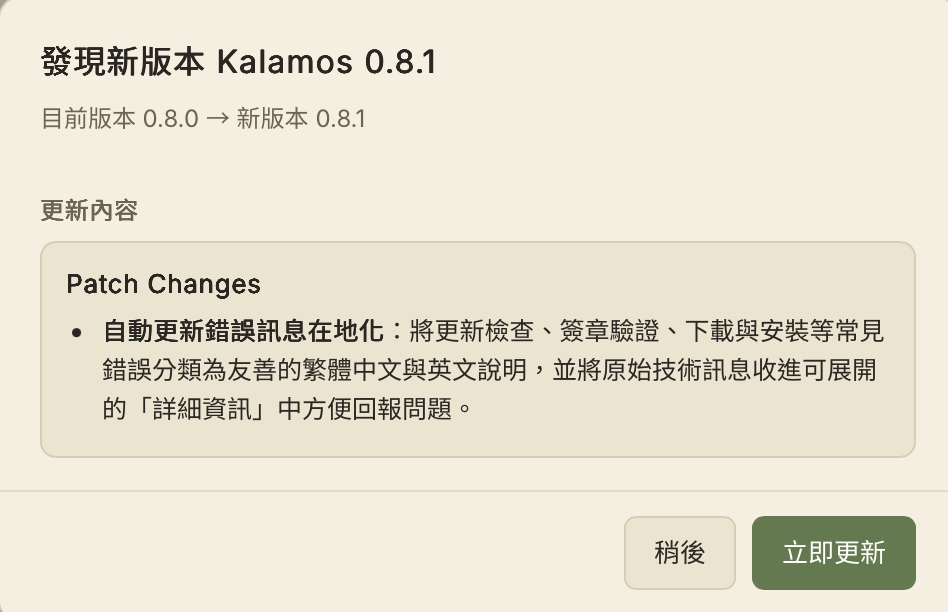

# 前情提要

前面兩篇開發紀錄，分別聊了開源之後從 `v0.2` 到 `v0.7` 的功能演進與外部 PR 協作（[開源之後的功能演進與審查外部 PR](/kalamos-dev-open-source-collaboration/)），以及把 Kalamos 帶到 Windows 的各種眉角（[Windows 實作的注意事項](/kalamos-dev-windows-support/)）。

等到 macOS（Apple Silicon / Intel）與 Windows 版本都能自動打包釋出之後，接下來馬上浮現一個很實際的體驗斷點：**每出一個新版，使用者都得自己跑回 GitHub Releases 下載安裝檔再手動覆蓋一次。** 於是我們把 Windows 規劃裡的最後一塊拼圖——**Issue #91：基於 `tauri-plugin-updater` 的應用程式內自動更新**——排上日程，在 **`v0.8.0`** 與 **`v0.8.1`** 把整條更新管線真正跑通。

但老實說，「自動更新」跟一般編輯器功能完全不是同一個量級的東西。排版跑掉頂多不好看，**自動更新一旦出包，輕則大家升級後資料沒存到、重則整個軟體變成遠端執行惡意程式的入口**。

這篇不講空泛的資安口號，直接攤開我們在 PR #130、#131、#133、#134、#135、#136 的完整設計取捨、Review 時加嚴的「Build 與簽章分離」、第一次發版真實踩到的五個坑，以及最後 `0.8.0 → 0.8.1` 實機跑通的全過程。

---

# 一、安全設計：把信任鏈和使用者控制權先釘死

開 Issue #91 之前，我先跟擔任 PM 的 Claude Code 把幾條**不可退讓的安全底線**寫進規格裡，確認每一關都沒有漏洞才派給 coder 開工（PR #130）：

| 防線 | 實際做法 | 目的 |
| :--- | :--- | :--- |
| **私鑰隔離** | 私鑰只存在維護者自己的密碼管理器／離線備份與 GitHub Secrets；不進 repo、不給任何 agent、不放 PR / CI，也不使用 `pull_request_target` | 避免私鑰在開發或外部 PR 階段外洩 |
| **環境與試跑隔離** | 只有 tag 觸發的 `build` job 宣告 `environment: release` 才能拿 secrets；`workflow_dispatch` 試跑走獨立的 `build-dry-run` job，完全碰不到私鑰 | 手動試跑打包不會不小心暴露私鑰 |
| **內建公鑰強制驗章** | 公鑰寫進 `src-tauri/tauri.conf.json` 的 `plugins.updater.pubkey`，由 `tauri-plugin-updater` 在安裝前強制做 minisign 驗章 | 就算傳輸或託管端被換包，簽章不符一律拒絕安裝 |
| **最小權限 Capabilities** | `src-tauri/capabilities/default.json` 只開放 `updater:allow-check`、`updater:allow-download`、`updater:allow-install` | 限縮 WebView 可呼叫的原生能力 |
| **Draft 閘門** | 更新端點只走 HTTPS，指向 `releases/latest/download/latest.json` | GitHub 的 `latest` 不會指向 Draft Release，唯有維護者確認產物後手動按 Publish，使用者才會收到通知 |
| **絕不靜默安裝** | 啟動後延遲 3 秒背景檢查（可在偏好設定「一般」關閉），或從選單點「檢查更新…」手動觸發；發現新版一定先彈窗詢問，使用者同意才下載並顯示進度 | 不偷跑流量、不無預警重啟打斷寫作 |
| **安全渲染更新內容** | 對話框顯示的 `CHANGELOG.md` 更新摘要，全部用純 DOM API（`createElement` + `textContent` / `createTextNode`）組出，**絕不呼叫 `innerHTML`** | 避免更新說明文字成為 XSS 注入面 |
| **安裝前保護未儲存文件** | 下載完成、準備替換 App 前，呼叫 `prepareForRestart()` 走既有的多分頁未儲存檢查（全部儲存／不儲存／取消） | 防止使用者辛苦寫一半的文章因為更新重啟而蒸發 |

這裡有兩個細節特別值得提一下：

1. **背景檢查失敗絕不跳錯打擾**：如果使用者正在離線寫文章（Kalamos 本來就是離線優先的編輯器），啟動 3 秒後的背景檢查連不到網路，只會在 console 靜默記錄，**絕對不會彈出錯誤視窗**；只有使用者自己點選單「檢查更新…」時，才需要明確告訴他「已是最新版本」或為什麼失敗。
2. **安裝失敗的退路**：如果使用者在未儲存確認對話框選了「取消」，整個安裝流程立刻中止，不會重啟；萬一使用者點了「不儲存」之後，`update.install()` 或重啟卻意外失敗，`updater.ts` 還會呼叫 `restoreRecoveryAfterFailedInstall()` 把當機救回快照還原回來，不讓使用者陷入兩頭空。

---

# 二、Review 時加強的設計：Build 與簽章分離

這是整次實作裡我覺得**最值回票價**的一個架構補強。

如果照一般 Tauri 自動更新的官方入門寫法，大家通常會把 `tauri.conf.json` 的 `bundle.createUpdaterArtifacts` 設成 `true`，然後在 GitHub Actions 跑 `npx tauri build` 時，直接把 `TAURI_SIGNING_PRIVATE_KEY` 跟 `TAURI_SIGNING_PRIVATE_KEY_PASSWORD` 塞進環境變數，讓 Tauri 打包完順手幫你簽章。

聽起來很方便，但在 Review PR #130 時，我們停下來想了一個問題：

> **`npx tauri build` 的過程裡，會跑 `vite build`、數百個 npm 套件，以及一大串 Cargo 建置腳本（`build.rs`）。如果其中任何一個建置期依賴遭到供應鏈攻擊，只要讀一下 `process.env`，我們的發版私鑰不就直接被整包端走了嗎？**

想到這裡背脊一涼。於是我們在合併前就把發版管線改成嚴格的**「Build 與簽章分離」**：

### 1. Build 階段完全不帶私鑰

首先把 `src-tauri/tauri.conf.json` 裡的 `bundle.createUpdaterArtifacts` 預設設為 **`false`**（順便帶來一個好處：本機跑 `npm run tauri build` 再也不需要設定私鑰）。

在 `.github/workflows/release.yml` 裡，建置步驟完全不注入任何簽章 secret：

```yaml
# Build step runs WITHOUT TAURI_SIGNING_PRIVATE_KEY so Vite / npm / Cargo
# build-time dependencies can never read the signing private key.
- name: Build Tauri installers (unsigned)
  shell: bash
  run: npx tauri build --target "${TARGET}" --bundles "${BUNDLES}" --config '{"bundle":{"createUpdaterArtifacts":false}}'
```

打包完後，先由一般步驟驗證 macOS `codesign --verify --deep --strict` 與 `.dmg` 結構，再自己把 `Kalamos.app` 壓成 `tauri-plugin-updater` 2.x 預期的壓縮包（這裡也有個小細節：updater 解壓時會剝掉最外層目錄，所以必須用 `COPYFILE_DISABLE=1 tar -czf ... -C .../macos Kalamos.app`，**不能**有 `./` 前綴，我們也在腳本裡檢查第一個 entry 確認結構無誤）。

### 2. 獨立簽章步驟：只跑編譯好的 signer，不跑 npm script

接著才開一個獨立的簽章 step，**只有這個 step 拿得到私鑰與密碼**，而且直接呼叫 Tauri CLI 裡的 signer，不經過 `npm run` 或任何打包工具：

```yaml
- name: Sign macOS updater tarball
  if: runner.os == 'macOS'
  shell: bash
  env:
    ARCH_LABEL: ${{ matrix.arch_label }}
    RELEASE_VERSION: ${{ needs.check-version.outputs.version }}
    TAURI_SIGNING_PRIVATE_KEY: ${{ secrets.TAURI_SIGNING_PRIVATE_KEY }}
    TAURI_SIGNING_PRIVATE_KEY_PASSWORD: ${{ secrets.TAURI_SIGNING_PRIVATE_KEY_PASSWORD }}
  run: |
    set -euo pipefail
    tarball="release-artifacts/Kalamos_${RELEASE_VERSION}_${ARCH_LABEL}.app.tar.gz"
    node node_modules/@tauri-apps/cli/tauri.js signer sign \
      --app-version "${RELEASE_VERSION}" \
      "$tarball"
```

Windows 端也是完全一樣的隔離方式，只對 `Kalamos_<version>_x64-setup.exe` 簽出 `.sig`。

### 3. 簽完立刻用「無私鑰步驟」做密碼學驗章

簽章完的下一步**不帶任何私鑰**，立刻執行我們自己寫的零依賴驗證腳本 `scripts/verify-updater-signature.mjs`（直接用 Node 內建的 `node:crypto` 實作 Ed25519 + BLAKE2b-512 minisign 驗章），拿 `src-tauri/tauri.conf.json` 裡的公鑰把剛剛產出的 `.sig` 驗過一遍：

- 比對公鑰與簽章的 key ID 是否吻合；
- 驗證檔案主簽章（支援 prehashed BLAKE2b-512 與 legacy Ed25519）；
- 驗證 `trusted comment` 的全域簽章（防竄改註解）；
- 強制檢查 `--require-signed-version`，確認簽章裡鎖定的 `version:` 跟這次發版版號完全一致。

等三個平台都打包簽完，後面的 `checksums` job 執行 `scripts/generate-updater-manifest.mjs` 產生 `latest.json` 時會再驗一次所有平台（`darwin-aarch64`、`darwin-x86_64`、`windows-x86_64`）的檔案、`.sig` 與 HTTPS URL，到了 `release` job 建立 Draft Release 前又會用 `--validate-only` 再檢查一次——任何一關對不上，整個發版流程直接中止。

為了確保自己寫的驗章邏輯沒有盲點，我們除了在單元測試（`tests/verify-updater-signature.test.mjs`）納入 `minisign-verify` 官方測試向量並涵蓋檔案與 trusted comment 版號遭竄改的情境，也**在本機用拋棄式測試金鑰實際跑過「簽章 → 驗章通過 → 竄改檔案內容 → 立刻被拒絕」**。PR #130 合併時，整套防線包含 `vitest` 561、`node --test` 43、`cargo test` 126、Playwright 208 全部綠燈。

---

# 三、真實踩到的五個坑（比寫程式本身還精彩）

功能寫完、測試全綠、PR #130 合併，甚至還順手修掉一個讓偏好設定 E2E 偶爾 flaky（約 3/25 失敗）的 race condition（PR #131：打開偏好設定 modal 時的 `setTimeout(..., 0)` 同步把「無法儲存介面語言」錯誤提示清掉了）。

原本以為接下來只要合併 Changesets 的 `v0.8.0` 版本 PR（#132）、推個 tag，就能優雅下班。結果真正推了 `v0.8.0` 之後，才開始一連串真實世界的震撼教育。

## 坑 1：在 Claude Code 用 `!` 跑互動式 `gh secret set`，密碼存成了空字串

建立簽章金鑰後，我要把私鑰跟密碼設進 GitHub Secrets。圖個方便，直接在 Claude Code 裡用 `!` shell 指令跑了互動式的 `gh secret set TAURI_SIGNING_PRIVATE_KEY_PASSWORD`，想說照提示輸入密碼就好。

結果第一次推 `v0.8.0` 跑 Release workflow，三個平台全都在獨立簽章步驟當場陣亡：

```text
env:
  TAURI_SIGNING_PRIVATE_KEY: ***
  TAURI_SIGNING_PRIVATE_KEY_PASSWORD: 
incorrect updater private key password: Wrong password for that key
       Error incorrect updater private key password: Wrong password for that key
```

盯著那兩行 `env:` 看三秒才恍然大悟：`TAURI_SIGNING_PRIVATE_KEY` 後面有 `***` 遮罩，但 **`TAURI_SIGNING_PRIVATE_KEY_PASSWORD:` 後面居然是完全空白的！**

原來透過 Claude Code 的 `!` 執行互動式指令時，沒有標準的互動 TTY 讓 `gh secret set` 讀到密碼輸入，它就默默把一個**空字串**存成 secret 了。GitHub Actions 對於空值不會印出 `***`，直接留白，這才在 log 裡露了餡。

更糗的是，接著還連續踩了第二腳：第一次發現空字串後，PM 想用 `pbpaste | gh secret set` 幫忙從剪貼簿寫入，結果當下剪貼簿其實是空的，又默默存了一次空字串；直到第三次決定先在本機把密碼驗過再設定，才發現原本記得的那組密碼根本不對，這才引出了下一個坑。

> **教訓**：設定 GitHub Secrets 一律在自己的獨立終端機操作，或是確認有值再透過 stdin 管線寫入，**絕不要**在非完整 TTY 的工具殼層裡跑互動式輸入；而且在設進 secret 之前，最好先在本機用 `tauri signer sign` 實際驗證過密碼能正確簽章。

## 坑 2：發現忘了第一把金鑰的密碼 → 趁未發佈前直接換金鑰（PR #133）

找到原因後，我本來想把正確密碼重新寫進 GitHub Secrets 就好——結果一查才發現，**第一把金鑰當初設的密碼根本找不回來了**。

這時候心裡其實很慶幸剛剛第一關就失敗了。因為 `v0.8.0` 的簽章步驟沒過，**還沒有任何一個對外發佈的 Release 或使用者手上的 App 信任這把舊公鑰**。

所以我們完全沒有猶豫，立刻止血重來：

1. 在維護者本機重新產生一把新的 minisign 金鑰組，立刻把新私鑰與密碼存進密碼管理器，並在獨立終端機更新 GitHub Secrets。
2. 開了 **PR #133**，把 `src-tauri/tauri.conf.json` 裡的 `plugins.updater.pubkey` 換成新公鑰（整個 PR 只有 `+1 -1` 一行）。
3. 合併後把尚未公開的 `v0.8.0` tag 移到新 commit 重新觸發發版。

這次插曲讓我深刻體會到一句話：

> **發佈前換金鑰零成本；一旦發佈出去，換金鑰會非常痛。**

為什麼？因為已經安裝在使用者電腦上的舊版 App，只認識寫死在裡面的舊公鑰。如果你在發佈後弄丟私鑰被迫輪替金鑰，**舊版 App 根本無法透過自動更新跨越金鑰輪替**——它們會把新金鑰簽出來的更新檔判定為「簽章驗證失敗」並直接拒絕，你只能發公告請所有使用者回 GitHub 手動重新下載安裝一次。

也因為親自痛過這一回，我們把「私鑰備份原則」、「私鑰遺失處理」與「私鑰外洩應變步驟」全寫進了 [`docs/release.md`](https://github.com/kkdai/Kalamos/blob/main/docs/release.md)，不再靠腦袋記。

## 坑 3：`release` job 因為間接依賴被 skip 的 `build-dry-run`，自己也被 skip（PR #134）

換完金鑰重跑 `v0.8.0`，整個 GitHub Actions 畫面上出現一顆漂亮的**綠色勾勾**！

我興沖沖點開 GitHub Releases 頁面準備檢查 Draft Release……結果一片空白，**Draft Release 根本沒建出來！**

回頭展開該次 workflow run 的每個 job 一看，傻眼了：

```text
Check release version: success
Build (x86_64-apple-darwin): success
Build (x86_64-pc-windows-msvc): success
Build (aarch64-apple-darwin): success
Build dry-run (${{ matrix.target }}): skipped
Generate updater manifest and SHA256SUMS: success
Create draft GitHub Release: skipped
```

三個平台的 build、簽章、驗章、`latest.json`、`SHA256SUMS.txt` 全部 `success`，偏偏最後一棒 `Create draft GitHub Release` 被 **`skipped`** 了！

追進 `.github/workflows/release.yml` 才抓到 GitHub Actions 一個超隱蔽的行為：

- 為了讓 `checksums` job 同時服務「推 tag 正式發版（`build`）」與「`workflow_dispatch` 手動試跑（`build-dry-run`）」，我們寫了 `needs: [check-version, build, build-dry-run]`，並且在 `checksums` 的 `if` 加上了 `always() && ...`，所以當 `build-dry-run` 被 skip 時，`checksums` 仍能正常執行並回報 `success`。
- 但下游的 `release` job 原本只寫了 `needs: [check-version, checksums]` 與 `if: github.event_name == 'push' && startsWith(github.ref, 'refs/tags/v')`，**沒有寫 `always()`**。
- 在 GitHub Actions 的判定規則裡，沒有明確寫 `always()` 的 job 會隱含套用 `success()`；只要**整個上游依賴鏈裡有任何祖先 job 被 skipped**（就算中間隔了一層已經 `success` 的 `checksums`），這個 `release` job 也會被連帶跳過！

**PR #134** 的修法非常明確，把 `release` 的依賴與條件一次寫死：

```yaml
  release:
    name: Create draft GitHub Release
    needs: [check-version, build, checksums]
    if: >-
      always() && !failure() && !cancelled() &&
      github.event_name == 'push' && startsWith(github.ref, 'refs/tags/v') &&
      needs.check-version.result == 'success' &&
      needs.build.result == 'success' &&
      needs.checksums.result == 'success'
```

這樣一來，`workflow_dispatch` 試跑或任何上游失敗時依然絕不會誤建 Release，而 tag 正式發版時也不會再被 `build-dry-run` 的 `skipped` 狀態拖下水。修完重跑，`v0.8.0` 的 Draft Release 終於順利生出來了。

## 坑 4：GitHub macOS arm64 runner 容量不足，排隊 15 分鐘後 0 step 被取消（PR #135）

這兩天密集跑 CI 和 Release 時，我們反覆撞到一個很煩人的外部狀況：GitHub Actions 託管的 `macos-latest`（Apple Silicon arm64）runner 偶爾容量吃緊，job 排隊排了約 15 分鐘之後直接逾時變成 `cancelled`（或 `failure`），點進去看一個步驟都沒跑（`steps` 數為 `0`），頁面上掛著這行 annotation：

```text
The job was not acquired by Runner of type hosted even after multiple attempts
```

這跟我們程式碼一點關係都沒有，但每次碰到都得人工進網頁點「Re-run failed jobs」。既然之後會常發版，**PR #135** 乾脆新增了一個 `.github/workflows/rerun-on-runner-shortage.yml` 來自動處理：

- 用 `workflow_run` 監聽 `CI` 與 `Release` 的 `completed` 事件，只在整體結論是 `failure` 或 `cancelled`，且 `run_attempt < 3`（最多自動重跑 2 次）時才啟動。
- 透過 GitHub REST API 檢查當次 attempt 裡，是不是真的有 **`conclusion` 為 `cancelled` / `failure`、`steps` 長度為 `0`**，而且 check-run annotations 含有 `not acquired by runner` 的 job。
- 全部條件吻合才呼叫 `POST /repos/{owner}/{repo}/actions/runs/{run_id}/rerun-failed-jobs`——**只重跑失敗的 job，已經綠燈的 job 不重跑**。
- **安全設計不打折**：這個 workflow **不 checkout 任何程式碼、不使用 `pull_request_target`、也不存取任何 secrets**，權限只開 `actions: write` 與 `checks: read`，所以就算觸發來源是外部 fork PR，也完全不會執行到未受信任的程式碼。

## 坑 5：0.7.0 以前的版本沒有 updater，必須手動更新一次

最後一個嚴格來說不是 Bug，而是**第一次導入自動更新一定會碰到的過渡期現實**：

- 自動更新機制是從 `v0.8.0` 才裝進 App 的。所有停在 **`v0.7.0` 或更早版本**的使用者，App 裡根本沒有 updater 模組，永遠不會跳出更新提示，**必須手動到 GitHub Releases 下載安裝一次 `0.8.x`**，之後才能在 App 內自動更新。
- 另外因為目前 macOS 仍是 ad-hoc 簽章（尚未經過 Apple 公證），透過自動更新替換 `/Applications/Kalamos.app` 之後，系統有可能要求重新授權（Finder 右鍵「打開」或 `xattr -cr`）。這兩件事我們都明確寫進四語 README、[`docs/release.md`](https://github.com/kkdai/Kalamos/blob/main/docs/release.md) 與每次的 Release Notes，避免使用者更新完一頭霧水。

---

# 四、為了驗證而生的 `v0.8.1`，與第一次實機自動更新成功

有了 `v0.8.0` 之後，光靠 mock 測試還不夠——就像前面幾篇文章反覆學到的，**沒有拿真實打包版從頭跑到尾一次，都不算真的做完**。我們必須真的發一個 `v0.8.1`，在真實的 macOS 機器上走一遍 `0.8.0 → 0.8.1` 的完整自動更新。

不過與其發一個空洞的測試版，我們把 **PR #135** 另一項使用者超有感的改善放進 `v0.8.1`：**自動更新錯誤訊息在地化**——而這項改善，正好就是實機測 `v0.8.0` 時意外催生出來的。

整個實機驗證的經過是這樣走的：

1. **`v0.8.0` 發佈前先按「檢查更新…」，順手驗證錯誤處理也催生了 `v0.8.1`**：在 `v0.8.0` 還沒 Publish 之前，我們先從 Draft 下載 `.dmg` 裝到 Apple Silicon Mac 上，直接點「Kalamos → 檢查更新…」。當時 GitHub 的 `releases/latest` 還指在沒有 `latest.json` 的 `v0.7.0`，結果畫面果然抓失敗並跳出錯誤——這一方面驗證了錯誤處理不會讓 App 當掉，另一方面也讓我們立刻看到痛點：它把 Tauri plugin 的英文技術原文（例如 `Could not fetch a valid release JSON from the remote`）直接丟到使用者臉上。於是我們決定在 PR #135 的 `src/updater/updater.ts` 裡加上 `classifyUpdaterError`，把錯誤分成六類（無法取得更新資訊、簽章驗證失敗、下載失敗、安裝失敗、重啟失敗、其他），各自對應友善的繁體中文與英文說明，原始技術訊息則收在可展開的「詳細資訊」（`<details>`）裡方便回報問題。
2. **Publish `v0.8.0` 後確認為最新版**：接著把 `v0.8.0` 正式按下 **Publish release**，再次在 App 裡點「檢查更新…」，確認順利顯示「目前已是最新版本」。
3. **發佈 `v0.8.1`，實機更新對話框登場**：合併 PR #135 與 Changesets 版本 PR（**PR #136**）並推上 `v0.8.1` tag 建立 Draft Release（依設計，因為 endpoint 指向 `releases/latest`，Draft 狀態不會被使用者抓到）。確認產物無誤後直接按下 **Publish release** 公開 `v0.8.1`，回到 `v0.8.0` 點「檢查更新…」，畫面立刻跳出這張久違的真實更新對話框：



4. **完整跑通更新鏈**：按下「立即更新」後，順利走完**詢問 → 下載並顯示進度 → minisign 簽章驗證 → 檢查未儲存文件 → 替換安裝 → 自動重啟**，重啟回來打開「關於 Kalamos」，版本號正式變成 **`0.8.1`**！

也誠實註記一下還沒測到的地方：目前已完成實機端對端驗證的是 **macOS（Apple Silicon）**；**Windows 的 NSIS 自動更新**雖然 CI 產物、簽章與 `latest.json` 驗章全部通過，但手邊尚未在 Windows 實機跑過一次完整升級，我們也在 Issue #91 與 Release Notes 裡如實標註。

---

# 五、給想做自動更新的人的 Checklist

把這次做完 Tauri 自動更新、踩完五個坑的心得，濃縮成一份動手前就能對照的 Checklist：

- [ ] **1. 金鑰絕不進 repo，也別在非標準 TTY 設 Secret**：在維護者自己的獨立終端機產生金鑰，私鑰與密碼第一時間存進密碼管理器並做離線備份；設完 GitHub Secrets 務必確認沒有存成空字串。
- [ ] **2. 趁還沒發佈前把金鑰跟簽章流程一次驗完**：發佈前換金鑰零成本，發佈後換金鑰會讓所有舊版 App 無法自動升級。順手把「私鑰遺失／外洩 SOP」先寫進發版文件。
- [ ] **3. Build 與簽章一定要分離**：不要把私鑰塞進 `tauri build` 或任何會跑 npm / Cargo 依賴的步驟。另開只執行 `tauri signer` 的獨立步驟，並用 `environment` 把 secrets 鎖在 tag 發版裡，不讓 PR、CI 或 dry-run 碰到。
- [ ] **4. 簽完立刻用公鑰驗章，不要等使用者幫你測**：在無私鑰步驟裡用內建公鑰做密碼學驗章，確認 key ID、檔案內容、trusted comment 與版號都吻合；本機先用拋棄式測試金鑰驗證「竄改後一定被拒」。
- [ ] **5. 用 Draft Release 當最後一道人工閘門**：endpoint 指向 `releases/latest/download/latest.json`，CI 只建 Draft，確認完產物再手動 Publish，並實測「Draft 狀態下舊版 App 真的抓不到」。
- [ ] **6. 永不靜默安裝，安裝前必攔截未儲存文件**：背景檢查失敗只靜默記錄、不彈錯干擾；有新版先顯示純文字更新內容詢問同意（不用 `innerHTML`）；下載完準備替換前，務必先走過未儲存變更確認。
- [ ] **7. 把錯誤訊息在地化，技術原文收進折疊區**：不要把英文底層錯誤直接丟給使用者，把網路／簽章／下載／安裝錯誤翻成人話，同時保留可展開的原始訊息方便回報。
- [ ] **8. 小心 GitHub Actions 的 `skipped` 傳遞與 runner 容量**：如果 workflow 有並行的 dry-run 分支，下游 `release` job 記得寫 `always() && !failure() && !cancelled()` 並逐一檢查上游 `needs.*.result == 'success'`；遇到 macOS runner 偶發 0-step 排隊取消，可以寫個不 checkout 程式碼、只呼叫 API 的 `workflow_run` 自動重跑失敗 job。
- [ ] **9. 記得提醒舊版使用者手動升級一次**：導入 updater 之前的舊版本不會自動收到通知，發佈公告與 README 要主動講清楚；若沒有正式程式碼簽章／Apple 公證，也要先寫好更新後重新授權的說明。

---

# 小結

回頭看這整趟從 #91 到 `v0.8.1` 的過程，其實滿有意思的：

1. **安全不是多裝一個套件就結束**：`tauri-plugin-updater` 幫你做好了 App 端的驗章，但私鑰怎麼隔離、建置依賴會不會偷看環境變數、Draft 會不會提早曝光、更新說明會不會變成 XSS、未儲存的文件怎麼保住，這些都要自己一層一層補齊。
2. **真發版才會照出流程裡的暗角**：互動式 `gh secret set` 存成空字串、第一把金鑰忘密碼、`release` job 被 `build-dry-run` 的 `skipped` 狀態連坐、macOS runner 排隊 15 分鐘被取消——這四件事沒有一件是跑單元測試能抓到的，全都是實際推 tag 發版才撞出來。
3. **跨過 `0.8.0 → 0.8.1` 這一步之後，後面輕鬆很多**：當 macOS 實機上跳出更新對話框、一路驗章安裝並重啟成 `0.8.1` 的那一刻，前面繞的那些彎路都值得了。

如果你想試試看 Kalamos，或者正在用 `v0.7.0` 以前的版本，記得手動更新一次到最新版，之後就能直接在 App 裡收到更新：

- GitHub Repo：[kkdai/Kalamos](https://github.com/kkdai/Kalamos)
- 產品頁：[https://www.evanlin.com/Kalamos/](https://www.evanlin.com/Kalamos/)
- 最新正式版下載：[Releases Latest](https://github.com/kkdai/Kalamos/releases/latest)

**同系列文章：**

- [\[Herdr 實戰\] 三天做出 Typora 風格的 macOS Markdown 編輯器 Kalamos](/kalamos-typora-style-markdown-editor-herdr/)
- [\[Kalamos 開發過程\] 開源之後的功能演進與審查外部 PR](/kalamos-dev-open-source-collaboration/)
- [\[Kalamos 開發過程\] Windows 實作的注意事項](/kalamos-dev-windows-support/)
