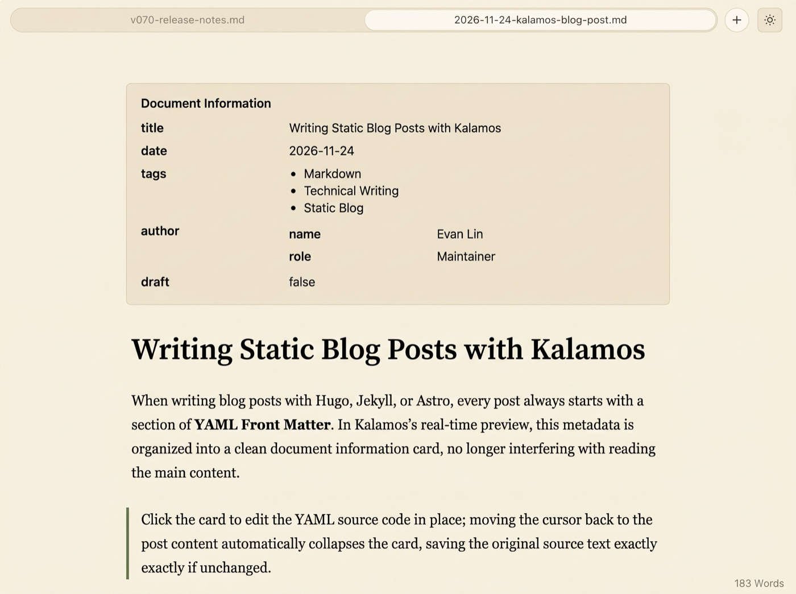
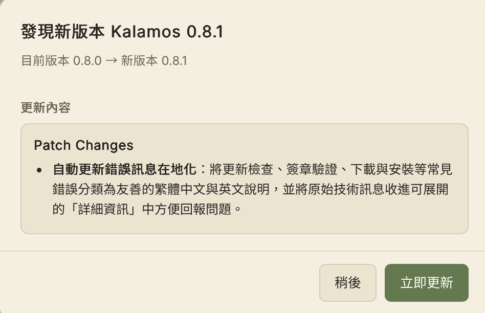
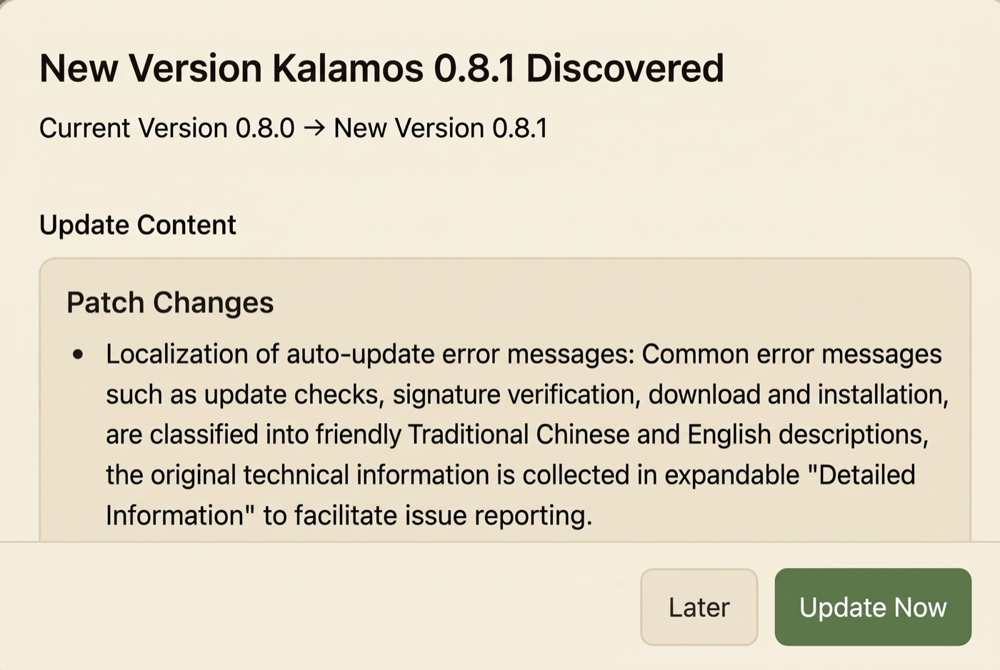
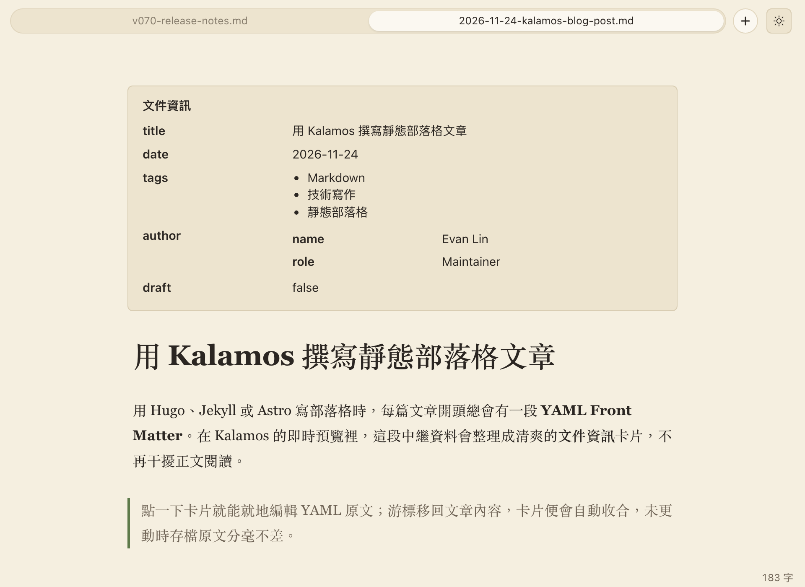
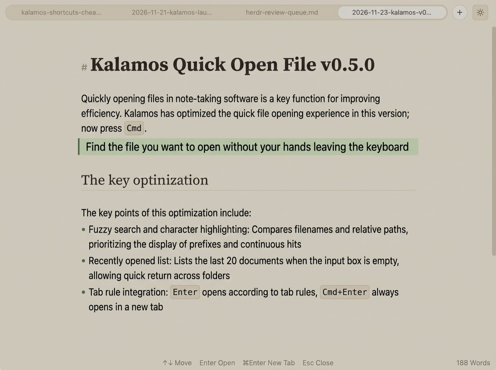
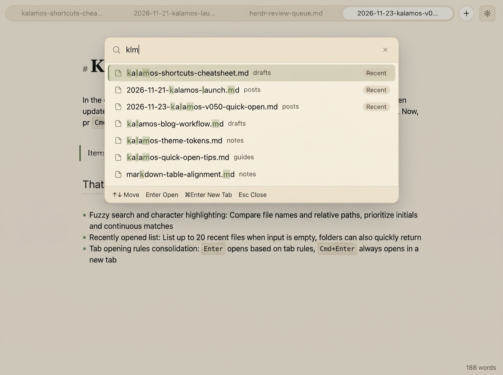
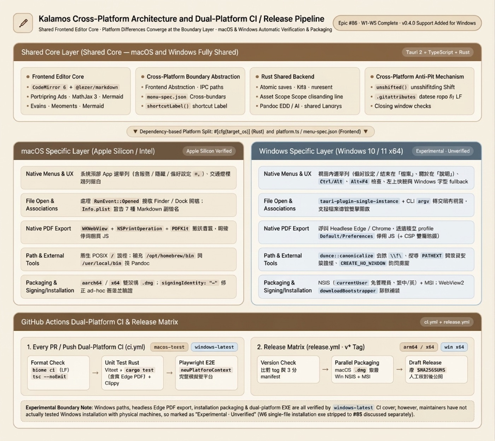

# 前情提要

我寫技術文章的習慣是：先用中文寫在自己的部落格，再丟一份草稿到 Dev.to，最後用自己寫的小工具 [devto-blog-translation-tool](https://github.com/kkdai/devto-blog-translation-tool) 一次把所有中文草稿翻成英文並發佈。

這個工具用了一陣子，文字翻譯一直很穩，但有個越來越明顯的缺點：

> **文章翻成英文了，可是裡面的截圖還是一整片中文。**

像是最近的 [Kalamos 開發紀錄](/kalamos-dev-auto-update/) 系列，每篇都有好幾張 App 截圖和架構圖，英文讀者看到的就是英文內文配中文圖，非常違和。

所以這次我加了一個新功能：**翻譯文章時，如果發現圖片裡有中文，就請 Gemini 重畫一張英文版，然後把文章裡的圖換掉。**

整個功能一樣是在 Herdr 裡完成的：Claude Code 負責寫規格和 Review，右邊 Pane 的 Antigravity（agy，背後是 Gemini 4 Neon）負責寫程式，前後跑了六輪「實作 → Review → 實機測試」。不過這篇的主角不是流程，而是 **Gemini 本身在「翻圖片」和「翻長文」上到底有多厲害**。

---

# 一、整條流程長怎樣

每篇中文文章在翻譯內文之前，會先跑一遍圖片處理：

```
擷取圖片網址 ─▶ 下載 ─▶ 偵測中文＋估字數 ─▶ 重畫英文版 ─▶ 原圖 vs 新圖比對驗證 ─▶ 上傳 GCS 並替換網址
```

| 步驟 | 用的模型 | 做什麼 |
| :--- | :--- | :--- |
| 偵測中文 | **Gemini 4 Neon**（`gemini-4-neon`） | 看圖判斷有沒有中文，並估算大概有幾個中文字 |
| 重畫英文版 | **Nano Banana Pro**（`gemini-3-pro-image`） | 輸入原圖，輸出版面、配色、圖示都一樣，只有文字換成英文的新圖（2K、自動選最接近原圖的比例） |
| 比對驗證 | **Gemini 4 Neon** | 原圖和新圖一起看，確認沒有殘留中文、也沒有漏掉任何面板或資訊 |
| 翻譯內文與標題 | **Gemini 4 Neon** | 翻整篇 markdown，標題超過 Dev.to 的 128 字元上限就自己改寫縮短 |

新圖會上傳到一個公開讀取的 Google Cloud Storage bucket，文章裡的圖片網址再換成 GCS 的網址。任何一張圖在任何一步出錯，都只會印個警告、保留原圖，不會讓整篇文章失敗。

重畫圖片的 prompt 其實很樸素：

```text
Recreate this image exactly, keeping layout, style, colors, icons and
non-text content identical, but translate all Chinese text into natural
English. Keep code, URLs, and proper nouns as-is.
```

真正讓我驚訝的，是 Nano Banana Pro 照著這一句話能做到什麼程度。

---

# 二、Gemini 翻圖片厲害的地方

## 1. UI 截圖幾乎是一比一重畫

這是 Kalamos 偵測到新版本時跳出的更新對話框，原圖是中文：



交給 Nano Banana Pro 之後：



幾個我覺得很到位的細節：

- **版面、圓角、配色、按鈕顏色完全保留**，乍看會以為是 App 本來就有的英文介面截圖。
- **按鈕用的是軟體介面的慣用語**：「稍後 / 立即更新」翻成「Later / Update Now」，而不是生硬的直譯。
- **版本號 `0.8.0 → 0.8.1` 和箭頭符號原樣保留**，`Patch Changes` 這種本來就是英文的標題也沒有亂動。
- 原圖只有 948×612，輸出是 **2K 解析度**，比原圖還清楚。

## 2. 它看得懂「畫面在說什麼」，不只是換字

文章開頭那張 YAML 文件資訊預覽，是我覺得最厲害的一張：



它不只把「文件資訊」翻成「Document Information」、把 `技術寫作`、`靜態部落格` 這些 tags 翻成 `Technical Writing`、`Static Blog`，連文章內文和引言區塊都翻成通順的英文，而且**內文仍然是襯線字體、引言仍然有左邊那條綠色邊線**。

最讓我會心一笑的是右下角：原圖的「**183 字**」被改成了「**183 Words**」。這代表模型理解那是編輯器的字數統計，英文介面該顯示的是 words，而不是把「字」硬翻成 characters。

同時，`title`、`date`、`author`、`draft` 這些 YAML key，以及 `2026-11-24`、`Evan Lin`、`Maintainer`、`false` 這些值，全部原封不動。**哪些是該翻的介面文字、哪些是不能動的資料，它分得很清楚。**

當然也不是完美無瑕：仔細看引言最後一行，出現了「exactly exactly」重複一個字。這種小錯字連後面的驗證步驟也沒抓到，算是目前圖片翻譯還需要接受的誤差。

## 3. Gemini 4 Neon 當裁判：抓到「畫錯了但沒有中文」的圖

圖片生成畢竟有隨機性。快速開檔面板（Cmd+P）這張截圖，第一次重畫的結果長這樣：



文字確實都翻成英文了，**但整個搜尋面板被畫不見了**，只剩後面的文章內容。這張截圖的重點就是那個面板，這樣換上去反而會誤導讀者。

當時我的驗證只檢查「還有沒有中文」，所以它被放行了。後來改成把**原圖和新圖一起丟給 Gemini 4 Neon 比對**：

```text
The first image is the original image, and the second image is its
English-translated version. ... Does the second image preserve all major
UI elements, panels, dialogs, chart/diagram sections, and information from
the first image? ...
```

拿同一張失敗圖去測，Neon 直接點出問題：

> The central quick-open search dialog modal from the original image is completely missing.

而另外兩張好的圖，它都回報 `preserves_content: true`。後來正式跑的時候，重新生成的版本面板完整保留、也通過了驗證：



注意看檔名清單裡的**綠色模糊比對標亮**（`k`、`a`、`l`、`m`）還在正確的位置，「最近」標記變成「Recent」，底部快捷鍵提示「↑↓ 移動 Enter 開啟 ⌘Enter 新分頁 Esc 關閉」也翻成了「↑↓ Move Enter Open ⌘Enter New Tab Esc Close」。

**用一個 Gemini 畫圖、再用另一個 Gemini 看圖把關**，這個組合是這次最值得的設計。

## 4. 估字數，知道自己什麼圖不該碰

並不是每張圖都適合重畫。第一版沒有任何限制，我拿 Windows 架構圖（2880×2570、密密麻麻的中文）去試，結果很慘：



- 只有標題和左欄標籤翻成英文，中間兩大區塊**還是中文，而且字形被畫成不存在的亂碼字**
- 英文出現 `Portripring Ads`、`macos-teest` 這類錯字
- 輸出只有 1094×976（當時沒指定解析度，預設 1K）

這張圖當時已經被換上 Dev.to，我發現後立刻換回原圖。

解法是讓偵測步驟順便**估算圖裡有幾個中文字**，超過門檻就直接跳過、保留原圖。Gemini 4 Neon 給的估計很有參考價值：

| 圖片 | 估計中文字數 | 結果 |
| :--- | ---: | :--- |
| 自動更新信任鏈流程圖 | ~710 | 跳過，保留原圖 |
| Windows 跨平台架構圖 | ~533 | 跳過，保留原圖 |
| 外部 PR 審查流程圖 | ~390 | 跳過，保留原圖 |
| 中英介面並排對照 | ~221 | 跳過，保留原圖 |
| YAML 文件資訊預覽 | ~127 | ✅ 重畫 |
| Cmd+P 快速開檔 | ~115 | ✅ 重畫 |
| 更新對話框 | ~92 | ✅ 重畫 |

我目前把門檻設在 150：**一般 UI 截圖交給 Gemini 重畫，資訊量爆炸的架構圖就老實保留原圖。**

---

# 三、Gemini 翻長文厲害的地方

圖片很吸睛，但文章本體的翻譯其實才是每天在用的部分。換成 Gemini 4 Neon 之後，有幾個表現讓我很放心。

## 1. 一萬八千字元一次翻完

[開源之後的功能演進](/kalamos-dev-open-source-collaboration/) 這篇是系列裡最長的一篇：

| 項目 | 數字 |
| :--- | ---: |
| 原文長度 | 17,810 字元 |
| 中文字數 | 6,418 |
| 輸出 token | 9,255 |
| 思考 token | 3,052 |
| 花費時間 | 約 115 秒 |

整篇 markdown 一次送出、一次翻完，標題層級、表格、程式碼區塊、連結全部保留，翻完的英文內文約 3.7 萬字元，用量只佔輸出上限（65,536）的五分之一左右。

## 2. 懂得保留「刻意引用」的中文

翻完之後我檢查了一下，內文還剩 **21 個中文字**。一開始以為是漏翻，仔細看才發現都是**該留的**：

- 文章提到 E2E 測試預期畫面要顯示的錯誤訊息，它保留了原本的中文字串，再補上英文說明：

  > expected the screen to display "無法儲存介面語言，請再試一次。" ("Could not save interface language...")

- 文章在介紹 changeset 規範時，說明格式要用繁體中文寫成 `**標題** ：說明`，它也保留了這個範例：

  > written in Traditional Chinese ` **標題** ：說明`

這兩處如果被翻成英文，文章反而會講錯。**它理解這些中文是「被討論的對象」，而不是「要翻譯的內容」**，這點比單純的機器翻譯聰明太多。

另外，圖片的 alt text 也一起被翻好了，例如：

> Real dialog appearing during a real-machine update check for Kalamos v0.8.0 on macOS: showing current version 0.8.0 → new version 0.8.1 and CHANGELOG content

對使用螢幕閱讀器的讀者來說，這也是很重要的細節。

## 3. 標題太長，它會自己改寫

Dev.to 的標題上限是 128 字元，而我的中文標題翻成英文後常常爆掉。原本的做法是硬切，結果出現過這種標題：

> ...Using Multiple Agents to Review and Take Over Exte

現在改成請 Gemini 4 Neon 在 128 字元內改寫。同一個 150 字元的標題，測了兩次：

> **120 字元**：[Kalamos Devlog] After Open-Sourcing: Feature Evolution (v0.2 to v0.7) and Multi-Agent Review & Takeover of External PRs

> **126 字元**：[Kalamos Devlog] After Open-Sourcing: v0.2–v0.7 Feature Evolution & Using Multiple Agents to Review and Take Over External PRs

開頭的 `[Kalamos Devlog]` 標籤有保留，關鍵資訊一個都沒少，而且讀起來比硬切自然太多。萬一兩次都改寫失敗，才會退回「在單字邊界截斷」。

---

# 四、實作上踩到的幾個坑

給也想用 Gemini 做類似功能的朋友參考：

1. **新版 Go SDK 預設走 API v1，但這些模型只在 v1beta**。`google.golang.org/genai` 第一次實機跑就回 `models/gemini-3-flash-preview is not found for API version v1`。單元測試全部用 mock，完全沒抓到。解法是建 client 時加上 `HTTPOptions: genai.HTTPOptions{APIVersion: "v1beta"}`。
2. **思考型模型的思考 token 也算在 `MaxOutputTokens` 裡**。標題縮短原本設 4096，Gemini 4 Neon 光是思考就把額度用光，兩次都失敗。調到 16384 就穩了，反正只按實際用量計費。
3. **長文偶爾會「想太多」**。同一篇文章第一次翻譯撞到上限失敗，用 API 重測卻只用了上限的五分之一，看起來是偶發的思考失控。後來加上「撞到上限自動重試一次」，重跑那篇就順利一次翻完了。
4. **一定要做生成後驗證，而且要拿原圖來比**。只檢查「有沒有中文」不夠，圖片模型可能把重要元素畫不見；讓另一個模型拿原圖並排檢查，才抓得到這種錯。

---

# 五、怎麼用

工具是開源的：[kkdai/devto-blog-translation-tool](https://github.com/kkdai/devto-blog-translation-tool)。圖片翻譯是選用功能，沒設定 `GCS_BUCKET` 就跟以前完全一樣。

```bash
# 1. 讓程式能用你的 GCP 憑證上傳圖片
gcloud auth application-default login

# 2. 建一個公開讀取的 bucket
gcloud storage buckets create gs://YOUR_BUCKET --uniform-bucket-level-access
gcloud storage buckets add-iam-policy-binding gs://YOUR_BUCKET \
  --member=allUsers --role=roles/storage.objectViewer

# 3. 設定環境變數（也可以寫在 .env）
export GCS_BUCKET=YOUR_BUCKET
export IMAGE_MAX_CHINESE_CHARS=150   # 預設 60，UI 截圖多的話可以調高

# 4. 執行
go build -o translator ./cmd/translator && ./translator
```

跑起來會看到每張圖的處理結果：

```
  🖼️  Image 1/4: .../kalamos-dev-collab-pr-workflow.png ... ⏭️  too much text (~390 Chinese chars), keeping original
  🖼️  Image 2/4: .../kalamos-dev-collab-quick-open.png ... ✅ replaced
  🖼️  Image 3/4: .../kalamos-dev-collab-front-matter.png ... ✅ replaced
  🖼️  Image 4/4: .../kalamos-dev-collab-bilingual.png ... ⏭️  too much text (~228 Chinese chars), keeping original
  Translating content... (removing frontmatter) ✅
  Updating article ID 5118206 and publishing... ✅ Published!
```

> ⚠️ 提醒：這個工具會把所有中文標題的草稿翻譯後**直接發佈**，上傳的圖片也會放在公開的 bucket 裡。第一次用建議先只留一篇測試文章。

---

# 結語

這次最大的感想是：**Gemini 的圖片模型已經可以拿來做「在地化」了**。只要是一般的 UI 截圖，Nano Banana Pro 重畫出來的英文版，品質好到可以直接放進正式文章。

但它也不是萬能的。文字太密的架構圖還是會畫壞，生成結果也每次不同。所以真正讓這個功能能上線的，不是單一模型多強，而是這三道防線：

1. **先估字數**，不碰自己畫不好的圖；
2. **用原圖比對驗證**，讓 Gemini 4 Neon 當裁判；
3. **任何一步失敗就保留原圖**，寧可不換，也不要換錯。

現在我的 Kalamos 開發紀錄英文版裡，更新對話框、快速開檔、YAML 預覽這幾張 UI 截圖都已經換成英文版，密集的架構圖則保留原圖。之後寫新文章，就只要專心寫中文，剩下的交給 Gemini。
