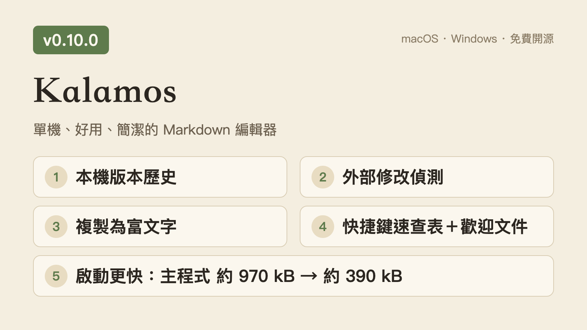
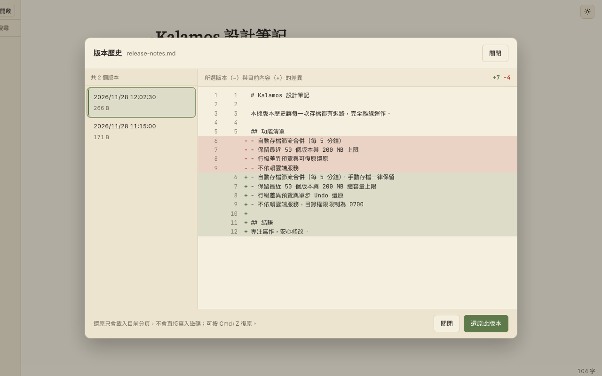
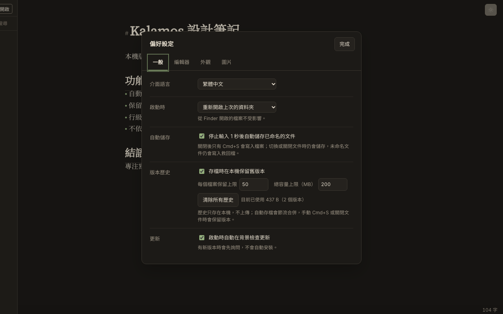
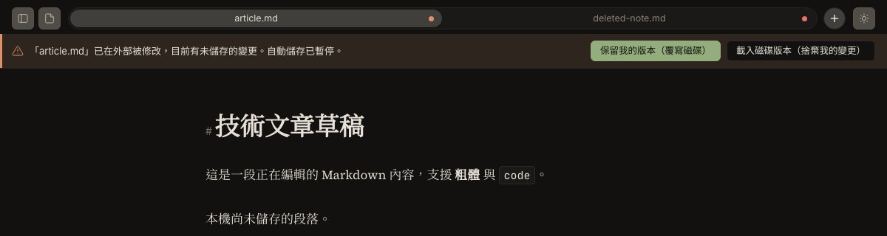
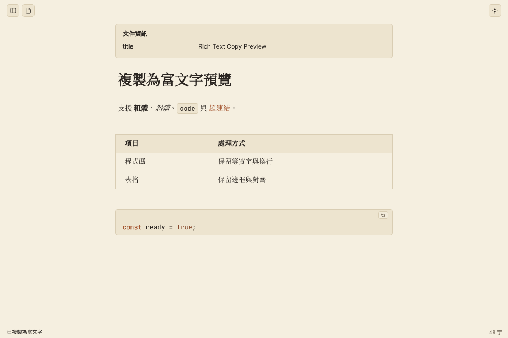
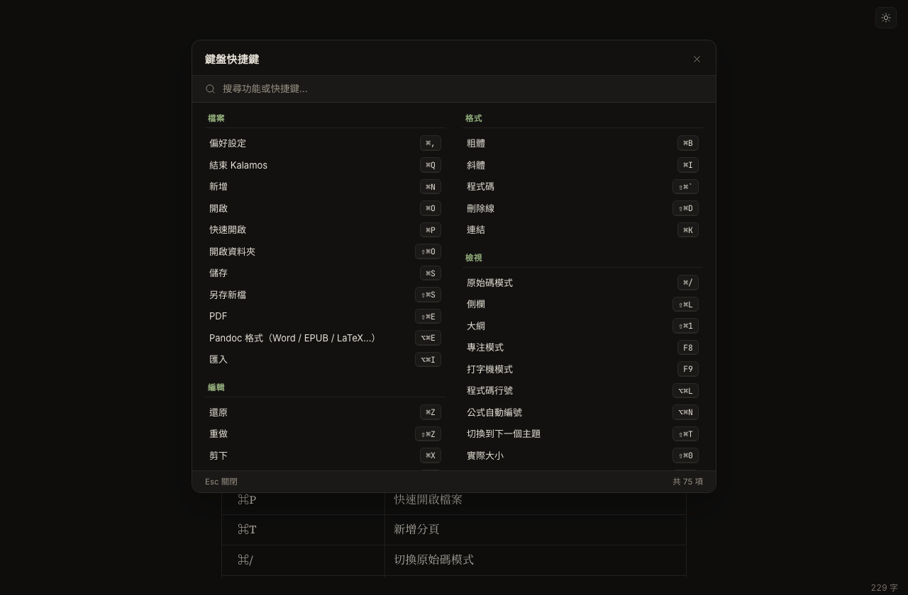
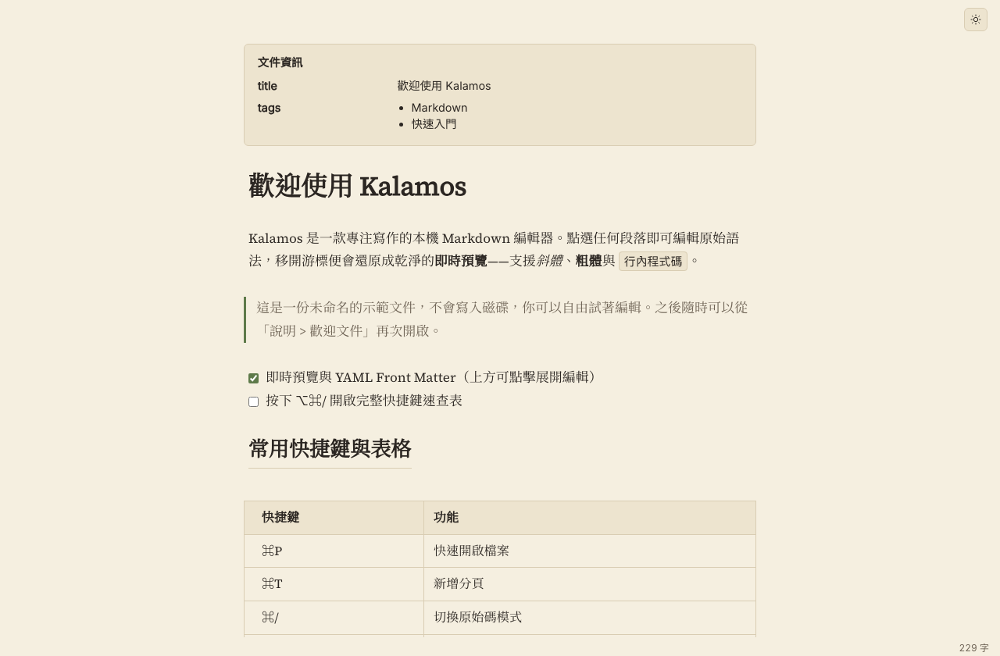

# 前情提要

**Kalamos** 是我自己開發、每天在用的 Markdown 編輯器，介面參考 Typora：單一視窗即時預覽，游標離開就把 Markdown 符號藏起來，存下來的仍然是乾淨的 `.md` 純文字檔。它支援 **macOS（Apple Silicon / Intel）與 Windows**，完全**免費、開源**，不需要帳號。

這幾天我們替 Kalamos 寫下了產品的基本精神（PRD §0），之後所有功能提案都要先通過這兩條：

1. **單機版**：在本機、離線、直接讀寫 `.md` 檔的桌面編輯器。不做帳號、伺服器或內建雲端同步，同步交給你自己選的 iCloud、Dropbox 或 Git；只有使用者明確觸發的功能（像是圖床上傳、檢查更新）才會連網，而且都可以關閉。
2. **好用、簡潔**：優先把核心寫作體驗做好；新功能要有明確的寫作情境，預設就要好用，設定越少越好；寧可把一件事做好，也不要多做一件需要長期維護的事。

**v0.10.0 的五個新功能，都是順著這個精神挑出來的。** 這一版沒有加帳號，也沒有加雲端同步，而是把「寫東西、存檔、交出去」這條路上會讓人卡住或擔心的地方，一個一個補起來：

| 功能 | 一句話說明 |
| :--- | :--- |
| **本機版本歷史**（#148） | 存檔時自動保留舊版本，可以看差異、可以還原 |
| **外部修改偵測**（#145） | 檔案被 Git、雲端同步或其他編輯器改過，Kalamos 會知道，不會蓋掉 |
| **複製為富文字**（#144） | 寫完直接貼到 Gmail、Google Docs、Medium、Notion |
| **快捷鍵速查表與歡迎文件**（#147） | 可搜尋的快捷鍵清單，新使用者第一次開啟有示範文件 |
| **啟動更快**（#146） | 主程式從約 970 kB 縮到約 390 kB |

下面一個一個介紹。

---

# 一、本機版本歷史：不靠雲端的後悔藥（#148）

## 解決什麼問題

改文章改到一半，發現半小時前刪掉的那一段其實比較好；或是不小心全選刪除、又按到存檔。沒有用 Git 管理的文件，這時候通常就救不回來了。

v0.10.0 開始，**Kalamos 每次存檔時，會先把磁碟上的舊版本保留在本機**。想回到之前的版本，打開版本歷史就好。

## 怎麼用

- 選單：**檔案 > 瀏覽版本歷史…**（macOS 與 Windows 相同）
- 左邊列出這份文件的所有版本（時間與大小），選一個版本，右邊會用**行級差異**顯示它和目前內容的不同：紅色是那個版本有、現在沒有的行，綠色是現在新增的行。
- 按「**還原此版本**」，那個版本的內容會載入目前的分頁。

## 貼心的細節

- **還原不會直接寫進磁碟**，而是變成一次普通的編輯，所以還原之後反悔了，按 `⌘Z`（Windows 用 `Ctrl+Z`）就能撤銷。
- **不會存一堆重複版本**：內容和上一版完全相同就不存；自動存檔很頻繁，所以同一個檔案自動存檔每 5 分鐘最多留一版；但手動按 `⌘S`／`Ctrl+S`，或關閉文件時，一定會留一版。
- **預設上限**：每個檔案最多 50 個版本、所有歷史總容量最多 200 MB，超過就從最舊的開始淘汰。可以在**偏好設定 > 一般 > 版本歷史**調整上限、關閉這個功能、查看目前用量，或一鍵「清除所有歷史」。
- **資料只在本機**：歷史版本存在 App 自己的資料夾裡，不上傳到任何地方。在 macOS 上，歷史資料夾的權限只開給你自己。

## 和外部修改偵測的整合

版本歷史和下一個功能是一起設計的，兩個細節值得一提：

- 如果 Kalamos 因為**偵測到衝突而拒絕寫入**，這次存檔就不會產生版本，避免歷史裡出現一個「其實沒有真的存進去」的錯誤版本。
- 如果你在衝突時選了「**保留我的版本**」覆寫磁碟，**被蓋掉的那份外部版本也會被留進歷史**。就算選錯了，還是找得回來。

---

# 二、外部修改偵測：搭配 Git、iCloud、Dropbox 也安心（#145）

## 解決什麼問題

Kalamos 堅持單機，不做內建雲端同步，而是請大家用自己習慣的 iCloud、Dropbox 或 Git。但這樣就有一個風險：**檔案在 Kalamos 外面被改了**（另一台電腦同步過來、`git pull`、或你同時用 VS Code 改了同一份檔案），而 Kalamos 下一次自動儲存時，會不會把那些修改蓋掉？

在 v0.10.0 之前，答案是「有可能」。這一版把它當成資料安全問題來處理。

## 怎麼運作

這個功能不需要任何設定，打開文件就會自動生效：

- **你這邊沒有未儲存的修改** → Kalamos 會自動重新載入磁碟上的新內容，**游標與捲動位置維持不變**，可以繼續寫。
- **你這邊也有未儲存的修改** → 編輯區上方會出現一條**不擋操作的橫幅**，讓你選：
  - 「**保留我的版本（覆寫磁碟）**」
  - 「**載入磁碟版本（捨棄我的變更）**」

  在你做出選擇之前，**這個分頁的自動儲存會暫停**，所以不會在你還在猶豫時就被蓋掉。橫幅不是對話框，你可以先把手上的句子寫完再決定。
- **檔案在外部被刪除或改名** → 也會用橫幅提醒；這時按 `⌘S`／`Ctrl+S` 會改走「另存新檔」，不會默默寫到錯的地方。

## 貼心的細節

- **存檔前的最後一道防線**：就算監看漏掉了某個事件，Kalamos 每次寫檔前都會比對磁碟上的內容，和上次載入或儲存時是否一致（比對內容的 SHA-256）。不一致就走上面的衝突流程，**絕不默默覆蓋外部修改**。
- **iCloud 的「先寫暫存檔再改名」也抓得到**：有些同步工具不是直接改檔案，而是寫一個新檔再換名字，Kalamos 也能正確偵測。切回 Kalamos 視窗時也會再檢查一次。
- **不會把自己的存檔當成外部修改**：Kalamos 自己寫檔時會先記錄下來，不會跳出莫名其妙的提示。

---

# 三、複製為富文字：寫完直接貼到 Gmail、Google Docs、Medium、Notion（#144）

## 解決什麼問題

我自己最常遇到的情境：在 Kalamos 寫好一篇文章或一封信，要貼到 Gmail、Google Docs 或 Medium。直接複製 Markdown 原文，貼過去就是一堆 `#` 和 `**`；匯出成 HTML 或 Word 再打開複製，又多好幾個步驟。

v0.10.0 加了「複製為富文字」，一個快捷鍵就能把格式一起帶過去。

## 怎麼用

- 選單：**編輯 > 複製為富文字**
- 快捷鍵：macOS `⌘⌥⇧C`（`Cmd+Opt+Shift+C`）；Windows `Ctrl+Alt+Shift+C`
- **有選取文字時，只複製選取的部分**；沒有選取時，複製整份文件。
- 複製完成後，左下角狀態列會顯示「已複製為富文字」。

## 貼心的細節

- **自動排除 YAML front matter**：寫部落格的人文章開頭常有一段 `title`、`tags`，這段不會被複製進去，不用再手動刪。
- **數學公式與 Mermaid 圖表會轉成圖片**：Gmail、Google Docs、Medium、Notion 通常會把 inline SVG 拿掉，所以 Kalamos 在本機先把公式和圖表畫好，轉成高解析度的 PNG 圖片放進剪貼簿，貼過去就看得到。公式寫錯時會保留原始 TeX 文字，不會讓內容消失。
- **格式盡量融入目標編輯器**：標題、粗斜體、清單、連結、引用用的是標準 HTML，不強加整份主題的字體與背景；程式碼保留等寬字與換行；表格保留邊框與對齊。
- **剪貼簿同時放了純文字版**：貼到只吃純文字的地方（例如 Facebook 貼文框）時，會自動用 Markdown 原文，內容不會掉。
- **本機圖片**：沒有設定圖床時，會把本機圖片直接內嵌（單張上限 2 MB、單次總共 8 MB）；有設定圖床上傳指令的話，會先上傳再填入網址。整個轉換都在本機完成，不需要連網。

小提醒：各平台對貼上內容的支援程度不同。例如 Medium 不支援原生表格，也不會顯示內嵌的圖片，這種情況建議設定圖床。詳細的平台對照表放在 repo 的 `docs/rich-text-copy.md`。

---

# 四、快捷鍵速查表與歡迎文件：上手更快（#147）

## 快捷鍵速查表

Kalamos 的快捷鍵不少，以前要記住只能一個一個翻選單。現在有一張可以搜尋的速查表：

- 選單：**說明 > 鍵盤快捷鍵**
- 快捷鍵：macOS `⌥⌘/`；Windows `Ctrl+Alt+/`
- 依類別列出所有快捷鍵，上方可以直接**搜尋功能名稱或按鍵**（支援輸入法輸入中文），按 `Esc` 關閉。
- macOS 顯示 `⌘`、Windows 顯示 `Ctrl`，跟著你的平台走。

這裡有一個我很在意的細節：**速查表的內容是直接從選單定義與按鍵設定產生的**，不是另外手寫一份清單，而且有測試確認每個選單快捷鍵都有列出。所以之後新增或調整快捷鍵，速查表會自動跟著更新，不會出現「表上寫的跟實際按的不一樣」。

順帶一提，為什麼不用更好記的 `⌘/`？因為 `⌘/` 已經是切換原始碼模式，而 `⌘⇧/` 在 macOS 上是系統「說明」選單的搜尋鍵，所以選了不衝突的 `⌥⌘/`。

## 首次開啟的歡迎文件

全新安裝 Kalamos、第一次打開時，會看到一份「**歡迎使用 Kalamos**」示範文件，用很短的篇幅示範即時預覽、front matter、表格、常用快捷鍵等功能，語言跟著介面語言（中文或英文）。

- 這是一份**未命名、不會寫入磁碟**的文件，可以隨意在上面試著編輯。
- 只會在第一次出現；已經在用 Kalamos 的人（有設定檔）不會突然看到它。
- 想再看一次，從**說明 > 歡迎文件**就能重新打開。

---

# 五、啟動更快（#146）

這一項看不到新畫面，但每天打開 Kalamos 都會用到。

原本 Kalamos 一啟動，就把數學公式（MathJax）、圖表（Mermaid）、匯出等模組全部載入，即使你只是要寫一篇純文字筆記。這一版改成**需要時才載入**：文件裡有數學才載入 MathJax、有圖表才載入 Mermaid，一般文件開啟時完全不碰這些模組（有自動化測試確認）。另外也移除了一個編輯器用不到的內嵌 HTML 語法解析器。

改善的數據：

| 項目 | 改善前 | 改善後 |
| :--- | ---: | ---: |
| 主程式（main chunk）體積 | 969.55 kB | 394.31 kB（v0.10.0 正式版，已包含這版的新功能） |
| 冷啟動代理指標（10 次的中位數，PR #153 當時量測） | 133.0 ms | 112.2 ms（快了約 15%） |

主程式體積是在 v0.10.0 正式版上用 `vite build` 量的，已經算進了版本歷史、快捷鍵速查表等這一版新增的功能。如果沒有改成拆分載入，加了這些功能之後，主程式只會比原本的約 970 kB 更大。

**這裡要誠實說明**：冷啟動的數字是**代理指標**，做法是用 `vite preview` 跑前端、再用 Playwright 量 10 次取中位數，**不是在 macOS 或 Windows 實機上量的 App 啟動時間**。實機的感受會受到電腦與系統環境影響，release build 上的實機數據目前還沒有量。功能本身完全沒有改變，第一次遇到數學或圖表時會再載入對應模組。

---

# 怎麼取得與更新

- **已經安裝 v0.8 以上的使用者**：點選單的「**檢查更新…**」就能更新到 v0.10.0（macOS 在「Kalamos」選單，Windows 在「說明」選單）。Kalamos **不會靜默安裝**，有新版一定會先詢問你，更新前也會先確認未儲存的文件。
- **新使用者，或還在用 v0.7 以前版本的人**：到 GitHub Releases 下載最新版安裝檔：
  - [https://github.com/kkdai/Kalamos/releases/latest](https://github.com/kkdai/Kalamos/releases/latest)
- **Windows 也支援**，Releases 頁面有 Windows 的安裝檔（x64），macOS 則有 Apple Silicon 與 Intel 兩種版本。

---

# 結語：你的回饋真的會影響下一版

Kalamos 一開始是做給自己用的，但開源之後，越來越多功能其實是被使用者推著做出來的。上一版 v0.9.0 新增的**近黑深色主題 Nyx**（#137），就是因為有人在 Threads 留言：「想問深色模式有可能再黑一點嗎？我覺得不錯，只是在我一堆深色模式軟體中，他有些突兀。」我們才分析原本 Melan 主題偏暖、偏亮的問題，做出了這個主題。這篇文章裡幾張截圖用的就是 Nyx。

所以如果你用 Kalamos 時有遇到問題、想要什麼功能，或覺得哪裡不順手，歡迎到 GitHub 開 issue 告訴我：

- [kkdai/Kalamos Issues](https://github.com/kkdai/Kalamos/issues)

也先說明一下：因為剛確立了「單機、好用、簡潔」的精神，不符合的提案（例如帳號、內建雲端同步）我們會在 issue 上說明原因、保留討論，但不會排入開發。這不是不重視意見，而是希望 Kalamos 能一直保持現在這個輕巧的樣子。

如果 Kalamos 對你的寫作有幫助，也歡迎請我喝杯咖啡，這會是我繼續維護下去的小小動力：

- [Buy Me a Coffee](https://www.buymeacoffee.com/evanlin)

想看 Kalamos 是怎麼一路做出來的，可以參考前幾篇開發紀錄：

- [\[Herdr 實戰\] 三天做出 Typora 風格的 macOS Markdown 編輯器 Kalamos](/kalamos-typora-style-markdown-editor-herdr/)
- [\[Kalamos 開發過程\] 開源之後的功能演進與審查外部 PR](/kalamos-dev-open-source-collaboration/)
- [\[Kalamos 開發過程\] Windows 實作的注意事項](/kalamos-dev-windows-support/)
- [\[Kalamos 開發過程\] 自動更新需要注意的地方](/kalamos-dev-auto-update/)
